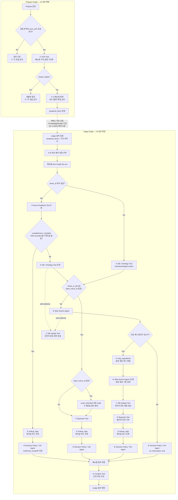

# ⓪ Supervisor Agent 스펙

담당: 박다은
상태: 구현 기준안 (Prepare/Judge 2-phase 및 외부 JSON 계약 확정, 운영값은 §8에서 협의 중)
상위 문서: `caution-multi-agent-architecture.md`, `caution-db-schema.md`

---

## 0. 역할 범위

Supervisor는 사용자 스캔 요청의 **유일한 진입점**이며, ① OCR Tool 호출부터 ⑨ Curation Tool 결과 취합까지 전체 파이프라인을 오케스트레이션한다.

핵심 책임은 세 가지다.

1. **백엔드가 확정한 `store_id` 검증과 스코프 강제**
2. **하위 Agent·Tool 호출 순서 결정과 결과 취합**
3. **요청 상태·근거·오류·실행 로그의 중앙 관리**

모든 하위 Agent·Tool은 Supervisor의 호출을 받아서만 동작하고, 결과도 Supervisor에게만 반환한다. Agent·Tool 간 직접 호출은 금지한다.

| 하지 않음 | 담당 |
|---|---|
| OCR 자체 수행 | ① OCR Tool |
| 메뉴명 문자열 정제 | ② |
| 확정 재료 조회 | ③ |
| 재료 확장/변형 태깅 | ④ |
| 확률 계산 | ⑤ |
| 웹 크롤링 | ⑥ |
| 물리 DB 쓰기/트랜잭션 | 백엔드 영속화 계층 |
| 저장 명령 생성 | ⑦ |
| 최종 위험 문구 생성 | ⑧ |

### 0-1. 중앙집중형 구조를 쓰는 이유

`store_id`가 빠지면 가게별 확정값과 prior가 전역으로 섞인다. 이 경우 다른 식당의 사장님 답변이나 웹서치 기반 추정이 현재 식당의 위험도에 영향을 줄 수 있어 FN(false negative) 위험이 커진다.

→ Supervisor는 모든 하위 호출에 `store_id`를 필수로 실어 보내고, `store_id`가 없거나 유효하지 않은 요청은 ①~⑨를 호출하지 않는다.

### 0-2. 구현 프레임워크 — LangChain + LangGraph

Supervisor는 **LangGraph `StateGraph`로 전체 실행 순서를 만들고, LLM이 필요한 Agent 내부에서만 LangChain을 사용**한다. 두 라이브러리는 같은 일을 중복해서 하는 것이 아니다.

| 구성 요소 | 쉬운 설명 | 이 프로젝트에서 하는 일 |
|---|---|---|
| LangGraph | 업무 순서표와 진행 상황판 | ①~⑨ 호출 순서, 조건 분기, 메뉴별 병렬 처리, 결과 합치기, 실패 우회 |
| `StateGraph` | LangGraph로 만드는 실제 상태 기반 워크플로 | 각 node가 공용 state를 읽고 자기 결과만 반환하도록 강제 |
| LangChain | LLM을 정해진 입력·출력으로 호출하는 도구 | ② 정규화 보조, ⑥ 검색 판단·추출, ⑧ 설명 문구 생성 |
| Pydantic | JSON 출입구 검사기 | §1·§4의 필드, 타입, enum, null 허용 여부 검증 |
| 일반 Python/API adapter | LLM이 필요 없는 실행 코드 | ①·③·④·⑤·⑦·⑨ 연결 |

쉽게 비유하면 **LangGraph가 공장 컨베이어 벨트**, **각 node가 작업대**, **state가 작업 중인 제품에 붙은 기록지**, **LangChain은 일부 작업대에서만 쓰는 언어 해석 장비**다. Supervisor 자체가 거대한 LLM Agent가 되는 구조가 아니다.

#### 0-2-1. 왜 Supervisor를 자유형 LLM Agent로 만들지 않는가

Supervisor에게 "다음 Tool을 알아서 선택하라"고 맡기면 같은 입력도 실행 경로가 달라질 수 있고, `store_id`, 3-State, `anomaly_locked`, 근거 ID가 중간에 빠질 수 있다. 이 프로젝트는 FN 최소화가 우선이므로 호출 순서를 코드로 고정한다.

- 분기 판단은 `if`와 conditional edge가 담당한다.
- LLM은 graph의 다음 node 이름을 만들 수 없다.
- LLM은 `store_id`, hard evidence 우선순위, SAFE 금지 조건을 바꿀 수 없다.
- LLM 결과는 Pydantic 검증을 통과한 뒤에만 state에 들어간다.
- 검증 실패·timeout 시 미리 정한 보수적 fallback으로 이동한다.

#### 0-2-2. LangChain을 쓰는 곳과 쓰지 않는 곳

| 번호 | 구현 방식 | LangChain 사용 | 이유 |
|---|---|---|---|
| ① OCR Tool | 기존 OCR Python/API adapter | 사용하지 않음 | 이미지 OCR 실행은 정해진 절차 |
| ② Normalization Agent | 규칙·사전 우선 + 제한적 구조화 LLM | 필요할 때만 사용 | 다국어·오탈자·복수 후보의 문맥 판단 |
| ③ Exact Feedback Tool | DB read adapter | 사용하지 않음 | 확정값 조회는 결정론적이어야 함 |
| ④ DB/Ontology Tool | DB 조회·재귀 확장 함수 | 사용하지 않음 | 온톨로지 관계를 임의 생성하면 안 됨 |
| ⑤ Bayesian Tool | 수식 기반 Python 함수 | 사용하지 않음 | 같은 입력은 같은 확률을 내야 함 |
| ⑥ Web Search Agent | 검색 전략·추출에 구조화 LLM + 검색 provider | 사용 | 검색어 구성과 문서 속 재료 추출에 언어 판단 필요 |
| ⑦ DB Update Tool | 저장 명령 builder | 사용하지 않음 | 권한·근거·명령 형식은 고정 규칙 |
| ⑧ Decision/XAI Agent | 위험 판정은 정책 함수, 다국어 설명만 구조화 LLM 가능 | 제한적으로 사용 | LLM이 SAFE/DANGER를 임의 결정하면 안 됨 |
| ⑨ Curation Tool | 검증 인덱스 검색·점수 정렬 | 기본적으로 사용하지 않음 | 승인된 데이터와 정렬식만 사용 |

⑧에서 가장 중요한 경계는 **판정과 문장 생성을 분리**하는 것이다. `risk_level`, `matched_tags`, `evidence_basis`는 Python 정책 함수가 만들고, LangChain은 이 확정 결과를 자연어 문장으로 표현할 때만 사용할 수 있다. LLM이 반환한 문장이 판정 JSON을 다시 덮어쓸 수 없다.

#### 0-2-3. 구현 시 고정할 원칙

- graph는 애플리케이션 시작 시 한 번 `compile()`하고 요청마다 다시 만들지 않는다.
- FastAPI 경계에서는 동기 `invoke()`가 아니라 비동기 `ainvoke()`를 사용한다.
- graph node는 `async def node(state, runtime) -> dict` 형태로 만들고 **전체 state가 아니라 변경 필드만** 반환한다.
- 외부 API·DB·LLM client는 node 안에서 매번 생성하지 않고 FastAPI lifespan에서 만든 뒤 adapter에 주입한다.
- `store_id`, `trace_id`, `scan_session_id`, `schema_version`은 LangGraph run-scoped context의 immutable 값으로 둔다.
- `call_scope`와 `item_id`는 각 node가 공통 context에서 호출 대상에 맞게 조립한다.
- 여러 메뉴의 결과는 reducer로 모으고, 최종 출력 전에 `source_index`로 다시 정렬한다. 병렬 완료 순서를 사용자 출력 순서로 사용하지 않는다.
- 초기 버전은 `compile(checkpointer=False)` 또는 checkpointer 없이 요청 단위 휘발성 state로 실행한다. checkpoint 도입은 §8 결정 뒤에 한다.
- 라이브러리 도입 전 `langgraph`, `langchain`, `langchain-core`, 사용하는 모델 provider 패키지(예: `langchain-openai`)의 **정확한 호환 버전**을 #76에서 고정한다. 특히 현재 `openai==3.8.0`과 provider 패키지의 호환성을 함께 확인한다. 현재 `requirements.txt`에는 LangChain/LangGraph 의존성이 없으므로 승인 전 설치했다고 가정하지 않는다.

이 문서의 코드 예시는 LangGraph 1.x 공개 API인 `StateGraph`, `context_schema`, reducer, conditional edge, `Send`, `compile()`, `ainvoke()`를 기준으로 한다. 정확한 pin을 정한 뒤 import와 인자 이름을 해당 버전에서 한 번 더 확인한다.

### 0-3. 입출력 계약의 기준 문서

**①~⑨ Agent·Tool과 Supervisor 사이의 wire JSON은 이 문서 §1·§4를 단일 기준으로 사용한다.** 개별 Agent·Tool 문서는 각 노드의 내부 처리 로직과 도메인 규칙을 설명하지만, 필드명·타입·필수 여부가 이 문서와 다르면 이 문서에 맞춰 수정한다.

JSON 계약은 **공통 envelope + 노드별 payload**의 2층 구조로 유지한다.

- 공통 envelope: 모든 노드가 동일하게 쓰는 `context`, `warnings`, `errors`
- 노드별 payload: OCR의 `scan_quality`, ⑤의 확률값, ⑧의 판정처럼 해당 노드에만 필요한 필드

모든 노드의 JSON을 완전히 같은 모양으로 만들면 필요 없는 필드와 `null`이 늘고, 어떤 노드가 어떤 값을 책임지는지 불명확해진다. 반대로 공통 필드까지 문서마다 따로 정의하면 이름과 타입이 쉽게 어긋난다. 따라서 공통 모델은 §1-2에서 한 번만 정의하고, 각 번호의 완전한 요청·응답은 §4에서 번호별로 구분한다. 개별 Agent·Tool 문서에는 내부 로직과 함께 자기 번호의 완성된 예시를 보여줄 수 있지만, 계약의 정본은 중복 정의하지 않고 이 문서 §4를 가리킨다.

- 모든 노드는 §1-2의 `context`, `warnings`, `errors` 형식을 공통으로 사용한다.
- 내부 구현의 클래스명이나 DB 컬럼명이 달라도 경계에서는 이 문서의 JSON으로 변환한다.
- 새 필드가 필요하면 개별 문서만 먼저 바꾸지 않고 이 문서의 계약과 `schema_version`을 함께 변경한다.
- 예시 JSON도 계약으로 취급한다. `"str | null"`처럼 설명용 union 문자열을 실제 값으로 보내지 않는다.
- 요청의 `warnings`·`errors`에는 해당 branch에서 앞 단계가 만든 신호를 한 번씩 넣는다. 응답은 이를 그대로 보존하고 현재 노드 신호를 append한다. Supervisor는 `(code, node, item_id)` 기준으로 중복 제거한다.

### 0-4. 외부 진입점 — Prepare/Judge 2-phase

Supervisor의 신규 구현과 백엔드 연동은 다음 두 경로만 사용한다.

| 순서 | 신규 API | Supervisor가 하는 일 | 결과를 사용하는 주체 |
|---|---|---|---|
| 1 | `/v1/analyze/prepare` | ① OCR → 촬영 품질 분기 → ②-A 메뉴명 정제 | 백엔드가 `prepared_items`를 저장하고 메뉴 후보·판정 지식을 조회 |
| 2 | `/v1/analyze/judge` | ②-B 후보 선택 → 메뉴별 ③~⑧ 판정 → 결과 취합 → ⑨ Curation | 백엔드가 최종 결과와 ⑦ 저장 명령을 처리 |

두 요청 사이에는 백엔드의 지식 조회 단계가 들어간다.

```text
POST /v1/analyze/prepare
  → Prepare Graph
  → prepared_items
  → 백엔드 메뉴 후보 조회 및 KnowledgeBundle 구성
  → POST /v1/analyze/judge
  → Judge Graph
  → 최종 판정
```

구현 원칙은 다음과 같다.

- Supervisor 외부 진입점은 `/v1/analyze/prepare`, `/v1/analyze/judge` 두 개만 사용한다.
- 단일 `/v1/analyze` 경로는 만들지 않는다.
- 두 경로 모두 Supervisor가 진입점이다. 백엔드는 ①~⑨ Agent·Tool을 직접 호출하지 않는다.
- Prepare와 Judge 사이의 상태를 AI 프로세스 메모리나 LangGraph checkpoint에 보관하지 않는다. Judge에 필요한 값은 백엔드가 Prepare 결과와 KnowledgeBundle로 다시 전달한다.
- Prepare/Judge와 KnowledgeBundle의 JSON 형식은 §1-3을 따른다. 백엔드는 이 계약에 맞춰 조회 결과를 조립하고, AI는 계약 밖 필드를 추측하지 않는다.

> 전환 참고: 과거의 3-phase API는 신규 구현 및 연동 대상이 아니다. 이 문서의 구현 기준은 위 두 경로뿐이다.

### 0-5. JSON을 조립해서 전달하는 방법

각 Agent·Tool의 응답 JSON이 그대로 다음 Agent·Tool의 요청이 되는 것은 아니다. Supervisor가 응답을 LangGraph state에 저장한 뒤, 다음 노드의 Request 모델에 필요한 값만 골라 새로운 JSON을 만든다.

```text
앞 단계 Response
  → Supervisor state에 저장
  → 다음 Request에 필요한 필드 선택
  → Pydantic 모델로 검증
  → 다음 Agent·Tool 호출
```

예를 들어 ③의 `ExactFeedbackResponse` 전체를 ④에 그대로 보내지 않는다. Supervisor는 확정 재료, override 가능 여부, anomaly·만료 상태, 근거 참조를 state에 보존하고 ④·⑤·⑧이 요구하는 Request 모양으로 각각 조립한다.

#### 공통 영역과 노드별 영역

```text
모든 요청·응답의 공통 영역
  context + warnings + errors

노드별 payload 예시
  ① OCR         : image, scan_quality, items
  ③ Exact       : confirmations
  ④ Ontology    : ingredients, variant_suggestion
  ⑤ Bayesian    : probabilities
  ⑧ Decision    : risk_level, message, owner_cards
```

모든 JSON을 같은 모양으로 만들지 않는다. 공통 영역은 동일하게 유지하고, 각 노드는 자기 역할에 필요한 payload만 가진다.

#### Supervisor가 끝까지 보존하는 값

- `schema_version`, `trace_id`, `scan_session_id`, `store_id`
- `item_id`, `source_index`
- OCR 원문, 정규화 메뉴명, 가격과 설명
- `constraint_tags`, `role`, `anomaly_locked`
- `evidence_refs`, `warnings`, `errors`

노드 요청에 당장 쓰이지 않는 값도 state에서는 삭제하지 않는다. 예를 들어 ②가 가격을 사용하지 않더라도 Supervisor는 가격을 state에 보존해 Judge 결과에 다시 넣는다.

#### Prepare에서 Judge까지의 조립 흐름

```text
OcrResponse.items[]
  → NameCleaningRequest.items[]
  → NameCleaningResponse.items[]
  → PrepareResponse.prepared_items[]
  → 백엔드 후보 조회 및 KnowledgeBundle 구성
  → CandidateSelectionRequest.items[]
  → CandidateSelectionResponse.items[]
  → 메뉴별 Item Graph
```

Prepare는 DB의 `menu_id`를 임의로 만들거나 확정하지 않는다. Judge는 백엔드가 제공한 후보 밖의 `menu_id`를 새로 만들 수 없다. `item_id`와 `source_index`는 Prepare부터 최종 결과까지 바꾸지 않는다.

#### Judge 내부의 대표 조립 흐름

```text
③ ExactFeedbackResponse.confirmations[]
  → override 가능한 값은 ⑧ confirmed_results[]
  → 만료·anomaly 등 override 불가 값은 버리지 않고 ④·⑤ 경로

④ OntologyResponse.ingredients[]
  → ⑤ BayesianRequest.ingredients[]

⑤ BayesianResponse.probabilities[]
  → ⑧ DecisionRequest.probability_results[]

⑧ DecisionResponse
  → 메뉴별 ItemResult
  → source_index 순서로 취합
  → ⑨ CurationRequest.decision_results[]
```

`warnings`와 `errors`는 앞 단계 값을 보존하고 현재 노드 값을 append한다. `forces_caution: true`인 warning이 하나라도 있으면 해당 메뉴는 SAFE가 될 수 없다. 근거 원본은 state의 evidence registry에 한 번 등록하고, 이후 결과는 `evidence_refs`로 가리킨다.

값이 없을 때 목록은 `[]`, nullable 단일 값과 객체는 `null`을 사용한다. 이전 Response에만 존재하고 다음 Request에 정의되지 않은 필드를 임의로 복사하지 않으며, 다음 Request에 없는 값을 새로 추측해 만들지도 않는다.

---

## 1. 입력 / 출력 스펙

### 1-1. JSON 공통 규칙

- 필드명은 `snake_case`, enum 값은 소문자 `snake_case`를 사용한다.
- 시간은 UTC ISO-8601 문자열을 사용한다. 예: `2026-10-08T03:00:00Z`.
- 실행 식별자(`trace_id`, `scan_session_id`, `item_id`, `evidence_id`)는 문자열을 사용한다. DB 식별자인 `store_id`, `menu_id`, `menu_category_id`, `ingredient_id`는 JSON 정수를 사용하며, 아직 DB에 매핑되지 않은 메뉴·재료 ID만 `null`을 허용한다.
- 목록은 값이 없을 때 `[]`, 객체형 결과가 없을 때 `null`을 사용한다. 목록에 `null`을 넣지 않는다.
- 0~1 점수는 JSON number이며 범위를 벗어나면 validation error다.
- 재료 상태는 `present | absent | unknown`만 허용한다. boolean으로 축약하지 않는다.
- 모든 노드 요청·응답은 `context`, `warnings`, `errors`를 포함한다.
- 노드는 입력 `context`를 수정하지 않고 그대로 반환한다.
- §4의 객체는 **closed schema**로 구현한다. 예시에 나온 필드는 모두 필수이며, 값이 없어도 생략하지 않고 예시에 따라 `null` 또는 `[]`를 보낸다. 정의되지 않은 추가 필드는 거부한다.
- `null`은 예시나 설명에서 명시적으로 허용한 필드에만 사용할 수 있다. 새 필드·enum·null 허용 여부를 바꾸면 `schema_version`과 이 문서를 먼저 변경한다.

### 1-2. 공통 모델

#### `NodeContext`

```json
{
  "schema_version": "2.0",
  "trace_id": "0199a2f0-0000-7000-8000-000000000001",
  "scan_session_id": "scan-123",
  "store_id": 123456,
  "call_scope": "item",
  "item_id": "scan-123:0"
}
```

| 필드 | 타입 | 규칙 |
|---|---|---|
| `schema_version` | string | 현재값 `2.0`. breaking change는 major 증가 |
| `trace_id` | UUID string | 요청 전체에서 동일. 없으면 Supervisor가 최초 1회 발급 |
| `scan_session_id` | string | 요청 전체에서 동일 |
| `store_id` | integer | 양수 필수. 백엔드가 존재·활성 검증을 마친 값 |
| `call_scope` | `scan | item | out_of_band` | 메뉴판 배치, 메뉴 단위, 스캔 외 피드백 호출 구분 |
| `item_id` | string \| null | `item`이면 필수, `scan`·`out_of_band`이면 null 허용 |

#### `IngredientRef`

```json
{
  "ingredient_id": 101,
  "canonical_name": "돼지고기"
}
```

`ingredient_id`의 타입은 `integer | null`이다. 표준 재료로 매핑되었으면 DB의 정수 ID를 보내고, 웹에서 처음 발견했거나 아직 매핑하지 못한 후보만 `null`을 허용한다. `canonical_name`은 ID 유무와 관계없이 항상 필수다.

#### `constraint_tags`

재료가 사용자 제한과 충돌하는지를 판정하기 위한 `is_*` 표준 태그 배열이다. 예: `is_pork`, `is_fish`, `is_beef`, `is_alcohol`. 어휘는 식약처 알레르기 19종에 `is_fish`, `is_duck`, `is_alcohol`을 더한 22종이며, 원본은 `ingredient_tags`와 `ai_ruleengine/constants.py`다. **태그는 ④만 붙인다** (결정, 2026-10-10, ④ §2-7). ③·⑥은 `[]`로 보내고, Supervisor가 ④ 태그 조회로 채운다. ⑤·⑧은 받은 값을 바꾸지 않는다. `is_spicy`는 재료 태그가 아니라 ① OCR이 메뉴 문구에서 찾는 메뉴 속성이다 (§4-0). 값이 없으면 `[]`이지만 표준 재료의 태그 조회 자체가 실패한 경우에는 빈 배열만 반환하지 않고 warning을 함께 보낸다.

#### `EvidenceRef`

```json
{
  "evidence_id": "evidence-001",
  "evidence_class": "hard",
  "source_type": "owner_feedback",
  "source_ref": "owner_verification_requests:question-001",
  "verification_status": "owner_confirmed",
  "reliability_weight": 1.0,
  "observed_at": "2026-10-08T03:00:00Z"
}
```

- `evidence_class`: `hard | soft`
- `source_type`: `owner_feedback | user_feedback | recipe | expanded | web_search | ocr_variant_tag | ocr_text_hint`
- `verification_status`: `owner_confirmed | approved | pending_review | rejected | inferred`
- `reliability_weight`: 0~1 number 또는 아직 출처 신뢰도를 계산하지 않은 경우 `null`. ⑥의 신규 웹 출처는 `null`로 시작한다.
- DB PK가 아직 없는 런타임 근거도 `evidence_id`를 생략하거나 null로 두지 않는다. 생성 노드가 `runtime:{scan_session_id}:{item_id}:{source_type}:{ordinal}` 형식의 run-local ID를 발급하고, 백엔드가 저장 후 DB ID와의 매핑을 관리한다.
- 웹서치 근거는 캐시에서 여러 스캔이 재사용하므로 예외적으로 `web:{canonical_url}` 형식을 사용한다. `canonical_url`은 fragment와 추적용 query parameter를 제거한 정규화 URL이다.

#### `NodeWarning`

```json
{
  "code": "cycle_detected",
  "node": "ontology",
  "item_id": "scan-123:0",
  "message": "재료 확장 중 순환 참조를 차단했습니다.",
  "forces_caution": true
}
```

다음 warning code는 모두 `forces_caution: true`로 고정한다.

| code | 발생 조건 |
|---|---|
| `max_depth_reached` | ④ 온톨로지 확장이 제한 깊이에 도달해 일부 하위 재료가 남을 수 있음 |
| `constraint_tags_lookup_failed` | ④ 표준 재료의 제한 태그를 조회하지 못함 |
| `unmapped_constraint_tags` | 웹 등에서 찾은 재료를 표준 재료나 제한 태그에 매핑하지 못함 |

Supervisor는 위 warning이 하나라도 있으면 해당 메뉴를 SAFE로 확정하지 않는다.

#### `NodeError`

```json
{
  "code": "web_search_timeout",
  "node": "web_search",
  "item_id": "scan-123:0",
  "message": "웹 검색 시간이 초과되었습니다.",
  "retryable": true,
  "fallback": "no_information"
}
```

### 1-3. Prepare/Judge 외부 계약

외부 요청·응답 모델은 다음 네 개만 정의한다.

- `PrepareRequest`: 이미지 참조, 실행 문맥, 언어
- `PrepareResponse`: 촬영 품질, OCR 원문, 정제된 메뉴 목록, 경고와 오류
- `JudgeRequest`: Prepare 결과, 사용자 프로필, KnowledgeBundle, Curation 옵션
- `JudgeResponse`: 메뉴별 판정, 근거, 추천, 저장 명령, 경고와 오류

#### `/v1/analyze/prepare` 요청 — `PrepareRequest`

```json
{
  "schema_version": "2.0",
  "trace_id": "0199a2f0-0000-7000-8000-000000000001",
  "scan_session_id": "scan-123",
  "store_id": 123456,
  "image": {
    "source": "camera",
    "storage_key": "scans/menu.jpg",
    "image_url": null,
    "version_id": null,
    "expected_etag": null
  },
  "locale": "ko"
}
```

`store_id`는 양의 정수이고, `image.storage_key`와 `image.image_url` 중 정확히 하나만 값이 있어야 한다. `source`는 `camera | upload`, `locale`은 응답 문구의 기본 언어다. `trace_id`는 요청 추적 ID, `scan_session_id`는 한 번의 메뉴판 스캔을 식별하는 ID이며 백엔드가 생성해 전달한다.

#### `/v1/analyze/prepare` 응답 — `PrepareResponse`

Prepare 응답은 기존 OCR 응답의 촬영 품질·메뉴 추출 구조를 유지하고, ②-A가 만든 정규화 필드를 같은 메뉴 객체에 추가한다. 백엔드가 기존 OCR 연동 모델을 최대한 재사용할 수 있도록 OCR 결과와 정규화 결과를 별도 배열로 나누지 않는다.

```json
{
  "schema_version": "2.0",
  "trace_id": "0199a2f0-0000-7000-8000-000000000001",
  "prepare_id": "0199a2f0-0000-7000-8000-000000000101",
  "scan_session_id": "scan-123",
  "store_id": 123456,
  "prepared_items_hash": "sha256:8d4f000000000000000000000000000000000000000000000000000000000001",
  "scan_quality": {
    "status": "usable",
    "score": 0.94,
    "reasons": [],
    "retake_suggestions": []
  },
  "prepared_items": [
    {
      "item_id": "scan-123:0",
      "source_index": 0,
      "raw_menu_name": "■ 김치 찌개 2인",
      "normalized_menu_name": "김치찌개",
      "display_name": "김치 찌개 2인",
      "description": null,
      "price_text": "8,000원",
      "price_options": [],
      "ocr_confidence": 0.93,
      "locale_hint": "ko",
      "options": ["2인"],
      "residual_tokens": [],
      "risk_tag_observations": []
    }
  ],
  "warnings": [],
  "errors": []
}
```

필드 규칙은 다음과 같다.

- `prepare_id`는 Supervisor가 Prepare 요청마다 한 번 발급하는 UUID이며 재시도 추적과 Judge 연결에 사용한다. 백엔드는 값을 변경하지 않고 Prepare 결과·KnowledgeBundle과 함께 보존한다.
- `prepared_items_hash`는 Supervisor가 `prepared_items`를 key 정렬·UTF-8·공백 없는 canonical JSON으로 직렬화한 뒤 계산한 SHA-256이다. 백엔드는 Judge 요청에 같은 값을 돌려보내며 AI가 다시 계산해 검증한다.
- `scan_quality.status`는 `usable | low_confidence | needs_retake`, `score`는 0~1이다.
- `prepared_items[]`는 기존 OCR 메뉴 필드에 `normalized_menu_name`, `display_name`, `options`, `residual_tokens`를 추가한 구조다.
- `item_id`는 `{scan_session_id}:{source_index}` 형식으로 한 번만 만들고 Judge 최종 결과까지 유지한다.
- Prepare에서는 DB 후보를 조회하거나 `menu_id`, `menu_category_id`를 확정하지 않으므로 두 필드를 응답에 넣지 않는다.
- `needs_retake`이면 ②-A를 실행하지 않고 `prepared_items: []`로 반환한다. `reasons`와 `retake_suggestions`로 재촬영 이유를 전달하며 이 응답으로 Judge를 호출할 수 없다.
- `low_confidence`이면 ②-A까지 실행하고 메뉴를 반환하되 `forces_caution: true` warning을 함께 보존한다.
- `description`, `price_text`는 인식하지 못하면 `null`, 목록형 필드는 값이 없으면 `[]`다.

#### `/v1/analyze/judge` 요청 — `JudgeRequest`

```json
{
  "schema_version": "2.0",
  "trace_id": "0199a2f0-0000-7000-8000-000000000001",
  "prepare_id": "0199a2f0-0000-7000-8000-000000000101",
  "scan_session_id": "scan-123",
  "store_id": 123456,
  "prepared_items_hash": "sha256:8d4f000000000000000000000000000000000000000000000000000000000001",
  "bundle_hash": "sha256:74ab000000000000000000000000000000000000000000000000000000000002",
  "knowledge_revision": "2026-10-12T03:00:00Z",
  "prepared_items": [
    {
      "item_id": "scan-123:0",
      "source_index": 0,
      "raw_menu_name": "■ 김치 찌개 2인",
      "normalized_menu_name": "김치찌개",
      "display_name": "김치 찌개 2인",
      "description": null,
      "price_text": "8,000원",
      "price_options": [],
      "ocr_confidence": 0.93,
      "locale_hint": "ko",
      "options": ["2인"],
      "residual_tokens": [],
      "risk_tag_observations": []
    }
  ],
  "knowledge_bundle": {
    "items": [
      {
        "item_id": "scan-123:0",
        "candidate_lookup": {
          "status": "ok",
          "candidates": [
            {
              "menu_id": 1001,
              "menu_category_id": 11,
              "canonical_name": "김치찌개",
              "score": 0.97,
              "match_type": "canonical"
            }
          ]
        },
        "candidate_knowledge": [
          {
            "menu_id": 1001,
            "exact_feedback": {
              "status": "ok",
              "exact": {
                "menu_id": 1001,
                "completeness": "unknown",
                "confirmations": []
              },
              "inherited": null
            },
            "ontology": {
              "status": "ok",
              "menu": {
                "menu_id": 1001,
                "base_menu_id": null,
                "remain_token": null,
                "menu_category_id": 11,
                "menu_category": "찌개",
                "exists_in_db": true,
                "is_variant": false,
                "variant_origin": null
              },
              "ingredients": [],
              "evidence": [],
              "variant_suggestion": null,
              "unmapped_tokens": []
            },
            "priors": {
              "status": "ok",
              "store": [],
              "cluster": [],
              "global": []
            }
          }
        ],
        "fallback_ontology": {
          "status": "not_found",
          "menu": null,
          "ingredients": [],
          "evidence": [],
          "variant_suggestion": null,
          "unmapped_tokens": []
        },
        "web_search_cache": {
          "status": "not_found",
          "cached_sources": [],
          "next_rank": 1
        }
      }
    ],
    "curation_index": {
      "status": "ok",
      "contents": []
    }
  },
  "user_profile": {
    "religion_type": "halal",
    "is_vegetarian": false,
    "vegetarian_type": null,
    "no_alcohol": false,
    "allergies": [],
    "no_spicy": false
  },
  "locale": "ko",
  "curation_options": {
    "limit": 5
  }
}
```

`prepared_items`에는 같은 `prepare_id`의 `PrepareResponse.prepared_items`를 수정 없이 다시 넣는다. `knowledge_bundle.items`와 `item_id`가 정확히 1:1로 대응해야 한다.

`candidate_lookup.candidates[]`는 score 내림차순·`menu_id` 오름차순으로 정렬하고 초기 최대 개수는 5개로 고정한다. 백엔드는 후보마다 같은 `menu_id`의 `candidate_knowledge[]`를 정확히 하나 제공한다. ②-B가 후보를 고른 뒤 Supervisor는 그 `menu_id`의 지식만 Item Graph에 전달한다. 후보가 없거나 ②-B가 선택하지 못하면 `fallback_ontology`로 longest-match·unknown 경로를 실행하며, 다른 후보의 지식을 대신 사용하지 않는다.

`exact_feedback.exact`는 해당 후보의 확인값이며 `{menu_id, completeness, confirmations}`를 사용한다. `exact_feedback.inherited`는 기존 계약 호환을 위해 필드를 남기지만 현재는 보류 상태이므로 항상 `null`이고 백엔드는 기본 메뉴의 사장님 답변을 조회할 필요가 없다. `confirmations[]`, `ontology.ingredients[]`·`evidence[]`·`variant_suggestion`, `web_search_cache.cached_sources[]`는 각각 §4-2, §4-3, §4-5의 동일 이름 closed schema를 사용한다. `priors`의 각 원소는 `{ingredient_id: integer, alpha: number, beta: number, evidence_refs: string[]}`이며 `alpha > 0`, `beta > 0`이어야 한다. `curation_index.contents[]`는 `{menu_id: integer, content_id: string, title: string, summary: string, source_id: string}`이다.

각 조회 영역의 `status`는 `ok | not_found | unavailable`이다.

- `ok`: 조회 성공. 결과가 필요한 영역은 배열에 값을 넣는다.
- `not_found`: 조회는 성공했지만 저장된 데이터가 없다. 후보는 unknown/웹 경로, 나머지는 다음 fallback으로 진행한다.
- `unavailable`: 장애·timeout 때문에 조회하지 못했다. 데이터 없음으로 해석하지 않고 해당 메뉴의 SAFE를 금지한다.
- `bundle_miss`: 백엔드가 보내는 status 값이 아니라 Supervisor 검증 결과다. 해당 `item_id` 또는 실행에 필요한 영역 자체가 누락된 경우 만들며 SAFE를 금지한다.

백엔드는 `knowledge_revision`을 번들 조회 스냅샷 시각으로 생성하고, `bundle_hash`는 `knowledge_bundle`의 canonical JSON SHA-256으로 생성한다. Supervisor는 두 hash와 `prepare_id`, `scan_session_id`, `store_id`, 모든 `item_id`를 검증한다. 불일치하면 하위 Agent·Tool을 호출하지 않고 Judge 요청 전체를 validation error로 종료한다.

#### `/v1/analyze/judge` 응답 — `JudgeResponse`

```json
{
  "schema_version": "2.0",
  "trace_id": "0199a2f0-0000-7000-8000-000000000001",
  "prepare_id": "0199a2f0-0000-7000-8000-000000000101",
  "scan_session_id": "scan-123",
  "store_id": 123456,
  "prepared_items_hash": "sha256:8d4f000000000000000000000000000000000000000000000000000000000001",
  "bundle_hash": "sha256:74ab000000000000000000000000000000000000000000000000000000000002",
  "knowledge_revision": "2026-10-12T03:00:00Z",
  "items": [
    {
      "item_id": "scan-123:0",
      "source_index": 0,
      "raw_menu_name": "■ 김치 찌개 2인",
      "normalized_menu_name": "김치찌개",
      "menu_id": 1001,
      "menu_category_id": 11,
      "status": "completed",
      "route": "exact_only",
      "risk_level": "danger",
      "evidence_basis": "confirmed",
      "information_status": "complete",
      "risk_ingredients": [],
      "matched_tags": ["is_pork"],
      "evidence_refs": ["evidence-001"],
      "message": {
        "ko": "돼지고기 성분이 포함되어 있어요.",
        "en": "This menu contains pork.",
        "ja": "このメニューには豚肉が含まれています。",
        "zh_hans": "这道菜含有猪肉成分。",
        "zh_hant": "這道菜含有豬肉成分。",
        "es": "Este plato contiene cerdo."
      },
      "owner_cards": [],
      "high_risk_review": {
        "required": false,
        "reason_code": null
      },
      "warnings": [],
      "errors": []
    }
  ],
  "menu_order": ["scan-123:0"],
  "recommendations": [],
  "evidence": [],
  "persistence_commands": [],
  "warnings": [],
  "errors": []
}
```

`items[]`는 `source_index` 순서로 반환하고, `menu_order`는 ⑨가 정한 표시 순서다. `evidence`에는 `items[].evidence_refs`와 저장 명령이 참조하는 모든 `EvidenceRef`를 중복 없이 넣는다. `persistence_commands`는 §4-6의 `DbUpdateResponse.commands[]`를 그대로 누적한 배열이며 실제 DB 저장 성공을 뜻하지 않는다.

단일 `AnalyzeRequest`·`AnalyzeResponse` 모델은 만들지 않는다. 네 외부 모델과 KnowledgeBundle은 이 절을 기준으로 구현하고, §4의 내부 Agent·Tool 계약을 외부 API payload로 그대로 노출하지 않는다.

공통 식별자와 `warnings`·`errors`는 §1-2를 따르고, 메뉴별 결과의 `status`는 `completed | partial_failed | failed`, `route`는 §5의 다섯 값 중 하나를 사용한다.

`JudgeResponse.items[]`와 내부 `ItemResult`의 핵심 필드는 다음처럼 고정한다.

| 필드 | 타입 | 규칙 |
|---|---|---|
| `menu_id` | integer \| null | DB에 매핑된 메뉴는 정수 ID, 미등록·미매칭 메뉴는 null |
| `menu_category_id` | integer \| null | DB 메뉴 분류가 있으면 정수 ID, 없거나 미매칭이면 null |
| `evidence_basis` | `confirmed \| estimated \| unknown` | 확정 근거, 추정 근거, 근거 부족을 구분 |
| `risk_ingredients[].ingredient.ingredient_id` | integer \| null | 표준 재료 ID. 미매핑 재료는 null |
| `risk_ingredients[].role` | `identity \| component \| hidden \| null` | 주재료·속재료·숨은 재료 구분. 판정에는 사용하지 않음 |
| `risk_ingredients[].confidence` | number \| null | ⑤의 0~1 근거 충분도. 확정값이면 null |
| `risk_ingredients[].prior_source` | `store \| cluster \| global \| uninformative \| null` | ⑤ prior의 fallback 출처. 확정값이면 null |
| `owner_cards[].round` | `1 \| 2 \| 3` | 각 사장님 질문의 차수. 질문이 없으면 owner_cards는 빈 배열 |
| `high_risk_review.required` | boolean | 고가 모델 재검증 후보 여부 |
| `high_risk_review.reason_code` | string \| null | 재검증 후보 사유. 후보가 아니면 null |

`owner_question_round`는 `owner_cards[].round`와 중복되므로 만들지 않는다. `risk_ingredients[].confirmation`도 기존 `status`, `evidence_refs`, `EvidenceRef.observed_at`, ③의 `expired`와 중복되므로 만들지 않는다.

---

## 2. 처리 로직



위 그림의 **AI 내부 실행 경계와 순서**, `/v1/analyze/prepare`, `/v1/analyze/judge` 경로와 §1-3의 외부 계약은 확정이다. `②-A`와 `②-B`는 별도 Agent 두 개가 아니라 같은 Normalization 책임을 두 operation으로 나눈 이름이다.

### 2-1. 기본 순서

**Prepare Graph**

1. 요청 schema와 백엔드가 확정한 `store_id`를 검증한다.
2. 이미지 참조와 실행 문맥을 state에 보존하고 ①을 호출한다.
3. ① 결과에 안정적인 `item_id = {scan_session_id}:{source_index}`를 한 번만 부여한다.
4. `scan_quality.status: needs_retake`면 ②~⑨를 호출하지 않고 재촬영 결과로 종료한다.
5. `low_confidence`면 원문과 경고를 보존하고 진행하되 이후 SAFE 제한 신호가 사라지지 않게 한다.
6. ②-A는 OCR 노이즈, 띄어쓰기, 인원·크기 옵션, 다국어 표기를 정리해 `normalized_menu_name`을 만든다. 이 단계에서는 DB 후보가 없으므로 `menu_id`를 확정하지 않는다.
7. §1-3의 `PrepareResponse`로 `scan_quality`와 `prepared_items`를 OCR 순서대로 반환한다. 백엔드는 `prepare_id`와 함께 저장하고 메뉴 후보·KnowledgeBundle을 조회한다.

**Judge Graph**

1. Prepare 결과와 백엔드가 제공한 지식 데이터의 `prepare_id`, `prepared_items_hash`, `bundle_hash`, `knowledge_revision`, item 대응 관계를 검증한다.
2. ②-B가 허용된 메뉴 후보 안에서 최종 후보를 선택한다. 후보 밖 `menu_id`는 만들 수 없다.
3. 메뉴마다 Item Graph를 fan-out한다. `menu_id`가 있으면 ③, 없으면 ④ unknown 경로에서 시작한다.
4. ③이 `completeness: complete`이고 `override_eligible: false`가 없으면 확장·확률 계산은 건너뛴다. `unknown`이거나 override 불가 확인값이 있으면 ④→⑤ heavy path로 간다.
5. ④가 exact DB 메뉴 또는 `base_menu_id`를 찾으면 ⑤로 간다. `exact_inherited` 단계는 이름만 유지하되 현재는 보류 node로 통과하며 ③을 다시 호출하거나 사장님 답변을 ⑤에 전달하지 않는다. 둘 다 찾지 못하면 ⑥으로 간다.
6. ⑥ 1단계가 출처별 재료명을 수집하면 ④가 표준 재료·태그로 매핑하고, ⑥ 2단계가 표준 재료 기준으로 집계한다. 수집 결과와 캐시가 모두 없을 때만 ⑧에 `no_information: true`를 전달한다.
7. ⑧을 호출하기 직전에 모든 경로가 ④ `lookup_tags`를 거친다. ③ 확인값이 없으면 no-op이고, 있으면 `confirmed_results[].constraint_tags`를 채운다.
8. 각 Item Graph의 오류는 해당 메뉴를 `partial_failed` 또는 `failed`로 만들고 SAFE를 금지한다. 다른 메뉴의 실행은 취소하지 않는다.
9. 결과를 `source_index`로 정렬하고 근거·경고·저장 명령을 중복 제거한 뒤 SAFE 후보 유무와 관계없이 ⑨를 호출한다. ⑨는 판정을 변경할 수 없다.
10. 판정, 근거, 위험 재료, 확인 질문, 전체 메뉴 순서, 추천, 저장 명령, 오류를 Judge 결과로 반환한다.

### 2-2. 배치 처리 원칙

①과 ②-A는 Prepare Graph에서 메뉴판 1장 단위로 실행한다. ②-B는 Judge Graph 진입 시 후보가 포함된 메뉴 목록을 배치로 해석한다. ③④⑤⑧은 메뉴별 호출을 기본으로 하되, 구현에서 같은 타입의 호출을 배치로 최적화할 수 있다.

웹서치(⑥)는 DB에 없는 메뉴에만 호출한다. OCR 결과 전체에 대해 무조건 웹서치를 돌리지 않는다.

⑥을 동시에 실행하는 메뉴는 초기값 **최대 5개**로 제한한다. 6번째 메뉴부터는 앞선 웹서치가 끝나는 순서대로 실행한다. Judge 제한 시간 안에 실행 차례가 오지 않으면 캐시가 있을 때는 캐시만으로 계속 처리하고, 캐시도 없으면 `found: false`, `no_information: true`로 보수 처리한다. 이 제한은 설정값 `max_concurrent_web_searches`로 두되 기본값과 상한은 모두 5다.

LangGraph 구현에서는 Judge Graph가 메뉴 항목을 fan-out해 독립 처리한 뒤 `item_id`와 OCR 순서로 collect한다. 병렬 처리는 같은 메뉴의 상태를 공유하지 않으며, 한 항목의 실패가 다른 항목을 취소하지 않게 한다.

### 2-3. StateGraph 상태 모델

실행 중 바뀌면 안 되는 ID는 state 바깥의 run-scoped context에 둔다.

```json
{
  "schema_version": "2.0",
  "trace_id": "0199a2f0-0000-7000-8000-000000000001",
  "scan_session_id": "scan-123",
  "store_id": 123456
}
```

Prepare Graph의 누적 state는 다음 모양이다.

```json
{
  "image": {
    "source": "camera",
    "storage_key": "scans/.../menu.jpg",
    "image_url": null,
    "version_id": null,
    "expected_etag": null
  },
  "user_profile": {},
  "locale": "ko",
  "ocr_response": null,
  "prepared_items": [],
  "warnings": [],
  "errors": []
}
```

Judge Graph의 누적 state는 다음 모양이다. `knowledge_bundle`은 §1-3 외부 계약을 검증한 뒤 내부 adapter가 필요한 slice를 읽는다.

```json
{
  "prepared_items": [],
  "knowledge_bundle": {
    "items": [],
    "curation_index": {
      "status": "not_found",
      "contents": []
    }
  },
  "locale": "ko",
  "curation_options": {
    "limit": 5
  },
  "candidate_selection_response": null,
  "item_updates": [],
  "ordered_items": [],
  "evidence": {},
  "recommendations": [],
  "persistence_commands": [],
  "warnings": [],
  "errors": []
}
```

- Prepare Graph는 `image`, OCR 원문, `source_index`, `item_id`, 품질 경고를 보존한다.
- Judge Graph는 전달받은 `prepared_items`를 다시 OCR하거나 이름을 임의로 바꾸지 않는다.
- `ocr_response.scan_quality`는 재촬영 여부와 사용자 안내에 사용한다.
- `item_updates`는 병렬 Item Graph가 reducer로 append하는 channel이다.
- `ordered_items`는 collect 후 `source_index` 순서로 정렬된 최종 메뉴 배열이다.
- `evidence`는 `evidence_id`를 키로 중복 제거한 근거 레지스트리다. 각 노드의 `evidence_refs`는 반드시 이 레지스트리에 존재하는 ID만 가리킨다.
- 각 node는 자신의 결과 필드만 갱신하며 이전 근거를 삭제하거나 재해석하지 않는다.
- `status`와 `route`는 각 `ItemResult` 안에서 §1-3과 §5의 enum을 사용한다.

### 2-4. Graph를 세 단위로 나누는 방법

OCR·재촬영 경계와 DB 지식이 필요한 판정 경계를 분리하기 위해 다음 세 단위로 나눈다.

```text
Prepare Graph — 이미지에서 판정 준비 자료 생성
  입력 검증 → ① OCR → 품질 분기 → ②-A 메뉴명 정제 → prepared_items

Judge Graph — 준비 자료와 지식 데이터로 전체 판정
  입력 검증 → ②-B 후보 선택 → 메뉴별 Item Graph 병렬 실행
            → 결과 취합 → ⑨ 큐레이션 → 최종 응답

Item Graph — 메뉴 하나
  ③ Exact → ④ Ontology → ⑤ Bayesian / ⑥ Web Search
           → 필요 시 ⑦ 저장 명령 → ⑧ Decision
           → 필요 시 ⑦ 사장님 질문 저장 명령
```

- **Prepare Graph**는 이미지·OCR 품질·OCR 순서·메뉴명 정제 결과를 소유한다.
- **Judge Graph**는 사용자 프로필·지식 데이터·메뉴별 실행·근거 취합·최종 추천을 소유한다.
- **Item Graph**는 반드시 메뉴 하나만 처리한다. 다른 메뉴 state를 읽거나 수정하지 않는다.
- Item Graph의 최종 출력은 하나의 `ItemResult`다.
- Judge Graph는 여러 `ItemResult`를 reducer로 모은 뒤 `source_index` 순으로 정렬한다.
- Item Graph 안에서 Agent·Tool을 직접 서로 호출하지 않는다. 각 node가 adapter를 호출하고 다음 node는 state에 저장된 결과를 읽는다.

이렇게 나누면 메뉴 10개가 있어도 같은 Item Graph를 10번 병렬 실행할 수 있고, 한 메뉴가 실패해도 나머지 9개 결과를 유지할 수 있다.

### 2-5. 생성할 디렉터리와 파일

프레임워크 승인 후 다음 구조를 기준으로 구현한다. 이름이 달라지더라도 책임 경계는 유지한다.

```text
ai_supervisor/
├── __init__.py
├── service.py             # Prepare/Judge 내부 실행 진입점
├── prepare_graph.py       # Prepare Graph 조립·compile
├── judge_graph.py         # Judge Graph 조립·compile
├── item_graph.py          # Item Graph 조립·compile
├── state.py               # RunContext, PrepareState, JudgeState, ItemState, reducer
├── routers.py             # 부작용 없는 조건 분기 함수
├── nodes.py               # Prepare/Judge Graph node
├── item_nodes.py          # Item Graph node
├── adapters.py            # ①~⑨ adapter Protocol과 의존성 컨테이너
├── contracts/
│   ├── common.py          # NodeContext, IngredientRef, EvidenceRef, warning/error
│   ├── supervisor.py      # §1-3 Prepare/Judge와 KnowledgeBundle 외부 계약
│   └── nodes.py           # §4의 ①~⑨ Request / Response Pydantic 모델
└── chains/
    ├── normalization.py   # ②의 제한적 구조화 LLM chain
    ├── web_search.py      # ⑥의 검색 판단·추출 chain
    └── xai_message.py     # ⑧의 판정 후 다국어 문장 chain

tests/
├── supervisor/
│   ├── test_contracts.py
│   ├── test_routers.py
│   ├── test_item_graph.py
│   ├── test_prepare_graph.py
│   ├── test_judge_graph.py
│   └── fakes.py           # 실제 DB·OCR·검색·LLM을 호출하지 않는 fake adapter
```

기존 `ai_ocr`, `ai_ruleengine`, `ai_web_search_agent`, `ai_result` 코드를 `ai_supervisor`로 복사하지 않는다. `ai_supervisor/adapters.py`가 기존 모듈을 §4 JSON으로 변환해 호출한다. 각 기존 모듈의 내부 로직은 해당 담당자가 유지한다.

### 2-6. 경계 모델과 내부 state를 분리한다

외부 JSON에는 Pydantic을, graph 내부 누적 state에는 `TypedDict`를 사용한다.

- Pydantic: 잘못된 API 입력이나 노드 응답을 즉시 거부하기 좋다.
- `TypedDict`: LangGraph node가 변경한 일부 필드만 반환하고 reducer를 붙이기 쉽다.
- Pydantic 모델은 `extra="forbid"`로 §1의 closed schema를 강제한다.
- wire JSON을 임의 dict로 넘기지 않는다. adapter 입구와 출구에서 항상 Pydantic 검증을 한다.

```python
from __future__ import annotations

import operator
from dataclasses import dataclass
from typing import Annotated
from typing_extensions import TypedDict

from ai_supervisor.contracts.nodes import (
    CandidateSelectionResponse,
    NameCleaningResponse,
    OcrResponse,
)


@dataclass(frozen=True)
class RunContext:
    """한 번의 graph 실행 동안 절대 바뀌지 않는 값."""

    schema_version: str
    trace_id: str
    scan_session_id: str
    store_id: int


class PrepareGraphInput(TypedDict):
    image: ImageRef
    locale: str


class PrepareGraphOutput(TypedDict):
    prepared_items: list[PreparedItem]
    scan_quality: ScanQuality
    warnings: list[NodeWarning]
    errors: list[NodeError]


class PrepareState(TypedDict, total=False):
    image: ImageRef
    locale: str
    ocr_response: OcrResponse
    prepared_items: list[PreparedItem]
    scan_quality: ScanQuality
    warnings: list[NodeWarning]
    errors: list[NodeError]


class JudgeGraphInput(TypedDict):
    prepared_items: list[PreparedItem]
    knowledge_bundle: KnowledgeBundle
    user_profile: UserProfile
    locale: str
    curation_options: CurationOptions


class JudgeGraphOutput(TypedDict):
    result: JudgeResult


class JudgeState(TypedDict, total=False):
    prepared_items: list[PreparedItem]
    knowledge_bundle: KnowledgeBundle
    user_profile: UserProfile
    locale: str
    curation_options: CurationOptions
    candidate_selection_response: CandidateSelectionResponse
    item_updates: Annotated[list[ItemResult], operator.add]
    ordered_items: list[ItemResult]
    evidence: dict[str, EvidenceRef]
    persistence_commands: list[PersistenceCommand]
    warnings: list[NodeWarning]
    errors: list[NodeError]
    menu_order: list[str]
    recommendations: list[Recommendation]
    result: JudgeResult


class ItemTask(TypedDict):
    item: NormalizedItem
    user_profile: UserProfile
    locale: str


class ItemOutput(TypedDict):
    item_result: ItemResult


class ItemState(TypedDict, total=False):
    item: NormalizedItem
    user_profile: UserProfile
    locale: str
    route: str
    exact_response: ExactFeedbackResponse
    inherited_response: ExactFeedbackResponse
    ontology_response: OntologyResponse
    bayesian_response: BayesianResponse
    web_collect_response: WebCollectResponse
    web_aggregate_response: WebAggregateResponse
    decision_response: DecisionResponse
    commands: Annotated[list[PersistenceCommand], operator.add]
    item_result: ItemResult
```

외부 API 모델을 graph에 그대로 넣지 않고, ID 네 개는 `RunContext`로 옮긴다. Prepare와 Judge가 별도 HTTP 호출이 되더라도 같은 `trace_id`, `scan_session_id`, `store_id`를 사용해야 한다. `RunContext`가 `schema_version`, `trace_id`, `scan_session_id`, `store_id`의 유일한 정본이며 각 node는 다음 helper로 §1의 `NodeContext`를 만든다.

```python
def make_node_context(
    run: RunContext,
    *,
    call_scope: str,
    item_id: str | None,
) -> NodeContext:
    return NodeContext(
        schema_version=run.schema_version,
        trace_id=run.trace_id,
        scan_session_id=run.scan_session_id,
        store_id=run.store_id,
        call_scope=call_scope,
        item_id=item_id,
    )
```

`RunContext`는 frozen dataclass라 node가 값을 바꾸려 하면 코드 단계에서 실패한다. 최종 응답의 네 ID도 state가 아니라 `RunContext`에서 다시 복사한다.

### 2-7. Adapter와 의존성 주입

Graph node는 기존 모듈의 함수명이나 HTTP 주소를 직접 알지 않는다. 번호별 adapter만 호출한다.

```python
from dataclasses import dataclass
from typing import Protocol


class OcrAdapter(Protocol):
    async def run(self, request: OcrRequest) -> OcrResponse: ...


class NormalizationAdapter(Protocol):
    async def clean(self, request: NameCleaningRequest) -> NameCleaningResponse: ...

    async def select(
        self,
        request: CandidateSelectionRequest,
    ) -> CandidateSelectionResponse: ...


# 같은 방식으로 Exact, Ontology, Bayesian, WebSearch,
# DbUpdate, Decision, Curation adapter를 선언한다.


@dataclass(frozen=True)
class SupervisorDeps:
    ocr: OcrAdapter
    normalization: NormalizationAdapter
    exact: ExactAdapter
    ontology: OntologyAdapter
    bayesian: BayesianAdapter
    web_search: WebSearchAdapter
    db_update: DbUpdateAdapter
    decision: DecisionAdapter
    curation: CurationAdapter
```

운영에서는 실제 adapter를 넣고 테스트에서는 fake adapter를 넣는다. 이 방식이면 graph 테스트가 실제 CLOVA, DB, 검색 API, LLM 비용에 의존하지 않는다.

Adapter의 공통 실행 순서는 다음과 같다.

1. state와 `RunContext`로 §4 Request 모델을 만든다.
2. `model_dump(mode="json")` 결과를 기존 Python 함수 또는 HTTP API에 전달한다.
3. 받은 dict를 §4 Response Pydantic 모델로 검증한다.
4. 응답 `context`가 요청 `context`와 같은지 검사한다.
5. `evidence_refs`, 3-State, `constraint_tags`, `anomaly_locked` 보존 여부를 검사한다.
6. 검증을 통과한 모델만 node가 state update로 반환한다.

### 2-8. Node 함수 규칙

모든 node는 가능한 한 다음 모양을 따른다.

```python
from langgraph.runtime import Runtime


async def ocr_node(
    state: PrepareState,
    runtime: Runtime[RunContext],
) -> dict:
    request = OcrRequest(
        context=make_node_context(
            runtime.context,
            call_scope="scan",
            item_id=None,
        ),
        image=state["image"],
        warnings=[],
        errors=[],
    )
    response = await deps.ocr.run(request)
    return {"ocr_response": response}
```

Node 작성 시 다음을 금지한다.

- 입력 `state`를 직접 수정하기
- 전체 state를 복사해서 반환하기
- node 안에서 다음 node를 직접 호출하기
- node 안에서 `store_id`나 `item_id`를 새로 만들기
- Pydantic 검증 전의 dict를 state에 넣기
- 예상하지 못한 예외를 빈 배열이나 SAFE 결과로 숨기기

Node는 자신이 소유한 필드만 반환한다. 다음 실행 위치는 edge 또는 router가 결정한다.

### 2-9. Router 함수 규칙

Router는 외부 API를 호출하지 않는 순수 함수다. 같은 state에는 항상 같은 node 이름을 반환해야 한다.

```python
from typing import Literal


def route_after_ocr(
    state: PrepareState,
) -> Literal["clean_names", "finalize_retake"]:
    status = state["ocr_response"].scan_quality.status
    if status == "needs_retake":
        return "finalize_retake"
    return "clean_names"


def route_after_exact(
    state: ItemState,
) -> Literal["tag_lookup", "ontology"]:
    exact = state["exact_response"]
    needs_heavy_path = any(
        not confirmation.override_eligible
        for confirmation in exact.confirmations
    )
    if exact.completeness == "complete" and not needs_heavy_path:
        return "tag_lookup"
    return "ontology"


def route_after_ontology(
    state: ItemState,
) -> Literal["variant_review", "exact_inherited", "bayesian", "web_search"]:
    menu = state["ontology_response"].menu
    if menu.variant_origin == "runtime_tagged":
        return "variant_review"
    if menu.base_menu_id is not None:
        # 보류 node를 거치지만 ③ inherited 조회는 실행하지 않는다.
        return "exact_inherited"
    if menu.exists_in_db:
        return "bayesian"
    return "web_search"


```

Router에서 LLM을 호출하거나 자연어를 파싱하지 않는다. 분기 조건은 §4 응답의 enum·boolean·null 여부만 사용한다.

### 2-10. 메뉴 fan-out과 결과 collect

②가 메뉴 여러 개를 반환하면 LangGraph의 `Send`로 같은 `analyze_item` node에 각각 보낸다.

```python
from langgraph.types import Send


def fan_out_items(state: JudgeState) -> str | list[Send]:
    items = state["candidate_selection_response"].items
    if not items:
        return "collect_items"

    return [
        Send(
            "analyze_item",
            {
                "item": item,
                "user_profile": state["user_profile"],
                "locale": state["locale"],
            },
        )
        for item in items
    ]


async def analyze_item_node(
    task: ItemTask,
    runtime: Runtime[RunContext],
) -> dict:
    result = await item_graph.ainvoke(task, context=runtime.context)
    return {"item_updates": [result["item_result"]]}
```

`item_updates`에는 `operator.add` reducer를 붙인다. reducer는 병렬 완료 순서대로 값을 모을 수 있으므로 `collect_items`에서 반드시 정렬한다.

```python
async def collect_items_node(state: JudgeState) -> dict:
    ordered = sorted(state.get("item_updates", []), key=lambda x: x.source_index)
    evidence = deduplicate_evidence(ordered)
    commands = deduplicate_commands(ordered)
    warnings = deduplicate_signals(ordered, field="warnings")
    errors = deduplicate_signals(ordered, field="errors")
    return {
        "ordered_items": ordered,
        "evidence": evidence,
        "persistence_commands": commands,
        "warnings": warnings,
        "errors": errors,
    }
```

동일한 list 필드에 reducer로 누적한 뒤 다시 같은 필드를 정렬 결과로 덮어쓰면 reducer가 한 번 더 append할 수 있다. 그래서 위 코드처럼 `item_updates`와 `ordered_items`라는 **누적 channel과 최종 channel을 분리**한다.

collect가 끝나면 Supervisor가 `high_risk_review.required: true`인 메뉴 중 최대 3개만 고가 모델 재검증 대상으로 선택한다. 우선순위는 `anomaly → unknown_tag → no_information → partial_information → insufficient_web_sources`이고 같은 사유끼리는 `source_index`가 작은 메뉴를 먼저 고른다.

재검증은 기존 `risk_level`, `evidence_basis`, `information_status`, `matched_tags`를 변경할 수 없다. 새로 확인할 재료를 찾으면 해당 메뉴의 `owner_cards`와 `message`만 보강하고, 추가 카드에는 `reason_codes: ["high_risk_review"]`를 넣어 ⑦ 질문 저장 명령도 함께 만든다. Judge 제한 시간 안에 끝나지 않거나 모델 호출이 실패하면 기존 메뉴 결과를 그대로 사용한다.

### 2-11. Item Graph의 node와 edge

| 현재 node | 조건 | 다음 node | state에 저장할 결과 |
|---|---|---|---|
| `prepare_item` | `menu_id != null` | `exact` | item 상태 초기화 |
| `prepare_item` | `menu_id == null` | `ontology` | item 상태 초기화 |
| `exact` | complete + `override_eligible: false` 없음 | `tag_lookup` | `ExactFeedbackResponse` |
| `exact` | unknown 또는 `override_eligible: false` 포함 | `ontology` | `ExactFeedbackResponse` |
| `ontology` | runtime 변형 | `variant_review` | `OntologyResponse` |
| `ontology` | `base_menu_id != null` | `exact_inherited` | `OntologyResponse`; 현재 보류 node로만 통과 |
| `ontology` | exact/base DB 근거 있음 | `bayesian` | `OntologyResponse` |
| `ontology` | exact/base 모두 없음 | `web_search` | `OntologyResponse` |
| `variant_review` | 항상 | `exact_inherited` | ⑦ 검토 command |
| `exact_inherited` | 항상 | `bayesian` | **보류:** ③ 재호출·inherited confirmation 전달 없이 통과 |
| `web_search` | 수집·캐시 결과 있음 | `ingredient_mapping` | ⑥ 1단계 `WebCollectResponse` |
| `ingredient_mapping` | 항상 | `web_aggregate` | ④ 재료 매핑 결과 (`ingredient_id`, `constraint_tags`, 매핑 실패 warning) |
| `web_aggregate` | 항상 | `web_review` | ⑥ 2단계 표준 재료 기준 집계 결과 |
| `web_search` | 수집·캐시 결과 모두 없음 | `decision_no_information` | `WebCollectResponse(found: false)` |
| `web_review` | 항상 | `bayesian` | ⑦ 검토 command |
| `bayesian` | 항상 | `tag_lookup` | `BayesianResponse` |
| `tag_lookup` | 항상 | `decision` | 모든 ③ 확인값에 ④ 태그 조회 결과를 채움. 확인값이 없으면 no-op |
| `decision*` | `owner_cards`가 비어 있지 않음 | `owner_request` | `DecisionResponse` |
| `decision*` | `owner_cards: []` | `finish_item` | `DecisionResponse` |
| `owner_request` | 항상 | `finish_item` | ⑦ 질문 저장 command |

`variant_review`, `web_review`, `owner_request`는 모두 ⑦ adapter를 사용하지만 graph node 이름을 분리한다. 그래야 trace만 보고도 어떤 이유로 저장 명령이 만들어졌는지 알 수 있다.

`decision_no_information`은 별도 판정 구현이 아니다. 같은 ⑧ adapter를 호출하되 `no_information: true`, `information_status: none`으로 Request를 만드는 node다.

```python
async def exact_inherited_hold_node(state: ItemState) -> dict:
    """보류된 inherited 조회는 실행하지 않고 빈 입력만 명시한다."""
    return {"inherited_confirmations": []}
```

```python
def build_item_graph(deps: SupervisorDeps):
    builder = StateGraph(
        ItemState,
        context_schema=RunContext,
        input_schema=ItemTask,
        output_schema=ItemOutput,
    )

    builder.add_node("prepare_item", prepare_item_node)
    builder.add_node("exact", make_exact_node(deps, scope="exact"))
    builder.add_node("ontology", make_ontology_node(deps))
    builder.add_node("variant_review", make_variant_review_node(deps))
    builder.add_node("exact_inherited", exact_inherited_hold_node)
    builder.add_node("tag_lookup", make_tag_lookup_node(deps))              # ④ lookup_tags
    builder.add_node("bayesian", make_bayesian_node(deps))
    builder.add_node("web_search", make_web_search_node(deps))
    builder.add_node("ingredient_mapping", make_ingredient_mapping_node(deps))  # ④ map_ingredients
    builder.add_node("web_aggregate", make_web_aggregate_node(deps))
    builder.add_node("web_review", make_web_review_node(deps))
    builder.add_node("decision", make_decision_node(deps, no_information=False))
    builder.add_node(
        "decision_no_information",
        make_decision_node(deps, no_information=True),
    )
    builder.add_node("owner_request", make_owner_request_node(deps))
    builder.add_node("finish_item", finish_item_node)

    builder.add_edge(START, "prepare_item")
    builder.add_conditional_edges(
        "prepare_item",
        route_item_start,
        {"exact": "exact", "ontology": "ontology"},
    )
    builder.add_conditional_edges(
        "exact",
        route_after_exact,
        {"tag_lookup": "tag_lookup", "ontology": "ontology"},
    )
    builder.add_edge("tag_lookup", "decision")
    builder.add_conditional_edges(
        "ontology",
        route_after_ontology,
        {
            "variant_review": "variant_review",
            "exact_inherited": "exact_inherited",
            "bayesian": "bayesian",
            "web_search": "web_search",
        },
    )
    builder.add_edge("variant_review", "exact_inherited")
    builder.add_edge("exact_inherited", "bayesian")
    builder.add_conditional_edges(
        "web_search",
        route_after_web_search,
        {
            "ingredient_mapping": "ingredient_mapping",
            "decision_no_information": "decision_no_information",
        },
    )
    builder.add_edge("ingredient_mapping", "web_aggregate")
    builder.add_edge("web_aggregate", "web_review")
    builder.add_edge("web_review", "bayesian")
    builder.add_edge("bayesian", "tag_lookup")
    builder.add_conditional_edges(
        "decision",
        route_after_decision,
        {"owner_request": "owner_request", "finish_item": "finish_item"},
    )
    builder.add_conditional_edges(
        "decision_no_information",
        route_after_decision,
        {"owner_request": "owner_request", "finish_item": "finish_item"},
    )
    builder.add_edge("owner_request", "finish_item")
    builder.add_edge("finish_item", END)

    return builder.compile(checkpointer=False, name="caution_item")
```

`exact_inherited_hold_node`는 기존 node 이름과 상속 범위 계약을 보존하기 위한 보류 지점이다. 10/10 회의 결정에 따라 사장님 답변을 확률 계산에 사용하지 않으므로 ③을 호출하지 않고 `inherited_confirmations: []`를 유지한 채 ⑤로 보낸다. 향후 상속 정책이 별도 이슈에서 확정되기 전에는 이 node에 조회 로직을 넣지 않는다.

### 2-12. Prepare/Judge Graph 조립 코드 골격

아래 코드는 구현자가 시작할 최소 골격이다. node 본문은 위 규칙과 §4 계약에 맞춰 채운다.

```python
from langgraph.graph import END, START, StateGraph


def build_prepare_graph(deps: SupervisorDeps):
    builder = StateGraph(
        PrepareState,
        context_schema=RunContext,
        input_schema=PrepareGraphInput,
        output_schema=PrepareGraphOutput,
    )

    builder.add_node("ocr", make_ocr_node(deps))
    builder.add_node("finalize_retake", finalize_retake_node)
    builder.add_node("clean_names", make_name_cleaning_node(deps))
    builder.add_node("finalize_prepared", finalize_prepared_node)

    builder.add_edge(START, "ocr")
    builder.add_conditional_edges(
        "ocr",
        route_after_ocr,
        {
            "clean_names": "clean_names",
            "finalize_retake": "finalize_retake",
        },
    )
    builder.add_edge("clean_names", "finalize_prepared")
    builder.add_edge("finalize_retake", END)
    builder.add_edge("finalize_prepared", END)

    return builder.compile(checkpointer=False, name="caution_prepare")


def build_judge_graph(deps: SupervisorDeps):
    item_graph = build_item_graph(deps)

    builder = StateGraph(
        JudgeState,
        context_schema=RunContext,
        input_schema=JudgeGraphInput,
        output_schema=JudgeGraphOutput,
    )

    builder.add_node("validate_knowledge", validate_knowledge_node)
    builder.add_node("select_candidates", make_candidate_selection_node(deps))
    builder.add_node(
        "analyze_item",
        make_analyze_item_node(item_graph),
        input_schema=ItemTask,
    )
    builder.add_node("collect_items", collect_items_node)
    builder.add_node("high_risk_review", make_high_risk_review_node(deps, limit=3))
    builder.add_node("curation", make_curation_node(deps))
    builder.add_node("finalize", finalize_node)

    builder.add_edge(START, "validate_knowledge")
    builder.add_edge("validate_knowledge", "select_candidates")
    builder.add_conditional_edges(
        "select_candidates",
        fan_out_items,
        ["analyze_item", "collect_items"],
    )
    builder.add_edge("analyze_item", "collect_items")
    builder.add_edge("collect_items", "high_risk_review")
    # ⑨는 SAFE 추천과 전체 메뉴 순서를 함께 만들므로 항상 호출한다.
    builder.add_edge("high_risk_review", "curation")
    builder.add_edge("curation", "finalize")
    builder.add_edge("finalize", END)

    return builder.compile(checkpointer=False, name="caution_judge")
```

`validate_knowledge`는 번들 내부 데이터를 조회하거나 수정하는 node가 아니라, §1-3의 식별자·status·hash·item 대응 조건을 검사하는 입구다. 정확한 LangGraph pin에서 `compile(checkpointer=False)` 지원 형태가 다르면 checkpointer 인자를 생략한다. 초기 구현의 요구사항은 **영속 checkpoint를 사용하지 않는 것**이다.

### 2-13. LangChain chain 구현 방식

②·⑥·⑧에서 공통으로 `prompt → chat model → Pydantic 구조화 출력` 형태를 사용한다. 자유 텍스트를 받은 뒤 `json.loads()`로 억지 파싱하지 않는다.

```python
from langchain.chat_models import init_chat_model
from langchain_core.prompts import ChatPromptTemplate
from pydantic import BaseModel, ConfigDict, Field


class NormalizationLLMOutput(BaseModel):
    model_config = ConfigDict(extra="forbid")

    selected_menu_id: int | None
    normalized_menu_name: str
    confidence: float = Field(ge=0.0, le=1.0)
    reason_codes: list[str]


def build_normalization_chain(settings):
    prompt = ChatPromptTemplate.from_messages(
        [
            ("system", settings.normalization_system_prompt),
            ("human", "OCR 원문: {raw_name}\n허용 후보: {candidates}"),
        ]
    )
    model = init_chat_model(
        settings.normalization_model,
        temperature=0,
        timeout=settings.llm_timeout_seconds,
    )
    structured_model = model.with_structured_output(NormalizationLLMOutput)
    return prompt | structured_model
```

②-A는 규칙·사전을 우선 사용해 메뉴명과 옵션을 정제하고, 문맥 해석이 필요할 때만 별도 구조화 출력을 사용한다. ②-B에서는 LLM에 전체 메뉴 DB를 주지 않고 백엔드가 제공한 후보만 준다. 반환된 `selected_menu_id`가 후보 목록에 없으면 폐기한다. confidence가 threshold보다 낮으면 `normalized`로 확정하지 않고 `ambiguous` 또는 `unmatched`로 보존한다.

⑥에서는 chain이 검색어와 추출 후보를 만들 수 있지만, URL 접근·timeout·허용 도메인·출처 수 계산은 provider와 Python 코드가 담당한다. LLM이 만든 출처 URL을 실제 검색 결과와 대조하지 못하면 폐기한다.

⑧에서는 다음 순서를 지킨다.

1. Python 정책 함수가 hard evidence, 확률, 태그, 사용자 프로필로 `risk_level`, `evidence_basis`, `matched_tags`, `risk_ingredients`를 확정한다.
2. 확정된 판정 JSON을 변경 불가능한 입력으로 message chain에 전달한다.
3. message chain은 6개 언어 문장만 반환한다.
4. 구조화 출력 실패 시 LLM을 다시 판정에 사용하지 않고 `risk_level + evidence_basis`별 고정 템플릿을 사용한다.

Supervisor 구현에서는 `create_agent()`나 ReAct loop를 사용하지 않는다. 이 프로젝트의 ②·⑥·⑧은 도구를 자율 선택하는 범용 Agent가 아니라, 입력과 출력이 고정된 **한 번의 구조화 chain**이기 때문이다.

### 2-14. 서비스 연결 경계

FastAPI endpoint는 graph 구조를 알 필요가 없고 `SupervisorService`만 호출한다. `/v1/analyze/prepare`는 `prepare()`만, `/v1/analyze/judge`는 `judge()`만 호출한다. 외부 Pydantic 모델은 §1-3을 그대로 구현하고 `extra="forbid"`를 적용한다.

```python
class SupervisorService:
    def __init__(self, prepare_graph, judge_graph):
        self._prepare_graph = prepare_graph
        self._judge_graph = judge_graph

    async def prepare(
        self,
        graph_input: PrepareGraphInput,
        run_context: RunContext,
    ) -> PrepareGraphOutput:
        return await self._prepare_graph.ainvoke(
            graph_input,
            context=run_context,
        )

    async def judge(
        self,
        graph_input: JudgeGraphInput,
        run_context: RunContext,
    ) -> JudgeGraphOutput:
        return await self._judge_graph.ainvoke(
            graph_input,
            context=run_context,
        )
```

외부 endpoint는 다음 두 개만 등록한다. 네 요청·응답 모델과 KnowledgeBundle은 §1-3 계약을 사용한다.

```python
@app.post("/v1/analyze/prepare", response_model=PrepareResponse)
async def prepare_analysis(
    request: PrepareRequest,
    service: SupervisorService = Depends(get_supervisor_service),
) -> PrepareResponse:
    result = await service.prepare(
        to_prepare_graph_input(request),
        make_run_context(request),
    )
    return PrepareResponse.model_validate(result)


@app.post("/v1/analyze/judge", response_model=JudgeResponse)
async def judge_analysis(
    request: JudgeRequest,
    service: SupervisorService = Depends(get_supervisor_service),
) -> JudgeResponse:
    result = await service.judge(
        to_judge_graph_input(request),
        make_run_context(request),
    )
    return JudgeResponse.model_validate(result)
```

신규 Supervisor 애플리케이션에는 위 Prepare/Judge router만 등록한다.

HTTP adapter는 요청에서 `RunContext`를 만들고 위 메서드에 전달한다. Prepare와 Judge 사이에 AI 프로세스의 in-memory state를 공유하지 않는다. Judge에 필요한 값은 백엔드가 저장한 Prepare 결과와 지식 데이터를 다시 전달해야 하므로 LangGraph checkpoint를 phase 연결 수단으로 사용하지 않는다.

두 graph와 실제 adapter client는 FastAPI lifespan에서 한 번 만든다. 요청마다 graph를 compile하거나 LLM/HTTP client를 새로 만들지 않는다.

### 2-15. Timeout·retry·fallback 구현 위치

| node | 자동 retry | timeout 후 fallback |
|---|---|---|
| ① OCR | 읽기 요청에 한해 최대 1회 재시도 | `needs_retake` 또는 OCR error 응답 |
| ② Normalization | LLM transient error 1회 | 규칙 기반 후보·원문 보존 |
| ③ Exact | DB read transient error 1회 | ④ heavy path |
| ④ Ontology | DB read transient error 1회 | partial + ⑥/⑧ 보수 경로 |
| ⑤ Bayesian | 재시도 없음 | unknown + partial |
| ⑥ Web Search | 전체 7초 안에서 provider transient error 1회 | 수집 결과나 캐시가 있으면 부분 결과 + `web_search_deadline_exceeded`; 둘 다 없을 때만 `found: false`, `no_information: true` |
| ⑦ DB Update | Supervisor 자동 재시도 금지 | 판정 유지 + command 생성 error |
| ⑧ Decision | 정책 함수 재시도 없음, 문장 LLM 1회 | 보수 판정 유지 + 고정 문장 템플릿 |
| ⑨ Curation | 검색 read 1회 | `recommendations: []` |

SDK·adapter·graph 세 계층이 동시에 재시도하지 않는다. 실제 재시도 책임은 adapter 한 곳에만 둔다. 예상한 timeout·validation 오류는 `NodeError`로 변환하고, 프로그래밍 오류나 invariant 위반은 숨기지 말고 요청 전체를 실패시켜 로그에서 바로 발견할 수 있게 한다.

### 2-16. 이 설계대로 구현됐는지 확인하는 기준

- `build_prepare_graph(fake_deps)`와 `build_judge_graph(fake_deps)`가 외부 서비스 없이 compile된다.
- 각 `graph.get_graph()`에서 Prepare/Judge Graph의 node와 edge를 확인할 수 있다.
- router 단위 테스트가 모든 반환 node 이름을 검증한다.
- 메뉴 3개를 서로 다른 지연시간으로 처리해도 최종 `items`가 `source_index` 순서다.
- 한 Item Graph가 timeout이어도 다른 Item Graph 결과가 사라지지 않는다.
- ②·⑥·⑧ LLM이 schema 밖 필드를 반환하면 Pydantic validation으로 거부된다.
- LLM을 전부 실패시키는 fake를 넣어도 SAFE 쪽으로 fallback하지 않는다.
- node 전후의 `store_id`, `trace_id`, `scan_session_id`가 동일하다.
- Prepare가 끝난 뒤 process memory를 비워도 저장된 `prepared_items`로 Judge를 다시 실행할 수 있다.
- `prepared_items`의 `item_id`·`source_index`가 Judge 최종 결과까지 유지된다.
- `evidence_refs`가 evidence registry에 없는 ID를 가리키면 finalize가 응답을 만들지 않는다.
- 같은 ⑦ operation을 두 번 생성해도 `idempotency_key`가 같다.

### 2-17. 구현 참고 자료

- [LangGraph `StateGraph` 공식 API](https://reference.langchain.com/python/langgraph/graph/state/StateGraph)
- [LangGraph graph module과 START/END](https://reference.langchain.com/python/langgraph/graph)
- [LangGraph `compile()`과 checkpointer](https://reference.langchain.com/python/langgraph/graph/state/StateGraph/compile)
- [LangChain·LangGraph 학습 경로](https://docs.langchain.com/oss/python/learn)

---

## 3. 가게 컨텍스트 계약

### 3-1. 책임 경계

| 주체 | 책임 |
|---|---|
| 백엔드 | GPS 동의/입력 처리, 공공데이터 후보 조회, Kakao fallback, 사용자 선택, 기존 공공데이터 가게 매칭, `scan_sessions` 연결 및 스냅샷 저장 |
| AI Supervisor | 전달받은 `store_id` 형식 검증, 동일 값을 ①~⑨ 호출에 전파, 분석 결과에 그대로 반환 |

백엔드는 AI 호출 전에 `stores.id`의 존재와 `status='active'`를 검증한다. AI는 가게 마스터 DB를 조회·생성·수정하지 않는다. 가게가 선택되지 않은 요청은 백엔드가 거절하므로 AI에는 GPS, 검색어, 가게 후보 목록 계약을 두지 않는다.

### 3-2. 타입 계약

| 경계 | 타입 |
|---|---|
| PostgreSQL | `BIGINT` |
| Spring Boot | `Long` |
| JSON | number (정수) |
| Python | `int` |

`null`, 문자열 숫자(`"123"`), 0, 음수는 모두 `StoreIdRequiredError` 대상이다. 이 검증은 다른 가게의 데이터로 fallback하는 것보다 요청을 실패시키는 편이 안전하다는 FN 최소화 원칙을 따른다.

---

## 4. 하위 Agent·Tool 호출 계약

각 요청·응답은 §1-2의 공통 모델을 사용한다. 아래 JSON이 ①~⑨ 경계의 canonical wire contract다.

- 모든 응답은 입력 `context`를 그대로 반환한다.
- `warnings`와 `errors`는 항상 배열로 존재한다.
- `ingredient`, `name`, 재료명 문자열만 단독으로 보내는 형식은 사용하지 않고 `IngredientRef`로 통일한다.
- Supervisor는 한 노드의 응답을 다음 노드 요청으로 조합하지만 근거·경고·식별자를 삭제하지 않는다.
- `evidence` 객체를 만든 ①·③·④·⑥ 응답과 ④의 `variant_suggestion`을 받는 즉시 Supervisor가 state의 evidence registry에 등록한다. 이후 `evidence_refs`는 등록된 ID만 사용한다.

### 4-0. ① OCR Tool

#### 요청 — `OcrRequest`

```json
{
  "context": {
    "schema_version": "2.0",
    "trace_id": "0199a2f0-0000-7000-8000-000000000001",
    "scan_session_id": "scan-123",
    "store_id": 123456,
    "call_scope": "scan",
    "item_id": null
  },
  "image": {
    "source": "camera",
    "storage_key": "scans/menu.jpg",
    "image_url": null,
    "version_id": null,
    "expected_etag": null
  },
  "warnings": [],
  "errors": []
}
```

#### 응답 — `OcrResponse`

```json
{
  "context": {
    "schema_version": "2.0",
    "trace_id": "0199a2f0-0000-7000-8000-000000000001",
    "scan_session_id": "scan-123",
    "store_id": 123456,
    "call_scope": "scan",
    "item_id": null
  },
  "scan_quality": {
    "status": "usable",
    "score": 0.94,
    "reasons": [],
    "retake_suggestions": []
  },
  "items": [
    {
      "item_id": "scan-123:0",
      "source_index": 0,
      "raw_menu_name": "■ 김치 찌개",
      "description": null,
      "price_text": "8,000원",
      "price_options": [],
      "ocr_confidence": 0.93,
      "locale_hint": "ko",
      "risk_tag_observations": [
        {
          "tag": "is_spicy",
          "confidence": 0.78,
          "evidence": {
            "evidence_id": "ocr:scan-123:0:is_spicy",
            "evidence_class": "soft",
            "source_type": "ocr_text_hint",
            "source_ref": "scan-123:0",
            "verification_status": "inferred",
            "reliability_weight": 0.4,
            "observed_at": "2026-10-08T03:00:00Z"
          }
        }
      ]
    }
  ],
  "warnings": [],
  "errors": []
}
```

Supervisor의 OCR adapter가 기존 OCR 출력의 `menu_name_ko`, `description_ko`, `price_text`, `price_options`, `display_order`, `scan_quality`, `is_spicy`를 위 형식으로 변환한다. 기존 품질 점수가 0~100이면 0~1로 나눠 변환한다. `item_id`는 `scan_session_id:source_index`로 한 번만 발급한다. OCR은 메뉴명을 의미적으로 정규화하지 않는다.

`price_options` 원소는 `{ "label": string, "price_text": string, "inferred": boolean }`이다. 설명이나 가격을 읽지 못하면 각각 `description: null`, `price_text: null`로 반환한다. `risk_tag_observations`에는 **긍정적으로 감지한 태그만** 넣으며 감지하지 못한 것을 `absent` 근거로 만들지 않는다. 현재 허용 태그는 `is_spicy`이고, 이 값은 soft evidence이므로 단독으로 DANGER 확정에 사용하지 않는다.

### 4-1. ② Menu Normalization Agent

2-phase 내부 실행에서는 ②의 책임을 두 단계로 분리한다. Prepare의 ②-A는 문자열만 정리하고, Judge의 ②-B는 백엔드가 조회한 허용 후보 안에서 최종 후보를 선택한다.

#### Prepare 요청 — `NameCleaningRequest`

```json
{
  "context": {
    "schema_version": "2.0",
    "trace_id": "0199a2f0-0000-7000-8000-000000000001",
    "scan_session_id": "scan-123",
    "store_id": 123456,
    "call_scope": "scan",
    "item_id": null
  },
  "items": [
    {
      "item_id": "scan-123:0",
      "source_index": 0,
      "raw_menu_name": "■ 김치 찌개 2인",
      "description": null,
      "price_text": "8,000원",
      "price_options": [],
      "ocr_confidence": 0.93,
      "locale_hint": "ko",
      "risk_tag_observations": []
    }
  ],
  "warnings": [],
  "errors": []
}
```

#### Prepare 응답 — `NameCleaningResponse`

```json
{
  "context": {
    "schema_version": "2.0",
    "trace_id": "0199a2f0-0000-7000-8000-000000000001",
    "scan_session_id": "scan-123",
    "store_id": 123456,
    "call_scope": "scan",
    "item_id": null
  },
  "items": [
    {
      "item_id": "scan-123:0",
      "source_index": 0,
      "raw_menu_name": "■ 김치 찌개 2인",
      "normalized_menu_name": "김치찌개",
      "display_name": "김치 찌개 2인",
      "description": null,
      "price_text": "8,000원",
      "price_options": [],
      "ocr_confidence": 0.93,
      "options": ["2인"],
      "residual_tokens": [],
      "risk_tag_observations": []
    }
  ],
  "warnings": [],
  "errors": []
}
```

#### Judge 요청 — `CandidateSelectionRequest`

```json
{
  "context": {
    "schema_version": "2.0",
    "trace_id": "0199a2f0-0000-7000-8000-000000000001",
    "scan_session_id": "scan-123",
    "store_id": 123456,
    "call_scope": "scan",
    "item_id": null
  },
  "items": [
    {
      "item_id": "scan-123:0",
      "source_index": 0,
      "raw_menu_name": "■ 김치 찌개 2인",
      "normalized_menu_name": "김치찌개",
      "display_name": "김치 찌개 2인",
      "description": null,
      "price_text": "8,000원",
      "price_options": [],
      "ocr_confidence": 0.93,
      "options": ["2인"],
      "residual_tokens": [],
      "risk_tag_observations": [],
      "candidate_status": "ok",
      "match_candidates": [
        {
          "menu_id": 1001,
          "menu_category_id": 11,
          "canonical_name": "김치찌개",
          "score": 0.97,
          "match_type": "canonical"
        }
      ]
    }
  ],
  "warnings": [],
  "errors": []
}
```

#### Judge 응답 — `CandidateSelectionResponse`

```json
{
  "context": {
    "schema_version": "2.0",
    "trace_id": "0199a2f0-0000-7000-8000-000000000001",
    "scan_session_id": "scan-123",
    "store_id": 123456,
    "call_scope": "scan",
    "item_id": null
  },
  "items": [
    {
      "item_id": "scan-123:0",
      "source_index": 0,
      "raw_menu_name": "■ 김치 찌개 2인",
      "normalized_menu_name": "김치찌개",
      "display_name": "김치 찌개 2인",
      "description": null,
      "price_text": "8,000원",
      "price_options": [],
      "ocr_confidence": 0.93,
      "options": ["2인"],
      "residual_tokens": [],
      "risk_tag_observations": [],
      "normalization_status": "normalized",
      "selected_candidate": {
        "menu_id": 1001,
        "menu_category_id": 11,
        "canonical_name": "김치찌개",
        "score": 0.97,
        "match_type": "canonical"
      },
      "match_candidates": [
        {
          "menu_id": 1001,
          "menu_category_id": 11,
          "canonical_name": "김치찌개",
          "score": 0.97,
          "match_type": "canonical"
        }
      ]
    }
  ],
  "warnings": [],
  "errors": []
}
```

`candidate_status`는 `ok | not_found | unavailable`이다. `unavailable`은 후보가 없다는 뜻이 아니라 조회하지 못했다는 뜻이므로 해당 메뉴의 SAFE 판정을 금지한다. `not_found`면 후보 없이 unknown 경로로 진행한다.

`normalization_status`는 `normalized | ambiguous | unmatched | invalid`다. `normalized`일 때만 `selected_candidate`를 채운다. 나머지는 `null`이며 후보는 `match_candidates`에 보존한다. ②-B는 입력에 없는 `menu_id`를 새로 만들거나 선택할 수 없다.

`match_type`은 `canonical | spacing | synonym | ocr_correction | fuzzy | llm_context | unmatched`, `score`는 0~1이다. `match_candidates`는 score 내림차순이며 동점이면 `menu_id` 오름차순으로 정렬한다.

후보의 `menu_id`와 `menu_category_id`는 백엔드 DB의 정수 ID다. 최종 매칭에 실패하면 `selected_candidate` 자체를 `null`로 두며, 최종 `ItemResult`의 두 ID도 `null`을 허용한다.

Supervisor는 ②-A가 반환한 `raw_menu_name`과 `normalized_menu_name`의 매핑을 Judge와 최종 응답까지 유지한다. 최종 응답에서 사용자가 본 메뉴명과 내부 매칭 결과를 연결해야 하기 때문이다. ②-A와 ②-B는 `risk_tag_observations`를 해석하거나 수정하지 않고 입력 그대로 반환한다. `CandidateSelectionRequest`는 `KnowledgeBundle.items[].candidate_lookup`을 내부 최소 입력 view로 변환하며 후보는 §1-3에 따라 최대 5개다.

### 4-2. ③ Exact Feedback Tool

#### 요청 — `ExactFeedbackRequest`

```json
{
  "context": {
    "schema_version": "2.0",
    "trace_id": "0199a2f0-0000-7000-8000-000000000001",
    "scan_session_id": "scan-123",
    "store_id": 123456,
    "call_scope": "item",
    "item_id": "scan-123:0"
  },
  "menu": {
    "menu_id": 1001,
    "menu_category_id": 11,
    "normalized_menu_name": "김치찌개"
  },
  "scope_hint": "exact",
  "warnings": [],
  "errors": []
}
```

#### 응답 — `ExactFeedbackResponse`

```json
{
  "context": {
    "schema_version": "2.0",
    "trace_id": "0199a2f0-0000-7000-8000-000000000001",
    "scan_session_id": "scan-123",
    "store_id": 123456,
    "call_scope": "item",
    "item_id": "scan-123:0"
  },
  "menu_id": 1001,
  "confirmation_scope": "exact",
  "completeness": "unknown",
  "confirmations": [
    {
      "ingredient": {
        "ingredient_id": 101,
        "canonical_name": "돼지고기"
      },
      "constraint_tags": [],
      "status": "present",
      "evidence": {
        "evidence_id": "evidence-001",
        "evidence_class": "hard",
        "source_type": "owner_feedback",
        "source_ref": "ingredient_confirmations:confirmation-001",
        "verification_status": "owner_confirmed",
        "reliability_weight": 1.0,
        "observed_at": "2026-10-08T03:00:00Z"
      },
      "flagged_anomaly": false,
      "override_eligible": true,
      "expired": false
    }
  ],
  "warnings": [],
  "errors": []
}
```

`scope_hint`와 `confirmation_scope`는 `exact | inherited`, `completeness`는 `complete | unknown`이다. `expired`는 사장님 확인값의 유효기간이 지났는지 여부다 (기준은 ③ 문서). `status`는 3-State를 유지한다. ③은 `constraint_tags: []`로 반환하며 `conflict`, `superseded` 같은 정의되지 않은 필드는 보내지 않는다. Supervisor는 경로와 관계없이 ⑧ 직전에 ④ 태그 조회(`tag_lookup` node)를 불러 모든 ③ 확인값의 태그를 채운다 (§2-11, ④ §2-7).

첫 번째 호출은 대상 `menu_id`가 안정적으로 식별된 경우에만 `scope_hint="exact"`로 전달한다. `menu_id`가 없으면 ③을 호출하지 않는다.

`scope_hint="inherited"` 두 번째 호출은 현재 보류한다. `exact_inherited` node 이름은 유지하지만 ③을 호출하지 않고, 기본 메뉴의 사장님 답변을 ⑤ prior 보정에 전달하지 않는다. 향후 상속 정책이 별도 이슈에서 확정되기 전까지 `confirmation_scope: inherited` 응답은 생성하지 않는다.

### 4-3. ④ DB / Ontology Tool

#### 요청 — `OntologyRequest`

```json
{
  "context": {
    "schema_version": "2.0",
    "trace_id": "0199a2f0-0000-7000-8000-000000000001",
    "scan_session_id": "scan-123",
    "store_id": 123456,
    "call_scope": "item",
    "item_id": "scan-123:0"
  },
  "menu": {
    "menu_id": null,
    "normalized_menu_name": "차돌김치찌개",
    "match_candidates": [],
    "residual_tokens": ["차돌"]
  },
  "unconfirmed_only": true,
  "confirmed_ingredients": [],
  "anomaly_locked_ingredients": [],
  "warnings": [],
  "errors": []
}
```

#### 응답 — `OntologyResponse`

```json
{
  "context": {
    "schema_version": "2.0",
    "trace_id": "0199a2f0-0000-7000-8000-000000000001",
    "scan_session_id": "scan-123",
    "store_id": 123456,
    "call_scope": "item",
    "item_id": "scan-123:0"
  },
  "menu": {
    "menu_id": null,
    "base_menu_id": 1001,
    "remain_token": "차돌",
    "menu_category_id": 11,
    "menu_category": "찌개",
    "exists_in_db": false,
    "is_variant": true,
    "variant_origin": "runtime_tagged"
  },
  "ingredients": [
    {
      "ingredient": {
        "ingredient_id": 110,
        "canonical_name": "액젓"
      },
      "taxonomy_category": "fermented",
      "allergen_tags": ["is_fish"],
      "dietary_tags": [],
      "constraint_tags": ["is_fish"],
      "role": "hidden",
      "depth": 1,
      "parent_ingredient": {
        "ingredient_id": 109,
        "canonical_name": "김치"
      },
      "source": "expanded",
      "k_count": 41,
      "n_total": 57,
      "anomaly_locked": false,
      "evidence_refs": ["recipe:menu-001:ingredient-010"]
    }
  ],
  "evidence": [
    {
      "evidence_id": "recipe:menu-001:ingredient-010",
      "evidence_class": "soft",
      "source_type": "expanded",
      "source_ref": "recipe_ingredients:menu-001:ingredient-009",
      "verification_status": "approved",
      "reliability_weight": 0.8,
      "observed_at": "2026-10-08T03:00:00Z"
    }
  ],
  "variant_suggestion": {
    "base_menu_id": 1001,
    "remain_token": "차돌",
    "suggested_ingredients": [
      {
        "ingredient": {
          "ingredient_id": 120,
          "canonical_name": "소고기"
        },
        "constraint_tags": ["is_beef"],
        "role": "identity"
      }
    ],
    "evidence": {
      "evidence_id": "runtime:scan-123:0:ocr_variant_tag:0",
      "evidence_class": "soft",
      "source_type": "ocr_variant_tag",
      "source_ref": "scan-123:0:차돌",
      "verification_status": "pending_review",
      "reliability_weight": 0.3,
      "observed_at": "2026-10-08T03:00:00Z"
    }
  },
  "unmapped_tokens": [],
  "warnings": [],
  "errors": []
}
```

`exists_in_db`는 **현재 메뉴 자체의 exact row 존재 여부**다. `false`여도 `base_menu_id`가 있으면 신규 runtime 변형이므로 웹서치하지 않고 base recipe 확장 → `exact_inherited` 보류 node → ⑤로 진행한다. 보류 node에서는 ③을 호출하지 않는다. 웹서치는 `exists_in_db: false`이면서 `base_menu_id: null`일 때만 호출한다.

`variant_origin`은 `db_registered | runtime_tagged | null`, 재료 `source`는 `recipe | expanded | variant_suggested | web_search`다. `variant_suggestion`은 `variant_origin: runtime_tagged`일 때 위 객체이고, 그 외에는 `null`이다. `evidence`에는 `ingredients[].evidence_refs`가 참조하는 모든 `EvidenceRef`를 넣는다. `constraint_tags`는 `allergen_tags`와 `dietary_tags`를 합치고 중복 제거한 `is_*` 표준 태그 배열이다.

`role`은 `identity | component | hidden | null`이다. ④가 레시피·온톨로지 관계로 주재료(`identity`), 속재료(`component`), 양념·가공식품 안의 숨은 재료(`hidden`)를 구분하고 판단할 근거가 없으면 `null`을 반환한다. 이 값은 “빼기 어려울 수 있음” 안내에만 사용하며 위험도 판정에는 사용하지 않는다. ④ `lookup_tags`가 ③ 확인값을 보강할 때도 같은 재료의 `role`을 함께 채운다.

③의 출력 중 `status != unknown` AND `override_eligible: true`인 재료만 `confirmed_ingredients`로 전달한다.

`override_eligible: false`인 재료는 누락하지 않고 ⑤ 계산 대상에 남긴다. 단 `anomaly_locked: true`는 `flagged_anomaly: true`인 재료에만 부여한다. `expired: true` 또는 `confirmation_scope: inherited`라는 이유만으로 override가 거부된 재료에는 `anomaly_locked: false`를 유지한다.

`anomaly_locked_ingredients`에도 `flagged_anomaly: true`인 재료만 넣는다. `not override_eligible` 전체를 이 배열로 복사하지 않는다.

### 4-4. ⑤ Bayesian Tool

#### 요청 — `BayesianRequest`

```json
{
  "context": {
    "schema_version": "2.0",
    "trace_id": "0199a2f0-0000-7000-8000-000000000001",
    "scan_session_id": "scan-123",
    "store_id": 123456,
    "call_scope": "item",
    "item_id": "scan-123:0"
  },
  "menu_category_id": 11,
  "ingredients": [
    {
      "ingredient": {
        "ingredient_id": 110,
        "canonical_name": "액젓"
      },
      "constraint_tags": ["is_fish"],
      "role": "hidden",
      "source": "expanded",
      "depth": 1,
      "k_count": 41,
      "n_total": 57,
      "anomaly_locked": false,
      "evidence_refs": ["recipe:menu-001:ingredient-010"]
    }
  ],
  "inherited_confirmations": [],
  "warnings": [],
  "errors": []
}
```

#### 응답 — `BayesianResponse`

```json
{
  "context": {
    "schema_version": "2.0",
    "trace_id": "0199a2f0-0000-7000-8000-000000000001",
    "scan_session_id": "scan-123",
    "store_id": 123456,
    "call_scope": "item",
    "item_id": "scan-123:0"
  },
  "probabilities": [
    {
      "ingredient": {
        "ingredient_id": 110,
        "canonical_name": "액젓"
      },
      "constraint_tags": ["is_fish"],
      "role": "hidden",
      "posterior_mean": 0.62,
      "alpha_post": 42.0,
      "beta_post": 17.0,
      "prior_source": "store",
      "source": "expanded",
      "depth": 1,
      "confidence": 0.55,
      "anomaly_locked": false,
      "evidence_refs": ["recipe:menu-001:ingredient-010"]
    }
  ],
  "warnings": [],
  "errors": []
}
```

`prior_source`는 `store | cluster | global | uninformative`다. `inherited_confirmations`는 현재 보류 상태이므로 항상 `[]`이며 ⑤가 사장님 답변을 prior 보정에 사용하지 않는다. ⑤에는 확정 override 대상이 아닌 재료만 전달한다. ⑤는 `constraint_tags`, `role`, `anomaly_locked`, `evidence_refs`를 계산하거나 수정하지 않고 입력 그대로 각 probability에 복사한다. ⑤의 결과는 최종 판정이 아니며 ⑧이 사용자 프로필과 정책을 적용해 해석한다.

`menu_category_id`는 category prior 조회에 사용하는 DB 정수 ID이며 없으면 `null`이다. null이면 ⑤는 category/cluster prior를 건너뛰고 정의된 다음 fallback 단계로 이동한다.

### 4-5. ⑥ Web Search Agent

#### 1단계 요청 — `WebCollectRequest`

```json
{
  "context": {
    "schema_version": "2.0",
    "trace_id": "0199a2f0-0000-7000-8000-000000000001",
    "scan_session_id": "scan-123",
    "store_id": 123456,
    "call_scope": "item",
    "item_id": "scan-123:0"
  },
  "menu": {
    "menu_id": null,
    "normalized_menu_name": "마라탕",
    "locale_hint": "ko"
  },
  "max_sources": 10,
  "cached_sources": [],
  "next_rank": 1,
  "warnings": [],
  "errors": []
}
```

#### 1단계 응답 — `WebCollectResponse`

```json
{
  "context": {
    "schema_version": "2.0",
    "trace_id": "0199a2f0-0000-7000-8000-000000000001",
    "scan_session_id": "scan-123",
    "store_id": 123456,
    "call_scope": "item",
    "item_id": "scan-123:0"
  },
  "menu": {
    "menu_id": null,
    "normalized_menu_name": "마라탕"
  },
  "found": true,
  "sources": [
    {
      "source_url": "https://example.com/recipe/mala-tang",
      "title": "마라탕 레시피",
      "fetched_at": "2026-10-08T03:00:00Z",
      "evidence": {
        "evidence_id": "web:https://example.com/recipe/mala-tang",
        "evidence_class": "soft",
        "source_type": "web_search",
        "source_ref": "https://example.com/recipe/mala-tang",
        "verification_status": "pending_review",
        "reliability_weight": null,
        "observed_at": "2026-10-08T03:00:00Z"
      },
      "ingredients": [
        {
          "ingredient_id": null,
          "canonical_name": "소고기"
        }
      ]
    }
  ],
  "warnings": [],
  "errors": []
}
```

`cached_sources`는 백엔드가 `JudgeRequest.knowledge_bundle.items[].web_search_cache`에서 꺼내 전달하며 1단계 응답의 `sources[]`와 같은 closed schema를 사용한다. 캐시가 없으면 `[]`이고 `next_rank`는 `1`이다. 캐시가 있으면 마지막으로 수집한 다음 검색 순위를 보내며, 예를 들어 1~10위가 저장되어 있으면 `11`이다.

KnowledgeBundle의 웹 캐시 영역은 다음 형식으로 고정한다.

```json
{
  "items": [
    {
      "item_id": "scan-123:0",
      "web_search_cache": {
        "status": "not_found",
        "cached_sources": [],
        "next_rank": 1
      }
    }
  ]
}
```

Supervisor는 `item_id`가 같은 항목만 해당 Item Graph에 전달하고, 다른 메뉴의 캐시를 fallback으로 사용하지 않는다. 캐시 데이터에 기록된 메뉴명이 Prepare의 `normalized_menu_name`과 다르면 백엔드가 해당 cache slice를 `unavailable`로 보내야 하며, AI가 다른 메뉴 캐시로 대체하지 않는다.

1단계는 출처별 원문과 추출한 재료명만 반환한다. 이 단계에서는 이름을 합치거나 `k_count`, `n_total`을 계산하지 않는다. Supervisor는 `sources[].ingredients`를 ④ `map_ingredients`에 보내 표준 `ingredient_id`, `canonical_name`, `constraint_tags`를 채운다.

#### 2단계 요청 — `WebAggregateRequest`

```json
{
  "context": {
    "schema_version": "2.0",
    "trace_id": "0199a2f0-0000-7000-8000-000000000001",
    "scan_session_id": "scan-123",
    "store_id": 123456,
    "call_scope": "item",
    "item_id": "scan-123:0"
  },
  "menu": {
    "menu_id": null,
    "normalized_menu_name": "마라탕"
  },
  "mapped_sources": [
    {
      "source_url": "https://example.com/recipe/mala-tang",
      "source_origin": "new",
      "corpus": "web_search",
      "evidence_id": "web:https://example.com/recipe/mala-tang",
      "ingredients": [
        {
          "ingredient": {
            "ingredient_id": 120,
            "canonical_name": "소고기"
          },
          "constraint_tags": ["is_beef"],
          "role": "identity"
        }
      ]
    }
  ],
  "warnings": [],
  "errors": []
}
```

#### 2단계 응답 — `WebAggregateResponse`

```json
{
  "context": {
    "schema_version": "2.0",
    "trace_id": "0199a2f0-0000-7000-8000-000000000001",
    "scan_session_id": "scan-123",
    "store_id": 123456,
    "call_scope": "item",
    "item_id": "scan-123:0"
  },
  "menu": {
    "menu_id": null,
    "normalized_menu_name": "마라탕"
  },
  "found": true,
  "sources": [
    {
      "source_url": "https://example.com/recipe/mala-tang",
      "title": "마라탕 레시피",
      "fetched_at": "2026-10-08T03:00:00Z",
      "evidence": {
        "evidence_id": "web:https://example.com/recipe/mala-tang",
        "evidence_class": "soft",
        "source_type": "web_search",
        "source_ref": "https://example.com/recipe/mala-tang",
        "verification_status": "pending_review",
        "reliability_weight": null,
        "observed_at": "2026-10-08T03:00:00Z"
      },
      "ingredients": [
        {
          "ingredient_id": null,
          "canonical_name": "소고기"
        }
      ]
    }
  ],
  "ingredients": [
    {
      "ingredient": {
        "ingredient_id": 120,
        "canonical_name": "소고기"
      },
      "constraint_tags": ["is_beef"],
      "role": "identity",
      "source": "web_search",
      "depth": 0,
      "curated": false,
      "observation_basis": "direct",
      "observations": [
        {
          "corpus": "web_search",
          "k_count": 1,
          "n_total": 1
        }
      ],
      "anomaly_locked": false,
      "evidence_refs": ["web:https://example.com/recipe/mala-tang"]
    }
  ],
  "review_notes": [
    {
      "rule_code": "general_web_source",
      "message": "일반 웹 출처이므로 관리자 확인이 필요해요."
    }
  ],
  "warnings": [],
  "errors": []
}
```

Supervisor는 신규 수집 결과와 캐시를 모두 ④에 매핑한 뒤 `mapped_sources`로 전달한다. `source_origin`은 `new | cache`이며, 2단계는 둘을 합쳐 표준 재료·사이트별 `observations`를 계산한다. 응답 `sources`에는 저장·관리자 검토 대상인 신규 출처만 넣고 캐시 출처를 다시 넣지 않는다. `curated`는 false, `observation_basis`는 `direct`로 고정한다. `role`은 ④ 매핑 결과를 그대로 옮기며 ⑥이 새로 판단하지 않는다.

집계 재료의 `evidence_refs`는 원본 출처를 가리킨다. 매핑하지 못한 재료는 버리지 않고 `ingredient_id: null`로 유지하며, ④의 `unmapped_constraint_tags` warning을 이어받아 ⑧이 SAFE를 막게 한다. `review_notes`는 관리자 검토용이며 판정에는 사용하지 않는다. 수집 결과와 캐시가 모두 없을 때만 `found: false`다.

⑥의 warning `code`에는 `insufficient_sources`(유효 출처 부족), `web_search_deadline_exceeded`(시간 제한 초과로 일부 결과만 반환), `web_llm_extraction_failed`(LLM 추출 실패로 규칙 결과만 반환)가 있다. 모두 `forces_caution: true`다. 기준값은 ⑥ 문서를 따른다.

④가 `exists_in_db: false`이면서 `base_menu_id: null`을 반환한 경우에만 호출한다. ⑥ 결과는 실시간 ⑤ 계산에는 사용할 수 있지만 DB에 자동 반영하지 않는다.

### 4-6. ⑦ DB Update Tool

#### 요청 — `DbUpdateRequest`

```json
{
  "context": {
    "schema_version": "2.0",
    "trace_id": "0199a2f0-0000-7000-8000-000000000001",
    "scan_session_id": "scan-123",
    "store_id": 123456,
    "call_scope": "item",
    "item_id": "scan-123:0"
  },
  "operations": [
    {
      "operation_id": "operation-001",
      "operation_type": "create_review_item",
      "payload": {
        "review_origin": "web_search",
        "menu": {
          "menu_id": null,
          "normalized_menu_name": "마라탕"
        },
        "web_sources": [
          {
            "source_url": "https://example.com/recipe/mala-tang",
            "title": "마라탕 레시피",
            "fetched_at": "2026-10-08T03:00:00Z",
            "ingredients": [
              {
                "ingredient_id": null,
                "canonical_name": "소고기"
              }
            ],
            "evidence": {
              "evidence_id": "web:https://example.com/recipe/mala-tang",
              "evidence_class": "soft",
              "source_type": "web_search",
              "source_ref": "https://example.com/recipe/mala-tang",
              "verification_status": "pending_review",
              "reliability_weight": null,
              "observed_at": "2026-10-08T03:00:00Z"
            }
          }
        ],
        "review_notes": [
          {
            "rule_code": "general_web_source",
            "message": "일반 웹 출처이므로 관리자 확인이 필요해요."
          }
        ],
        "variant_suggestion": null
      }
    },
    {
      "operation_id": "operation-002",
      "operation_type": "save_web_search_cache",
      "payload": {
        "normalized_menu_name": "마라탕",
        "original_menu_name": "마라탕",
        "search_status": "searched",
        "sources": [
          {
            "source_url": "https://example.com/recipe/mala-tang",
            "title": "마라탕 레시피",
            "fetched_at": "2026-10-08T03:00:00Z",
            "ingredients": [
              {
                "ingredient_id": null,
                "canonical_name": "소고기"
              }
            ],
            "evidence": {
              "evidence_id": "web:https://example.com/recipe/mala-tang",
              "evidence_class": "soft",
              "source_type": "web_search",
              "source_ref": "https://example.com/recipe/mala-tang",
              "verification_status": "pending_review",
              "reliability_weight": null,
              "observed_at": "2026-10-08T03:00:00Z"
            }
          }
        ],
        "next_rank": 11,
        "searched_at": "2026-10-08T03:00:00Z",
        "expires_at": "2027-01-08T03:00:00Z"
      }
    }
  ],
  "warnings": [],
  "errors": []
}
```

`operation_type`은 다음 다섯 값만 허용한다. ④의 `save_menu_ingredient_cache`는 ④가 직접 만들므로 이 요청의 operation에는 넣지 않는다.

- `create_review_item`: 웹서치·런타임 변형 soft evidence 검토 요청
- `create_owner_verification_request`: ⑧의 `owner_cards[]` 각 카드에 대한 저장 요청. 카드마다 명령 하나 생성
- `record_owner_answer`: 사장님 답변 기록·확정값 갱신 요청
- `update_source_reliability`: 출처별 신뢰도 갱신 요청
- `save_web_search_cache`: ⑥이 새로 수집한 출처와 다음 검색 순위를 캐시에 저장하는 요청

`payload`는 `operation_type`별로 다음 closed schema 중 하나를 사용한다. 서로 다른 타입의 payload 필드를 섞지 않는다. 아래 최상위 다섯 key는 타입별 payload를 한 번에 보여주기 위한 문서용 라벨이며 실제 wire JSON에는 보내지 않는다.

```json
{
  "create_review_item": {
    "review_origin": "web_search",
    "menu": {
      "menu_id": null,
      "normalized_menu_name": "마라탕"
    },
    "web_sources": [
      {
        "source_url": "https://example.com/recipe/mala-tang",
        "title": "마라탕 레시피",
        "fetched_at": "2026-10-08T03:00:00Z",
        "ingredients": [
          {
            "ingredient_id": null,
            "canonical_name": "소고기"
          }
        ],
        "evidence": {
          "evidence_id": "web:https://example.com/recipe/mala-tang",
          "evidence_class": "soft",
          "source_type": "web_search",
          "source_ref": "https://example.com/recipe/mala-tang",
          "verification_status": "pending_review",
          "reliability_weight": null,
          "observed_at": "2026-10-08T03:00:00Z"
        }
      }
    ],
    "review_notes": [
      {
        "rule_code": "general_web_source",
        "message": "일반 웹 출처이므로 관리자 확인이 필요해요."
      }
    ],
    "variant_suggestion": null
  },
  "create_owner_verification_request": {
    "menu_id": 1001,
    "ingredient": {
      "ingredient_id": 110,
      "canonical_name": "액젓"
    },
    "question": {
      "ko": "이 메뉴에 액젓이 들어가나요?",
      "en": "Does this menu contain fish sauce?",
      "ja": "このメニューに魚醤は入っていますか？",
      "zh_hans": "这道菜含鱼露吗？",
      "zh_hant": "這道菜含魚露嗎？",
      "es": "¿Este plato contiene salsa de pescado?"
    },
    "reason_codes": ["low_confidence"],
    "evidence_refs": ["evidence-010"]
  },
  "record_owner_answer": {
    "menu_id": 1001,
    "ingredient": {
      "ingredient_id": 110,
      "canonical_name": "액젓"
    },
    "question_id": "question-001",
    "present": true,
    "answered_at": "2026-10-08T03:10:00Z"
  },
  "update_source_reliability": {
    "source_type": "web_search",
    "source_key": "example.com",
    "correct_count_delta": 1,
    "comparison_count_delta": 1,
    "trigger_evidence_ref": "evidence-001"
  },
  "save_web_search_cache": {
    "normalized_menu_name": "마라탕",
    "original_menu_name": "마라탕",
    "search_status": "searched",
    "sources": [
      {
        "source_url": "https://example.com/recipe/mala-tang",
        "title": "마라탕 레시피",
        "fetched_at": "2026-10-08T03:00:00Z",
        "ingredients": [
          {
            "ingredient_id": null,
            "canonical_name": "소고기"
          }
        ],
        "evidence": {
          "evidence_id": "web:https://example.com/recipe/mala-tang",
          "evidence_class": "soft",
          "source_type": "web_search",
          "source_ref": "https://example.com/recipe/mala-tang",
          "verification_status": "pending_review",
          "reliability_weight": null,
          "observed_at": "2026-10-08T03:00:00Z"
        }
      }
    ],
    "next_rank": 11,
    "searched_at": "2026-10-08T03:00:00Z",
    "expires_at": "2027-01-08T03:00:00Z"
  }
}
```

- `create_review_item.review_origin`은 `web_search | variant_suggestion`이다. `web_search`이면 `web_sources`가 비어 있지 않고 `variant_suggestion`은 `null`; `variant_suggestion`이면 `web_sources: []`이고 ④가 반환한 `variant_suggestion` 객체를 그대로 넣는다.
- `create_review_item.review_notes`는 ⑥ 응답을 그대로 보존한다. 검토 화면에만 사용하며 위험 판정이나 확률 계산에는 사용하지 않는다.
- `record_owner_answer.present`만 사장님이 답한 yes/no 사실이므로 boolean을 쓴다. 재료 판정 상태로 변환된 뒤에는 반드시 `present | absent | unknown`을 사용한다.
- `update_source_reliability`의 두 delta는 0 이상의 정수이며 `correct_count_delta <= comparison_count_delta`여야 한다.
- `save_web_search_cache.sources`에는 이번 호출에서 새로 찾은 ⑥ `sources[]`만 넣는다. 기존 캐시를 다시 넣지 않는다. `search_status`는 `searched | unresolved`, `next_rank`는 다음 검색 시작 순위인 1 이상의 정수다. `searched_at`과 `expires_at`은 UTC ISO 8601 문자열이며 `expires_at > searched_at`이어야 한다.
- 신규 웹 출처가 있으면 Supervisor는 같은 `DbUpdateRequest`에 `create_review_item`과 `save_web_search_cache`를 각각 하나의 operation으로 함께 넣는다. ⑦은 두 저장 명령을 만들고, 백엔드는 캐시 원본은 관리자 승인 없이 저장하되 지식 DB 반영은 검토가 통과된 자료에만 수행한다.
- 스캔 중 생긴 작업은 원래 `item` context를 사용한다. 사장님 답변처럼 스캔 흐름 밖에서 들어오는 작업은 `call_scope: out_of_band`, `item_id: null`로 별도 요청한다.

⑦이 command에 추가하는 `provenance`는 다음 closed schema다.

```json
{
  "origin_node": "web_search",
  "source_type": "web_search",
  "evidence_class": "soft",
  "verification_status": "pending_review",
  "reliability_weight": null,
  "evidence_refs": ["web:https://example.com/recipe/mala-tang"]
}
```

- `origin_node`: `ontology | web_search | decision | external_owner_answer | db_update`
- `source_type`: `web_search | ocr_variant_tag | decision_policy | owner_feedback | system`
- `evidence_class`: `hard | soft | null`. 아직 답변이 없는 질문이나 집계 명령은 `null`이다.
- `verification_status`: `pending_review | pending_answer | owner_confirmed | approved | rejected`
- `reliability_weight`: 0~1 또는 아직 산정하지 않은 경우 `null`
- `evidence_refs`: 명령을 만들게 한 기존 근거 ID 목록. 백엔드가 저장 과정에서 새로 발급할 근거 ID는 미리 만들지 않는다.

operation별 provenance 고정값은 다음과 같다.

| `action` | `origin_node` | `source_type` | `evidence_class` | `verification_status` |
|---|---|---|---|---|
| `create_review_item`(웹) | `web_search` | `web_search` | `soft` | `pending_review` |
| `create_review_item`(변형) | `ontology` | `ocr_variant_tag` | `soft` | `pending_review` |
| `create_owner_verification_request` | `decision` | `decision_policy` | `null` | `pending_answer` |
| `record_owner_answer` | `external_owner_answer` | `owner_feedback` | `hard` | `owner_confirmed` |
| `update_source_reliability` | `db_update` | `system` | `null` | `approved` |
| `save_web_search_cache` | `web_search` | `web_search` | `soft` | `pending_review` |

#### 응답 — `DbUpdateResponse`

```json
{
  "context": {
    "schema_version": "2.0",
    "trace_id": "0199a2f0-0000-7000-8000-000000000001",
    "scan_session_id": "scan-123",
    "store_id": 123456,
    "call_scope": "item",
    "item_id": "scan-123:0"
  },
  "commands": [
    {
      "command_id": "command-001",
      "operation_id": "operation-001",
      "action": "create_review_item",
      "idempotency_key": "trace:item:operation-001",
      "payload": {
        "review_origin": "web_search",
        "menu": {
          "menu_id": null,
          "normalized_menu_name": "마라탕"
        },
        "web_sources": [
          {
            "source_url": "https://example.com/recipe/mala-tang",
            "title": "마라탕 레시피",
            "fetched_at": "2026-10-08T03:00:00Z",
            "ingredients": [
              {
                "ingredient_id": null,
                "canonical_name": "소고기"
              }
            ],
            "evidence": {
              "evidence_id": "web:https://example.com/recipe/mala-tang",
              "evidence_class": "soft",
              "source_type": "web_search",
              "source_ref": "https://example.com/recipe/mala-tang",
              "verification_status": "pending_review",
              "reliability_weight": null,
              "observed_at": "2026-10-08T03:00:00Z"
            }
          }
        ],
        "review_notes": [
          {
            "rule_code": "general_web_source",
            "message": "일반 웹 출처이므로 관리자 확인이 필요해요."
          }
        ],
        "variant_suggestion": null,
        "provenance": {
          "origin_node": "web_search",
          "source_type": "web_search",
          "evidence_class": "soft",
          "verification_status": "pending_review",
          "reliability_weight": null,
          "evidence_refs": ["web:https://example.com/recipe/mala-tang"]
        }
      }
    }
  ],
  "warnings": [],
  "errors": []
}
```

각 command의 `action`은 입력 `operation_type`과 같고 `operation_id`를 보존한다. `idempotency_key`는 같은 operation에 대해 항상 같은 값이어야 한다. command `payload`는 해당 입력 payload의 모든 필드를 보존하고 위 `provenance` 객체 하나를 추가한 형태다.

soft evidence는 관리자 검토 명령까지만 만들고, hard evidence는 백엔드가 검증할 기록 명령을 만든다. ⑦은 저장 완료를 가장하지 않으며 실제 쓰기는 백엔드가 권한·FK·멱등성을 검증한 뒤 수행한다. 응답 `commands`는 Supervisor의 `persistence_commands`에 그대로 누적한다.

### 4-7. ⑧ Decision Policy / XAI Agent

#### 요청 — `DecisionRequest`

```json
{
  "context": {
    "schema_version": "2.0",
    "trace_id": "0199a2f0-0000-7000-8000-000000000001",
    "scan_session_id": "scan-123",
    "store_id": 123456,
    "call_scope": "item",
    "item_id": "scan-123:0"
  },
  "menu": {
    "menu_id": 1001,
    "menu_category_id": 11,
    "normalized_menu_name": "김치찌개"
  },
  "confirmed_results": [
    {
      "ingredient": {
        "ingredient_id": 101,
        "canonical_name": "돼지고기"
      },
      "constraint_tags": ["is_pork"],
      "role": "identity",
      "status": "present",
      "override_eligible": true,
      "expired": false,
      "evidence_refs": ["evidence-001"]
    }
  ],
  "probability_results": [
    {
      "ingredient": {
        "ingredient_id": 110,
        "canonical_name": "액젓"
      },
      "constraint_tags": ["is_fish"],
      "role": "hidden",
      "posterior_mean": 0.62,
      "confidence": 0.55,
      "prior_source": "store",
      "anomaly_locked": false,
      "evidence_refs": ["recipe:menu-001:ingredient-010"]
    }
  ],
  "proposed_variant_ingredients": [
    {
      "ingredient": {
        "ingredient_id": 120,
        "canonical_name": "소고기"
      },
      "constraint_tags": ["is_beef"],
      "role": "identity",
      "source": "variant_suggested",
      "evidence_refs": ["runtime:scan-123:0:ocr_variant_tag:0"]
    }
  ],
  "risk_tag_observations": [
    {
      "tag": "is_spicy",
      "confidence": 0.78,
      "evidence_refs": ["ocr:scan-123:0:is_spicy"]
    }
  ],
  "no_information": false,
  "information_status": "complete",
  "user_profile": {
    "religion_type": "halal",
    "is_vegetarian": false,
    "vegetarian_type": null,
    "no_alcohol": false,
    "allergies": ["is_fish"],
    "no_spicy": false
  },
  "locale": "ko",
  "warnings": [],
  "errors": []
}
```

#### 응답 — `DecisionResponse`

```json
{
  "context": {
    "schema_version": "2.0",
    "trace_id": "0199a2f0-0000-7000-8000-000000000001",
    "scan_session_id": "scan-123",
    "store_id": 123456,
    "call_scope": "item",
    "item_id": "scan-123:0"
  },
  "menu": {
    "menu_id": 1001,
    "menu_category_id": 11,
    "normalized_menu_name": "김치찌개"
  },
  "risk_level": "danger",
  "evidence_basis": "confirmed",
  "information_status": "complete",
  "risk_ingredients": [
    {
      "ingredient": {
        "ingredient_id": 101,
        "canonical_name": "돼지고기"
      },
      "constraint_tags": ["is_pork"],
      "matched_tags": ["is_pork"],
      "role": "identity",
      "status": "present",
      "posterior_mean": null,
      "confidence": null,
      "prior_source": null,
      "anomaly_locked": false,
      "evidence_refs": ["evidence-001"]
    }
  ],
  "matched_tags": ["is_pork"],
  "evidence_refs": ["evidence-001"],
  "message": {
    "ko": "돼지고기 성분이 포함되어 있어요.",
    "en": "This menu contains pork.",
    "ja": "このメニューには豚肉が含まれています。",
    "zh_hans": "这道菜含有猪肉成分。",
    "zh_hant": "這道菜含有豬肉成分。",
    "es": "Este plato contiene cerdo."
  },
  "owner_cards": [],
  "high_risk_review": {
    "required": false,
    "reason_code": null
  },
  "warnings": [],
  "errors": []
}
```

`risk_level`은 `danger | caution | safe`, 출력 `evidence_basis`는 `confirmed | estimated | unknown`, `information_status`는 `complete | partial | none`이다.

`risk_ingredients[].confidence`와 `prior_source`는 ⑤ 결과에서 온 추정 재료라면 그대로 보존한다. ③의 확정값처럼 prior 계산을 사용하지 않은 재료는 두 필드를 모두 `null`로 보낸다. `role`은 ④가 정한 값을 입력 세 목록과 최종 `risk_ingredients[]`까지 그대로 보존하며 위험도 계산에는 사용하지 않는다.

`constraint_tags`는 해당 재료가 가진 전체 제한 태그, `matched_tags`는 그중 현재 `user_profile`과 실제로 충돌한 태그다. 최상위 `matched_tags`는 모든 위험 재료와 `risk_tag_observations`에서 충돌한 태그를 중복 제거한 목록이다. ⑧은 이름 문자열로 위험을 추측하지 않고 이 태그들로 판정한다.

`evidence_refs`는 판정에 사용한 `confirmed_results`, `probability_results`, `proposed_variant_ingredients`, `risk_tag_observations`의 근거 ID를 중복 제거한 목록이다. 위험 재료가 없는 SAFE 판정도 부재 확정 근거가 있으면 이 목록에 보존한다.

`owner_cards`는 질문이 필요 없으면 `[]`이고, 필요하면 다음 closed schema의 카드를 재료별로 하나씩 담는다. 한 메뉴에서 여러 장을 반환할 수 있다.

```json
{
  "menu_id": 1001,
  "round": 1,
  "ingredient": {
    "ingredient_id": 110,
    "canonical_name": "액젓"
  },
  "question": {
    "ko": "이 메뉴에 액젓이 들어가나요?",
    "en": "Does this menu contain fish sauce?",
    "ja": "このメニューに魚醤は入っていますか？",
    "zh_hans": "这道菜含鱼露吗？",
    "zh_hant": "這道菜含魚露嗎？",
    "es": "¿Este plato contiene salsa de pescado?"
  },
  "reason_codes": ["low_confidence"],
  "evidence_refs": ["evidence-010"]
}
```

`owner_cards[].round`는 `1 | 2 | 3`만 허용한다. 질문 차수는 각 카드의 이 필드에서만 관리하며 메뉴 결과에 `owner_question_round`를 중복해서 만들지 않는다. `reason_codes` 허용값은 `low_confidence`(확률 근거 부족), `anomaly`(이상 답변), `no_information`(정보 없음), `unknown_tag`(태그 모름), `expired`(3개월 만료), `high_risk_review`(재검증 발견)이며 한 카드에 여러 값을 넣을 수 있다. 카드 정렬 우선순위는 `anomaly → expired → unknown_tag → high_risk_review → low_confidence → no_information`이다.

`high_risk_review.required`는 해당 메뉴가 고가 모델 재검증 후보인지 나타낸다. `reason_code`는 `anomaly | unknown_tag | no_information | partial_information | insufficient_web_sources | null`이며 `required: false`이면 반드시 `null`이다. 이 값은 Judge Graph가 메뉴판 전체 후보 중 최대 3개를 고르기 위한 신호이며 ⑧의 현재 `risk_level`을 바꾸지 않는다.

`probability_results`의 `anomaly_locked`는 ③이 override 거부한 재료가 ④를 거쳐 ⑤까지 온 값을 그대로 옮긴다. Supervisor나 ⑧이 이 값을 제거하지 않는다.

③의 3-State와 `expired`는 `confirmed_results[]`로 그대로 전달하며 boolean status로 축약하지 않는다. ④·⑤의 `warnings`도 요청 `warnings`에 누적한다. 다음 중 하나라도 있으면 SAFE를 허용하지 않는다.

- `forces_caution: true` warning이 있음
- `no_information: true`
- `information_status != complete`
- `anomaly_locked: true`
- `probability_results`가 비어 있지 않음
- `proposed_variant_ingredients`가 비어 있지 않음
- `risk_tag_observations`가 사용자 금지 태그와 겹침

확률값이나 변형 제안만 있는 경우는 Hard Evidence가 아니므로 확률이 낮더라도 CAUTION이다.

`risk_tag_observations`는 사용자 프로필의 대응 제한(`no_spicy` 등)과 겹칠 때 CAUTION 근거로만 사용한다. hard evidence가 아니므로 이것만으로 DANGER를 확정하지 않으며, ⑧은 필요하면 `owner_cards`를 만든다.

### 4-8. ⑨ Curation Tool

#### 요청 — `CurationRequest`

```json
{
  "context": {
    "schema_version": "2.0",
    "trace_id": "0199a2f0-0000-7000-8000-000000000001",
    "scan_session_id": "scan-123",
    "store_id": 123456,
    "call_scope": "scan",
    "item_id": null
  },
  "decision_results": [
    {
      "item_id": "scan-123:1",
      "source_index": 1,
      "menu_id": 1002,
      "menu_category_id": 12,
      "normalized_menu_name": "비빔밥",
      "risk_level": "safe",
      "evidence_basis": "confirmed",
      "information_status": "complete",
      "risk_ingredients": [],
      "matched_tags": [],
      "evidence_refs": ["evidence-010"]
    },
    {
      "item_id": "scan-123:0",
      "source_index": 0,
      "menu_id": 1001,
      "menu_category_id": 11,
      "normalized_menu_name": "김치찌개",
      "risk_level": "caution",
      "evidence_basis": "estimated",
      "information_status": "complete",
      "risk_ingredients": [],
      "matched_tags": [],
      "evidence_refs": ["evidence-011"]
    }
  ],
  "user_profile": {
    "religion_type": "halal",
    "is_vegetarian": false,
    "vegetarian_type": null,
    "no_alcohol": false,
    "allergies": [],
    "no_spicy": false
  },
  "locale": "ko",
  "limit": 5,
  "warnings": [],
  "errors": []
}
```

`decision_results`에는 SAFE 후보만 거르지 않고 ⑧ 처리가 끝난 전체 메뉴를 전달한다. `decision_results[].evidence_refs`는 해당 ⑧ 결과의 최상위 `evidence_refs`를 그대로 전달하고, `source_index`는 메뉴판에서의 원래 순서다. ⑨가 전체 메뉴 순서를 만든 뒤, 그중 `risk_level: safe`이면서 `information_status: complete`인 항목만 추천 후보로 사용한다.

#### 응답 — `CurationResponse`

```json
{
  "context": {
    "schema_version": "2.0",
    "trace_id": "0199a2f0-0000-7000-8000-000000000001",
    "scan_session_id": "scan-123",
    "store_id": 123456,
    "call_scope": "scan",
    "item_id": null
  },
  "menu_order": ["scan-123:1", "scan-123:0"],
  "recommendations": [
    {
      "rank": 1,
      "item_id": "scan-123:1",
      "menu_id": 1002,
      "menu_name": "비빔밥",
      "recommendation_score": 1.0,
      "reason_codes": ["safe_confirmed", "culture_match"],
      "culture_contents": [
        {
          "content_id": "culture-101",
          "title": "비빔밥의 구성과 먹는 방법",
          "summary": "검증된 인덱스에서 가져온 요약",
          "source_id": "curation-source-11"
        }
      ],
      "sponsored": false
    }
  ],
  "warnings": [],
  "errors": []
}
```

`menu_order`는 전체 `decision_results`의 `item_id`를 위험도와 근거 기준으로 정렬한 배열이며 입력의 모든 item_id를 정확히 한 번씩 포함한다. ⑨는 표시 순서와 SAFE 추천·문화 콘텐츠만 반환하며 기존 판정·근거·위험 재료를 수정할 수 없다. SAFE 후보가 없어도 ⑨를 호출하고 `menu_order`와 빈 `recommendations`를 반환한다.

전체 메뉴는 `safe` → `caution + estimated` → `caution + unknown` → `danger` 순서로 배치하고, 같은 구간에서는 `source_index` 순서를 유지한다. 확률값은 전체 메뉴 정렬 기준으로 사용하지 않는다.

`recommendation_score`는 검증된 문화 콘텐츠가 있으면 `1.0`, 없으면 `0.5`이며 안전도·확률·스폰서 여부를 포함하지 않는다. `reason_codes`는 현재 `safe_confirmed | culture_match`만 사용하고 `profile_match`는 사용자 선호 데이터가 생길 때까지 만들지 않는다. `culture_contents`의 네 필드(`content_id`, `title`, `summary`, `source_id`)는 모두 필수 문자열이다. 같은 `recommendation_score`는 `menu_id` 오름차순으로 정렬한다.

---

## 5. 라우팅 규칙

| 상황 | route | 호출 경로 |
|---|---|---|
| 모든 관련 재료가 exact로 확인됨 | `exact_only` | ③ → ④ tag lookup → ⑧ |
| DB 메뉴 + 미확인 재료 있음 | `db_bayes` | ③ → ④ → ⑤ → ④ tag lookup → ⑧ |
| DB 등록/런타임 변형 메뉴 | `db_variant_bayes` | ③ → ④ → `exact_inherited` 보류 node → ⑤ → ④ tag lookup → ⑧ |
| DB에 없고 웹서치 성공 | `web_bayes` | ④ → ⑥ 수집 → ④ 매핑 → ⑥ 집계 → ⑤ → ④ tag lookup → ⑧ |
| DB에도 없고 웹서치 실패 | `no_information` | ④ → ⑥ → ⑧ |

`no_information` 경로에서는 SAFE 판정을 허용하지 않는다. ⑧이 CAUTION 이상을 유지하도록 `no_information: true`를 반드시 전달한다.

---

## 6. 예외 처리

### 6-1. 공통 오류 모델

```json
{
  "code": "web_search_timeout",
  "node": "web_search",
  "item_id": "scan-123:0",
  "message": "웹 검색 시간이 초과되었습니다.",
  "retryable": true,
  "fallback": "no_information"
}
```

- 읽기 전용이고 멱등인 호출만 제한적으로 재시도한다.
- 입력 검증 실패와 ⑦ 저장 명령은 Supervisor가 자동 재시도하지 않는다.
- `trace_id`, `item_id`, node, route, latency를 구조화 로그로 남긴다.
- 사용자 프로필과 원문 메뉴는 로그에 그대로 남기지 않고 마스킹·요약 정책을 적용한다.

| 상황 | 처리 |
|---|---|
| `store_id` 누락·null·문자열·0 이하 | `store_id_required`, ①~⑨ 호출 금지 |
| ② Menu Normalization Agent 실패 | 원본 메뉴명을 보존하고 ④ longest-match/unknown 경로로 넘김 |
| ③ 조회 에러 | 해당 메뉴는 ④⑤⑧ heavy path로 보내되 로그 남김 |
| ④ cycle 감지 | `forces_caution: true` warning과 확장 가능한 재료를 ⑤·⑧에 전달 |
| ④ 치명적 조회 실패 | `information_status: partial`, ⑥ 또는 ⑧ 보수 경로 |
| ⑤ 계산 실패 | 해당 재료를 `unknown`, `information_status: partial`로 ⑧에 전달 |
| ⑥ deadline 초과 | 수집 결과나 캐시가 있으면 모은 결과를 반환하고 `web_search_deadline_exceeded`; 둘 다 없을 때만 `found: false`, `no_information: true` |
| ⑦ 명령 생성 실패 | 판정은 반환하되 저장 명령 누락을 error에 기록, 자동 재시도 금지 |
| ⑧ 판정 실패 | 해당 메뉴 `status: partial_failed`, `risk_level: caution`, `evidence_basis: unknown`, `information_status: partial`로 채우고 "확인하지 못했어요" fallback 문구 사용 |
| 고위험 재검증 timeout/error | 기존 판정·질문·문구를 그대로 반환하고 다음 메뉴 처리 계속 |
| ⑨ timeout/error | 추천은 빈 배열, `menu_order`는 `source_index` 순 fallback, 기존 판정 결과는 정상 반환 |
| 일부 메뉴만 실패 | 실패 메뉴는 CAUTION 이상, 나머지 메뉴는 정상 결과 반환 |

---

## 7. 테스트 케이스

| # | 입력 | 기대 동작 | 검증 포인트 |
|---|---|---|---|
| 1 | 양의 정수 `store_id` + 이미지 | Prepare ①→②-A, Judge ②-B→메뉴별 라우팅 | 모든 하위 호출과 응답에 같은 `store_id` 포함 |
| 2 | `store_id` 누락/문자열/0 이하 | 즉시 검증 실패 | 모든 하위 호출 없음 |
| 3 | Exact complete 메뉴 | 확장·⑤는 스킵하고 ④ tag lookup 후 ⑧ | confirmed 기반 판정과 태그 유지 |
| 4 | Exact 일부 확인 | 확인 재료 제외, 미확인 재료만 ④⑤ | 부분 확인 유지 |
| 5 | `flagged_anomaly` 포함 | override 금지, ⑤와 ⑧까지 anomaly 신호 유지 | SAFE로 내려가지 않음 |
| 5-a | `expired: true`, `flagged_anomaly: false` | heavy path 진행 + `anomaly_locked: false` + ⑧에 expired 전달 | 만료를 이상 답변으로 잘못 설명하지 않음 |
| 6 | 차돌된장찌개 런타임 변형 | ④ variant_suggested → ⑤ scale 0.5 → ⑧ caution 가능 | DB 자동 INSERT 없음 |
| 7 | unknown 메뉴 + 웹서치 실패 | ⑧에 `no_information: true` | CAUTION 이상 |
| 7-a | 웹서치가 deadline 전에 일부 출처만 수집 | 모은 결과로 계속 처리 + `web_search_deadline_exceeded` | 부분 근거를 버리지 않음 |
| 8 | 웹서치 성공 | ⑥ 수집 → ④ 매핑 → ⑥ 집계 후 ⑤에 사용, ⑦에는 관리자 검토 항목 생성 | 표준화 전에 재료 개수를 세지 않음 |
| 9 | 메뉴 3개 중 1개 timeout | 2개 정상 + 1개 보수적 부분 응답 | 전체 요청 실패 없음, 순서 유지 |
| 10 | ⑨ Curation 실패 | 판정 결과 정상 반환 + 추천 빈 배열 | 판정 결과 변경 없음 |
| 11 | OCR `needs_retake` | ②~⑨ 미호출 + 재촬영 응답 | 불량 OCR 텍스트로 SAFE 판정하지 않음 |
| 12 | exact `present` 돼지고기 + halal 프로필 | `tag_lookup`(④)이 `constraint_tags: [is_pork]`를 채운 뒤 DANGER | 모든 경로에서 확인값 태그 손실 없음 |
| 12-a | 일부 확인 메뉴 + 돼지고기 `present` | ④⑤ 이후 공통 `tag_lookup`이 확인값의 `is_pork`를 채움 | heavy path에서도 확인값 태그 손실 없음 |
| 12-b | ⑥ 웹 재료가 표준 재료로 매핑 안 됨 | ④ `unmapped_constraint_tags` warning, CAUTION 이상 | 태그 없이 SAFE로 새지 않음 |
| 13 | ④ 재료가 ⑤를 통과 | `constraint_tags`·`anomaly_locked`·`evidence_refs` 동일 | ⑧ 입력까지 메타데이터 손실 없음 |
| 14 | 확률 재료 또는 변형 제안만 존재 | 확률값이 낮아도 CAUTION | Hard Evidence 없이 SAFE 금지 |
| 15 | 한 메뉴에 확인할 재료 2개 | `owner_cards` 2개 + ⑦ 명령 2개 | 질문 누락 없음 |
| 16 | SAFE 후보가 없는 메뉴판 | ⑨ 호출, `recommendations: []`, 전체 `menu_order` 반환 | 추천과 전체 정렬 분리 |
| 17 | ⑧ 판정 실패 | `partial_failed`, CAUTION, unknown, partial | ⑨ 정렬 가능한 보수 fallback |
| 18 | 웹서치 대상 메뉴 7개 | 동시에 최대 5개 실행, 나머지는 완료 순서대로 시작 | 검색·LLM 동시성 상한 유지 |
| 19 | 숨은 재료 액젓 | ④의 `role: hidden`이 ⑤·⑧·최종 결과까지 유지 | 안내용 역할 정보 손실 없음 |
| 20 | 재검증 후보 메뉴 5개 | 우선순위와 `source_index`로 최대 3개만 재검증 | 판정값은 유지하고 카드·문구만 보강 |
| 21 | runtime 변형에 `base_menu_id` 존재 | `exact_inherited` 보류 node 통과, ③ 재호출 없음, `inherited_confirmations: []` | 사장님 답변을 확률 계산에 사용하지 않음 |

---

## 8. 미확정 항목 (팀 확인 대기)

- [x] 가게 검색·선택·기존 공공데이터 매칭은 백엔드 책임, Supervisor는 확정된 `store_id`만 입력받음
- [ ] LangChain 생태계 + LangGraph `StateGraph` 사용 최종 승인 (#76과 함께 결정)
- [x] AI 내부 실행은 Prepare Graph와 Judge Graph로 분리하고 Judge 안에서 메뉴별 Item Graph fan-out
- [x] Prepare는 ① OCR→재촬영 분기→②-A 이름 정제, Judge는 ②-B 후보 선택→③~⑨ 판정
- [x] 초기 graph는 영속 checkpoint 없이 실행하고 phase 사이 상태는 process memory에 의존하지 않음
- [x] 외부 진입점은 `/v1/analyze/prepare`, `/v1/analyze/judge` 두 개만 사용
- [x] 모든 ⑧ 진입 경로에서 ③ 확인값에 ④ `lookup_tags` 적용
- [x] `anomaly_locked`는 `flagged_anomaly: true`에만 적용하고 만료·상속과 구분
- [x] ⑥은 수집 → ④ 표준 매핑 → ⑥ 집계의 두 단계로 호출
- [x] ⑥ 웹서치 동시 실행은 최대 5개, 대기 시간이 끝난 메뉴는 캐시 또는 보수 fallback 사용
- [x] 웹 캐시는 `KnowledgeBundle.items[].web_search_cache`로 전달하고 다음 검색 순위까지 보존
- [x] ⑥ 신규 출처는 ⑦의 `create_review_item`과 `save_web_search_cache` 두 명령으로 전달
- [x] Hard Evidence가 없는 확률·변형·OCR 위험 신호는 SAFE 금지
- [x] ⑧ 질문 출력은 `owner_cards[]`, ⑨는 전체 메뉴를 받아 `menu_order`와 SAFE 추천을 분리 반환
- [x] `owner_cards[].reason_codes` 6종과 카드 정렬 우선순위 확정
- [x] 재료 `role`을 ④에서 생성해 ⑤·⑧·최종 응답까지 보존
- [x] 고위험 재검증은 메뉴판당 최대 3개, 판정은 유지하고 카드·문구만 보강
- [x] `exact_inherited`는 보류 node로 유지하고 ③ 재호출·⑤ prior 반영 금지
- [x] PrepareResponse JSON — 기존 OCR 응답 기반 + ②-A 정규화 결과
- [x] PrepareRequest, Judge 요청·응답, KnowledgeBundle 전체 JSON — §1-3으로 확정
- [x] 후보 조회는 백엔드가 담당하고 최대 5개 전달, `not_found | unavailable | bundle_miss` 의미 — §1-3으로 확정
- [x] `prepare_id`는 Supervisor가 발급하고 백엔드가 Prepare 결과와 함께 보존
- [x] `prepared_items_hash`는 Supervisor 생성·검증, `bundle_hash`·`knowledge_revision`은 백엔드 생성·Supervisor 검증
- [x] ⑨ Curation 데이터는 백엔드가 조회해 `KnowledgeBundle.curation_index`에 포함
- [ ] phase별 timeout, Prepare 결과의 저장 위치·보존 기간, Judge API 재시도·멱등성, `persistence_commands` 적용 시점·실패 재처리 — 백엔드 합의
- [ ] 메뉴판 1장 기준 ③④⑤⑧ 호출의 실제 배치 API 형태와 동시성 제한
- [ ] 일부 메뉴 에러 발생 시 사용자 응답에서 메뉴별 오류를 어떤 문구로 보여줄지
- [x] DANGER/CAUTION/SAFE 확률 cutoff는 사용하지 않음. Hard Evidence가 없으면 확률값과 무관하게 CAUTION
- [x] 공통 재료 식별자, `constraint_tags`, EvidenceRef registry, warning/error, ⑧ 입력의 3-State 계약 — §1·§4로 확정

---

## 9. 구현 계획 (GitHub Backlog / Iteration)

아래 항목은 GitHub Issue 등록 시 각각 하나의 Sub-issue로 만든다. 문서 작업은 #67, 구현 작업은 #55, 공통 프레임워크 결정은 #76에 연결한다.

### Iteration 1 — 문서와 계약 확정 (10/13까지)

#### `[DOCS] Supervisor LangGraph 오케스트레이션 설계 확정`

**작업 내용**

PPT의 Hub & Spoke 흐름을 LangGraph 상태 그래프로 확정하고 Supervisor 책임과 호출 경계를 문서화한다.

**배경**

현재 API가 단계별로 분리되어 있어 전체 상태·근거·오류를 한 요청으로 추적할 수 없고, 현재 문서는 OCR이 Supervisor 밖에서 실행되는 것으로 적혀 있어 기준 문서와 충돌한다.

**세부 작업**

- [x] state/context/input/output 스키마 확정
- [x] ①~⑨ node와 conditional edge 확정
- [x] LLM Agent와 결정론적 Tool 경계 확정
- [x] fan-out/collect와 ⑦ 명령 흐름 확정
- [x] Prepare/Judge 내부 graph 책임과 ②-A/②-B 경계 정의
- [x] 기존 OCR 응답 기반 PrepareResponse 외부 JSON 확정
- [x] PrepareRequest·Judge 외부 JSON과 KnowledgeBundle 세부 계약 확정

**관련 서비스**

- [x] ai_ocr
- [x] ai_result
- [x] ai_ruleengine
- [x] ai_web_search_agent
- [ ] crawling
- [x] 공통 (app.py, README, 인프라)

**참고**

- 상위 이슈 #67, 구현 이슈 #55, 공통 이슈 #76
- `docs/ppt-baseline.md`, `docs/caution-multi-agent-architecture.md`

#### `[DOCS] Agent·Tool 공통 데이터 계약 및 오류 규격 정의`

**작업 내용**

Supervisor와 ①~⑨ 사이의 공통 문맥, 메뉴·재료 식별자, 입출력, 오류, 근거 전달 규격을 Pydantic 모델 기준으로 정의한다.

**배경**

문서별 필드명이 다르고 3-State·`anomaly_locked`·출처가 중간 단계에서 손실될 가능성이 있어 병렬 구현 전에 계약 고정이 필요하다.

**세부 작업**

- [x] `RequestContext`와 `item_id` 규칙 정의
- [x] ①~⑨ 요청·응답 모델 표 작성
- [x] 재료 식별자와 3-State 계약 통일
- [x] evidence/provenance와 공통 오류 모델 정의
- [ ] schema version 변경 규칙 및 담당자 리뷰

**관련 서비스**

- [x] ai_ocr
- [x] ai_result
- [x] ai_ruleengine
- [x] ai_web_search_agent
- [x] crawling
- [x] 공통 (app.py, README, 인프라)

**참고**

- 상위 이슈 #67, #76
- 구현 이슈 #55~#62, #78

### Iteration 2 — Supervisor 골격 구현

#### `[FEAT] Supervisor Prepare/Judge StateGraph 골격 구현`

**작업 내용**

확정된 AI 내부 계약을 기반으로 Prepare/Judge Graph, 입력 검증, ①·② adapter를 구현하고 합의된 외부 API에 연결한다.

**배경**

전체 Agent·Tool을 순차 연결하기 전에 빈 adapter로도 실행 가능한 공통 골격과 호환 API가 필요하다.

**세부 작업**

- [ ] LangChain/LangGraph 버전 검토·고정
- [ ] prepare_graph/judge_graph/item_graph/state/models/adapters 구조 생성
- [ ] 공통 Pydantic 모델과 입력 검증 구현
- [ ] ①·②-A/②-B adapter, item state 초기화 구현
- [ ] 합의된 Prepare/Judge endpoint와 기존 API 호환 처리
- [ ] 정상·잘못된 store_id·빈 OCR 결과 테스트

**관련 서비스**

- [x] ai_ocr
- [ ] ai_result
- [x] ai_ruleengine
- [ ] ai_web_search_agent
- [ ] crawling
- [x] 공통 (app.py, README, 인프라)

**참고**

- 상위 이슈 #55
- 선행: Iteration 1의 Supervisor 설계·공통 계약

### Iteration 3 — 전체 연동과 운영 안정화

#### `[FEAT] Supervisor 조건부 라우팅과 Agent·Tool adapter 연동`

**작업 내용**

③~⑨ adapter와 전체 조건부 경로를 연결하고 근거 손실 없이 최종 응답을 취합한다.

**배경**

필요한 노드만 선택 호출해야 hard evidence 우선순위를 지키고 비용·지연을 제한할 수 있다.

**세부 작업**

- [ ] ③ exact 및 complete 조기 종료 구현, `exact_inherited`는 조회 없는 보류 node로 유지
- [ ] ④·⑤ DB/variant/bayesian 경로 구현
- [ ] ⑥·⑦ web evidence와 검토 명령 경로 구현
- [ ] ⑧ 근거 취합과 ⑨ 후처리 연결
- [ ] 다섯 route 및 `anomaly_locked` 통합 테스트

**관련 서비스**

- [ ] ai_ocr
- [x] ai_result
- [x] ai_ruleengine
- [x] ai_web_search_agent
- [ ] crawling
- [x] 공통 (app.py, README, 인프라)

**참고**

- 상위 이슈 #55
- 관련 이슈 #57~#62, #78

#### `[FEAT] Supervisor 배치·부분 실패·재시도·추적 기능 구현`

**작업 내용**

여러 메뉴를 안전하게 fan-out하고 일부 실패에도 보수적 부분 응답을 반환하는 운영 제어를 구현한다.

**배경**

외부 API 지연이나 메뉴 한 건의 실패가 전체 응답 실패 또는 잘못된 SAFE 판정으로 이어지면 안 된다.

**세부 작업**

- [ ] fan-out/collect와 순서 보존 구현
- [ ] node별 timeout·전체 deadline·멱등 재시도 구현
- [ ] 부분 실패 및 fallback 구현
- [ ] 구조화 로그와 민감정보 마스킹 구현
- [ ] 부하·timeout·부분 실패 통합 테스트

**관련 서비스**

- [x] ai_ocr
- [x] ai_result
- [x] ai_ruleengine
- [x] ai_web_search_agent
- [ ] crawling
- [x] 공통 (app.py, README, 인프라)

**참고**

- 상위 이슈 #55
- `app.py`의 기존 OCR 시간 예산

### Iteration 4 — QA

#### `[CHORE] Supervisor 전체 시나리오 QA 및 회귀 검증`

**작업 내용**

정상·경계·실패 경로를 계약 기반으로 검증하고 FN 위험, 상태 손실, 기존 API 회귀를 수정한다.

**배경**

단위 테스트만으로는 Agent·Tool 사이의 context 손실과 잘못된 fallback을 확인하기 어렵다.

**세부 작업**

- [ ] 다섯 route end-to-end 검증
- [ ] store/trace/item context 유지 검증
- [ ] no_information·timeout이 SAFE가 되지 않는지 검증
- [ ] 일부 실패와 기존 API 회귀 검증
- [ ] 응답 시간·호출 횟수 측정 및 치명 결함 재검증

**관련 서비스**

- [x] ai_ocr
- [x] ai_result
- [x] ai_ruleengine
- [x] ai_web_search_agent
- [x] crawling
- [x] 공통 (app.py, README, 인프라)

**참고**

- 상위 이슈 #55
- 북극성 지표: FN 최소화, F2 기준
