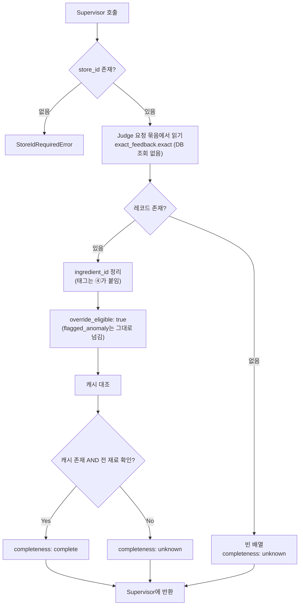

# ③ Exact Feedback Tool (재료 단위 확인 조회)

담당: 정유진 / 상위 문서: `caution-multi-agent-architecture.md`

---

## 0. 역할 범위

**③은 순수 조회기다. 판단하지 않는다.**

- 하는 것: Judge 요청 묶음(KnowledgeBundle)에 들어 있는 이 메뉴의 확인값(`exact_feedback.exact`)과 캐시(`ontology.cache`)를 읽어 재료 단위 확인 맵을 반환한다. 메뉴 애매함 플래그에 대한 사장님 답(§1-8)도 함께 반환한다
- **DB는 부르지 않는다** (10/10 회의 결정 1). 백엔드가 Judge 요청을 만들 때 `store_id + menu_id`로 `ingredient_confirmations`를 미리 조회해 묶음에 담는다 (⓪ §1-3). 가게 없는 스캔(`store_id: null`)이면 담지 않고(`exact_feedback.status: not_found`) ③도 불리지 않는다 (§1-1). ③은 Item Graph에 들어온 같은 `item_id`의 자료만 읽는다 (⓪ §2-6)
- 하지 않는 것: 재료 태그(`constraint_tags`, 재료가 걸리는 제한 태그, 예: 돼지고기 → `is_pork`)는 붙이지 않는다. **태그는 ④만 붙인다** (결정, 2026-10-10 회의, ④ §2-7). ③은 확인값마다 `ingredient_id`만 정확히 돌려주고 `constraint_tags`는 `[]`로 보낸다
- 태그를 채우는 방법: **③이 ④를 직접 부르지 않는다. Supervisor가 ③ 결과를 받은 뒤 ④의 태그 조회(`lookup_tags`)를 불러 채운다** (⓪ §1-2, §2-8 `tag_lookup`). Agent·Tool끼리는 직접 호출하지 않기 때문이다 (⓪ §0). ③ 확인값이 ⑧로 가는 경로는 모두 채워야 한다. ③만 거치는 경로뿐 아니라 ④⑤를 거치는 경로도 마찬가지다. ④는 확인된 재료를 확장 결과에서 빼므로(④ §2-1 7단계), 따로 채우지 않으면 확인값의 태그가 빈 채로 ⑧에 간다 (§6)
- 설계 원칙: **메뉴 단위 이분법 금지.** 부분 확인을 반드시 지원한다.

| 하지 않음 | 담당 |
|---|---|
| 재료 확장 / 변형 판정 | ④ |
| 전부·일부 판단 후 라우팅 | ⓪ Supervisor Agent |
| 사용자 알레르기 태그 매칭 | ⑧ Decision Policy / XAI Agent |
| 확률 계산 | ⑤ |
| DB 쓰기 | ⑦ |

### 0-1. 순서 문제와 해결

③은 ④보다 먼저 실행되므로 **그 메뉴의 전체 재료 목록(분모)을 모른다.** 따라서 "전부 확인됨"을 ③이 단독 판정할 수 없다.

→ **③은 보유한 확인 레코드만 반환한다.** 완전성은 `menu_ingredient_cache`(④가 과거 확장 결과를 저장한 테이블)가 있을 때만 `complete`로 표기하고, 없으면 `unknown`으로 반환해 Supervisor가 ④를 호출하게 한다.

### 0-2. 기준 문서(PPT) 대응

[`ppt-baseline.md`](ppt-baseline.md)의 ③ 관련 내용과 이 문서의 대응 위치다. 이 표의 항목이 빠지면 이 문서가 틀린 것이다.

| PPT 표현 | 이 문서 |
|---|---|
| 7쪽: 검증·저장된 메뉴의 재료 확정 근거(Hard Evidence)를 조회 (`확정 근거 조회`) | §0, §2. 백엔드가 `store_id + menu_id`로 조회해 Judge 요청에 담은 `ingredient_confirmations`를 읽음. 확정 근거는 사장님 답변만 (§1-4) |
| 7쪽: 존재 / 부재 / 미확인 상태를 반환 (`3-State`) | §1-3. `present` / `absent` / `unknown` |
| 7쪽: Agent는 판단하고 Tool은 수행한다 | §0. ③은 조회기다. override 가능 여부·완전성 표시는 정해진 규칙으로 계산한다 (§1-6, §2) |
| 3쪽 외부 연결: 가게 직원 — 질문, 답변 | §1-4. 확정 근거의 출처 |
| 8쪽 1: 모든 호출에 `store_id`를 유지해 가게별 확정 재료가 섞이지 않게 | §1-1, §4-2. `store_id` 필수, 없으면 에러, 전역 조회 금지. 가게 없는 스캔은 ③을 부르지 않아 다른 가게 확정값이 섞일 수 없다 (§4-1 6번, #281) |
| 8쪽 2: 확인된 재료는 그대로 유지, 미확인 재료만 확장·추정, 전부 확인되면 확률 계산 생략 | §0(부분 확인 지원), §2(`completeness`), §3-2(`complete`면 ④⑤ 생략) |
| 8쪽 흐름: ③ 확정 재료 조회 (가게에서 제공 재료 정보 · 사용자 피드백 우선 반영) | §3 호출 시점. "사용자 피드백"은 손님 화면의 확인 질문으로 받은 **사장님 답변**으로 해석한다 (§1-4) |
| 8쪽 흐름: 미확정 재료가 없으면 확정 재료로 바로 판정 | §3-2. `completeness: complete` → ⑧ 직행 |
| 8쪽 5: 사장님 확인 정보 → 최소 n회 이상 시 기록 · 이상 여부 검사 | ⑦ 담당 (n=1: 답 한 번으로 바로 확정, ⑦ §2-3, ⓪ #151). ③은 확정된 값과 ⑦이 붙인 `flagged_anomaly`를 읽기만 한다 (§4-2). **이상 여부 검사 결과로 override를 막지 않는다** (10/27 회의, §1-6). PPT와 다르다 |
| 8쪽 6: 사장님 확인 n건↑ → DANGER/SAFE 확정 | ③은 `override_eligible: true`로 확정 근거임을 표시하고, 판정은 ⑧이 한다 (§1-6) |
| 8쪽 6: n개월마다 재확인 | §1-7. **두지 않는다.** 사장님 답은 기간 만료 없이 쓰고 다시 묻지 않는다 (10/26 회의, ⓪ #151) |
| 10쪽: `Exact-first` | §3. ④보다 먼저 호출해 전부 확인된 메뉴는 가벼운 경로로 끝낸다 |
| 10쪽 RAI 02: 기록 재확인 경로 제공 | ③ 범위 밖. 사장님 답을 주기적으로 다시 묻는 경로는 두지 않는다 (§1-7) |

- PPT에 없던 기본 메뉴(`base_menu_id`) 확인값 2차 호출은 삭제했다 (2026-10-13, §3-1, §6).

---

## 1. 입력 / 출력 스펙

**JSON 형식은 [⓪ §4-2 "③ Exact Feedback Tool"](0-agent-supervisor.md)에서만 정의한다** (요청 `ExactFeedbackRequest`, 응답 `ExactFeedbackResponse`, 공통 모델은 ⓪ §1-2). 이 문서에는 JSON을 다시 적지 않고, ③이 값을 어떻게 정하는지만 적는다. 필드를 바꾸려면 ⓪을 고친다.

### 1-1. 입력에서 ③이 지키는 것

- `context.store_id`는 양수 필수다. 없거나 0 이하면 즉시 에러를 낸다. 전역 조회는 하지 않는다. `context`는 수정하지 않고 그대로 반환한다.
- 가게 없는 스캔(Judge `store_id: null`)이면 Supervisor가 ③을 **부르지 않는다** (⓪ §1-3, AGENTS.md). 가게가 없으면 가게별 사장님 확인값도 없기 때문이다. 그래서 ③에 `null`이 들어오면 계약 위반이므로 위 규칙대로 에러를 낸다.
- `menu.menu_id` 하나만 본다. 변형/base 구분은 하지 않는다. `menu_id`가 없으면 Supervisor가 ③을 부르지 않는다.
- `menu.normalized_menu_name`은 조회에 쓰지 않는다 (로그·추적용).
- `scope_hint`는 항상 `exact`다. 해석하지 않고 응답 `confirmation_scope`로 그대로 돌려준다 (§1-5).
- 입력 `warnings`·`errors`는 보존하고 ③의 신호를 덧붙인다.

### 1-2. 출력 값을 정하는 규칙

| 필드 | ③이 정하는 방법 |
|---|---|
| `completeness` | `complete \| unknown` 두 값만 쓴다. **③이 계산한다** — 백엔드는 보내지 않는다 (§2, §6, ⓪ §1-3) |
| `confirmations[].constraint_tags` | 항상 `[]`. Supervisor가 ④ `lookup_tags`로 채운다 (§0) |
| `confirmations[].status` | 3값 유지 (§1-3) |
| `confirmations[].evidence` | 사장님 답변 근거 (§1-4). `observed_at`은 DB `ingredient_confirmations.confirmed_at` |
| `confirmations[].flagged_anomaly` | ⑦이 저장할 때 붙인 값을 그대로 읽어 넘긴다. override·`completeness`에는 쓰지 않는다 (§1-6) |
| `confirmations[].override_eligible` | §1-6 표 |
| `flag_confirmations` | 메뉴 애매함 플래그에 대한 사장님 답 (§1-8) |

### 1-3. `status` — 3값 필수 (2값 금지)

| 값 | 의미 |
|---|---|
| `present` | 들어있다고 확인됨 |
| `absent` | 없다고 확인됨 |
| `unknown` | 아직 확인 안 됨 (레코드 없음과 동일 취급) |

> ⚠️ `true/false` 2값으로 설계하면 **"없다고 확인됨"과 "아직 안 물어봄"이 구분되지 않는다.** 전자는 override 대상, 후자는 확률 계산 대상 — 정반대 처리다.

### 1-4. `evidence` — 근거 종류

| `evidence.source_type` | `evidence_class` | `verification_status` | 후속 처리 |
|---|---|---|---|
| `owner_feedback` | `hard` | `owner_confirmed` | override 후보 |

> 확인 기록은 **사장님 답변만** 다룬다. 사용자(관광객)가 직접 알려준 재료 정보(`user_hard`)는 수집 경로가 없어 제외했다 (2026-10-09). 제출 PPT 8쪽의 "사용자 피드백 우선 반영"은 사용자 화면에 띄운 확인 질문을 통해 받은 **사장님 답변**으로 해석한다 (`ppt-baseline.md` 7쪽 ③ 정의 "확정 근거(Hard Evidence) 조회", 8쪽 "사장님 확인 정보 → 기록").

### 1-5. `confirmation_scope`

| 값 | 의미 | Supervisor의 사용법 |
|---|---|---|
| `exact` | 이 menu_id에 직접 확인됨 | **override** — ⑤ 스킵 가능 (단 `override_eligible: true`일 때만) |

- 기본 메뉴에서 물려받는 `inherited`는 삭제했다 (2026-10-13). 10/10 회의에서 사장님 답변을 확률 계산에 쓰지 않기로 해 쓸 곳이 없어졌다. ⓪에서도 지워 `scope_hint`·`confirmation_scope`는 `exact` 한 값만 쓴다 (⓪ §4-2).

### 1-6. `override_eligible` — 사장님 답은 항상 override (결정, 2026-10-27 회의)

사장님 답은 이상 답변 표시(`flagged_anomaly`)와 관계없이 **항상 `override_eligible: true`**다. 이상 답변 잠금(`anomaly_locked`, 통계상 이상해 보이는 답을 확정값으로 쓰지 않고 CAUTION 이상으로 고정하던 규칙)은 과정을 줄이려고 없앴다 (10/27 회의, AGENTS.md).

- `flagged_anomaly`는 ⑦이 사장님 답을 저장할 때 붙인 값을 그대로 읽어 넘긴다. 표시 기준은 ⑦ §2-3이다 (레시피상 확률 0.9 이상인데 "없음", #193). ③은 이 값으로 `override_eligible`도 `completeness`(§2)도 바꾸지 않는다.
- **영향**: 통계상 이상한 "없음" 답(예: 돈까스에 `돼지고기: absent`)도 그대로 확정되므로, 그 메뉴가 SAFE로 나올 수 있다. 회의에서 감수하기로 했다.
- 제출 PPT 8쪽의 "이상 여부 검사"와 다르다. `ppt-baseline.md`는 고치지 않는다.
- 이상 표시 값과 DB 칸(`flagged_anomaly` 등)까지 지울지는 정하지 않았다 (§6, #340).
- 예전 규칙(이상 답은 override 거부 → ④⑤로 넘겨 확률 계산 → ⑧에서 `anomaly_locked`로 CAUTION 이상 강제, 2026-10-06 결정)은 폐지했다.

| 조건 | `override_eligible` | Supervisor 동작 |
|---|---|---|
| 모든 재료 확인값 (`flagged_anomaly` 값과 무관) | `true` | override 적용, ⑤ 스킵 가능. `status: unknown`은 §3-2대로 override에서 뺀다 |

### 1-7. 확인값 유효기간 — 없음 (결정, 2026-10-26 회의)

사장님 답은 **대상마다 한 번만 받아 바로 확정하고, 기간 제한 없이** 확정 정보로 쓴다 (10/26 회의, 단일 확인 정책 ⓪ #151, ⑦ §2-3). 답이 이상해 보여도 다시 묻지 않는다.

- ③은 만료를 계산하지 않는다. 오래된 확인값도 다른 확인값과 똑같이 §1-6 규칙으로 `override_eligible`을 정한다.
- 이상 답변(`flagged_anomaly: true`)도 다시 묻지 않고, 다른 답과 똑같이 확정 정보로 쓴다 (§1-6, 10/27 회의).
- 예전 규칙(확인 후 3개월이 지나면 `expired: true`로 override 거부, ⑧이 다시 묻는 카드 생성, 2026-10-06·10-10·10-22·10-23 결정)은 폐지했다.
- ⓪ 문서에서는 `expired`가 빠졌지만 ⓪ 계약 코드(`ai_supervisor/contracts`)에는 아직 필수 필드로 남아 있어, ③ 코드는 그때까지 항상 `expired: false`를 보낸다 (§8).

### 1-8. 메뉴 애매함 플래그 답 — `flag_confirmations` (결정, 2026-10-12)

메뉴에는 "젓갈이 들어갈 수 있음" 같은 애매함 플래그가 붙어 있다 (④ §1-2 `menu_ambiguity_flags`). 재료 목록 밖에 사용자 제한에 걸릴 재료가 있을 수 있다는 뜻이라, ⑧은 사장님에게 메뉴 단위로 묻는다. 예) "이 메뉴의 젓갈에 생선이 들어가나요?" (⑧ §2-1 5-2). 그 답을 ③이 조회해 넘긴다. 형식은 [⓪ §4-2 `flag_confirmations`](0-agent-supervisor.md)다 (원본은 Judge 요청의 `exact_feedback.exact.flag_confirmations`, ⓪ §1-3). ③이 지키는 것:

- `constraint_tags`는 사장님에게 물어본 태그다. 질문에 들어 있던 값을 저장한 것이라 ③이 붙이는 태그가 아니다 (§0의 "태그는 ④만"은 재료 태그 이야기).
- `status`는 §1-3과 같은 3값이다.
- `override_eligible`은 항상 `true`다. 재료 확인값과 달리 비교할 확률이 없어 anomaly 표시가 없고, 기간 만료도 없다 (§1-7).

- 같은 플래그를 다른 태그로 물은 답은 따로 반환한다. 어느 답을 쓸지는 ⑧이 정한다.
- 답 한 번으로 바로 확정하는 규칙(⓪ #151)은 재료 확인값과 같이 ⑦이 저장할 때 적용한다. ③은 확정된 답만 읽는다.
- `completeness`(§2)에는 영향을 주지 않는다. `completeness`는 재료 확인값만 본다.

### 1-9. 이전 질문의 진행 상태 — 삭제 (2026-10-26)

사장님 답은 대상마다 한 번만 받아 바로 확정하므로 (⑦ §2-3, ⓪ #151) 2·3차 질문이 없고, "몇 차까지 물었는지"(`owner_question_states`)를 넘길 필요도 없다. ⓪ 문서 §4-2 응답에서도 빠졌다.

- ⓪ 계약 코드(`ai_supervisor/contracts`)에는 아직 필수 필드로 남아 있어, ③ 코드는 그때까지 묶음 값을 바꾸지 않고 그대로 넘긴다 (§8).

---

## 2. 처리 로직



### 2-1. 함수 시그니처

```python
def query_exact_confirmations(
    request: ExactFeedbackRequest,                  # context.store_id 필수·양수. None/0 이하 → StoreIdRequiredError
) -> ExactFeedbackResponse:
    """context.store_id + menu.menu_id 범위의 재료 단위 확인값을 Judge 요청 묶음에서 읽어 반환.
    DB 조회·판단·확장·라우팅 없음."""


def check_completeness(
    confirmations: list[Confirmation],
    cache: MenuIngredientCache | None,              # Judge 요청 묶음의 ontology.cache
) -> Literal["complete", "unknown"]:
    """cache가 있고, 전 재료가 확인됐을 때만 complete. 이상 답변 표시는 보지 않는다.
    cache가 없으면(None) 항상 unknown (④ 호출 유도)."""


def resolve_override_eligibility(c: Confirmation) -> bool:
    """항상 True. 이상 답변 표시(§1-6)나 기간(§1-7)으로 거부하지 않는다."""
```

### 2-2. 의사코드

```
store_id = request.context.store_id
menu_id = request.menu.menu_id
scope_hint = request.scope_hint
warnings = list(request.warnings)                    # 입력 신호 보존

if store_id is None or store_id <= 0:
    raise StoreIdRequiredError

# DB를 부르지 않는다. 백엔드가 Judge 요청 묶음에 담아 준 같은 item_id의 자료만 읽는다 (⓪ §1-3, §2-6)
knowledge = item_knowledge.candidate(menu_id)        # ②-B가 고른 후보의 자료
exact = knowledge.exact_feedback.exact               # not_found·unavailable이면 None
                                                     # (unavailable warning은 Supervisor가 이미 붙임)
rows = exact.confirmations if exact else []
flag_rows = exact.flag_confirmations if exact else []

confirmations = [to_confirmation(r) for r in rows]   # 이상 답변 표시도 그대로 넘김
flag_confirmations = [to_flag_confirmation(r) for r in flag_rows]   # §1-8

for c in confirmations:
    c.constraint_tags = []                           # 태그는 ④가 붙인다 (④ §2-7)

for c in confirmations:
    c.override_eligible = resolve_override_eligibility(c)

for f in flag_confirmations:                         # §1-8. 이상 답변 표시·기간 만료 없음
    f.override_eligible = True

cached = knowledge.ontology.cache                    # 지식 버전이 같은 캐시만 들어옴. 없으면 None
completeness = (
    "complete"
    if cached
       and all(c.status != "unknown" for c in cover(cached, confirmations))
    else "unknown"
)

return ExactFeedbackResponse(
    context             = request.context,          # 수정 없이 그대로
    menu_id             = menu_id,
    confirmation_scope  = scope_hint,
    completeness        = completeness,
    confirmations       = confirmations,            # evidence.observed_at = confirmed_at
    flag_confirmations  = flag_confirmations,
    warnings            = warnings,
    errors              = list(request.errors),
)
```

> 이상 답변 표시는 `complete` 조건에 넣지 않는다 (2026-10-27 회의). 예전에는 "믿을 수 없는 확인"이라 `complete`를 막고 ④⑤로 보냈지만, 이제 이상 답도 확정 정보로 쓰기 때문이다 (§1-6).

---

## 3. Supervisor와의 계약 (Contract)

**호출 시점**: ② Menu Normalization Agent 직후, ④보다 **먼저**. 가벼운 경로 조기 종료를 위해. 가게가 있고(`store_id` 양수) `menu_id`가 있을 때만 불린다. 가게 없는 스캔이나 `menu_id`가 없는 메뉴는 ④ 경로에서 시작한다 (⓪ §2-1 Judge 3단계).

### 3-1. 호출 횟수: 메뉴당 1회

| 인자 | 시점 | 결과 사용 |
|---|---|---|
| `menu_id`=대상 메뉴, `scope_hint="exact"` | ④ 이전 | `complete`면 ④⑤ 스킵하고 ⑧ 직행 |

> 기본 메뉴(`base_menu_id`)의 확인값을 가져오는 2차 호출은 **삭제했다** (2026-10-13). 원래는 ④가 기본 메뉴를 찾은 뒤 Supervisor가 ③을 다시 불러 기본 메뉴 답변을 ⑤ prior 보정에 쓰려 했지만, 10/10 회의에서 사장님 답변을 확률 계산에 쓰지 않기로 해 쓸 곳이 없어졌다. 변형 메뉴(차돌된장찌개)는 자기 `menu_id`의 확인값만 쓰고, 기본 메뉴(된장찌개)의 사장님 답은 쓰지 않는다.

### 3-2. ③ → Supervisor 반환값별 후속 판단

| 반환 | Supervisor 동작 |
|---|---|
| `completeness: complete` | ④⑤ 스킵 → ⑧ 직행 |
| `confirmations` 일부 존재 | ④ 호출 시 `confirmed_ingredients`에 **`status != unknown` AND `override_eligible: true`** 인 재료만 전달 |
| `confirmations` 빈 배열 | ④ 호출 (`confirmed_ingredients=[]`) |

**③이 직접 호출하지 않는 것**: 어떤 Agent·Tool도 호출하지 않는다. 조회 후 반환하고 종료.

---

## 4. 케이스별 관여 범위 / 예외

### 4-1. 원본 시나리오별 동작

| 케이스 | ③의 동작 | 반환 |
|---|---|---|
| **1) DB 존재 + 피드백 없음** | 조회 → 레코드 없음 | 빈 배열, `unknown` |
| **2) DB 존재 + 피드백 일부** | 해당 재료만 반환 | 부분 맵, `unknown` |
| **2-b) 피드백 전부** | 캐시 대조 후 완전 확인. 이상 답변 표시가 있어도 확인값으로 센다 (§1-6) | `complete` → ④⑤ 스킵 |
| **3) 변형 메뉴** | DB에 등록된 변형은 변형 `menu_id`의 확인값만 반환. 기본 메뉴 확인값은 가져오지 않는다 (§3-1). DB에 없는 런타임 변형은 `menu_id`가 없어 호출되지 않음 | `exact` |
| **4) DB에 없는 unknown 메뉴** | **호출되지 않음.** `menu_id`가 없어 Supervisor가 ④ unknown 경로로 바로 보낸다 (§1-1) | — |
| **5) 웹서치까지 실패 (엣지)** | **관여 없음** | 4번과 같이 호출되지 않음 |
| **6) 가게 없는 스캔** (`store_id: null`) | **호출되지 않음.** Supervisor가 ④ 경로로 바로 보낸다 (⓪ §1-3, §2-1 Judge 3단계) | — |

### 4-2. 예외 처리

| 상황 | 처리 |
|---|---|
| `context.store_id` 누락/null/0 이하 | `StoreIdRequiredError`. **전역 조회 fallback 금지**. 가게 없는 스캔의 `null`은 Supervisor가 ③을 부르지 않으므로 여기까지 오면 계약 위반이다 (§1-1) |
| 묶음에 이 메뉴의 확인값이 없음 (`exact_feedback.status: not_found`) | 빈 배열 + `unknown` 반환. 예외 발생시키지 않음 |
| 묶음의 확인값을 백엔드가 못 가져옴 (`exact_feedback.status: unavailable`) | 빈 배열 + `unknown`. "확인값 없음"으로 믿지 않고 SAFE 금지 warning(`knowledge_slice_unavailable`)이 남는다 (⓪ §1-3) |
| `flagged_anomaly: true` | 다른 확인값과 같이 `override_eligible: true`로 반환하고 표시는 그대로 넘긴다 (§1-6) |
| 같은 재료의 확정값이 여러 개 | 생기지 않는다. 확정값 표(`ingredient_confirmations`)는 가게·메뉴·재료당 1행이다 (UNIQUE). 사장님 답은 대상마다 한 번만 받아 ⑦이 바로 확정한다 (⑦ §2-3, ⓪ #151). ③은 확정값 표만 읽는다 |
| `menu_ingredient_cache` 없음 | `completeness: unknown` 강제 → ④ 호출 유도 |
| 메뉴 레시피가 바뀌어 캐시가 오래됨 | 백엔드가 지식 버전(`menus.knowledge_revision`)이 같은 캐시만 묶음에 담으므로 `cache: null`로 온다 → `unknown` 반환 (안전 방향, §6 캐시 무효화) |

---

## 5. 테스트 케이스

| # | 입력 | 기대 동작 | 검증 포인트 |
|---|---|---|---|
| 1 | 확인 레코드 0건 | 빈 배열 + `unknown` | 에러 발생하지 않을 것 |
| 2 | 5개 중 2개만 확인 | 2건 반환 + `unknown` | **메뉴 단위 이분법 없을 것** (부분 확인 지원) |
| 3 | `status: absent` 레코드 | `absent`로 반환 | `unknown`과 구분될 것 (3값 검증) |
| 4 | 차돌된장찌개 호출 | 빈 배열 + `scope: exact` | base 정보를 ③이 스스로 끌어오지 않을 것 |
| 5 | 차돌된장찌개의 기본 메뉴(된장찌개) 확인값 | ③을 다시 부르지 않음, `inherited` 응답 없음 (2차 호출 삭제) | 기본 메뉴의 사장님 답이 판정·확률 계산에 쓰이지 않을 것 (⓪ §7 #21) |
| 6 | `context.store_id` 누락 | 즉시 에러 | 전역 fallback 없을 것 |
| 6-a | 가게 없는 스캔 (Judge `store_id: null`) | ③ 호출 없음 | Supervisor가 ③을 건너뛰고 ④ 경로로 갈 것 (⓪ 테스트 2-a) |
| 7 | 돈까스 `돼지고기: absent` + `flagged_anomaly: true` | `override_eligible: true` + 표시 유지 | 이상 답변이어도 override를 거부하지 않을 것 (§1-6, 10/27 회의) |
| 8 | 전 재료 확인 + 이상 답변 1건 | `completeness: complete` | 이상 답변이 `complete`를 막지 않을 것 |
| 9 | 캐시 존재 + 전 재료 확인 | `complete` | ④⑤ 스킵 경로 작동할 것 |
| 10 | 1년 전 `돼지고기: absent` (anomaly 아님) | `override_eligible: true`, `expired: false` | 시간이 지났다는 이유로 override를 거부하지 않을 것 (§1-7) |
| 11 | 캐시 존재 + 전 재료 확인 + 그중 1건이 1년 전 확인값 | `completeness: complete` | 오래된 확인값이 `complete`를 막지 않을 것 (§1-7) |
| 12 | 돼지고기 `status: present` 확인값 | `ingredient_id` 정확히 반환, `constraint_tags: []` | 태그를 ③이 붙이지 않을 것. Supervisor가 ④ 태그 조회 후 ⑧이 `is_pork`로 대조할 것 (⓪ 테스트 12) |
| 13 | 김치찌개 `땅콩: present` + `flagged_anomaly: false` (레시피 확률 낮음) | `override_eligible: true` | "있음" 답변은 anomaly가 아니므로 override가 거부되지 않을 것 |
| 14 | 일부만 확인된 메뉴(④⑤ 경로) + 돼지고기 `status: present` | ③은 `constraint_tags: []`로 반환, Supervisor가 ④ `lookup_tags`로 `is_pork`를 채운 뒤 ⑧에 전달 | ④⑤를 거치는 경로에서도 확인값 태그가 빠지지 않을 것 (§0) |
| 15 | 김치찌개에 젓갈 플래그 답 1건(`is_fish`, `absent`) | `flag_confirmations`에 1건, `confirmations`·`completeness`는 그대로 | 플래그 답이 재료 확인값과 섞이지 않을 것 |
| 16 | 1년 전 젓갈 플래그 답 | `override_eligible: true`, `expired: false` | 플래그 답에도 기간 만료가 없을 것 (§1-8) |
| 17 | (삭제, 2026-10-26) 2·3차 질문 진행 상태 | — | 질문을 한 번만 하므로 진행 상태를 넘기지 않는다 (§1-9) |

---

## 6. 미확정 항목 (팀 확인 대기)

- [x] **확인 정보 유효기간** — 없음 (2026-10-26 회의, §1-7). 2026-10-06 회의의 3개월 규칙과 세는 기준(10-10·10-22·10-23)은 폐지
- [x] **만료된 재료 재질문 경로** — 삭제. 사장님 답은 한 번만 받고 다시 묻지 않는다 (2026-10-26 회의, §1-7)
- [x] **`menu_ingredient_cache` 무효화 시점** — ④ 방식을 따른다 (④ §2-1 6단계): 캐시는 `menus.knowledge_revision`이 같을 때만 유효하고, 메뉴의 레시피·온톨로지가 바뀌면(웹 레시피 DB 등록, 크롤링 데이터 재적재, 숨은 재료 규칙 추가 등) 리비전이 올라가 자동 무효화된다. 사장님 확인값은 캐시에 넣지 않으므로 새 확인값이 들어와도 무효화하지 않는다. 재료 단위 변경 시 리비전을 올리는 방식은 ④ §8 (#169)
- [x] **2차 호출(`inherited`)** — 삭제 (2026-10-13). 10/10 회의에서 사장님 답변은 확률 계산에 쓰지 않기로 해 쓸 곳이 없고, 백엔드도 항상 `null`인 `exact_feedback.inherited`를 지우자고 요청함 (§3-1)
- [x] **2차 호출 삭제 ⑤ 반영 (외부 의존)** — ✅ ⑤도 반영됨 (#286·#290, 2026-10-21 확인). ⓪은 반영됨: Bundle `exact_feedback.inherited`(#274), `scope_hint`·`confirmation_scope`의 `inherited` 값, `exact_inherited` 보류 node, ⑤ 요청 `inherited_confirmations` 삭제. ⑤도 §1-1·§3-3·§8에 입력에서 삭제됐다고 적었다
- [x] **④⑤ 경로에서 확인값 태그 채우기 (외부 의존)** — ✅ ④ §2-7도 "모든 경로에서 ⑧ 직전"으로 반영됨 (#286, 2026-10-21 확인). ⓪은 반영됨: 모든 경로가 ⑧ 직전에 `tag_lookup`을 거친다 (⓪ §2-8 라우터 `bayesian → tag_lookup → decision`, §4-2, 테스트 12-a, 2026-10-13 확인). ④ §3 `lookup_tags` 설명도 "③만 거치는 경로" → "모든 경로, 일부만 확인된 메뉴도 포함"으로 고쳐졌다. 이 경로가 빠지면 일부만 확인된 메뉴에서 확인값 태그가 비어 할랄 사용자에게 돼지고기 `present`가 DANGER로 걸리지 않을 수 있었다 (FN)
- [x] **`completeness` 계산 주체** — ③이 캐시(`ontology.cache`)로 계산한다 (이상 답변 규칙은 2026-10-27 회의로 빠짐, §1-6). 같은 규칙을 백엔드에도 두면 둘이 어긋날 수 있어서, 백엔드는 Judge 요청에 `completeness`를 넣지 않는다 (2026-10-13, ⓪ §1-3)
- [x] **판정 중 DB 조회** — 하지 않는다. 확인값·캐시는 백엔드가 Judge 요청에 담아 주고 ③은 읽기만 한다 (10/10 회의 결정 1, §0·§2, 2026-10-13)
- [x] **`completeness: partial` 기준** — `partial`은 쓰지 않고 `complete | unknown` 두 값만 쓴다. ⓪·④·⑤는 "complete인지 아닌지"로만 경로를 나누어 `partial`과 `unknown`의 차이가 어디에도 쓰이지 않기 때문이다. ⓪ §4-2의 값 목록과 예시에서 `partial`을 지운다 (2026-10-12)
- [x] **⓪ 반영 요청** — ⓪ §4-2 응답과 §1-3 Judge 요청 `exact_feedback.exact`에 `flag_confirmations` 추가, §1-8은 ⓪ 링크로 바꿈 (2026-10-13)
- [x] **2·3차 질문 진행 상태 전달** — 삭제. 질문을 한 번만 하므로 넘길 진행 상태가 없다 (2026-10-26 회의, ⓪ #151, §1-9). 처음 결정은 ⓪ #269
- [ ] **플래그 답 저장 위치 (외부 의존)** — `flag_confirmations`(§1-8)를 읽을 DB 자리. ⑦·DB 스키마 문서에는 반영됨: 새 테이블 `owner_flag_confirmations` 제안, ⑦이 저장 (#259, ⑦ §2-4, `caution-db-schema.md` §6 11·12번). 남은 것: 백엔드가 테이블을 확정
- [x] **가게 없는 스캔** — 백엔드 지적(2026-10-13): 앱에 가게를 고르지 않고 스캔하는 기능이 있다. 결정 (#281, AGENTS.md 갱신): Prepare는 `store_id`를 받지 않고, Judge는 `store_id: null`을 가게 없는 스캔으로 받는다. 이때 Supervisor는 ③을 부르지 않고, 사장님 질문·저장 명령을 만들지 않으며, 모든 메뉴는 SAFE 금지다 (⓪ §1-3). ③의 규칙(§1-1 `store_id` 필수)은 그대로다 (§4-1 6번)
- [x] **anomaly 판정 기준** — 레시피 확률(⑤ `posterior_mean`) 0.9 이상 + "없음" 답변이면 anomaly. "있음"은 대상 아님 (2026-10-06, #193, ⑦ §2-3, §1-6). 2026-10-27 회의로 이 표시는 override에 쓰지 않는다
- [ ] **이상 표시 값·DB 칸을 남길지** (2026-10-28) — 잠금은 없앴다 (§1-6). `flagged_anomaly`, DB `ingredient_confirmations.flagged_anomaly`·`override_eligible`(GENERATED), 이상 판정에만 쓰는 `owner_verification_requests.recipe_probability`까지 지울지 #340에서 정한다. 지금 이 표시는 ⑦ 출처 신뢰도 계산(이상 답은 정답 비교에서 뺌)에 쓰인다

## 7. 확정된 결정 (변경 금지)

- **이상 답변 잠금 없음**: 사장님 답은 이상 답변 표시와 관계없이 override한다 (2026-10-27 회의, AGENTS.md). 예전 "override 거부, CAUTION 이상 강제 유지"는 폐지
- **anomaly 판정 기준**: 레시피 확률 0.9 이상 + "없음" 답변. "있음"은 anomaly 아님. 표시는 ⑦이 붙이고, override에는 쓰지 않는다 (#193, 2026-10-27 회의)
- **기본 메뉴 확인값 상속 안 함**: 2차 호출 삭제. 변형 메뉴는 자기 `menu_id`의 확인값만 쓴다 (2026-10-13)
- **`status` 3값**: `present` / `absent` / `unknown`
- **`menu_ingredient_cache`**: 생성하기로 확정. 무효화는 ④ 방식을 따른다 — 메뉴 지식 리비전(`menus.knowledge_revision`)이 바뀌면 자동 무효화, 사장님 확인값으로는 무효화하지 않음 (2026-10-11, ④ §2-1)
- **확정 근거는 사장님 답변만**: 관광객이 직접 알려주는 재료 정보(`user_hard`)는 수집 경로가 없어 쓰지 않는다 (2026-10-09, #214)
- **확정값은 재료당 1행**: 사장님 답은 한 번만 받아 ⑦이 바로 확정한다. ③은 확정값 표만 읽는다 (#167, ⓪ #151)
- **태그는 ④만 붙인다**: ③은 `constraint_tags: []`로 반환하고 Supervisor가 ④ `lookup_tags`로 채운다 (2026-10-10 회의)
- **확인값 유효기간 없음**: 사장님 답은 한 번만 받고 기간 제한 없이 쓴다. 다시 묻지 않는다 (2026-10-26 회의, 3개월 규칙 대체)
- **가게 없는 스캔은 ③을 부르지 않는다**: Judge `store_id: null`이면 가게별 확인값이 없으므로 Supervisor가 ③을 건너뛴다. ③의 `store_id` 필수 규칙은 그대로다 (#281, AGENTS.md)

---

## 8. ⓪에 미반영 항목

이 문서에서 정했지만 [⓪ Supervisor 문서](0-agent-supervisor.md)에 아직 반영되지 않은 것을 적는다. JSON 형식은 ⓪에서만 정의하므로, 여기 남은 항목은 ⓪만 보고 구현하면 빠진다. ⓪에 반영되면 체크한다.

- [ ] **⓪ 계약 코드의 `expired`·`owner_question_states`** (2026-10-27) — ⓪ 문서 §4-2에서는 빠졌지만 `ai_supervisor/contracts`(`Confirmation`, `FlagConfirmation`, `ExactFeedbackResponse`)에는 아직 필수다. 그때까지 ③ 코드는 `expired: false`를 보내고 진행 상태를 그대로 넘긴다. 구현 가이드 §3 "기존 다차 질문·3개월 만료 필드 제거" 항목. Item Graph(`ai_supervisor/item_graph.py`)가 ③에 넘기는 시계(`clock`)도 이제 쓰지 않으니 함께 빼면 된다
- [x] **이상 답변 잠금 전달 빼기** (2026-10-28, 10/27 회의) — ③은 이상 답도 `override_eligible: true`로 보낸다 (§1-6). ⓪에 반영함 (2026-10-28): Item Graph가 ④ 요청 `anomaly_locked_ingredients`를 항상 `[]`로 보내고, ⓪ 문서(Judge 조립 흐름, ④ `OntologyRequest`·`OntologyResponse`·⑧ `DecisionRequest`·`DecisionResponse` 설명, 테스트 5·39)와 ⓪ 테스트 2개를 고쳤다. 칸 자체를 지울지는 §6
