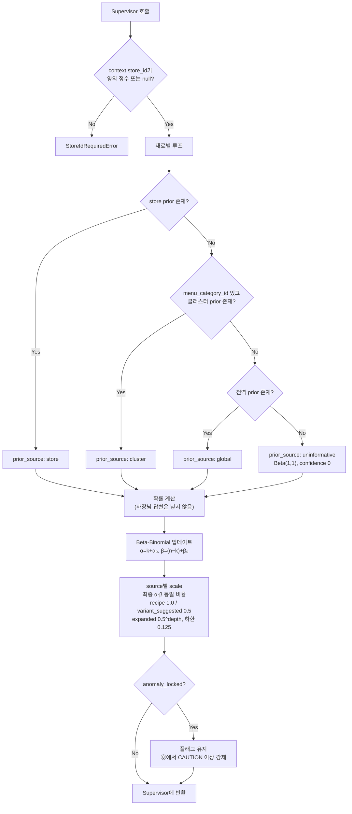

# ⑤ Bayesian Tool 스펙

담당: 윤지
상태: v3 (공식 확정으로 구현 착수 가능. 확정 결정은 §10, 미확정 항목은 §8 참조)
상위 문서: `caution-multi-agent-architecture.md`, `caution-db-schema.md`

---

## 0. 역할 범위

⑤는 확정되지 않은 재료에 대해 사전확률(prior)과 수집된 근거를 결합해, **해당 가게에서 그 재료가 실제로 들어갈 확률**을 Beta-Binomial로 추정하는 **확률 계산 Tool**이다. 입력 재료는 ④가 확장한 목록(또는 ⑥ 웹 후보)이다.

| 하지 않음 | 담당 |
|---|---|
| DANGER / CAUTION / SAFE 판정 | ⑧ Decision Policy / XAI Agent |
| threshold(F2 컷오프) 결정 | ⑧ (보관 주체는 §8 미확정) |
| 사용자 알레르기 태그 매칭 | ⑧ |
| 재료 확장 | ④ |
| `ingredient_risk_scores` 갱신 | **누구도 직접 UPDATE하지 않음.** ⑦이 `ingredient_evidence_log` INSERT 명령을 만들고, 백엔드가 저장한 뒤 애플리케이션 로직이 α/β를 재계산 |

### 0-1. 설계 원칙

- **가게 스코프 prior만 쓴다.** `store_id`로 분리된 prior를 먼저 쓰고, 전역 prior는 최후의 수단이다.
- **가게 증거로 전역 prior를 갱신하지 않는다** (결정, 2026-10-10 회의). 전역 prior는 크롤링 코퍼스(`menu_recipe_corpora`, `menu_ingredient_priors`)와 큐레이션 레시피(`recipe_ingredients`)로만 만든다. 사장님 답변·승인된 웹 근거 같은 가게 증거는 그 가게의 `ingredient_risk_scores`에만 쌓이고, 배치로 모아 전역 prior에 다시 넣지도 않는다. 한 가게의 레시피가 다른 가게 확률을 바꾸면 가게 스코프 원칙이 깨지기 때문이다. 개발 실험의 전역 prior 배치 재학습(`regenerate_global_prior_offline`)은 구현하지 않는다.
- **예외는 출처 신뢰도다.** `source_reliability`는 prior가 아니라 "어느 출처가 믿을 만한가"라서 여러 가게의 사장님 확정값으로 함께 배운다 (⑦ §3-1). 신뢰도는 근거에 곱하는 가중치일 뿐, 다른 가게의 재료 정보가 이 가게 확률에 들어가지 않는다.
- **불확실은 낮은 확률이 아니다.** 근거가 약하면 확률 평균을 낮추지 않고 분포를 넓힌다 (§2-1). 평균을 낮추면 SAFE 쪽으로 기우는 FN이 생긴다.
- **근거가 없으면 무정보로 표시한다.** 관측 0건은 0.5와 낮은 `confidence`로 내보내며, SAFE 쪽 기본값을 쓰지 않는다.
- **판정하지 않는다.** ⑤의 출력은 확률 수치이고 해석은 ⑧이 한다.
- **받은 플래그를 바꾸지 않는다.** `anomaly_locked`는 그대로 옮긴다.
- **부작용이 없다.** 같은 입력에는 같은 결과를 내고, DB에 쓰지 않는다.
- **외부 경계는 Pydantic 모델로 검증한다** (⓪ §1-3).

### 0-2. 기준 문서 대응

[`ppt-baseline.md`](ppt-baseline.md)의 ⑤ 관련 내용과 이 문서의 대응 위치다. 이 표의 항목이 빠지면 이 문서가 틀린 것이다.

| PPT 표현 | 이 문서 |
|---|---|
| 7쪽: 확정되지 않은 재료에 대해 사전확률(prior)과 수집된 근거를 결합 (`확률 추정`) | §3 공식, §1-3 prior fallback |
| 7쪽: 해당 재료가 존재할 가능성을 갱신 (`Posterior 갱신`) | §2 처리 로직 |
| 7쪽: `불확실성 정량화` | §1-2 `alpha_post`/`beta_post`/`confidence`, §2-1 scale |
| 8쪽 6: Hard Evidence 없음 → DANGER/SAFE 판정 불가, CAUTION + 확률 수치 제공 | §5-2 |
| 9쪽 3: α = k + 1, β = (n − k) + 1, p = α / (α + β) | §3 |
| 9쪽 2·4: 독립 가정 X, 자카드 보정, Chow-Liu + TAN, 결합 모델 | §3-2 |
| 9쪽 5: 출처 신뢰도 반영 (Dawid-Skene 응용) | §3-3 |

---

## 1. 입력 / 출력 스펙

**JSON 형식은 [⓪ §4-4 "⑤ Bayesian Tool"](0-agent-supervisor.md)에서만 정의한다** (요청 `BayesianRequest`, 응답 `BayesianResponse`, 공통 모델은 ⓪ §1-2, `priors`·`source_reliability`는 ⓪ §1-3). 이 문서에는 JSON을 다시 적지 않고, ⑤가 값을 어떻게 해석·계산하는지만 적는다. 필드를 바꿀 때는 ⓪부터 고친다.

### 1-1. 입력에서 ⑤가 지키는 것

공통 문맥은 ⓪ §1-2 `NodeContext`, `priors`·`source_reliability`는 ⓪ §1-3 KnowledgeBundle 슬라이스다. ⑤가 지켜야 할 것:

- `context.store_id`는 양의 정수 또는 `null`. 필드 누락·문자열·0 이하면 에러. store prior는 가게 스코프다.
- **가게 없는 스캔(`store_id: null`, AGENTS.md · ⓪ §1-3)**: 에러가 아니다. `priors`는 `{status: not_found, store: [], evidence: []}`로 오므로 store prior 없이 ④의 `observations`(레시피 통계)로 전역 prior를 계산한다. SAFE 금지 경고(`store_context_missing`)는 Supervisor가 붙인다.
- `menu_category_id`가 `null`이면 `cluster` 단계를 건너뛴다 (지금은 `cluster`가 항상 비어 있다).
- `ingredients[]`는 ④ 또는 ⑥ 출력이다. `observations`(출처별 관측값)와 `observation_basis`는 ④ §1-5 규칙으로 만들어진 값이다. `anomaly_locked`는 Supervisor가 붙이고 ④가 보존한 값이다.
- 원본 메뉴 확인값(`inherited_confirmations`)은 입력에서 **삭제됐다** (2026-10-13, ③ §3-1). 사장님 답변은 확률 계산에 쓰지 않는다 (10/10 회의).
- `source_reliability.weights[]`에 없는 출처는 0.5로 본다 (⑦ §3-1).
- ⑤가 내는 warning 코드(`empty_ingredients`, `integrity_error`, `prior_global_ignored`)는 ⓪ §4-4에 있다.

**`priors` 슬라이스의 뜻 (결정, 2026-10-12)** — 판정 단계에서 ⑤는 DB를 조회하지 않고 이 값만 쓴다

| 배열 | 내용 | ⑤의 처리 |
|---|---|---|
| `store` | `ingredient_risk_scores` (가게 증거 합계, `alpha = 1 + δα`, `beta = 1 + δβ`) | `alpha − 1`, `beta − 1`만 더한다 (§3-3, 테스트 22). 근거 출처는 그 가게 메뉴판의 변형 근거(`ocr_variant_tag`)뿐이다. 승인된 웹 레시피는 가게와 무관해 여기 들어오지 않고, 30개가 모이면 공용 메뉴로 등록된다 (⑦ §2-1, 2026-10-20). 사장님 답변(`owner_feedback`)도 들어오지 않는다 |
| `cluster` | **항상 `[]`** | 메뉴 분류 prior는 #200으로 연기 |
| `global` | **항상 `[]`** | 전역 prior는 ⑤가 ④의 `observations` × 출처 신뢰도 + 큐레이션으로 계산한다 (§3-3). 여기에 α·β를 또 받으면 같은 크롤링 레시피를 두 번 센다 |

- `cluster`·`global`은 백엔드가 보내는 KnowledgeBundle 계약에서 빠졌다 (⓪ §1-3·§4-4). Supervisor가 ⑤ 요청을 만들 때 빈 배열로 채운다. 그래도 값이 들어오면 무시하고 `prior_global_ignored` warning을 남긴다.
- `priors.status`가 `unavailable`이면 `store`가 비어도 "가게 증거 없음"으로 보지 않는다. ⓪ 규칙대로 SAFE 금지 warning을 유지한다.

**⑤에 오는 재료 / 오지 않는 재료**

| 구분 | ⑤에 오는가 | 이유 |
|---|---|---|
| `scope: exact` + `override_eligible: true` | ❌ 오지 않음 | Supervisor가 override 처리 후 제외 |
| `scope: exact` + `flagged_anomaly: true` (이상 답변) | ✅ **온다** | override 거부됐으므로 확률 계산이 필요. `anomaly_locked: true`로 CAUTION 이상 유지 |
| `scope: inherited` | 보류 | 원본 메뉴 확정값. override도 prior 보정도 하지 않는다 (③ §6) |
| 3개월 지난 확정값 (`exact`, 만료) | ✅ **온다** | 만료되면 override하지 않지만 버리지도 않는다 (AGENTS.md). 재료는 레시피 확률로 계산하고, **만료된 답 자체는 확률에 넣지 않는다** (사장님 답변은 확률 계산에 쓰지 않음, 10/10 회의). ⑧이 다시 묻는 카드를 만든다 (⑧ §2-1) |
| 미확인 재료 | ✅ 온다 | 기본 계산 대상 |

### 1-2. 출력 값을 정하는 규칙

⑤가 값을 정하는 방법:

- `context`는 입력 값을 수정하지 않고 그대로 돌려준다.
- `ingredient`, `constraint_tags`, `role`, `anomaly_locked`, `evidence_refs`는 입력 그대로 복사한다. ⑤는 계산하거나 바꾸지 않는다.
- `posterior_mean`, `alpha_post`, `beta_post`: §2·§3 공식과 scale로 계산한다.
- `prior_source`: §1-3 fallback 단계.
- `confidence`는 **0~1 사이 숫자**다 (결정, 2026-10-06, #187). 1에 가까울수록 근거가 충분하다는 뜻이다. 계산식과 "낮음" 기준은 §1-2-1에 있다.

#### 1-2-1. `confidence` 계산식 (결정, 2026-10-12)

```
ν = alpha_post + beta_post − 2        # 실질 근거 수. 출처 신뢰도·depth 감쇠 반영 후, Beta(1,1) 몫 2를 뺀다. 0 미만이면 0
confidence = 1 − 1 / √(ν + 1)
낮은 confidence = ν < 5  (confidence < 0.59)
```

- **뜻**: 근거 덕분에 불확실성이 얼마나 줄었는가. Beta 분포의 표준편차는 `√(p(1−p)/(α+β+1))`이다. 같은 확률 p에서 근거가 없을 때와 비교한 표준편차 비율은 `1/√(ν+1)`로, **p와 무관하게 근거 양만으로 정해진다.**
- **분포 폭(표준편차)을 그대로 쓰지 않는 이유**: 확률이 0.5 근처인 재료는 근거가 많아도 폭이 넓게 나와 "확률이 반반"과 "근거 부족"이 섞인다. confidence는 근거 양만 나타낸다. ⑧은 낮은 confidence를 카드 이유 `insufficient_recipe_evidence`(확률 근거 부족) 표시로만 쓴다 (⑧ §2-1 7단계). `low_confidence`는 사진 품질(`scan_quality.status`) 값이라 다른 뜻이다.
- **"낮음" 기준 5**: ⑤가 따로 정한 기준이다 (2026-10-12). ⑥의 웹 레시피 최소 개수(10개, ⑥ §2-3)와는 관계없다.
- 출처 신뢰도(§3-3)와 depth 감쇠(§2-1)는 둘 다 ν를 줄이므로 따로 반영하지 않는다.
- **`prior_source`는 섞지 않는다.** confidence는 근거 양만, `prior_source`는 근거 출처만 나타낸다. ⑧은 둘을 따로 받는다 (§5-2). 지금 데이터는 대부분 `global`이라, 단계로 상한을 두면 거의 모든 재료가 "낮음"이 되어 순위를 매길 수 없다.

| 경우 | ν | confidence |
|---|---|---|
| 관측 0건 / `uninformative` | 0 | 0 |
| 레시피 3개 | 3 | 0.50 |
| 레시피 5개 (기준선) | 5 | 0.59 |
| 레시피 57개, 출처 신뢰도 0.2 | 11.4 | 0.72 |
| 레시피 57개, depth 2 (scale 0.25) | 14.25 | 0.74 |
| 레시피 57개, 출처 신뢰도 1 | 57 | 0.87 |

#### 1-2-2. 사장님 질문 후보 — ⑤는 거르지 않는다

⑧은 사용자 태그와 겹치고 사장님 확인값이 없는 재료마다 카드를 만들고, 확률이나 confidence 숫자로 거르지 않기로 했다 (⑧ §2-1 7단계, 2026-10-12). 그래서 ⑤는 질문 후보용 기준을 따로 내보내지 않는다. 한때 검토한 신용구간 기준(상한 ≥ 0.1, 하한 ≤ 0.9; 시드의 알레르겐 재료 쌍 2,013개 중 780개가 해당)은 QA(#192) 참고용으로만 남긴다.

### 1-3. `prior_source` — fallback 단계 (내림차순 우선)

| 값 | 의미 | 조건 |
|---|---|---|
| `store` | 해당 가게 고유 prior | `ingredient_risk_scores`에 (`store_id`, `menu_id`, `ingredient_id`) 레코드 존재 |
| `cluster` | 동일 메뉴 분류(`menus.category_id`) 클러스터 prior | store prior 없음. 구현은 #200으로 연기 (§8) |
| `global` | 전역 prior. 크롤링 코퍼스 관측값(`menu_recipe_corpora`, `menu_ingredient_priors`, ④가 `observations`로 전달)과 큐레이션 레시피 | **최후의 수단.** confidence는 근거 양대로 계산하고, 가게와 다를 수 있다는 점은 `prior_source`로 ⑧에 전달. 확률만으로는 SAFE가 나오지 않는다 (⑧ §3) |
| `uninformative` | 근거 전무 (`n_total=0` 포함) | ⑧에서 CAUTION 이상 강제 유지 |

### 1-4. `anomaly_locked`

③이 **`flagged_anomaly: true`(이상 답변)** 로 반환한 재료에만 Supervisor가 `true`를 부여하고, ④가 그대로 보존해 ⑤로 넘긴다 (④ §1-1, ③ §1-6). 3개월 만료(`expired: true`)로 `override_eligible: false`가 된 재료는 ⑤ 확률 계산 대상이지만 `anomaly_locked: false`다.
**⑤는 이 값을 만들거나 바꾸지 않고 출력에 그대로 옮긴다.**
⑧은 이 플래그가 있으면 **posterior_mean과 무관하게 CAUTION 이상을 유지**한다.

---

## 2. 처리 로직



### 2-1. 근거 강도별 처리 — **scale은 α·β 동일 비율 축소**

| ④의 `source` | 근거 | scale |
|---|---|---|
| `recipe` | DB 명시 재료 (**DB 등록 변형 재료 포함**) | 1.0 |
| `expanded` | 재귀 확장 도출 | `max(0.5^depth, 0.125)` (아래 depth 감쇠) |
| `variant_suggested` | 런타임 태깅 제안, DB 미반영 | **0.5** |
| `web_search` | ⑥ 웹 레시피 후보 | **1.0** — 출처 신뢰도(`web_search`)를 이미 곱하므로 scale로 한 번 더 줄이지 않는다 (결정, 2026-10-12) |

**α만 줄이면 안 되는 이유 (중요)**

α만 축소하면 posterior mean이 **낮아진다** → 재료가 없다고 판단 → **SAFE 쪽으로 기움** → **FN 발생.**
변형 재료는 "없을 가능성이 높다"가 아니라 **"불확실하다"** 이다. 불확실은 낮은 확률이 아니라 **넓은 분포**다.

```
확정 재료:           α=8,  β=2   → mean 0.80, 좁은 분포
variant (틀린 방식):  α=4,  β=2   → mean 0.67   ← SAFE 쪽으로 이동. 위험
variant (올바른 방식): α=4,  β=1   → mean 0.80, 넓은 분포  ← mean 보존, 불확실성만 증가
```

→ **α, β를 동일 비율로 축소해 pseudo-count 총량만 줄인다.** posterior mean은 보존되고 분산만 커져, ⑧에서 "확률은 높은데 confidence가 낮다 → 사장님 질문 우선순위 상향"으로 자연스럽게 연결된다.

**scale은 관측치를 더한 최종 α·β에 적용한다.** 위 예시(α=8, β=2 → α=4, β=1)도 최종값을 축소한 것이다. prior(α₀, β₀)만 축소하고 관측치를 그대로 더하면 mean이 보존되지 않는다.

```
k=2, n=10, prior Beta(1,1)
  scale 없음:               α=3,   β=9    → mean 0.250
  prior만 0.5배 (틀린 방식): α=2.5, β=8.5  → mean 0.227  ← SAFE 쪽 이동
  최종 α·β 0.5배 (올바름):   α=1.5, β=4.5  → mean 0.250, 분산 증가
```

> `variant_origin: db_registered`(④ DB 컬럼 등록 변형)는 관리자 컨펌을 거친 확정 데이터이므로 `source: recipe`이며 **scale 축소 대상이 아니다.** 축소는 `runtime_tagged`에서 나온 `variant_suggested`에만 적용한다.

**depth 감쇠 — 확률은 그대로, 확신도만 낮춘다** (결정, 2026-10-10)

```
scale(depth) = max(0.5 ** depth, 0.125)
```

| depth | 예시 (김치찌개) | scale |
|---|---|---|
| 0 | 김치 | 1.0 |
| 1 | 액젓 | 0.5 |
| 2 | 새우 | 0.25 |
| 3~5 | 그 아래 | 0.125 (하한) |

- 감쇠도 위와 같은 **최종 α·β 동일 비율 축소**다. 깊을수록 확률을 곱해 깎는 방식(선형·지수로 mean을 낮추는 방식)은 쓰지 않는다. 숨은 재료 확률이 내려가 그대로 FN이 된다.
- 깊을수록 "있을 수 있지만 덜 확실함"이 되어 분산이 커지고, ⑧에서 CAUTION·사장님 질문 쪽으로 간다.
- 깊이 1의 0.5는 `variant_suggested`와 같은 값이다. 추정 변형 1개와 같은 수준의 근거로 본다.
- 하한 0.125를 두는 이유: 깊이 5까지 계속 줄이면 분포가 거의 평평해져 모든 메뉴가 CAUTION으로 도배되고 경고가 의미를 잃는다.
- **예외**: 하위 재료라도 `observation_basis: direct`(레시피에 직접 나온 수가 상위 재료보다 많음, ④ §1-5)면 scale 1.0이다. 직접 관측이므로 깊이 때문에 깎을 이유가 없다.
- 0.5와 0.125는 초기값이다. F2 튜닝(QA #192)에서 다시 본다.

### 2-2. 함수 시그니처

```python
A0, B0 = 1.0, 1.0                                      # Beta(1,1) 라플라스 스무딩


def estimate_probabilities(
    context: RequestContext,                           # 필수. context.store_id 양수 또는 None(가게 없는 스캔)
    menu_id: int | None,
    menu_category_id: int | None,
    ingredients: list[IngredientNode],
) -> BayesianResult:
    """재료별 존재 확률(posterior mean) 산출. 판정하지 않음."""


def resolve_prior(
    store_id: int, menu_id: int | None, ingredient_id: int, menu_category_id: int | None,
) -> tuple[float, float, PriorSource]:
    """store → cluster → global → uninformative 순 fallback.
    menu_category_id가 None이면 cluster를 건너뛴다.
    전역 prior는 최후의 수단이며 prior_source로 표시한다."""


def apply_source_scale(
    alpha: float, beta: float,                         # 관측치를 더한 최종 α·β
    source: Literal["recipe", "expanded", "variant_suggested", "web_search"],   # web_search는 1.0 (§2-1)
    depth: int,
    observation_basis: Literal["direct", "inherited", "none"] = "direct",
) -> tuple[float, float]:
    """최종 α·β를 동일 비율로 축소. mean 보존, 분산 증가.
    recipe=1.0, variant_suggested=0.5,
    expanded=max(0.5 ** depth, 0.125) (observation_basis가 direct면 1.0)."""


def beta_binomial_update(
    k_count: int, n_total: int,
    a0: float = A0, b0: float = B0,
) -> tuple[float, float]:
    """α = k_count + a0, β = (n_total − k_count) + b0.
    normalize_ingredients.py 구현과 동일."""
```

### 2-3. 의사코드

```
store_id = context.store_id
if store_id is None or store_id <= 0:
    raise StoreIdRequiredError

results = []
for ing in ingredients:
    rel = source_reliability()        # 출처별 신뢰도 0~1, ⑦ §3-1이 계산해 source_reliability에 저장한 값

    # 1) 크롤링 코퍼스: ④가 넘긴 출처별 observations (k > n이면 integrity_error, §6)
    alpha = 1 + sum(rel[f"corpus:{o.corpus}"] * o.k_count             for o in ing.observations)
    beta  = 1 + sum(rel[f"corpus:{o.corpus}"] * (o.n_total - o.k_count) for o in ing.observations)
    # 출처가 코퍼스 하나이고 신뢰도 1이면 확정 공식 α=k+1, β=(n−k)+1과 같다.

    # 2) 큐레이션 레시피: 목록에 있으면 α에만 더한다 (§3-3)
    if ing.curated:
        alpha += rel["curated"]

    # 3) 이 가게의 증거: ingredient_risk_scores. ⑦이 기록할 때 이미 신뢰도를 곱했으므로 그대로 더한다
    store = store_evidence(store_id, menu_id, ing.ingredient_id)
    if store:
        alpha += store.alpha - 1
        beta  += store.beta - 1

    prior_src = decide_prior_source(store, ing.observations, ing.curated, menu_category_id)
    # store → cluster(#200 연기) → global → uninformative

    alpha, beta = apply_source_scale(alpha, beta, ing.source, ing.depth, ing.observation_basis)   # 최종 α·β 동일 비율

    results.append(Probability(
        posterior_mean = alpha / (alpha + beta),
        alpha_post     = alpha,
        beta_post      = beta,
        prior_source   = prior_src,
        confidence     = confidence_score(alpha, beta),   # 1 − 1/√(α+β−2+1), §1-2-1
        anomaly_locked = ing.anomaly_locked,
    ))

return BayesianResult(context=context, probabilities=results)
```

### 2-4. KnowledgeBundle 조립 쿼리 (백엔드가 실행)

⑤는 판정 단계에서 DB를 조회하지 않는다. 아래는 **백엔드가 KnowledgeBundle의 `priors`·`source_reliability`를 만들 때** 쓰는 쿼리다 (백엔드 ERD V7~V11 기준). 크롤링 코퍼스 관측값은 ④가 `observations`로 넘기므로 여기서 가져오지 않는다. `priors.cluster`·`priors.global`은 빈 배열로 보낸다 (§1-1).

```sql
-- 가게 증거 (prior_source: store)
SELECT ingredient_id, alpha, beta, evidence_count
FROM ingredient_risk_scores
WHERE store_id = :store_id AND menu_id = :menu_id
  AND ingredient_id = ANY(:ingredient_ids);

-- 출처 신뢰도 (전체 공통 하나) → source_reliability.weights[]: source_key = source_type, weight = reliability
SELECT source_type, reliability FROM source_reliability;

-- 클러스터 prior (같은 분류 메뉴 합산) — #200 연기, 지금은 쓰지 않음
SELECT p.ingredient_id, SUM(p.k_count) AS k, SUM(c.n_total) AS n
FROM menus m
JOIN menu_recipe_corpora c    ON c.menu_id = m.id
JOIN menu_ingredient_priors p ON p.menu_id = c.menu_id AND p.corpus = c.corpus
WHERE m.category_id = :menu_category_id AND p.ingredient_id = ANY(:ingredient_ids)
GROUP BY p.ingredient_id;
```

---

## 3. 확률 공식 (확정)

`normalize_ingredients.py` 실제 구현과 일치. **Beta(1,1) 사전분포 기반 라플라스 스무딩.**

```python
A0, B0 = 1.0, 1.0                       # Beta(1,1) 사전분포
alpha = k_count + A0                    # = k_count + 1
beta  = (n_total - k_count) + B0        # = (n_total - k_count) + 1

posterior_mean = alpha / (alpha + beta)
```

| 기호 | 정의 |
|---|---|
| `k_count` | 그 메뉴의 레시피 중 해당 재료가 등장한 횟수 |
| `n_total` | 그 메뉴의 전체 레시피 수 |

**검증 예시**: 갈비구이-마늘 `n_total=57, k_count=53` → `α=54, β=5` → `posterior_mean ≈ 0.915`

> 이 공식은 baseline 모델(`predict_ingredients`), train/test 재계산(`compute_prior_from`), store 계층 구조의 global prior까지 전 구간에서 동일하게 사용된다.
> **doc2의 `α=5/β=1` 초기화 규칙은 폐기됨** (팀 확정).

### 3-1. `n_total = 0` 처리

Beta(1,1)이 사전분포이므로 관측 0건이면 `α=1, β=1` → `posterior_mean = 0.5`.

- 0 나눗셈은 발생하지 않는다.
- 다만 **0.5는 SAFE도 DANGER도 아닌 완전 무정보 상태**이므로 낮은 `confidence`를 부여하고, ⑧에서 CAUTION 이상을 유지하도록 신호를 보낸다.

### 3-2. PPT 9쪽 모델 고도화와의 관계

PPT 9쪽은 위 공식을 **baseline(①)** 으로 두고, 세 가지 보정을 실험해 결합 모델(④)이 가장 좋았다고 보고했다.

| 지표 | ① baseline | ② 자카드 보정 | ③ Chow-Liu + TAN | ④ 결합 |
|---|---|---|---|---|
| Brier Score (↓) | 0.0797 | 0.0801 | 0.0755 | 0.0751 |
| ECE (↓) | 0.0145 | 0.0148 | 0.0151 | 0.0076 |
| AUC-ROC (↑) | 0.868 | 0.868 | 0.869 | 0.870 |
| F2 (↑) | 0.700 | 0.700 | 0.716 | 0.717 |

- PPT는 [파, 마늘]처럼 함께 등장하는 "재료 클러스터"를 근거로 **"베이지안 추정 시 독립가정 X"** 라고 적었다.
- 이 문서의 §2 처리 로직은 재료마다 따로 계산하므로 ① baseline에 해당한다.
- **단계적 도입 (결정, 2026-10-12):** 이번 이터레이션의 런타임 ⑤는 Beta-Binomial(① baseline)만 쓴다. 자카드 보정·Chow-Liu + TAN 결합 모델은 **QA 단계(#192)에서 확률 보정으로 단계적으로 도입**한다. 결합 모델은 PPT 9쪽에서 F2를 0.700 → 0.717로 올린 보정이므로, baseline 확률이 먼저 런타임에 연결돼야 그 위에 얹을 수 있다.
- 2026-10-06 기준 저장소에는 자카드 보정, Chow-Liu, TAN 구현 코드가 없다. 실험 코드 위치를 확인해 함께 기록해야 한다.
- 어느 모델을 쓰더라도 §3의 Beta(1,1) 공식은 baseline이자 prior 계산식으로 유지된다 (확정).

### 3-3. 출처 신뢰도 (PPT 9쪽 5, Dawid-Skene 응용)

PPT 9쪽은 출처별 신뢰도를 EM으로 추적해 가중치를 주는 방식을 제시했다.

| 출처 | 등록 직후 weight | 확정 피드백 62건 후 weight |
|---|---|---|
| web_crawl (실제 크롤링 코퍼스) | 1.000 | 1.946 |
| partner_api (데모·의도적 부정확) | 1.000 | 0.000 |

- **이 문서의 방식 (결정, 2026-10-06, #187·#194):** 출처 신뢰도는 0~1 숫자이고, 가장 믿을 만한 출처가 1이다. 사장님 확정값과 비교해 맞추면 오르고 틀리면 내린다. 계산은 ⑦ §3-1이 맡고, ⑤는 그 값을 근거 가중치로 쓴다 (§2-3).
- PPT 표는 1을 넘을 수 있는 다른 눈금이다. 이 문서 눈금으로 옮기면 web_crawl은 1에 가깝고 partner_api는 0에 가깝다 (⑦ §3-1).
- 학습 데이터는 `ingredient_evidence_log`(출처별 이벤트 로그)다 (`caution-db-schema.md` §3).

**⑤에서 쓰는 식**

```
α = 1 + Σ 신뢰도(출처) × k(출처)
β = 1 + Σ 신뢰도(출처) × (n(출처) − k(출처))
```

- 출처별 `k`(그 재료가 있다고 한 수)와 `n`(전체 수)에 그 출처의 신뢰도를 곱해 더한다. 출처는 크롤링 사이트별 코퍼스(`corpus:semie` / `corpus:wtable` / `corpus:10000recipe`, ④가 넘긴 `observations`), 큐레이션 레시피(`curated`), 관리자가 승인한 웹 레시피(`web_search`)다.
- **신뢰도를 곱하는 위치 (결정, 2026-10-10):** 크롤링 코퍼스와 큐레이션은 ⑤가 계산할 때 곱한다. 가게 증거(`ingredient_risk_scores`)는 출처별로 나뉘지 않고 합친 값만 저장되므로, **⑦이 증거를 기록할 때 신뢰도를 미리 곱해 `delta_alpha`에 넣는다** (⑦ §3-1). ⑤는 가게 증거를 그대로 더한다.
- 확인 정보는 **사장님 답변만** 쓴다. 손님이 소통 카드로 물어보고 사장님이 답한 결과가 `owner_verification_requests`로 들어오며, 이것은 이 식이 아니라 ③의 override로 쓰인다. 관광객이 직접 알려주는 재료 정보는 수집 경로가 없어 출처에 넣지 않는다 (③ 결정, 2026-10-09). 백엔드 ERD의 `scan_records.feedback`(스캔 기록에 남기는 소통 결과 메모)도 증거로 쓰지 않는다.
- **큐레이션 레시피(`recipe_ingredients`) 반영 (결정, 2026-10-10, #187):** 큐레이션 레시피는 횟수 없이 "이 메뉴에 들어간다"는 목록만 있다. 그래서 목록에 있는 재료는 출처 `curated`의 근거 1건으로 보고 **α에만** `신뢰도(curated) × 1`을 더한다. 목록에 없다고 β를 더하지 않는다. 큐레이션에 안 적혔다고 그 재료가 안 들어간다는 뜻은 아니므로, β를 더하면 확률이 SAFE 쪽으로 기운다. `curated` 신뢰도도 다른 출처처럼 사장님 확정값과 비교해 ⑦ §3-1이 계산한다.
- 출처가 레시피 데이터 하나이고 신뢰도가 1이면 확정 공식 `α = k_count + 1`, `β = (n_total − k_count) + 1`과 같다.
- 신뢰도가 낮은 출처는 근거가 작게 반영된다. 그만큼 확률이 0.5(모름) 쪽으로 가고 `confidence`가 낮아진다. 확률을 0 쪽으로 끌어내리지 않으므로 SAFE로 기울지 않는다.
- 사장님 확정값은 이 식에 들어가지 않는다. 확률 계산 없이 override로 쓰인다 (③).

**원본 메뉴 확정값 (`inherited_confirmations`)은 입력에서 삭제됐다** (2026-10-13, ③ §3-1). 10/10 회의에서 사장님 답변은 확률 계산에 넣지 않기로 했다. 원본 메뉴의 답은 override도, prior 보정도 하지 않는다.

---

## 4. 케이스별 관여 범위

| 케이스 | ⑤의 동작 |
|---|---|
| **1) DB 존재 + 피드백 없음** | store prior로 전 재료 확률 계산 |
| **2) DB 존재 + 피드백 일부** | 미확인 재료만 계산. override 재료는 Supervisor가 제외 |
| **2-b) 피드백 전부 (anomaly 없음)** | **호출되지 않음** |
| **2-c) 피드백 전부 (anomaly 포함)** | anomaly 재료만 계산 + `anomaly_locked: true` |
| **3-a) DB 등록 변형** | 재료 `source: recipe` → scale 1.0. 원본 메뉴 확정값은 쓰지 않음 (보류) |
| **3-b) 신규 변형** | `variant_suggested` 재료는 `observations: []`(④ §1-5) → mean 0.5, 낮은 `confidence`, scale 0.5 (mean 보존) |
| **4) DB에 없는 unknown 메뉴** | Supervisor가 ⑥ 결과로 ⑦ 검토 명령을 만든 뒤 ⑤를 호출한다(⓪ §2). 웹 근거는 관리자 검토 전이라 미검증 상태다. `menu_category_id`가 없으므로 `prior_source`는 `global` 또는 `uninformative` |
| **5) 웹서치도 실패 (엣지)** | 호출되지 않거나 `uninformative` 반환. **SAFE로 떨어뜨리지 않음** |

---

## 5. Supervisor와의 계약

**호출 조건**: ④가 `exists_in_db: true`를 반환했거나 ⑥이 재료 후보를 반환한 경우. ③이 `completeness: complete`면 호출되지 않는다.

### 5-1. Supervisor → ⑤ (받는 것)

⓪ §4-4 `BayesianRequest`. 보장 사항과 ⑤가 지킬 것은 §1-1.

### 5-2. ⑤ → Supervisor (돌려주는 것)

형식은 ⓪ §4-4 `BayesianResponse`. ⑧이 이 값을 어떻게 쓰는지:

| 값 | 후속 판단 |
|---|---|
| `posterior_mean` | → ⑧이 판정 정책에 따라 해석. ⑤의 결과는 확률 수치일 뿐 판정이 아니다. PPT 8쪽 6은 hard evidence가 없으면 DANGER/SAFE를 확정하지 않고 CAUTION과 확률 수치를 제공한다고 정한다. threshold 적용 방식은 ⑧ 소관이다 (#173, #139) |
| `prior_source: uninformative` | → ⑧에서 CAUTION 이상 강제 유지 |
| 낮은 `confidence` | → ⑧이 카드 이유 `insufficient_recipe_evidence`로 표시한다. 카드를 만들지 정하는 조건은 아니다 (⑧ §2-1 7단계) |
| `anomaly_locked: true` | → ⑧이 **확률과 무관하게 CAUTION 이상 강제** |

> ⚠️ `prior_source`와 `confidence`가 ⑧까지 도달해야 위 두 줄이 동작한다. ⓪ §4-7과 ⑧ §1 입력 형식에 `confidence`와 `prior_source`를 반영했다.

**⑤가 하지 않는 것**: DB 쓰기, 판정, 타 Agent·Tool 호출. 특히 **`ingredient_risk_scores` 직접 UPDATE 금지** — α/β 재계산은 ⑦이 만든 `ingredient_evidence_log` INSERT 명령을 백엔드가 저장한 뒤 애플리케이션 로직이 수행한다.

---

## 6. 예외 처리

| 상황 | 처리 |
|---|---|
| `context.store_id` 누락/문자열/0 이하 | `StoreIdRequiredError`. **다른 가게 prior fallback 금지** |
| `context.store_id: null` (가게 없는 스캔) | 에러 아님. store prior 없이 관측값으로 계산 |
| store prior 없음 | cluster → global 순 fallback. `prior_source` 반드시 표기 |
| 전역 prior도 없음 | `uninformative` + 낮은 `confidence`. **SAFE 방향 기본값 금지** |
| `n_total = 0` | Beta(1,1)로 `mean = 0.5`, 낮은 `confidence`, `uninformative` 표기 |
| `observations` 안에 `k_count > n_total` | 데이터 무결성 오류. 로그 + 그 출처 관측값은 버리고, 남은 근거가 없으면 `uninformative`. `warnings`에 `integrity_error` |
| `observations` 필드 부재 또는 `[]` | 크롤링 근거 없음. 큐레이션·가게 증거도 없으면 `uninformative` |
| `source_reliability`에 그 출처가 없음 | 처음 보는 출처는 신뢰도 0.5(`(0+1)/(0+2)`)로 쓴다 |
| `inherited` 확정값이 들어옴 | 쓰지 않는다 (보류, ③ §6) |
| 재료 리스트 빈 배열 | 빈 결과 + `warnings`에 `empty_ingredients`. ⑧에서 CAUTION 이상 유지 |
| `anomaly_locked` 재료의 확률이 낮게 나옴 | **확률과 무관하게 플래그 유지.** ⑧이 CAUTION 이상 강제 |

오류는 ⓪ §6-1 공통 오류 모델(`code`, `node`, `item_id`, `retryable`, `fallback`)로 Supervisor에 반환한다.

---

## 7. 테스트 케이스

| # | 입력 | 기대 동작 | 검증 포인트 |
|---|---|---|---|
| 1 | 갈비구이-마늘 `k=53, n=57` | `α=54, β=5`, mean ≈ 0.915 | `normalize_ingredients.py`와 동일 결과 |
| 2 | store prior 존재 재료 | `prior_source: store` | 전역 prior 섞이지 않을 것 |
| 3 | 신규 가게 (store prior 없음) | `cluster` fallback | `global`로 바로 떨어지지 않을 것 |
| 4 | 전역 prior도 없음 | `uninformative` + `low` | **SAFE 쪽 기본값으로 가지 않을 것** |
| 5 | `variant_suggested` 재료 | 최종 α·β 0.5배 | **posterior mean이 낮아지지 않을 것** (분산만 증가) |
| 5-b | `k=2, n=10`, `source: variant_suggested` | mean 0.250 유지 | prior만 축소해 0.227이 되지 않을 것 |
| 6 | `db_registered` 변형 재료 | scale 1.0 | 신규 변형과 같게 취급되지 않을 것 |
| 7 | depth 0 vs depth 3 동일 관측값 (`inherited`) | scale 1.0 vs 0.125, mean 같음 | depth가 무시되지 않고, mean이 내려가지 않을 것 |
| 7-b | depth 2, `observation_basis: direct` | scale 1.0 | 직접 관측을 깊이 때문에 깎지 않을 것 |
| 8 | `inherited` 확인 정보 포함 | α·β 변화 없음 | override로도, prior 보정으로도 쓰지 않을 것 |
| 9 | `anomaly_locked: true` 재료 | 확률 계산 + 플래그 유지 | 재료가 누락되지 않을 것 |
| 9-b | 3개월 만료 재료 (`expired: true`, `anomaly_locked: false`로 들어옴) | 확률 계산, `anomaly_locked: false` 그대로 | 만료를 이상 답변으로 바꾸지 않을 것 |
| 10 | `context.store_id` 누락 또는 0 | 즉시 에러 | 전역 fallback 없을 것 |
| 10-b | `context.store_id: null` + 관측값 있는 재료 | `prior_source: global`로 계산 | 에러가 나지 않고, 가게 prior를 쓰지 않을 것 |
| 11 | `n_total = 0` | mean 0.5 + 낮은 `confidence` | 0 나눗셈 없을 것, SAFE 처리 안 될 것 |
| 12 | `k_count > n_total` | `uninformative` + 오류 로그 | 음수 β 발생하지 않을 것 |
| 13 | 동일 입력 2회 실행 | 동일 결과 | 재현성 (부작용 없을 것) |
| 14 | ⑥ 웹 재료 (사이트별 `observations` 있음, `source: web_search`) | 사이트별 관측값 × 출처 신뢰도로 계산, scale 1.0 | 관측값을 버리고 무정보로 처리하지 않을 것 |
| 14-b | ⑥ 웹 재료인데 `observations: []` | `uninformative` + 낮은 `confidence` | SAFE 쪽 기본값으로 가지 않을 것 |
| 15 | `menu_category_id: null` | `cluster` 건너뜀 | 다른 카테고리 prior가 섞이지 않을 것 |
| 16 | 정상 호출 | 출력 `context`가 입력과 동일 | `store_id`·`item_id`를 수정하지 않을 것 |
| 17 | 레시피 출처 하나, 신뢰도 1, `k=53, n=57` | `α=54, β=5` | 확정 공식과 같은 결과일 것 |
| 18 | 같은 근거, 출처 신뢰도 0.2 | mean이 0.5 쪽으로 이동, `confidence` 낮아짐 | 확률이 0 쪽으로 내려가지 않을 것 |
| 19 | 큐레이션 목록에 있는 재료 (`curated: true`) | α만 `신뢰도(curated)`만큼 증가 | β가 늘지 않을 것 |
| 20 | 큐레이션 목록에 없는 재료 | 큐레이션 근거 없음 | "목록에 없음"을 없다는 근거로 쓰지 않을 것 |
| 21 | 사이트 2곳에 관측값 | 사이트별 신뢰도를 곱해 합산 | 한 사이트 값만 쓰지 않을 것 |
| 22 | 가게 증거 있음 | `ingredient_risk_scores`의 α−1, β−1을 그대로 더함 | 신뢰도를 두 번 곱하지 않을 것 |
| 23 | 3개월 지난 사장님 확정값 | 재료는 레시피 확률로 계산, 만료된 답은 α·β에 넣지 않음 | 만료값으로 override하지도, 확률에 섞지도 않을 것 |
| 24 | `α=1, β=1` (관측 0건) | `confidence = 0` | 무정보에 0보다 큰 값을 주지 않을 것 |
| 25 | `k=53, n=57`, 신뢰도 1 vs `k=28, n=57`, 신뢰도 1 | 둘 다 `confidence ≈ 0.87` | 확률이 0.5 근처라고 confidence가 낮아지지 않을 것 |
| 26 | ν = 4.9 / 5.0 | "낮음" / "낮지 않음" | 기준 ν < 5를 지킬 것 |
| 27 | `source: web_search`, 출처 신뢰도 0.6 | 신뢰도만 곱하고 scale 1.0 | 두 번 할인하지 않을 것 |
| 28 | `priors.global`에 α·β가 들어옴 + ④ `observations` 있음 | `global` 값은 무시, `observations`로만 전역 prior 계산, warning | 같은 크롤링 레시피를 두 번 세지 않을 것 |
| 29 | `priors.status: unavailable`, `store: []` | 관측값으로 계산하되 SAFE 금지 warning 유지 | "가게 증거 없음"으로 보지 않을 것 |

---

## 8. 미확정 항목 (팀 확인 대기)

- [x] **depth 감쇠 함수** — 최종 α·β에 `max(0.5^depth, 0.125)` 동일 비율 적용, mean 보존. `observation_basis: direct`는 1.0 (2026-10-10, §2-1). 값 조정은 QA #192
- [x] **`variant_suggested` scale 0.5의 적정성** — 0.5 유지 (2026-10-06, #187). F2 튜닝 시 재조정은 QA #192
- [x] **`inherited_confirmations` 사용** — 쓰지 않음. ③ 두 번째 호출과 함께 입력에서 삭제 (2026-10-13, ③ §3-1)
- [x] **클러스터 축 확장 여부** — 이번에는 하지 않음. 데이터가 생기면 구현 백로그 #200에서 진행 (2026-10-06, #187)
- [x] **F2 최적화 threshold를 누가 계산하는가** — 판정용 threshold는 쓰지 않는다. ⑧ §3에서 확률은 판정 기준선이 아니라고 정했다. F2는 QA(#192)에서 scale·애매 기준 같은 값을 맞추는 데 쓴다 (2026-10-12 확인)
- [x] **`confidence` 계산식** — `1 − 1/√(ν+1)`, ν = 실질 근거 수. "낮음"은 ν < 5 (2026-10-12, §1-2-1)
- [x] **사장님 질문 후보 기준** — ⑤는 거르지 않는다. ⑧이 숫자 필터 없이 카드를 만든다 (⑧ §2-1, 2026-10-12, §1-2-2)
- [x] **prior와 관측치의 결합 방식** — 출처별 `k`·`n`에 출처 신뢰도(0~1)를 곱해 더한다 (2026-10-06, #187, §3-3). 같은 레시피 데이터가 두 번 세어지지 않게 가게 증거에는 그 가게에서 새로 생긴 증거만 담는다
- [x] **PPT 9쪽 결합 모델 반영** — 이번엔 Beta-Binomial만, 결합 모델은 QA 단계 확률 보정으로 단계적 도입 (2026-10-12, §3-2). 실험 코드 위치 확인은 QA #192에서
- [x] **신뢰도를 곱하는 위치** — 코퍼스·큐레이션은 ⑤가 계산할 때, 가게 증거는 ⑦이 기록할 때 곱한다 (2026-10-10, §3-3)
- [x] **관광객 피드백을 출처로 쓸지** — 쓰지 않는다. 확인 정보는 사장님 답변만 다룬다 (③ 결정, 2026-10-09, §3-3)
- [x] **출처 신뢰도(Dawid-Skene) 반영 위치** — ⑦이 계산하고 ⑤가 근거 가중치로 사용 (2026-10-06, ⑦ §3-1). ⑥ 담당자에게 공유 필요 (⑥ §5, #125, #171)
- [x] **`web_search` 출처의 scale** — 1.0. 출처 신뢰도로 이미 할인하므로 추가로 줄이지 않는다 (2026-10-12, §2-1)
- [x] **⑧ 전달 필드** — `prior_source`, `confidence`, `warnings`가 ⑧ 입력 형식에 들어감 (⑧ §1, 2026-10-12 확인). 
- [x] **재료 공통 식별자** — 입출력 모두 정수 `ingredient_id` + `canonical_name` (2026-10-10, 백엔드 ERD 기준). ⓪ §4 공통 계약(#103)도 같이 고쳐야 함
- [x] **KnowledgeBundle `priors` 정의 반영** — ⓪ 반영됨 (#274): Bundle에는 `priors.store`·`priors.evidence`만 오고, `cluster`·`global`은 Supervisor가 내부 ⑤ 요청에 빈 배열로 채운다. `store` 근거는 `web_search`·`ocr_variant_tag`만 (§1-1)
- [x] **⑤ warning 코드** — `empty_ingredients`, `integrity_error`, `prior_global_ignored`. ⓪ §4-4에 반영 (2026-10-13)

---

## 9. 구현 계획 (GitHub Backlog / Iteration)

아래 항목은 2026-10-06에 GitHub 이슈로 등록했다. 제목 옆 번호가 이슈 번호이고, 문서 작업은 #71, 구현 작업은 #59의 하위 이슈다. **진행 상황과 결정 내용은 이슈에서 관리한다.** 아래 본문은 등록 당시 초안이다.

### Iteration 1 — 문서와 계약 확정 (10/13까지)

#### `[DOCS] ⑤ Bayesian - prior 결합 방식과 ⑧ 전달 신호 확정` (#187)

**작업 내용**

prior와 레시피 관측치를 합치는 방식, confidence 계산식, ⑧까지 전달할 신호를 확정한다.

**배경**

prior와 관측치를 그대로 더하면 같은 레시피 데이터가 두 번 세어질 수 있다. 또 근거가 없다는 신호(`prior_source`, `confidence`)가 ⑧까지 가지 않으면, 관측 0건 재료가 확률 0.5만 들고 SAFE로 판정될 수 있다.

**세부 작업**

- [x] prior와 관측치 결합 방식 결정
- [x] `confidence` 0~1 계산식과 "낮음" 기준값 결정 (§1-2-1)
- [x] `inherited_confirmations` 사용 여부 결정 (삭제)
- [x] depth 감쇠 방식 결정 (§2-1)
- [x] `web_search` scale 결정
- [x] `prior_source`·`confidence`를 ⑧ 입력에 넣는 안을 ⓪·⑧ 담당자와 확정

**관련 서비스**

- [ ] ai_ocr
- [x] ai_result
- [ ] ai_ruleengine
- [ ] ai_web_search_agent
- [x] crawling
- [x] 공통 (app.py, README, 인프라)

**참고**

- 상위 이슈 #71, ⑧ 컷오프 #173·#139
- `docs/0-agent-supervisor.md` §4-7

#### `[DOCS] ⑤ Bayesian - PPT 9쪽 결합 모델·출처 신뢰도 반영 범위 결정` (#188)

**작업 내용**

PPT 9쪽의 자카드 보정, Chow-Liu + TAN 결합 모델, Dawid-Skene 출처 신뢰도를 런타임 ⑤에 넣을지와 그 범위를 정한다.

**배경**

PPT는 "독립 가정 X"와 결합 모델 성능을 제출했지만, 현재 스펙과 저장소는 재료별 독립 계산(baseline)만 다룬다. 제출 내용과 구현 범위의 차이를 문서로 정리해야 한다.

**세부 작업**

- [ ] 실험 코드 위치 확인과 문서 기록
- [x] 결합 모델 런타임 도입 여부와 시점 결정 (QA 단계 단계적 도입)
- [x] 출처 신뢰도 계산 위치 결정 (#125, #171) — ⑦ 계산, ⑤ 사용으로 결정됨 (⑦ §3-1)
- [x] 결정 결과를 §3-2·§3-3에 반영

**관련 서비스**

- [ ] ai_ocr
- [ ] ai_result
- [ ] ai_ruleengine
- [x] ai_web_search_agent
- [x] crawling
- [ ] 공통 (app.py, README, 인프라)

**참고**

- 상위 이슈 #71
- `docs/ppt-baseline.md` 9쪽

### Iteration 2 — 핵심 구현

#### `[FEAT] ⑤ Bayesian - 입출력 모델과 prior fallback 구현` (#189)

**작업 내용**

공통 호출 문맥을 포함한 입출력 Pydantic 모델과 `store → cluster → global → uninformative` fallback을 구현한다.

**배경**

가게별 prior가 섞이면 다른 가게의 정보로 위험도가 낮아질 수 있다. fallback 단계와 `prior_source` 표기가 코드로 고정돼야 한다.

**세부 작업**

- [ ] 입력·출력 모델과 `context.store_id` 검증 구현
- [ ] prior fallback 4단계와 `menu_category_id: null` 처리 구현
- [ ] `confidence_score` 구현 (§1-2-1). 무정보 prior는 confidence 0
- [ ] prior 조회를 저장소 인터페이스와 테스트용 가짜 저장소로 분리

**관련 서비스**

- [ ] ai_ocr
- [ ] ai_result
- [ ] ai_ruleengine
- [ ] ai_web_search_agent
- [x] crawling
- [x] 공통 (app.py, README, 인프라)

**참고**

- 상위 이슈 #59

#### `[FEAT] ⑤ Bayesian - Beta-Binomial 갱신과 동일 비율 scale 구현` (#190)

**작업 내용**

확정 공식으로 posterior를 계산하고, 근거 강도에 따라 최종 α·β를 같은 비율로 축소한다.

**배경**

scale을 prior에만 적용하면 평균이 내려가 SAFE 쪽으로 기운다. 확정 규칙인 "평균 보존, 분산 증가"를 코드와 테스트로 보장해야 한다.

**세부 작업**

- [ ] `α = k + 1`, `β = (n − k) + 1` 계산을 `normalize_ingredients.py`와 동일하게 구현
- [ ] 최종 α·β 동일 비율 scale 구현
- [ ] 필드 부재·`k > n` 무정보 처리 구현
- [ ] `anomaly_locked` 그대로 전달 구현
- [ ] §7 테스트 케이스 1·5·5-b·11·12 작성

**관련 서비스**

- [ ] ai_ocr
- [ ] ai_result
- [ ] ai_ruleengine
- [ ] ai_web_search_agent
- [x] crawling
- [x] 공통 (app.py, README, 인프라)

**참고**

- 상위 이슈 #59
- `crawling/normalize_ingredients.py`

### Iteration 3 — 연동

#### `[FEAT] ⑤ Bayesian - prior 데이터 연동과 Supervisor 연결` (#191)

**작업 내용**

크롤링 prior 데이터와 가게별 prior를 조회하도록 연결하고, Supervisor adapter에 붙인다.

**배경**

④가 넘긴 관측치와 가게별 prior가 실제 데이터로 이어져야 확률이 의미를 가진다.

**세부 작업**

- [ ] 크롤링 prior CSV 조회 연결
- [ ] 가게별 prior 조회 연결 (백엔드 DB 연동 #82 이후)
- [ ] Supervisor adapter 연결과 `context` 그대로 반환
- [ ] ④ 출력 → ⑤ 입력 연결 테스트

**관련 서비스**

- [ ] ai_ocr
- [x] ai_result
- [ ] ai_ruleengine
- [ ] ai_web_search_agent
- [x] crawling
- [x] 공통 (app.py, README, 인프라)

**참고**

- 상위 이슈 #59, Supervisor 연동 #154, DB 연동 #82

### Iteration 4 — QA

#### `[CHORE] ⑤ Bayesian - 시나리오 QA 및 회귀 검증` (#192)

**작업 내용**

§7 테스트 케이스와 케이스별 관여 범위(§4)를 끝까지 검증한다.

**배경**

근거가 없거나 약한 재료가 어떤 경로로도 SAFE 쪽 기본값을 받지 않는지 확인해야 한다.

**세부 작업**

- [ ] §7 테스트 케이스 전체 통과
- [ ] 무정보·anomaly 재료가 ⑧에서 CAUTION 이상이 되는지 통합 검증
- [ ] F2 기준 scale 0.5 적정성 측정
- [ ] 동일 입력 재현성 검증

**관련 서비스**

- [ ] ai_ocr
- [x] ai_result
- [ ] ai_ruleengine
- [ ] ai_web_search_agent
- [x] crawling
- [ ] 공통 (app.py, README, 인프라)

**참고**

- 상위 이슈 #59
- 북극성 지표: FN 최소화, F2 기준

---

## 10. 확정된 결정 (변경 금지)

- **공식**: `α = k_count + 1`, `β = (n_total − k_count) + 1` (Beta(1,1) 라플라스 스무딩) — 팀 확정, `normalize_ingredients.py` 구현과 일치. doc2의 `α=5/β=1` 규칙은 폐기
- **scale 방식**: α·β **동일 비율** 축소 (mean 보존, 분산 증가). α 단독 축소 금지
- **`variant_suggested` scale**: 0.5. `db_registered` 변형은 1.0
- **fallback 순서**: `store → cluster → global → uninformative`. 전역 prior는 최후의 수단
- **anomaly 재료**: 확률 계산은 수행하되 `anomaly_locked`로 CAUTION 이상 강제
