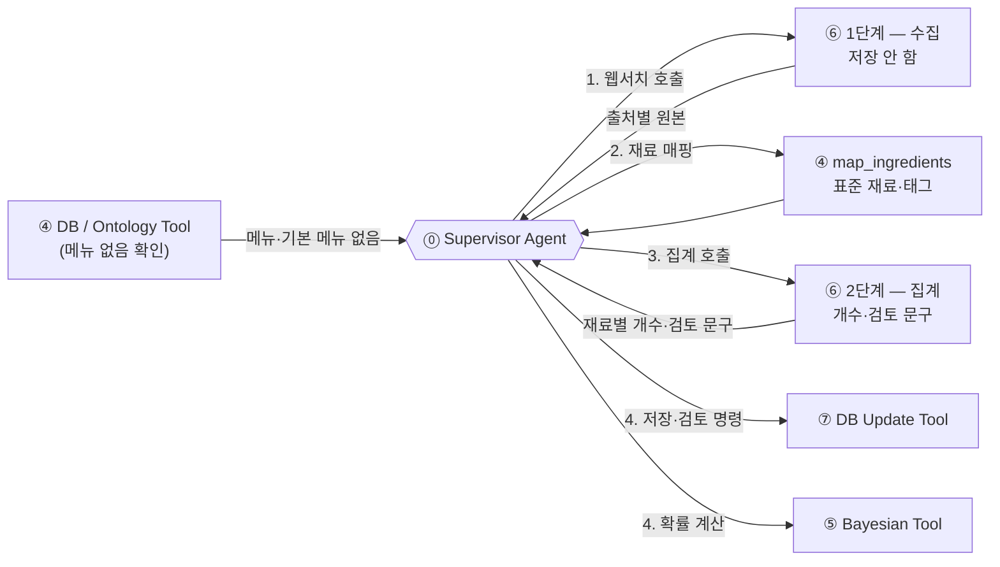
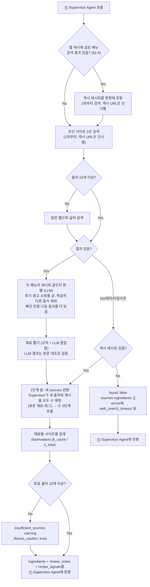

# ⑥ Web Search Agent 스펙

담당: 정유진
상태: 1단계(수집)·2단계(집계)·네이버 검색·일반 웹으로 넓히기 구현됨. ⓪ 서비스에 네이버 검색·LLM을 조립하는 일이 남음 (§7, `ai_web_search_agent/README.md`)
상위 문서: `caution-multi-agent-architecture.md`, `caution-db-schema.md`

---

## 0. ⑥ 결과의 성격 — soft evidence

⑥이 웹에서 모은 결과는 **soft evidence**(사람이 확인하지 않은 미검증 정보)다.

| 항목 | 내용 |
|---|---|
| 판정에 쓰는 법 | ⑤ 확률 계산에 바로 쓴다. 판정은 CAUTION까지이고, DANGER/SAFE는 사장님 확인값으로만 나온다 (⑧ §3, PPT 8쪽 6) |
| DB에 올리는 법 | **자동 등록이 기본**이고, 이상 신호가 잡힌 레시피만 운영자가 예(DB에 넣기)/아니오(빼기)로 정한다 (2026-10-26 회의, PPT 8쪽 "관리자 검토·승인"과 다름). 신호는 3개(다른 음식 의심·제목에 메뉴명 없음·매핑 안 된 재료), 신호가 없는 레시피는 바로 통과, 통과 레시피 30개 이상이면 DB 등록 (2026-11-02, §5 "웹 레시피 자동 등록"). 원본 기록(`web_search_cache`)은 검토 없이 저장한다. 저장은 메뉴판 분석이 끝난 뒤 한 번에 한다 (§2-4). 가게 없는 스캔은 아무것도 저장하지 않는다 (§2-4 "가게 없는 스캔") |
| 위험을 낮추는 데 쓰는가 | 쓰지 않는다. 웹 레시피에 재료가 없어도 "없음"의 근거가 되지 않는다 (`caution-db-schema.md` §5) |

주의: 기계가 혼자 추측한 데이터를 사람 검토 없이 공유 DB에 흘려보내면, 크롤링 하나가 잘못돼도 그 메뉴를 스캔하는 모든 사용자의 확률이 조용히 오염된다. 자동 등록에서는 이상 신호(§5)가 이 위험을 막는다.

**⑥은 저장 권한이 전혀 없다.**

---

## 1. 전체 흐름에서 ⑥의 위치



- **⑥ Web Search Agent**: DB에 없는 메뉴를 웹에서 조사만 한다. **DB에 아무것도 쓰지 않고, 저장 명령도 만들지 않는다.** 검색 결과(출처별 `sources`, 재료별 집계 `ingredients`)만 반환한다.

> Agent·Tool끼리 직접 호출하지 않는다. ④의 결과를 보고 ⑥을 부를지는 ⓪ Supervisor가 정하고, ⑥의 결과도 ⓪을 거쳐 다음 단계로 간다 (⓪ §0).

> **재료 태그는 ④만 붙인다** (결정, 2026-10-10 회의). ⑥은 표준 재료 매핑(`ingredient_id`)과 태그(`constraint_tags`)를 스스로 붙이지 않고, ④를 직접 부르지도 않는다. 대신 **⑥은 두 단계로 나눠 불리고, 그 사이에 Supervisor가 ④의 재료 매핑(`map_ingredients`)을 부른다** (결정, 2026-10-12).
>
> 1. **⑥ 1단계 — 수집**: 검색 → 이 메뉴의 레시피 글인지 판별 → 재료 뽑기. 출처별 원본(`sources`)을 돌려준다.
> 2. **Supervisor → ④ 매핑**: 뽑은 재료명을 표준 재료(`ingredient_id`)와 태그로 맞춘다. 예: "진간장" → 표준 재료 "간장". 맞추지 못한 재료에는 ④가 `unmapped_constraint_tags` warning을 붙인다 (④ §2-7).
> 3. **⑥ 2단계 — 집계**: ④가 맞춘 **표준 재료 기준으로** 사이트별 개수(`observations`)를 세고, 검토 문구(`review_notes`)를 만든다. 개수를 세기 전에 이름을 맞추므로 "간장"과 "진간장"이 둘로 나뉘지 않는다.
> 4. 그다음 Supervisor가 ⑦(캐시 저장·검토 명령)과 ⑤(확률 계산)로 넘긴다. 가게 없는 스캔은 ⑦을 건너뛰고 ⑤로만 넘긴다 (⓪ §1-3, §2-4 "가게 없는 스캔").
>
> 검토 자료는 ⑥이 맡고, 저장이 필요할 때 ⑦을 쓴다 (Agent·Tool끼리 직접 부르지 않으므로 Supervisor를 거친다, ⓪ §0).

> ⑥이 Agent인 이유: 검색 전략(검색어)과 근거 검토를 **판단**해야 하므로 LLM 추론 노드다 (`docs/ppt-baseline.md` 7쪽 "Agent는 판단하고 Tool은 수행한다").

**PPT 정의와의 대응**

PPT 7쪽은 ⑥을 "내부 근거가 부족하거나 DB 미등록 메뉴일 때 검색 여부, 쿼리, 출처 신뢰도를 판단하여 외부 레시피와 재료 근거를 보완"하는 Agent로 정의한다 (`조건부 검색` `출처 평가` `근거 수집`). 이 문서는 이를 다음과 같이 나눠 맡는다.

| PPT 표현 | 이 문서에서 | 담당 |
|---|---|---|
| 조건부 검색 (검색 여부) | DB 미등록이고 기본 메뉴도 없는 메뉴에만 호출 (§2). 호출 여부는 ⓪이 정한다 | ⓪ |
| 내부 근거가 부족할 때 | **다루지 않는다** (결정, 2026-10-11). 레시피 근거가 적은지 판단하는 로직은 없다. DB에 있는 메뉴는 ④·⑤ 경로로 간다 | — |
| 쿼리 | 템플릿으로 검색어를 만든다 (§3-0) | ⑥ 코드 |
| 출처 평가 / 출처 신뢰도 판단 | 이 메뉴의 레시피 글인지 판별(LLM)하고 우선 검색 사이트(§2-3-1)부터 찾는다. 신뢰도 **숫자 계산**은 하지 않는다 (#194) | ⑥ (판별), ⑦ (신뢰도 계산) |
| 근거 수집 | 레시피에서 재료를 찾고 사이트별로 개수를 센다 (§2-2, §3) | ⑥ |
| 7쪽·8쪽 4: 검색 실패 → NO_INFORMATION, 안전으로 단정하지 않음 | 웹 근거가 하나도 없으면 `found: false` → ⑧이 정보 없음으로 CAUTION (§3-2). 캐시에 웹 근거가 있으면 새 검색이 실패해도 그 근거로 판정한다 (§2-4) | ⑥, ⑧ |
| 8쪽 흐름: 웹 근거 있음 → ⑦ 새 근거 저장(관리자 페이지 업로드·검토 후 DB 갱신) → ⑤ 확률 계산 | ⑥은 저장하지 않고 결과만 돌려준다. 새로 검색한 레시피는 자동 등록이 기본이고 이상 신호가 잡힌 것만 운영자가 정한다 (2026-10-26 회의로 PPT와 다르게 함, §2-6). 판정에 쓰는 레시피는 ⑤로 간다 (§2-4). 가게 없는 스캔은 저장·검토 없이 ⑤로만 간다 | ⑦, ⑤ |
| 10쪽: `Caching` | 웹 캐시 재사용, 캐시에 있는 글은 건너뛰고 새 레시피 검색 (§2-4) | ⑥ |

---

## 2. 입력 / 출력

**JSON 형식은 [⓪ §4-5 "⑥ Web Search Agent"](0-agent-supervisor.md)에서만 정의한다** (1단계 `WebCollectRequest`·`WebCollectResponse`, 2단계 `WebAggregateRequest`·`WebAggregateResponse`, 공통 모델은 ⓪ §1-2). 이 문서에는 JSON을 다시 적지 않고, ⑥이 값을 어떻게 정하는지만 적는다. 필드를 바꾸려면 ⓪을 고친다.

**호출 조건**: ④가 `exists_in_db: false`이면서 `base_menu_id: null`을 반환한 경우에만 호출된다 (⓪ §4-5). 즉 메뉴도 없고 기본 메뉴도 찾지 못한 경우다. 차돌된장찌개처럼 기본 메뉴(된장찌개)를 찾은 변형 메뉴는 웹서치가 아니라 ④의 변형 경로로 간다. 레시피 근거가 적은지 판단하는 로직은 없으며, DB에 있는 메뉴는 웹서치를 하지 않는다 (PPT 7쪽 "내부 근거가 부족할 때"는 다루지 않음, §1).

### 2-1. 1단계(수집)에서 ⑥이 지키는 것

- `context.store_id`는 로그·추적용이다. 가게 없는 스캔이면 `null`이다 (⓪ §1-3). 웹 캐시는 가게와 무관하다. `context`는 수정하지 않고 그대로 반환한다.
- `menu.menu_id`는 DB에 없는 메뉴라 항상 `null`이다. 검색어는 `menu.normalized_menu_name`(②가 정규화한 이름)으로 만들고 `menu.locale_hint`(메뉴판 언어)를 참고한다.
- `max_sources`는 한 번 검색할 때 **새로** 모을 최대 출처 수 `10`이다 (§2-3). 캐시 레시피(`cached_sources`)는 이 수와 별개로 함께 쓴다 (§2-4).
- 검색은 **매번 1위부터** 한다. 캐시에 이미 있는 URL은 건너뛰고 그만큼 더 읽는다 (§2-4, 2026-10-27 회의). 요청·응답에 검색 순위(`next_rank`)를 담지 않는다.
- 예전 `next_rank`(다음에 읽을 순위)는 ⓪ 계약에서 지웠다 (2026-10-28). ⑦ 코드도 더 쓰지 않는다 (#354, 웹 캐시 저장의 중복 방지 키는 메뉴 이름 + 새 출처 주소 목록). ⓪ 계약의 ⑦ 저장 명령에서도 지웠다 (⓪ #368).
- 응답 `sources[]`에는 **이번에 새로 검색한 출처만** 넣는다. 출처마다 원문 재료명을 그대로 뽑고, 이름을 합치거나 개수를 세지 않는다.
- `sources[].evidence`는 항상 `evidence_class: soft`, `source_type: web_search`, `verification_status: pending_review`(사람이 아직 확인하지 않음)다. 출처 신뢰도 `reliability_weight`는 계산하지 않고 `null`로 보낸다 (#194).
- 입력 `warnings`·`errors`는 보존하고 ⑥의 신호를 덧붙인다 (§3-2).

### 2-2. 2단계(집계)에서 ⑥이 지키는 것

Supervisor가 새 출처와 캐시를 모두 ④ `map_ingredients`로 표준 재료에 맞춘 뒤(`mapped_sources`) ⑥을 다시 부른다. 출처마다 레시피 제목(`title`)도 함께 온다. 검토 규칙 2(§2-6)에 쓴다.

- **`ingredients[]`는 표준 재료 기준 개수 세기다.** 새 출처와 캐시를 합쳐 ④가 맞춘 `ingredient_id`로 묶는다. 표준 재료로 못 맞춘 재료는 버리지 않고 `ingredient_id: null`, `canonical_name`에 ⑥이 뽑은 이름 그대로 둔다. ⑤ 확률 계산의 입력이 된다.
- **`observations[]`는 사이트별로 따로 센다** (⑤ §1-1·§3-3, ④ §1-5와 같은 형식).
  - `corpus`: 우선 검색 사이트는 크롤링 코퍼스와 같은 이름(`10000recipe` / `wtable` / `semie`), 그 밖의 일반 웹 출처는 모두 `web_search`로 묶는다.
  - `n_total`: 그 사이트의 유효 레시피 수 (§2-3). 같은 사이트면 모든 재료가 같은 값이다.
  - `k_count`: 그 사이트 레시피 중 이 재료가 나온 수. 한 번도 안 나온 사이트도 `k_count: 0`으로 넣는다.
- 고정값: `source: web_search`, `depth: 0`(펼치기 전), `curated: false`(DB에 없는 메뉴라 큐레이션 레시피가 없음), `observation_basis: direct`(레시피마다 직접 셈), `anomaly_locked: false`(사장님 답변이 아님).
- `constraint_tags`와 `role`은 ④가 매핑하며 붙인 값을 그대로 옮긴다. ⑥이 새로 붙이지 않는다 (§1, ④ §2-7).
- `ingredients[].evidence_refs`는 그 재료가 나온 출처의 `evidence_id` 목록이다.
- 2단계 응답에는 출처 원본(`sources`)을 다시 넣지 않는다. 저장·검토에 쓸 새 출처 원본은 Supervisor가 1단계 응답 `sources`를 그대로 쓴다 (⓪ §4-5).
- `found`는 캐시와 새 검색 모두에서 쓸 수 있는 출처를 하나도 못 찾았을 때만 `false`다. 그때 `ingredients`는 `[]`.
- `recipe_signals[]`는 운영자가 볼 새 레시피와 그 이유다 (§5 "웹 레시피 자동 등록"). 원소는 `{evidence_id, code, message}`이고 `code`는 `other_dish_suspected`(다른 음식 의심) | `title_mismatch`(제목에 메뉴명 없음) | `unmapped_ingredient`(표준 재료로 못 맞춘 재료 있음), `message`는 한국어 한 줄이다. `evidence_id`는 이번 요청의 새 출처(`source_origin: new`)만 가리킨다. 캐시 레시피는 새로 들어왔을 때 이미 거쳤으므로 보지 않는다. 신호가 없으면 **빈 배열을 꼭 보낸다.** 칸이 빠지면 Supervisor가 새 레시피 전부를 운영자 검토로 보낸다 (⓪ §4-6). Supervisor는 신호가 잡힌 새 레시피만 운영자 검토로 보내고, 새 레시피는 신호와 관계없이 모두 캐시에 저장한다 (⓪ #368). 판정에는 쓰지 않는다.
- `review_notes[]`는 운영자에게 보여줄 검토 필요 문구다 (§2-6). `rule_code`는 걸린 규칙, `message`는 한국어 한 줄. 걸린 규칙이 없으면 `[]`. 판정에는 쓰지 않는다.
- **개수 세기는 병합·선택이 아니다.** "어느 출처를 믿을지" 고르지 않고 모든 유효 출처를 그대로 센다. 레시피를 DB에 넣을지 뺄지는 이상 신호가 잡힌 레시피만 운영자가 정한다 (§2-6). 원본은 `sources`에 남고 `ingredients[].evidence_refs`가 원본을 가리킨다.

### 2-3. 수집 개수와 중복 허용 (결정)

| 항목 | 값 |
|---|---|
| 최대 출처 수 | **한 번 검색에 10개** (`max_sources`). 캐시가 쌓인 메뉴는 판정에 더 많이 쓸 수 있다 (§2-4) |
| 최소 출처 수 | **10개**. 10개 미만이면 결과는 반환하되 `insufficient_sources` warning(`forces_caution: true`)을 붙인다 (2026-10-10 회의) |
| 중복 | **따로 구분하지 않는다.** 재료 구성이 같은 레시피도 각각 1개로 센다 (2026-10-10 회의). 복사본을 골라 표시하는 단계는 두지 않는다 (2026-10-12) |
| 유효 출처 | **이 메뉴의 레시피로 판별되고(§3 2단계) 재료가 하나 이상 뽑힌 글**만 센다. 후기·광고·다른 음식 레시피·재료 없는 글은 세지 않고, 유효 출처가 10개가 될 때까지 다음 검색 결과를 더 읽는다. 우선 사이트에서 더 없으면 일반 웹으로 넓히고(§2-3-1), 시간 제한(§2-5) 안에 못 채우면 모은 만큼 쓴다 (결정, 2026-10-23) |

**근거 1 — 팀 크롤링 데이터 시뮬레이션** (`crawling/wtable_normalized.csv`, 2026-10-08)

레시피가 30개 이상인 메뉴 11개(불고기, 삼겹살, 육개장, 떡만두국, 후라이드치킨, 김밥, 콩나물무침, 떡볶이, 오징어 순대, 간장게장, 양념게장)에서 메뉴마다 전체 레시피를 정답으로 보고, n개만 무작위로 뽑는 것을 500번씩 반복했다.

| 뽑은 레시피 수 | 핵심 재료 포착률 (레시피 절반 이상에 나오는 재료) | 20% 이상 나오는 재료 포착률 |
|---|---|---|
| 3 | 94.9% | 76.7% |
| **5** | **99.0%** | 89.2% |
| 7 | 99.8% | 94.7% |
| **10** | **100%** | **98.1%** |
| 15 | 100% | 99.6% |
| 20 | 100% | 99.9% |

- 10개면 핵심 재료를 100%, 다섯 번에 한 번 나오는 재료도 98% 잡고, 그 이후로는 거의 늘지 않는다 → 한 번 검색에서 최소·최대 10개

**최소 10개로 정한 이유 (2026-10-10 회의)**: 웹 근거만 있는 메뉴는 판정이 어차피 CAUTION이라(⑧ §3), 확률 정확도보다 **재료를 놓치지 않는 것**이 중요하다. 10개면 레시피 30% 이상에 나오는 재료를 95% 넘게 잡는다 (95% 신뢰 기준). 크롤링 대상 메뉴 76개 모두 레시피가 37개 이상 있어(가장 적은 메뉴: 약과 37개, 경단·부대찌개 51개) 10개를 모으기 어렵지 않다.

**근거 2 — 놓칠 확률 공식**: 비율 p로 나오는 재료를 출처 n개에서 한 번도 못 볼 확률은 (1−p)^n이다. 절반에 나오는 재료는 10개면 0.1%, 30%에 나오는 재료는 10개면 약 3% 놓친다. 다섯 번에 한 번 나오는 재료는 10개면 11% 놓친다. 시뮬레이션 결과와 맞는다.

**근거 3 — 3의 법칙(rule of three)**: n개 중 0번 나왔을 때 실제 비율의 95% 상한은 약 3/n이다. 10개 레시피에 소고기가 한 번도 없어도 "소고기 확률 30% 미만"까지만 말할 수 있다. 웹 결과로는 "없다"고 확신할 수 없으므로, 웹 데이터로 위험을 낮추지 않는다는 원칙(§0)과 맞는다. ([BMJ Quality & Safety](https://qualitysafety.bmj.com/content/22/12/1042))

**근거 4 — 검색 결과 품질**: 검색 클릭의 대부분은 첫 페이지(상위 10개)에 몰리고 10위 클릭률은 약 2.5%다. 10개를 넘기면 레시피가 아닌 글이 섞일 가능성이 커진다. ([Search Engine Journal](https://www.searchenginejournal.com/google-first-page-stats/374516/))

**중복을 허용하는 이유 (2026-10-10 회의)**: 많이 퍼진 레시피는 그만큼 많은 사람이 실제로 해 먹는 레시피라, 개수에 그 인기를 반영한다. 팀 크롤링 데이터(만개의레시피)에서 재료 구성이 완전히 같은 레시피는 4.8%뿐이라 영향도 작다.

**주의와 보완**: 블로그 여러 곳이 같은 레시피를 퍼 가면 레시피가 사실상 1개인데 개수가 늘어, 근거가 충분하다고 착각할 수 있다. 퍼 간 레시피에 없는 재료는 확률이 낮게 나와 FN으로 이어질 수 있다 ([Recipe1M](https://im2recipe.csail.mit.edu/im2recipe.pdf)). 이 문제는 복사본을 자동으로 골라내지 않기로 했다 (2026-10-12). 예전에는 관리자가 같은 글을 여러 번 통과시키지 않는 것으로 막았지만, 2026-10-26 회의로 자동 등록이 기본이 되어 사람이 보지 않는 레시피도 개수에 들어간다. 복사본을 이상 신호로 잡을지는 아직 정하지 않았다 (§5 "웹 레시피 자동 등록"). 웹 근거만 있는 메뉴는 어차피 CAUTION 이상이라 판정이 SAFE로 새지는 않는다.

**한계**: 사이트 1곳·메뉴 11개 실험이고, 집밥 레시피라 식당 레시피와 다를 수 있다.

### 2-3-1. 우선 검색 사이트 (결정)

아래 3개 레시피 사이트를 **우선** 검색한다.

| 사이트 | 도메인 |
|---|---|
| 만개의레시피 | `10000recipe.com` |
| 우리의식탁 | `wtable.co.kr` |
| 새미네부엌 | `semie.cooking` |

**근거**
- **재료가 목록으로 정리돼 있어 재료를 덜 놓친다.** 레시피 사이트는 재료를 따로 목록으로 적는다 (크롤러도 이 목록만 가져온다, `crawling/README.md`). 블로그·후기는 재료가 본문에 흩어져 있거나 양념을 빠뜨리는 경우가 많다. 맛집 후기·광고·쇼핑몰 글도 애초에 들어오지 않는다.
- **규모가 크거나 전문가가 만든 레시피다.**

| 사이트 | 규모 | 출처 |
|---|---|---|
| 만개의레시피 | 레시피 20만여 개, "1,000만 이용자" | [앱스토어 소개](https://apps.apple.com/kr/app/id494190282) |
| 우리의식탁 | 요리연구가·푸드스타일리스트가 만든 레시피 2,000여 개 + 커뮤니티 레시피 매달 1,000여 개, "200만 유저" | [메트로신문 2023-09](https://www.metroseoul.co.kr/article/20230921500119), [앱스토어 소개](https://apps.apple.com/kr/app/id1090371750) |
| 새미네부엌 | 샘표 우리맛 연구팀이 10년 이상 연구한 요리 500여 가지 | [세계일보 2024-08](https://www.segye.com/newsView/20240820518713) |

> 수치는 각 사이트의 자체 소개나 보도 기준이며, 최신 값은 사이트에서 다시 확인해야 한다. 만개의레시피는 규모, 우리의식탁·새미네부엌은 전문가가 만든 레시피라는 점이 강점이다.

**우선 사이트에서 레시피가 부족할 때 (결정)**
- 우선 사이트 3곳에서 모은 출처가 **10개 미만**이면 **일반 웹으로 넓혀** `max_sources`(10개)까지 채운다.
- **같은 판에서 같이 검색한다** (2026-11-02): 한 판에서 우선 사이트 후보(레시피 주소만 남긴 것)가 그 판에 읽을 수(모자란 수의 2배)보다 적으면, 모자란 만큼 블로그도 바로 검색해 함께 본문을 읽고 LLM으로 판별한다. 예전에는 우선 사이트가 바닥난 다음 판에서야 블로그를 찾아, 두 번째 판이 7초 안에 끝나지 않았다 (§6-3). 남길 때는 우선 사이트 레시피가 먼저다. 우선 사이트 후보만으로 그 판이 차면 블로그는 찾지 않는다. LLM 판별은 우선 사이트 글이든 블로그 글이든 똑같이 한다
- 일반 웹으로 넓혀도 10개 미만이면 `insufficient_sources` warning을 붙인다 (§2-3).

**검색 방법 (결정, 2026-10-28)** — 네이버 검색 API 실제 호출로 확인했다 (§5 "검색 서비스")
- **우선 사이트**: 사이트마다 웹문서 검색에 `site:{도메인}`을 붙인다. `site:`가 다른 도메인을 섞어 내므로 결과 도메인을 코드에서 다시 확인하고, **아래 레시피 주소만 남긴 뒤** 1단계 판별(§3-0)로 넘긴다. 회원 프로필·상담·목록 페이지를 읽느라 시간 제한(§2-5)을 쓰지 않기 위해서다

  | 사이트 | 남길 레시피 주소 |
  |---|---|
  | 만개의레시피 | `/recipe/{숫자}` |
  | 우리의식탁 | `/recipes/{id}` (목록 `/recipes`는 뺌) |
  | 새미네부엌 | `/cooking/id/`, `/recipe-lab/archive/`, `/semie/archive/` (`www.` 포함) |

- **우리의식탁·새미네부엌은 제목에 메뉴명이 있을 때만 후보로 둔다 (결정, 2026-11-08, ⑥ 담당)**: 두 사이트는 레시피 수가 적어 메뉴 대부분에 해당 레시피가 없는데, `site:` 검색은 비슷한 다른 음식(김치찜·미역국·팥빙수)을 돌려줘 우선 사이트 후보의 약 1/3을 차지했다(맞는 레시피 우리의식탁 8%, 새미네부엌 15%). 두 사이트 제목은 "갓김치 - 우리의식탁"처럼 음식 이름이라 제목만으로 거의 맞게 가려진다. 띄어쓰기는 무시한다. 빠진 자리는 같은 판에서 블로그가 채운다. 실제 검증에서 레시피 10개를 채운 메뉴가 6/10 → 10/10, 판별 못 하고 남은 글이 8 → 1이었다(§6-5). 만개의레시피는 제목이 자유 글이라("백종원 7분 찌개") 지금처럼 LLM이 판별한다. 코드: `collect.py` `TITLE_CHECKED_SITES`
- **일반 웹**: **블로그 검색**으로 넓힌다. `site:` 없는 웹문서 검색은 우선 사이트 결과와 겹치고, `-site:`로 우선 사이트를 뺄 수도 없다
- "우선 사이트에 더 없음"은 응답의 `total`이 아니라 실제로 받은 결과 수로 판단한다. `total`은 `site:`를 반영하지 않는다
- **본문 읽기**: 검색 API는 제목과 짧은 요약만 주므로, 남긴 글만 페이지를 열어 본문을 읽는다 (여러 글 동시에, 1.5초, §2-5). 페이지에 schema.org 레시피 데이터(`recipeIngredient`)가 있으면 그 재료 목록만 읽고, 없으면 보이는 글자를 읽는다. 네이버 블로그는 `m.blog.naver.com` 주소로 읽는다. 제때 못 읽은 글은 제목·요약만으로 재료를 찾는다
- **필요한 수의 2배를 한 번에 읽는다**: 검색·본문·LLM 한 판이 약 4.5초라, 빠진 글을 채우려는 두 번째 판은 7초 안에 거의 끝나지 않는다 (2026-10-28 실제 호출). 그래서 처음부터 모자란 수의 2배를 읽어 한 판에 10개를 채운다. 본문과 LLM은 동시에 돌아 시간은 거의 늘지 않고, 호출 수가 늘어난다. 2배를 우선 사이트만으로 못 채우면 같은 판에서 블로그로 채운다 (위)
- 사이트가 주소 모양을 바꿔 레시피 주소가 0개가 돼도 **경고를 두지 않는다**. 블로그 검색이 채우고, 웹 근거만 있는 메뉴는 CAUTION 이상이라 SAFE로 새지 않는다. 메뉴에 따라 0개인 것도 정상이라 경고는 잡음이 된다

### 2-4. 웹 캐시 재사용과 DB 승격 (결정)

DB에 없는 메뉴는 **없음 → 웹 캐시 → DB** 세 단계를 거친다.

| 단계 | 상태 | 판정 (⑧) | 다음 단계로 가는 조건 |
|---|---|---|---|
| **없음** | DB에도 `web_search_cache`에도 없음 | 이번 스캔에서 바로 웹서치한다. 성공하면 CAUTION + 확률 (`evidence_basis: estimated`), 실패하면 정보 부족으로 CAUTION (`found: false` → `evidence_basis: unknown`, §3-2) | 웹서치에 성공하면 메뉴판 분석이 끝난 뒤 결과가 `web_search_cache`에 저장됨 |
| **웹 캐시** | 웹서치 결과가 쌓이는 중 | CAUTION + 확률 (`evidence_basis: estimated`) | 통과 레시피가 **30개 이상** → DB 등록. 신호가 없는 레시피는 바로 통과, 신호가 잡힌 레시피는 운영자가 "예"를 눌러야 통과 (가게 없는 스캔은 쌓이지 않음, 아래) |
| **DB** | 통과 레시피 30개 이상으로 `menus`/`recipe_ingredients`에 정식 등록 | 피해야 할 재료가 사장님 확인으로 들어 있으면 DANGER, 모든 재료가 사장님 확인값이고 SAFE 금지 조건이 없으면 SAFE, 그 밖에는 CAUTION + 확률 (⑧ §3, PPT 8쪽 6) | — |

**웹 캐시 재사용**
- `web_search_cache`는 가게와 무관하다. 다른 사용자·다른 가게에서 같은 메뉴를 검색한 결과도 재사용한다. 웹 결과는 원래 "일반 레시피"라 누가 검색했든 의미가 같고, 가게별 정보는 사장님 확인값(③)으로 따로 다룬다.
- **같은 메뉴가 다시 나오면 1위부터 다시 검색해 캐시에 없는 새 레시피 10개를 모으고, 캐시에 쌓인 레시피와 합쳐 판정한다** (결정, 2026-10-12, 순위 대신 URL로 건너뛰기는 2026-10-27 회의). 아래 "30개를 채우는 방법".

**DB 승격**
> 2026-10-26 회의로 웹 레시피는 자동 등록이 기본이고, 이상 신호가 잡힌 레시피만 운영자가 예/아니오로 정한다. **통과**는 신호가 없는 레시피(바로 통과)와 신호가 잡혔지만 운영자가 "예"를 누른 레시피다 (2026-11-02, §5). 아래 30개 근거는 그대로다.

- **조건: 통과 레시피 30개 이상** (2026-11-02 그대로 두기로 함) (2026-10-10 회의 후 20개 → 30개, 2026-10-12 "재료 구성이 서로 다른" 조건 삭제). 운영자가 "아니오"를 누른 레시피는 DB에 올리지 않는다 (§0).
- 30개 근거: 열 번에 한 번 나오는 재료까지 95% 확률로 한 번 이상 잡는다(`(1−0.1)^30 ≈ 0.04`). 확률 수치의 95% 오차도 약 ±18%p로 줄어, DB prior로 쓸 만해진다. 20개면 다섯 번에 한 번 나오는 재료는 98.8% 잡지만(`(1−0.2)^20 ≈ 0.012`) 열 번에 한 번 나오는 재료는 88%만 잡는다. 지금 DB의 크롤링 데이터는 메뉴당 레시피가 최소 37개다.
- ⑥은 승격을 결정하거나 저장하지 않는다. 이상 신호가 잡힌 레시피의 예/아니오는 운영자가 하고 (2026-10-26 회의), 레시피 수를 세서 DB에 등록하는 것은 백엔드가 한다 (2026-10-12).
- **PPT 8쪽 흐름과 다르다 (2026-10-26 회의):** PPT는 새 근거를 관리자 페이지에 올려 검토한 뒤 DB를 갱신한다. 지금은 웹서치를 할 때마다(가게 없는 스캔 제외) **새로 검색한 레시피** 중 이상 신호가 잡힌 것만 운영자 페이지에 올라간다 (캐시에서 꺼내 쓴 레시피는 이미 거친 것이라 다시 올리지 않는다, §2-6). DB에 올리려면 근거가 충분해야 하므로 **레시피가 30개 이상 쌓였을 때** DB에 등록한다.
- DB에 올라가도 사장님 확인값이 없으면 판정은 CAUTION이다. 대신 매번 웹서치를 하지 않아 빨라지고, ④가 재료를 끝까지 펼치고(예: 액젓 → 생선) 변형 메뉴를 연결해 재료를 덜 놓친다.

**30개를 채우는 방법 — 1위부터 읽고 캐시에 있는 글은 건너뛰기 (결정, 2026-10-11 · 2026-10-27 회의로 바꿈)**

같은 검색을 반복하면 상위 결과가 거의 같아 서로 다른 레시피가 늘지 않는다. 그래서 DB에 등록되기 전까지는 메뉴가 웹서치 경로로 올 때마다 **캐시에 없는 새 레시피**를 더 모은다. 따로 백그라운드 수집은 하지 않는다.

예전에는 다음에 읽을 검색 순위(`next_rank`)를 캐시에 저장해 그 순위부터 이어 읽었다. 2026-10-27 회의에서 과정을 줄이려고 없앴다. 지금은 **매번 1위부터 읽고 캐시에 이미 있는 URL만 건너뛴다.** 저장할 순위가 없고, 검색 순위가 바뀌어도 이미 본 글을 다시 세거나 새 글을 건너뛰지 않는다. 일반 웹으로 넓힐 때 어느 검색의 순위를 저장할지(§5)도 정할 필요가 없어졌다. 대가는 이미 본 글을 검색 결과로 다시 받아 오는 것이다 (최대 30개 정도, 네이버는 한 번에 100개까지 받으므로 검색은 1번).

1. **캐시가 없으면** (처음 나온 메뉴) 1~10위를 검색해 그 결과로 판정한다.
2. **캐시가 있으면** 1위부터 "캐시 수 + 10"개를 검색해 캐시에 있는 URL은 건너뛰고 새 레시피 10개(`max_sources`)를 모은 뒤, **캐시 레시피와 합쳐 판정한다** (결정, 2026-10-12). 순위가 그대로면 두 번째는 11~20위, 세 번째는 21~30위의 글이 새로 들어온다. 우선 사이트 3곳에서 더 나올 게 없으면 일반 웹으로 넓힌다 (§2-3-1).
3. 새로 검색한 결과는 출력 `sources`에 담고, 메뉴판 분석이 끝난 뒤 캐시에 더해 저장한다 (§3 0단계). 따로 저장 경로를 만들지 않는다. 순위는 저장하지 않는다. 가게 없는 스캔은 저장하지 않는다 (아래).
4. 통과 레시피가 30개 이상 쌓이면 DB에 등록되고 (위 "DB 승격"), 그때부터 이 메뉴는 웹서치하지 않는다 (④·⑤ 경로).
5. 검색 결과가 모두 캐시에 있으면 새 레시피 없이 캐시 레시피만으로 판정한다. 새 검색이 실패·시간 초과해도 캐시 레시피만으로 판정한다. 캐시도 없을 때만 `found: false`다.

| 스캔 | 판정에 쓰는 레시피 | 새로 검색 | 캐시에 쌓인 레시피 |
|---|---|---|---|
| 1번째 | 새 검색 1~10위 (10개) | 1~10위 | 10개 |
| 2번째 | 캐시 10개 + 새 10개 (20개) | 1~20위 (캐시에 있는 1~10위는 건너뜀) | 20개 |
| 3번째 | 캐시 20개 + 새 10개 (30개) | 1~30위 (1~20위는 건너뜀) | 30개 → 통과 레시피가 30개 이상이면 DB 등록 |
| DB 등록 후 | DB 레시피 (웹서치 안 함) | — | — |

- 새 검색은 같은 스캔 안에서 메뉴 하나 7초 안에 돈다 (§2-5). 어차피 기다리는 검색이라 이번 판정에도 쓴다. 저장은 다른 결과와 함께 메뉴판 분석이 끝난 뒤 한 번에 하므로 따로 저장 경로가 필요 없다 (결정, 2026-10-12).
- 레시피가 쌓일수록 확률 근거가 늘어난다. 판정은 웹 근거만 있으면 CAUTION이라 SAFE로 새지 않는다.
- DB에 등록되기 전까지 계속 쌓으므로 캐시 유효기간은 따로 두지 않는다.

**가게 없는 스캔 (`store_id: null`, #281)**
- 웹서치는 똑같이 한다. 웹 캐시는 가게와 무관해서 읽어 쓸 수 있다 (⓪ §1-3 가게 없는 스캔 규칙이 막는 것은 가게별 확인값·가게 prior·`menu_ingredient_cache`다).
- 다만 이 스캔은 **저장 명령을 하나도 만들지 않는다** (⓪ §1-3, `persistence_commands: []`). 그래서 새로 검색한 레시피는 이번 판정에만 쓰이고, 캐시에 쌓이지 않고, 운영자 페이지에도 올라가지 않는다. 새 레시피가 캐시에 쌓이지 않으므로, 다음 스캔은 같은 글을 새 레시피로 다시 읽는다.
- ⑥이 할 일은 달라지지 않는다. ⑥은 원래 저장하지 않고 결과만 돌려준다 (§0).

---

### 2-5. 시간 제한 (결정)

사용자는 식당에서 결과를 기다리고 있다. ⑥은 메뉴 하나당 **최대 7초** 안에 끝낸다.

| 구간 | 최대 시간 |
|---|---|
| 검색 API 호출 1회 | 3초 |
| 남긴 글의 본문 읽기 1회 (여러 글 동시에) | 1.5초. 제때 못 읽은 글만 검색 제목·요약을 쓴다 (§2-3-1 "검색 방법"). 페이지는 대부분 1.1초 안에 왔다 (2026-10-28). **글마다 스레드를 쓰지 않고 비동기로 읽는다** (2026-11-08): 메뉴 5개를 동시에 돌리면 페이지 100개가 스레드 풀에 줄을 서서 29~42%가 1.5초를 넘겼고, 비동기로는 0~1%였다. 시간을 넘긴 요청은 실제로 취소된다 (§6-3) |
| LLM 호출 1회 (레시피 판별, 재료 뽑기) | 3초. 넘기면 규칙(재료 사전) 결과만 쓴다 (§3-0). **남은 시간이 2초 미만이면 부르지 않는다** (2026-11-02): LLM 응답 중간값이 1.98초라 거의 시간 초과로 끝나고, 시간 초과된 호출에도 비용이 든다. 그 글은 판별 못 한 글로 둔다. 글을 3개씩 나눠 동시에 부른다: 본문을 붙인 글 8개를 한 번에 보내면 5.6초, 3개씩 동시에는 2초였다 (2026-10-28) |
| **⑥ 전체 (메뉴 하나)** | **7초** |
| **동시에 웹서치하는 메뉴 수** | **최대 5개** (초기값) |

- 검색 API의 일시 오류는 Supervisor adapter가 7초 안에서 1번만 다시 시도한다 (⓪ §2-13). 그 밖의 재시도 판단은 ⓪이 한다 (§3-1).

**근거**: 스캔 전체 응답 목표는 30초다 (`ai_ocr/README.md` "30초 SLA"). OCR이 약 16초를 쓰면 판정 쪽에 약 12초가 남고, 그 안에서 ④⑤와 ⑧ 문장 생성도 돌아야 한다. 메뉴별로 병렬 처리하므로 ⑥에는 메뉴 하나당 7초를 쓴다. 이 계산은 Prepare(OCR)·Judge(판정) 두 단계로 나누기 전 기준이다. 지금 OCR은 Prepare에서 따로 끝나므로 7초는 Judge 단계 안에서 쓰고, Judge 단계 전체 시간은 ⓪·백엔드가 정한다 (⓪ §8). 같은 메뉴가 다시 나오면 캐시에 없는 새 레시피를 검색해 캐시와 합쳐 판정한다 (§2-4).

**메뉴판 한 장에 웹서치할 메뉴가 여러 개일 때 (결정, 2026-10-11)**
- 한 번에 최대 5개 메뉴까지 동시에 웹서치하고, 나머지는 앞 메뉴가 끝나는 대로 이어서 한다. 캐시 결과를 쓰는 메뉴는 검색하지 않으므로 이 수에 들어가지 않는다.
- 5개는 초기값이다. 검색 API 호출 한도와 LLM 호출 한도를 넘지 않으면서, 메뉴 하나 7초 기준으로 판정 단계 안에 대부분 끝나도록 잡았다. 실제 한도와 응답 시간을 보고 QA에서 조정한다.
- 판정 단계 전체 시간 안에 차례가 오지 않은 메뉴는 `found: false`, `web_search_timeout`으로 처리한다. 캐시가 있는 메뉴는 캐시로 판정하므로 해당하지 않는다. CAUTION 이상이라 SAFE로 새지 않는다.

**실측 (2026-11-05, BAZE `gpt-5.4-mini`·네이버 실제 호출)**: 메뉴 하나 웹서치는 중간값 4.9초(10개 메뉴 4.1~6.2초)로 7초 안에 끝났다. 5개를 동시에 돌려도 전체 5.1초로, 1개일 때와 거의 같다. LLM 호출 105번 중 6번은 시간 안에 답이 오지 않았지만 모든 메뉴가 레시피 10개를 채웠다. 동시 5개는 지금 값으로 충분하다. 동시 8개부터는 BAZE 호출 한도(429)에 걸렸다(§6-3).

**7초를 넘기면**
- 그때까지 모은 레시피가 있으면 **모은 만큼으로 결과를 낸다.** `warnings`에 `web_search_deadline_exceeded`(`forces_caution: true`)를 붙인다. 판정은 어차피 CAUTION이라 위험이 늘지 않고, 재료 정보를 하나라도 더 넘길 수 있다. 10개 미만이면 `insufficient_sources`도 함께 붙는다.
- 하나도 못 모았으면 `found: false`와 `web_search_timeout` 오류를 낸다. (캐시가 있는 메뉴는 캐시로 판정하므로 여기에 오지 않는다, §2-4)

> 이 7초는 백엔드 2-phase 제안의 판정(judge) 단계 타임아웃 안에 들어간다. 판정 단계 전체 값은 ⓪·백엔드와 함께 정한다.

### 2-6. 검토 자료

> **2026-10-26 회의로 전제가 바뀌었다.** 아래 규칙 7개와 화면은 "새 웹 레시피를 모두 관리자가 본다"는 전제(2026-10-12 결정)로 만들었고, 지금 코드(`ai_web_search_agent/aggregate.py`)도 이대로다. 회의 결정은 **자동 등록이 기본이고, 이상 신호가 잡힌 레시피만 운영자가 예(DB에 넣기)/아니오(빼기)로 정한다**이다. 백엔드는 레시피 승인 API 하나만 둔다. **신호는 3개로 정했다** (2026-11-02, §5 "웹 레시피 자동 등록"): 다른 음식 의심, 제목에 메뉴명 없음(아래 규칙 2를 레시피 단위로), 매핑 안 된 재료 포함(규칙 6을 레시피 단위로). 규칙 1·3·4·5·7은 운영자 페이지에 올리지 않는다. 신호는 ⑥이 계산해 응답 `recipe_signals[]`에 싣고, ⓪은 신호가 잡힌 레시피만 운영자 검토로 보낸다 (⓪ #368, 2026-11-10 ⑥ 연결). 묶음 단위 `review_notes` 칸이 ⓪ 계약에 남아 있어 규칙 7개 계산은 아직 그대로 둔다 (§7).

웹서치를 할 때마다(§2-4) ⑥은 운영자 페이지에 쓸 **검토 자료**를 만든다. ⑥은 자료만 만들고, 화면과 승인 처리는 하지 않는다. 가게 없는 스캔에서도 ⑥은 같은 자료를 만들지만, Supervisor가 저장 명령을 만들지 않아 운영자 페이지에 올라가지 않는다 (§2-4 "가게 없는 스캔").

**⑥이 만드는 것**

묶음 요약은 `ingredients[].observations`(재료별 개수)로, 레시피별 목록은 `sources[]`로 만들 수 있다. 출력에 따로 담는 것은 검토 필요 문구(`review_notes`)뿐이다 (결정, 2026-10-12).

| 항목 | 내용 |
|---|---|
| 묶음 요약 | 메뉴 이름, 레시피 수, 재료별 등장 수 (예: 소고기 15/22) |
| 레시피별 목록 | 레시피마다 제목, 링크, 뽑힌 재료 |
| 검토 필요 문구 | 출력 `review_notes[]` (§2-2). 아래 규칙에 걸린 항목을 읽기 쉬운 문장으로 정리 (예: "땅콩은 레시피 22개 중 3개에만 나와서 확인이 필요해요") |

**검토 필요 문구 — 이유도 문장도 규칙(코드)**
- 검토가 필요한 **이유는 코드가 아래 규칙으로 뽑는다.** LLM이 이유까지 정하면 매번 다르게 말하거나 중요한 경고를 빠뜨릴 수 있다.
- 처음에는 뽑힌 이유를 LLM이 읽기 쉬운 문장으로 바꾸기로 했으나, **하지 않는다** (2026-11-02). 운영자 페이지에는 레시피별 이상 신호 3개만 올라가고(§5), 신호 문구는 코드가 만든다(`recipe_signals()`). 규칙 7개의 문구도 지금처럼 코드 문장 그대로 둔다.

| 분류 | # | 규칙 | 기준 (초기값) | 왜 필요한가 |
|---|---|---|---|---|
| **A. 같은 음식이 맞나** | 1 | 일반 웹 출처 포함 | 우선 검색 사이트(§2-3-1)가 아닌 도메인의 출처가 1개 이상 | 후기·광고가 섞였을 수 있다 |
| | 2 | 레시피 제목이 메뉴명과 다름 | 제목에 메뉴명이 없는 레시피 | 다른 음식(예: 마라탕 ↔ 마라샹궈)이 섞였을 수 있다 |
| | 3 | 레시피끼리 재료가 너무 다름 | 레시피 절반 이상에 나오는 재료가 3개 미만 | 서로 다른 음식이 섞였다는 신호다 |
| **B. 재료가 제대로 뽑혔나** | 4 | 드물게 나온 재료 | 레시피 1~2개에만 나온 재료 | 잘못 뽑혔거나 특이한 레시피의 재료일 수 있다 |
| | 5 | LLM만 찾은 재료 | 규칙(재료 사전)은 못 찾고 LLM만 찾은 재료 | 지어낸 재료인지 확인한다 |
| | 6 | 표준 재료 매핑 실패 | ④ 매핑에서 표준 재료로 맞추지 못한 재료 (`unmapped_constraint_tags`) | 태그가 없어 위험을 놓칠 수 있다. **C에도 함께 표시한다** |
| **C. 위험 재료를 놓치지 않았나** | 7 | 위험 태그 재료가 일부에만 나옴 | ④가 알레르기·종교·채식 태그를 붙인 재료가 레시피 절반 미만에 나옴 | 넣으면 과잉 경고, 빼면 FN이라 사람 판단이 필요하다 |

- 규칙별 `rule_code` (출력 `review_notes[].rule_code`): 1 `general_web_source`, 2 `title_mismatch`, 3 `inconsistent_recipes`, 4 `rare_ingredient`, 5 `llm_only_ingredient`, 6 `unmapped_ingredient`, 7 `risky_ingredient_partial`
- 검토 문구는 A → B → C 순서로 보여준다. 이 묶음이 맞는 음식인지 먼저 보고, 재료를 정리한 뒤, 위험 재료를 마지막에 확인하는 순서다.
- 규칙 1은 출처 링크의 도메인으로 판단한다. ⑥ 출력에 별도 표시 필드는 두지 않는다.
- **규칙은 이번에 새로 검색한 레시피만으로 계산한다** (결정, 2026-10-12). 검토는 이번 묶음을 대상으로 하므로 그 묶음에 대한 경고여야 한다. 대상은 이번에 새로 검색한 `sources`다. 캐시에서 받은 레시피는 이미 이전에 올라갔으므로 다시 계산하지 않는다. 예: "레시피 1~2개에만 나온 재료"는 이번 10개 기준이다.
- **규칙 6·7은 ④ 매핑 결과가 있어야 판단할 수 있다.** 그래서 검토 문구는 ⑥ 2단계에서 만든다. 2단계는 ④ 매핑 뒤에 불리므로 태그와 매핑 실패 여부를 알 수 있다 (§1, 결정 2026-10-12).
- 기준 숫자는 초기값이며, 실제 검토 결과를 보고 조정한다.

**⑥ 범위 밖 — 운영자 화면과 승인 처리 (⑦·백엔드·프론트에 전달)**

2026-10-26 회의 결정:
- 운영자 페이지에는 **이상 신호가 잡힌 레시피만** 올라간다. 신호가 없는 레시피는 자동으로 등록된다.
- 운영자는 레시피마다 **예(DB에 넣기) / 아니오(빼기)** 를 누른다. 화면에는 메뉴, 걸린 신호와 이유, 레시피 제목·출처·재료를 보여준다 (#328 화면 예시).
- 백엔드는 레시피 승인 API 하나만 둔다.
- 운영자 페이지에서는 재료를 고치지 않는다. 레시피를 넣고 빼는 것만 한다. 그래서 위험 재료를 임의로 지우는 일이 생기지 않는다. 표준 재료로 못 맞춘 재료(신호 "매핑 안 된 재료 포함")는 담당자가 재료 사전을 직접 고쳐 맞출 수 있다 (2026-11-02).

회의 전 안(묶음 요약, 전체 통과·레시피별 통과·반려, 통과된 레시피만 세어 30개에 등록)은 쓰지 않는다. 등록 조건은 §2-4 "DB 승격"과 §5에서 정한다.

---

## 3. 처리 로직




0. `web_search_cache`에 같은 메뉴의 레시피가 있으면 1위부터 다시 검색해 캐시에 없는 레시피를 더하고 캐시 레시피와 합쳐 판정한다 (§2-4). 다른 사용자·다른 가게의 검색 결과도 재사용한다. **⑥은 DB를 직접 조회하지 않는다.** 판정(judge) 도중에는 DB를 부르거나 저장하지 않으므로, 캐시 결과는 백엔드가 judge 요청에 담아 넘긴다. 새로 검색한 결과도 judge 결과에 담아 두고, 메뉴판 분석이 끝난 뒤 백엔드가 한 번에 저장한다 (결정, 2026-10-10 회의). 가게 없는 스캔은 캐시를 읽기만 하고 저장하지 않는다 (§2-4).
1. `menu.normalized_menu_name`으로 우선 검색 사이트 3곳(§2-3-1)에서 검색한다. 매번 1위부터 읽고 캐시에 있는 URL은 건너뛴다 (새 레시피 최대 `max_sources`개, §2-4). 모은 출처가 10개 미만이면 일반 웹으로 넓힌다. 실패·타임아웃이면 캐시 레시피만으로 진행하고, 캐시도 없으면 `found: false`.
2. **(LLM)** 검색된 글마다 **이 메뉴의 레시피 글인지** 판별한다 (결정, 2026-10-23). 맛집 후기·광고·쇼핑몰 글은 제외한다. 다른 음식 레시피는 **확실히 다른 음식일 때만** 제외한다. 예) 김치찌개 검색에 김치찜·김치볶음밥 레시피. 제목이 다른 음식을 가리키면 재료가 겹쳐도 다른 음식이다(애호박찌개, 김치쌀국수). 재료를 더하거나 바꾼 같은 음식(참치김치찌개)은 같은 음식이다 (2026-10-28, 실제 호출에서 프롬프트 보강). **애매하면 남기고** 검토 규칙 2(§2-6)로 넘긴다. 진짜 레시피를 잘못 빼면 그 레시피에만 있던 재료를 놓칠 수 있어서다 (FN). 빠진 글은 유효 출처로 세지 않고, 10개가 될 때까지 다음 결과를 더 읽는다 (§2-3).
2-1. **(규칙 + LLM)** 레시피 글에서 재료를 뽑는다. 규칙(재료 사전)과 LLM이 각각 뽑고, **둘 중 한쪽이라도 찾은 재료는 모두 남긴다** (§3-0).
2-1-1. **음식 종류 이름은 재료로 세지 않는다** (2026-11-07). 본문에 제목도 같이 읽어서, 백김치·파김치의 "김치"나 후라이드치킨의 "치킨"이 재료로 잡혔다. ④는 "김치"를 배추김치로 맞춰 파김치 레시피 전부에 배추김치가 들어간 것처럼 셌다. 그래서 메뉴 이름이 "꾸밈말 + 음식 종류"이면 끝의 음식 종류 이름은 메뉴 이름 밖에도 따로 나올 때만 센다(`collect.py` `drop_dish_name()`). 메뉴 이름 앞의 재료(김치찌개의 김치)와, 메뉴 이름이 곧 재료 이름인 경우(순대·곰탕: 순대는 돼지고기 태그를 가짐)는 그대로 센다. 메뉴 25개 결과에서 이 이름을 모두 빼 봐도 ④ 태그 기준으로 빠지는 알레르기 태그가 없었다
2-2. 출처마다 `source_url`, `title`, `fetched_at`, 재료 목록을 정리하고 `evidence`를 붙인다. **저장 명령은 만들지 않는다.**
3. **(1단계 끝)** `sources`(출처별 원본과 뽑은 재료명)를 Supervisor에 돌려준다. Supervisor가 ④ `map_ingredients`로 재료명을 표준 재료와 태그로 맞춘 뒤 ⑥ 2단계를 부른다 (§1).
4. **(2단계)** ④가 맞춘 **표준 재료 기준으로** 묶고, **출처 사이트별로** `k_count`(그 사이트에서 나온 레시피 수)와 `n_total`(그 사이트의 유효 레시피 수)을 세어 `observations`에 담는다. 우선 사이트 밖의 출처는 `web_search` 하나로 묶는다.
5. 유효 출처가 10개 미만이면 `insufficient_sources` warning을 붙인다. 결과는 버리지 않고 반환한다.
5-1. 검토 규칙 1~7(§2-6)을 확인해 `review_notes`를 만든다.
5-2. 새 레시피마다 이상 신호 3개(§5)를 확인해 `recipe_signals`를 만든다. 신호가 없으면 빈 배열이다.
6. `ingredients`, `review_notes`, `recipe_signals`를 ⓪ Supervisor Agent에 반환한다. 새 출처 원본은 1단계 응답 `sources`로 이미 넘겼다. 저장은 ⑥의 일이 아니다. 저장·검토 명령은 Supervisor가 ⑦을 불러 만든다. 가게 없는 스캔은 ⑦을 부르지 않는다 (⓪ §1-3).

**fallback**: 캐시도 없고 웹서치도 실패하면 "정보 없음"(`NO_INFORMATION`) 상태로 CAUTION 이상 처리 — SAFE로 떨어뜨리지 않는다 (FN-minimization 원칙, `docs/ppt-baseline.md` 8쪽 "4 정보 부족→보수적 판정").

### 3-0. LLM이 맡는 일과 코드가 맡는 일

PPT 7·8쪽은 ⑥을 "검색 전략 수립·근거 검토"를 하는 Agent로 정의한다. 모델은 **저가 모델**을 쓴다 (PPT 10쪽 "Web Search Agent — 저가 모델"). 참고로 PPT 10쪽의 ⑥ 설명 문장("메뉴명 오탈자 보정 및 옵션 분리")은 ② 설명과 같아 작성 실수로 보며, ⑥의 역할은 7쪽 정의를 따른다. LLM은 **문맥을 읽어야 하는 판단**에만 쓰고, 정해진 규칙대로 하면 되는 일은 코드가 맡는다. LLM을 많이 쓸수록 느려지고 결과가 매번 달라질 수 있기 때문이다. 모델·프롬프트·재시도 같은 공통 규칙은 `agent-implementation-guide.md` §5를 따른다.

| 단계 | 담당 | 이유 |
|---|---|---|
| 캐시 확인 | 코드 | judge 요청에 담겨 온 캐시 레시피를 확인 (DB 조회 아님) |
| 검색어 만들기 | 코드 (템플릿) | 한글 메뉴는 "{메뉴} 레시피" 같은 템플릿으로 충분하다. |
| 검색 실행, 시간 제한, 우선 사이트 검사 | 코드 | 정해진 절차 (§2-3-1) |
| **이 메뉴의 레시피 글인지 판별** | **LLM** | 맛집 후기·광고·쇼핑몰 글과 다른 음식 레시피(예: 김치찌개 ↔ 김치찜)를 걸러내는 건 문맥 판단이다. 단어("재료", "레시피") 포함 여부나 제목 글자 비교만으로는 후기도 통과하고, 제목에 메뉴명이 없는 진짜 레시피는 빠진다. 확실히 다른 음식일 때만 빼고 애매하면 남긴다 |
| **재료 뽑기** | **규칙 + LLM** | 규칙(재료 사전)은 아는 재료를 빠르고 일정하게 잡고, LLM은 사전에 없는 재료를 추가로 잡는다. 둘의 **합집합**을 쓴다 |
| LLM 결과 검증 | 코드 | 실제 검색 결과에 없는 URL은 버린다. LLM만 찾은 재료는 **본문에 실제로 있을 때만** 남긴다 (지어낸 재료 방지) |
| 검토 문구·이상 신호 (§2-6, §5) | 코드(규칙). 문장 LLM은 하지 않음 (2026-11-02) | 이유까지 LLM이 정하면 중요한 경고를 빠뜨릴 수 있다. 운영자에게는 신호 3개만 올라가 문장을 다듬을 일이 없다 |
| 표준 재료 매핑·태그 붙이기 | **⑥이 하지 않음** — ⑥ 1단계와 2단계 사이에 Supervisor가 ④ `map_ingredients`를 부른다 | 태그는 ④만 붙인다 (§1). 매핑 실패 warning도 ④가 붙인다 |
| 개수 세기, 10개 미만 경고 | 코드 | 정해진 규칙 (§2-3) |

**재료 뽑기 — 규칙 + LLM 합집합**
- **합집합을 쓰는 이유:** 둘 다 찾은 재료만 남기면 한쪽이 놓친 재료가 사라져 FN이 생긴다.
- **LLM이 실패·시간 초과해도** 규칙 결과는 남는다. 재료가 통째로 사라지지 않는다.
- **규칙(재료 사전)이 문법 어미를 재료로 읽지 않게 한다** (2026-11-12). 사전은 본문 전체를 훑기 때문에 "여름이라면"·"아니라면"의 "라면"을 재료로 잡아, 돼지고기 태그가 붙은 라면이 콩국수·닭강정·호두과자에 들어갔다(실제 한 사이클 실험). 그래서 `라면`은 긴 단어의 **끝**에서 "이·니·다·으" 바로 뒤에 올 때만 건너뛴다(`dictionary.py` `GRAMMAR_ENDINGS`). "신라면"·"라면사리"·"라면 1개"는 그대로 잡는다. "몇 가지"의 "가지"도 같은 종류지만 가지는 위험 태그가 없어 두었다.
- **LLM만 찾은 재료**는 본문에 그 단어가 있어야 남긴다. 표준 재료 매핑은 Supervisor가 부른 ④가 하며, 매핑되지 않으면 ④가 `unmapped_constraint_tags` warning(`forces_caution: true`)을 붙인다 (④ §2-7). 태그 없이 넘어가면 ⑧이 SAFE를 낼 수 있기 때문이다.

### 3-1. ⑥이 하지 않는 것

| 하지 않음 | 담당 |
|---|---|
| DB 저장, 저장 명령 생성 (`web_search_cache`, 정식 메뉴 등록) | ⑥ 범위 밖 |
| 여러 후보 중 어느 걸 믿을지 병합/선택 | ⑥ 범위 밖. 이상 신호가 잡힌 레시피의 예/아니오는 운영자 (§2-6) |
| 출처 신뢰도(`reliability_weight`) 계산 | ⑥ 범위 밖 (#194) |
| 확률 계산 | ⑤ Bayesian Tool |
| 재호출/재시도 여부 판단 | ⓪ Supervisor Agent |
| DANGER/CAUTION/SAFE 판정 | ⑧ Decision Policy / XAI Agent |

### 3-2. 예외 처리

| 상황 | 처리 |
|---|---|
| 검색 실패, 또는 7초 안에 레시피를 하나도 못 모음 | (캐시가 없는 메뉴) `found: false`, `sources: []`, `ingredients: []`. `errors`에 `web_search_timeout`(`retryable: true`, `fallback: no_information`)을 넣는다. 재시도 여부는 ⓪이 정한다 |
| 검색 키가 없음 (개발·테스트 환경) | 검색 자체를 하지 않았다는 것을 실제 실패와 구분한다 (#120). 키가 없으면 검색기 자리에 `UnconfiguredSearchProvider`를 두고, 검색할 때 `SearchNotConfiguredError`를 낸다. (캐시가 없는 메뉴) `found: false` + `errors`에 `web_search_not_configured`(`retryable: false` — 다시 해도 결과가 같다, `fallback: no_information`). (캐시가 있는 메뉴) 캐시로 판정하고 `warnings`에 `web_search_not_configured`(`forces_caution: false`). 판정 경로는 검색 실패와 같다 |
| 7초를 넘겼지만 모은 레시피가 있음 | 모은 만큼으로 결과를 반환하고 `warnings`에 `web_search_deadline_exceeded`(`forces_caution: true`)를 붙인다 (§2-5) |
| 웹 캐시를 못 가져옴 (`web_search_cache.status: unavailable`, 백엔드 조회 실패) | 캐시가 없다고 단정하지 않는다. 받은 캐시 레시피 없이 새로 검색하고, 백엔드가 붙인 warning은 그대로 보존한다 (⓪ §1-3 KnowledgeBundle 표) |
| 유효 출처 10개 미만 | 결과는 그대로 반환하고 `warnings`에 `insufficient_sources`(`forces_caution: true`)를 붙인다. ⑧은 이 경고가 있으면 SAFE를 내지 않는다 |
| 재료 구성이 같은 레시피 여러 개 | 구분하지 않고 각각 센다 (§2-3). 원본은 `sources`에 남긴다 |
| 재료를 하나도 뽑지 못한 출처 | 유효 출처로 세지 않는다 |
| 다른 음식 레시피가 섞임 (예: 김치찌개 검색에 김치찜) | LLM이 확실히 다른 음식이라고 판별한 글만 빼고, 빠진 만큼 다음 결과로 채운다. 애매하면 남겨 검토 규칙 2(§2-6)로 넘긴다 |
| LLM 호출 실패·시간 초과, 남은 시간 2초 미만이라 부르지 않음 | 규칙(재료 사전)으로 뽑은 결과만 반환한다. 남긴 레시피의 절반 이상이 판별 못 한 글이면 `warnings`에 `web_llm_extraction_failed`(`forces_caution: true`)를 붙인다 (2026-11-02). 판별 못 한 글은 **제목에 메뉴명이 있을 때만** 후보로 둔다 (2026-11-08, §6-3) |
| LLM이 뽑은 재료가 본문에 없음 | 버린다 (지어낸 재료 방지) |
| LLM만 찾은 재료가 표준 재료로 매핑되지 않음 | 재료는 남긴다. 매핑은 ④가 하며, 실패하면 ④가 `unmapped_constraint_tags` warning(`forces_caution: true`)을 붙인다 |

오류·경고 형식은 [⓪ §1-2 `NodeError`·`NodeWarning`](0-agent-supervisor.md)을 따른다. 위 `web_search_timeout` 예시도 ⓪ §1-2에 있다.

---

## 4. 테스트 케이스

| # | 입력 | 기대 동작 | 검증 포인트 |
|---|---|---|---|
| 1 | 웹서치 성공 (마라탕) | `found: true` + `sources` + `ingredients` 반환 | ⑥ 출력에 저장 명령이 없을 것. `menus`/`recipe_ingredients`는 미반영일 것 |
| 2 | 웹서치 실패/타임아웃 | `found: false`, `sources: []`, `ingredients: []`, `errors`에 `web_search_timeout` | ⑧이 "완전 정보 없음" 경로로 감 |
| 3 | 만개의레시피 5개 중 3개, 우리의식탁 3개 중 1개, 일반 웹 2개 중 0개에 소고기 | 소고기 `observations`: `10000recipe` 3/5, `wtable` 1/3, `web_search` 0/2 | 사이트별 개수가 맞고, 안 나온 사이트도 `k_count: 0`으로 들어갈 것 |
| 4 | 출처 10개 중 3개가 재료 구성이 같은 레시피 | 사이트별 `n_total` 합이 10, 최소 개수 충족 | 같은 구성의 레시피도 각각 셀 것 |
| 5 | 유효 출처 8개 | 결과 반환 + `insufficient_sources` warning(`forces_caution: true`) | 결과를 버리지 않고, SAFE를 막는 신호를 보낼 것 |
| 6 | 정상 결과 | 모든 `sources[].evidence.reliability_weight`가 `null` | ⑥이 출처 신뢰도를 계산하지 않을 것 |
| 7 | 검색 결과에 맛집 후기 글 섞임 | 후기 글은 유효 출처에서 제외 | LLM 레시피 판별이 동작할 것 |
| 8 | 재료 사전에 없는 재료(예: 마라소스)가 본문에 있음 | LLM이 찾아 결과에 포함 | 규칙만으로 놓치는 재료가 남을 것 |
| 9 | LLM이 본문에 없는 재료를 반환 | 그 재료는 버림 | 지어낸 재료가 결과에 들어가지 않을 것 |
| 10 | LLM 시간 초과 | 규칙 결과만 반환 + `web_llm_extraction_failed` warning | 재료가 통째로 사라지지 않을 것 |
| 11 | 우선 사이트 레시피 3개 | 일반 웹으로 넓혀 최대 10개까지 채움 | 레시피가 부족하면 일반 웹으로 넓힐 것 |
| 12 | 우선 사이트 레시피 10개 (한 판에 읽을 20개보다 적음) | 같은 판에서 블로그도 검색하지만, 우선 사이트 10개가 모두 유효하면 블로그 글은 쓰지 않음. 우선 사이트 후보로 판이 차면 블로그를 찾지 않음 | 우선 사이트 레시피가 먼저이고, 두 번째 판 없이 한 판에 끝날 것 (2026-11-02) |
| 13 | 7초까지 레시피 3개만 모음 | 3개로 결과 반환 + `web_search_deadline_exceeded` + `insufficient_sources` warning | 시간 초과여도 모은 결과를 버리지 않을 것 |
| 14 | 7초까지 레시피 0개 | `found: false` + `web_search_timeout` | 정보 없음 경로로 갈 것 |
| 15 | 웹서치 결과, 땅콩(`is_peanut`)이 22개 중 3개에만 나옴 | 검토 문구 C에 땅콩 표시 | 위험 태그 재료가 검토 문구에서 빠지지 않을 것 |
| 16 | (필요 없어짐, 2026-11-02) 검토 문구 생성 중 LLM 실패 | — | 검토 문구를 LLM으로 만들지 않기로 했다 (§2-6) |
| 17 | 같은 메뉴 2번째 웹서치, 캐시에 1~10위 레시피 10개 | 1위부터 20개를 검색해 캐시 URL 10개는 건너뛰고, 새 10개를 캐시 10개와 합쳐 20개로 판정. `sources`에는 새 10개만 | 저장된 순위 없이 캐시 레시피를 다시 세거나 `sources`에 넣지 않을 것 (2026-10-27 회의) |
| 18 | 캐시 레시피 10개 + 새 검색 실패 | 캐시 10개로 판정 (`found: true`) | 캐시가 있는데 정보 없음으로 떨어지지 않을 것 |
| 18-a | 검색 키 없음, 캐시 없음 / 캐시 있음 (#120) | `found: false` + `web_search_not_configured`(`retryable: false`) 오류 / 캐시로 판정 + 같은 코드 warning(`forces_caution: false`) | 검색 키가 없는 것과 검색했는데 실패한 것(`web_search_timeout`, `retryable: true`)이 구분될 것 |
| 18-b | 웹 캐시를 못 가져옴 (`web_search_cache.status: unavailable`, #121) | 캐시 없이 1위부터 새로 검색, ⓪이 붙인 `knowledge_slice_unavailable` warning(`forces_caution: true`) 보존 | 캐시가 없다고 단정하지 않고, 조회 실패 신호를 지우지 않을 것 (§3-2) |
| 19 | 가게 없는 스캔(`store_id: null`) + 캐시 레시피 10개 | 1위부터 검색해 캐시 URL을 건너뛰고 캐시와 합쳐 판정, `sources`에는 새 10개만. ⑥ 출력은 가게 있는 스캔과 같음 | 웹 캐시는 그대로 읽어 쓸 것. 저장·운영자 검토가 없는 것은 Supervisor 몫이다 (⓪ 테스트 2-a) |
| 20 | 김치찌개 검색 결과 10개 중 3개가 김치찜 레시피 | 김치찜 3개는 제외하고 다음 결과를 더 읽어 김치찌개 레시피 10개를 채움 | 다른 음식이 이번 판정에 섞이지 않고, 유효 출처 수가 줄지 않을 것 |
| 21 | 제목에 메뉴명이 없지만 본문은 김치찌개 레시피 ("엄마표 얼큰 찌개") | 남김 (검토 규칙 2에는 표시) | 애매한 레시피를 빼서 재료를 놓치지 않을 것 |
| 22 | 판별 LLM 실패 | 제목에 메뉴명이 있는 글을 남김 + `web_llm_extraction_failed` warning. 일부 호출만 실패하면 판별된 레시피로 먼저 채우고, 판별 못 한 글은 모자랄 때만, 제목에 메뉴명이 있을 때만 넣음 (warning은 남긴 레시피의 절반 이상이 판별 못 한 글일 때만, 2026-11-02 / 제목 조건 2026-11-08) | LLM이 없어도 레시피가 통째로 빠지지 않고, 판별 못 한 다른 음식(김치찌개 검색의 김치찜)이 섞이지 않을 것 |
| 23 | 파김치 메뉴, 제목 "파김치 담그기", 본문에 "김치"가 따로 없음 | "김치"를 재료로 세지 않음. 순대 메뉴의 "순대", 김치찌개의 "김치"는 셈 | 음식 종류 이름이 재료로 세지지 않고, 메뉴 이름이 곧 재료인 경우와 앞쪽 재료는 놓치지 않을 것 (2026-11-07) |
| 24 | 김치찌개 새 레시피 10개 중 1개는 제목에 메뉴명이 없고, 1개는 다른 레시피에 흔한 재료(김치·두부·양파)가 하나도 없고, 1개는 표준 재료로 못 맞춘 재료(마라소스)가 있음 | `recipe_signals`에 그 3개만 각각 `title_mismatch`·`other_dish_suspected`·`unmapped_ingredient` | 운영자에게 문제 있는 레시피만 올라갈 것 (§5) |
| 25 | 24번 입력에서 신호가 하나도 없음 / 캐시 레시피에만 이상 있음 | `recipe_signals: []` (칸은 빠지지 않음) | 빈 배열로 "검토할 레시피 없음"을 알리고, 캐시 레시피를 다시 올리지 않을 것 |
| 26 | 김치찌개 새 레시피 중 1개는 매핑 안 된 재료가 조미료·야채·반죽뿐, 1개는 여기에 "고기"도 있음 | 뒤의 1개만 `unmapped_ingredient` (문구에 "고기"만) | 일반 단어로 운영자 검토가 늘지 않고, 돼지고기일 수 있는 "고기"는 운영자가 볼 것 (2026-11-12) |
| 27 | 본문 "여름이라면 시원하게, 아니라면 따뜻하게" / "신라면 1봉지", "라면사리 넣고 라면을 끓인다" | 앞은 재료 없음, 뒤는 라면·라면사리 | 어미 "라면"이 돼지고기 태그 재료로 들어가지 않고, 진짜 라면은 놓치지 않을 것 (2026-11-12) |

---

## 5. 미확정 항목 (팀 확인 대기)

- [x] **수집 개수·중복** — 한 번 검색에 최소·최대 10개. 같은 구성의 레시피도 각각 센다 (2026-10-10 회의). 복사본 표시 단계는 두지 않는다 (2026-10-12, §2-3)
- [x] **관리자 확인 방식** — 웹서치할 때마다 관리자 페이지에 올림, 묶음 요약 기본 + 레시피별 통과·제외, 검토 필요 문구(이유는 규칙, 문장은 LLM), 관리자는 재료를 직접 고치지 않음 (§2-6). **2026-10-26 회의로 바뀜**: 자동 등록이 기본이고 이상 신호가 잡힌 레시피만 운영자가 예/아니오 (아래 "웹 레시피 자동 등록")
- [x] **규칙 추출용 재료 사전 출처** — 크롤링 데이터로 만든다 (2026-10-25): 표준 재료 324개(`crawling/ingredient_taxonomy.csv`)와, 크롤링 레시피에서 그 재료를 가리킨 원문 이름 중 두 번 이상 나오고 수량·메모가 섞이지 않은 것. 파일은 `ai_web_search_agent/data/ingredient_dictionary.csv`. 사전은 이름을 **찾기만** 하고, 표준 재료 매핑은 ④가 같은 `crawling/normalize_ingredients.py` 규칙으로 한다 (§3-0). 사전에 없는 재료는 LLM이 찾는다
- [x] **웹 결과와 기존 DB 값이 다를 때 우선순위** — 해당 없음. ⑥은 DB에 없는 메뉴에만 불리고(§2), DB에 등록되면 그 메뉴는 웹서치를 하지 않는다(§2-4). 한 메뉴에 웹 값과 DB 값이 동시에 쓰이는 경우가 없다 (2026-10-12, #170)
- [x] **웹 캐시 재사용과 DB 승격 기준** — 다른 사용자의 캐시도 재사용, 관리자가 통과시킨 레시피가 30개 이상이면 DB 등록 (2026-10-10, 2026-10-12 "서로 다른" 조건 삭제, §2-4). 등록 조건은 2026-10-26 회의로 다시 정하는 중 (아래 "웹 레시피 자동 등록")
- [x] **메뉴판 1장당 여러 unknown 메뉴가 나올 때 ⑥ 호출 배치 전략** — 동시에 최대 5개(초기값), 나머지는 이어서. 판정 단계 시간 안에 못 끝난 메뉴는 `found: false` (2026-10-11, §2-5)
- [x] **LLM이 맡는 부분과 코드가 맡는 부분 구분** — LLM은 레시피 글 판별과 재료 뽑기(규칙과 합집합)에만 쓰고 나머지는 코드 (§3-0)
- [x] **검색할 사이트 범위** — 만개의레시피·우리의식탁·새미네부엌 3곳을 우선 검색 (§2-3-1)
- [x] **우선 사이트에서 레시피가 부족할 때** — 10개 미만이면 일반 웹으로 넓힌다 (§2-3-1)
- [x] **⑥ 시간 제한** — 메뉴 하나당 7초 (검색 API 3초, LLM 3초). 넘기면 모은 만큼 반환 (§2-5). 2-phase 판정 단계 전체 타임아웃은 ⓪·백엔드와 함께 정한다
- [x] **캐시 확인 주체와 저장 시점** — 백엔드가 judge 요청에 캐시 결과를 담아 넘기고, 새 검색 결과는 judge 결과에 담아 메뉴판 분석이 끝난 뒤 한 번에 저장한다. judge 도중 DB 호출·저장 없음 (2026-10-10 회의, §3 0단계)
- [x] **캐시 재사용과 반복 검색** — 검색할 때마다 캐시에 없는 새 레시피 10개를 가져와 캐시 레시피와 합쳐 판정하고 (2026-10-27 회의로 순위 대신 1위부터 읽고 캐시 URL만 건너뜀), 새 레시피는 분석이 끝난 뒤 캐시에 더해 저장한다. 백그라운드 추가 수집과 캐시 유효기간은 두지 않는다. DB 등록 전까지 계속 (2026-10-11, 2026-10-12 판정 포함으로 변경, §2-4)
- [x] **새 레시피 검색을 언제 돌릴지** — 같은 스캔 안에서 돌리고 이번 판정에도 쓴다. 저장은 분석이 끝난 뒤 한 번에 하므로 따로 경로가 필요 없다 (2026-10-12, §2-4)
- [x] **통과된 레시피 30개를 누가 세서 DB에 등록할지** — 백엔드. 관리자 승인은 AI 판정 흐름 밖에서 일어나므로, 백엔드가 메뉴별 통과 레시피 수를 세다가 30개가 되면 등록한다. ⑥은 레시피를 모아 주기만 한다 (2026-10-12, #170)
- [x] **출처 신뢰도 가중치를 ⑥에서 어디까지 판단할지** — ⑥은 계산하지 않고 `reliability_weight: null`로 보낸다 (2026-10-06, #194)
- [x] **재료 태그(`constraint_tags`)를 누가 붙일지** — ④가 모두 붙인다. 웹 재료를 표준 재료로 매핑하는 일도 ④가 한다. ⑥이 ④를 직접 부르지 않고 ⑥ 1단계와 2단계 사이에 Supervisor가 ④ `map_ingredients`를 부른다 (2026-10-10 회의, §1, ④ §2-7). PPT 7쪽이 위험 속성 매핑을 ④의 역할로 정의한 것과 같다
- [x] **④ 매핑 후 같은 재료로 합쳐질 때 개수 다시 세기** — 순서를 바꿔 해결: ⑥ 1단계(수집) → ④ 매핑 → ⑥ 2단계(표준 재료 기준으로 개수 세기). 처음부터 "간장 10/10"으로 센다 (2026-10-12, §1)
- [x] **관리자 검토 규칙 6·7을 붙이는 시점** — ⑥ 2단계에서 ④ 결과로 판단한다. 관리자 검토 자료는 ⑥이 맡고, 저장할 때 ⑦을 쓴다 (2026-10-12, §1, §2-6)
- [x] **검색 서비스(provider)** — **네이버 검색 API** (2026-10-13). 한국어 레시피 글이 많이 잡히고 무료 한도가 커서 비용 부담이 없다. 구현 단계로 넘김 (#254): 우선 사이트 3곳(§2-3-1)만 골라 검색(`site:`)이 되는지 실제 API로 확인하고, 안 되면 대안을 정한다. 검색 1회 3초, 동시 5개(§2-5)가 호출 한도 안에 드는지도 #254에서 확인한다
  - **`site:` 확인 결과 (2026-10-28)** — 네이버 클라우드 NAVER API HUB 키(웹문서·블로그 검색)로 "김치찌개 레시피"를 실제 호출했다. **`site:`는 된다**: 우선 사이트 3곳 모두 결과 10개가 전부 그 사이트였다. 대안은 필요 없다
    - 응답의 `total`(전체 결과 수)은 `site:`를 반영하지 않는다 (만개의레시피만 지정 650,052건, 지정 없음 749,826건). "우선 사이트에 더 없음"은 `total`이 아니라 실제로 받은 결과 수로 판단해야 한다
    - 사이트마다 레시피가 아닌 페이지가 섞인다: 만개의레시피 10개 중 0개, 우리의식탁 1개(홈페이지), **새미네부엌 8개**(고민 상담 `/counseling/worry/`, 목록·가이드 페이지). 지금은 1단계 레시피 판별(§3-0)이 거르지만, 그만큼 시간 제한(§2-5) 안에 읽을 수 있는 글이 줄어든다
    - `site:` 없는 웹문서 검색은 10개 중 8개가 만개의레시피라 우선 사이트 결과와 겹친다. 블로그 검색은 10개 모두 `blog.naver.com`이었다
  - **2차 확인 (2026-10-28, 호출 60회)**
    - **호출 한도·시간은 문제없다**: 하루 25,000회(콘솔에서 확인). 동시 5개 × 4번 모두 0.3초 안에 응답했고, 15개를 한꺼번에 보내도 `429`(한도 초과)가 없었다. 검색 1회 3초·동시 5개(§2-5) 조건에 맞는다. 메뉴 하나에 4번쯤(우선 사이트 3번 + 일반 웹 1번, 한 번에 최대 100개) 부르면 하루 6,000개 메뉴까지 된다
    - **본문 읽기 확인 (2026-10-28)**: 네이버 검색은 제목과 짧은 요약만 줘서 재료를 뽑으려면 페이지 본문을 읽어야 한다. 페이지 하나에 0.3~1.2초 걸렸다. 우선 사이트 3곳은 페이지 안의 schema.org 레시피 데이터(`recipeIngredient`)에 재료 목록이 있어(새미네부엌 `/cooking/id/`는 없어 보이는 글자를 읽음) 그것만 읽는다. 만개의레시피는 페이지 글자 맨 앞에 음식 메뉴(두부찌개·소고기국…)가 있어 그대로 읽으면 없는 재료가 잡힌다. 네이버 블로그는 본문이 iframe 안에 있어 `blog.naver.com` 주소로는 빈 페이지가 오고 `m.blog.naver.com`으로는 읽힌다. 반영: §2-3-1 "검색 방법", §2-5 표, `ai_web_search_agent/pages.py`
    - **`site:`는 도메인을 엄격히 거르지 않는다**: 30개씩 받으면 `story.kakao.com/ch/10000recipe` 같은 다른 도메인이 섞였다. 결과 도메인은 코드에서 다시 확인해야 한다
    - **레시피 주소 모양** (메뉴 8개 × 사이트별 30개, 새미네부엌 3종은 페이지를 열어 재료 목록이 있는 레시피임을 확인)

      | 사이트 | 레시피 주소 | 레시피가 아닌 주소 (예) |
      |---|---|---|
      | 만개의레시피 | `/recipe/{숫자}` | 회원 프로필 `/profile/recipe.html`(240개 중 56개), 후기 `/profile/review.html`, 이벤트·토크·홈페이지 — 최소 82개 |
      | 우리의식탁 | `/recipes/{id}` | 홈페이지 `/`, 목록 `/recipes` — 10개 |
      | 새미네부엌 | `/cooking/id/`, `/recipe-lab/archive/`, `/semie/archive/` (`www.` 붙은 주소 포함) | 고민 상담 `/counseling/worry/`(104개), 목록·가이드·이벤트·검색 페이지 — **240개 중 164개** |

    - 순위가 내려가면 다른 메뉴 레시피가 섞인다 (예: 우리의식탁 한식 메뉴 검색에 팥빙수·치즈 달걀 토스트). 1단계 "다른 음식" 판별(§3-0)이 필요하다
    - **우선 사이트를 뺀 웹문서 검색(`-site:`)은 쓸 수 없다**: 10개 모두 새미네부엌의 상담·목록 페이지가 나왔다
    - **결정 (2026-10-28)** — 반영: §2-3-1 "검색 방법"
      - 우선 사이트 결과는 판별 전에 **위 표의 레시피 주소만 남긴다**. 새미네부엌은 결과의 3분의 2가 레시피가 아니라 거르지 않으면 시간 제한(§2-5) 안에 읽을 글이 크게 준다. 사이트가 주소 모양을 바꾸면 그 사이트 레시피를 놓치지만 따로 경고는 두지 않는다. 레시피가 10개 미만이면 블로그 검색이 채우고, 웹 근거만 있는 메뉴는 CAUTION 이상이라(§2-3 "주의와 보완") 판정이 SAFE로 새지 않는다. 메뉴에 따라 레시피 주소가 0개인 것도 정상이라(새미네부엌·우리의식탁은 메뉴당 레시피가 적음) 경고는 잡음이 되고 볼 사람도 없다
      - 일반 웹으로 넓힐 때는 **블로그 검색**을 쓴다. `site:` 없는 웹문서 검색은 우선 사이트 결과와 겹치고 `-site:`로 뺄 수도 없다
    - 구현에서 확인할 것: 블로그 본문은 iframe(페이지 안에 끼워 넣은 다른 페이지)에 들어 있어 본문을 읽는 방법을 따로 확인한다 (#254)
- [x] **⑥ 두 단계 호출 형식** — ⓪에 반영됨: node `ingredient_mapping` → `web_aggregate`, §4-5 1단계·2단계 요청·응답 (2026-10-12 확인). 원래 요청: ⓪ §2-11에 ⑥ 2단계 node를 추가하고(⑥ 1단계 → ④ 매핑 → ⑥ 2단계 → ⑦ → ⑤), §4-5에 단계별 요청·응답 형식을 정해야 함. 두 단계를 합쳐 메뉴 하나 7초 안 (§2-5)
- [x] **⑤로 넘기는 개수 형식** — ⑤·④와 같은 사이트별 `observations`로 보낸다. 일반 웹 출처는 `corpus: web_search` 하나로 묶는다 (§2-2)
- [x] **⑤가 요구하는 재료 필드** — ⑤ 입력에 맞춰 `curated`(항상 `false`)와 `observation_basis`(항상 `direct`)를 `ingredients[]`에 넣는다 (2026-10-11, §2-2)
- [x] **⑤ 문서 맞추기 (외부 의존)** — ✅ ⑤ 반영됨 (#286, #201 닫힘, 2026-10-21 확인). ⑤ §1-1 입력 표의 "⑥ 출력은 필드 정합 미확정"과 테스트 14번("⑥ 후보는 개수 없음 → 무정보") 정리, `web_search` 코퍼스 신뢰도와 반영 비율(#201) 결정. ⑤ §1-2-1 "'낮음' 기준 5는 ⑥에서 정한 '고유 레시피 최소 5개'와 같은 기준" 문장 정리 — ⑥은 10/10 회의에서 최소 10개, 같은 구성의 레시피도 각각 세기로 바꿨다 (§2-3). 5는 ⑤가 따로 정한 기준으로 적어야 한다 (2026-10-19 확인) — ⑤ 담당자 요청
- [x] **⑦ 문서 맞추기 (외부 의존)** — ✅ ⑦ 반영됨 (#286, 2026-10-21 확인). ⑦ §4의 "(정리 전)" 문단이 "⑥ §3은 ⑥이 검색 결과마다 `web_search_cache` 저장 명령을 직접 만든다"고 옛 내용을 적고 있다. ⑥은 저장 명령을 만들지 않고 `save_web_search_cache`는 ⑦이 만든다 (#208, §3-1). 옛 문단 삭제 요청 (2026-10-19 확인) — ⑦ 담당자 요청
- [x] **관리자가 승인한 웹 레시피를 언제·어디에 반영할지** — ✅ 결정 (2026-10-20 AI 회의): ⑥ 기준으로 통일. 승인된 레시피가 30개 모이면 공용 메뉴로 등록하고 가게 prior에는 넣지 않는다. ⑦ §2-1(#287)·⓪(#289) 반영됨. 아래는 결정 전 기록. 문서끼리 달랐다 (2026-10-19 확인). ⑥ §2-4는 승인된 레시피를 쌓다가 **30개가 되면** 백엔드가 공용 메뉴(`menus`·`recipe_ingredients`)로 등록하고, 웹 결과는 가게와 무관하다고 적는다. ⑦ §2-1은 **승인할 때마다 바로** `menus` → `recipe_ingredients` → `ingredient_evidence_log`를 넣고 **가게별** `ingredient_risk_scores`(가게 prior)를 다시 계산한다. ⓪ §1-3도 "가게 prior에 관리자 승인된 `web_search` 근거"라고 적는다. 정해야 할 것: ① 공용 메뉴 등록 시점(승인마다 / 30개), ② 승인된 웹 근거가 가게 prior로 가는지 공용 메뉴로 가는지. 안 정하면 백엔드가 어느 쪽을 구현할지 모르고, 승인마다 등록되면 레시피 몇 개로 DB 메뉴가 생겨 30개 기준이 의미가 없어진다
- [x] **⓪ 문서 반영 요청** — ⓪에 반영됨: `reliability_weight`는 `evidence` 안에만 `null`, `insufficient_sources` warning, 사이트별 `observations` (2026-10-12 확인). 원래 요청: ⓪ §4-5 예시는 `reliability_weight: 0.5`를 ⑥이 채우는 것처럼 되어 있고, 같은 값이 `sources[]`와 `evidence`에 두 번 들어간다. `null` 허용과 한 곳으로 합치기를 ⓪ 담당자에게 요청. `insufficient_sources` warning, ⑥ `ingredients[]`의 `k_count`·`n_total`을 사이트별 `observations`로 바꾸는 점도 ⓪에 반영 요청
- [x] **일반 웹으로 넓힐 때 `next_rank`가 가리키는 순위** — 필요 없어짐 (2026-10-27 회의). 순위를 저장하지 않고 매번 1위부터 읽어 캐시 URL만 건너뛰므로, 우선 사이트와 일반 웹의 순위가 따로여도 기준 순위가 필요 없다 (§2-4)
- [x] **다른 음식 레시피를 1단계에서 거를지** — 거른다 (결정, 2026-10-23). 1단계 LLM 판별에서 "이 메뉴의 레시피인지"까지 보고, 확실히 다른 음식만 빼고 애매하면 남긴다. LLM이 실패하면 전부 남긴다. 빠진 만큼 다음 결과로 채운다 (§2-3, §3 2단계). **판별 못 한 글은 판별된 레시피로 10개가 안 찰 때만 채운다 (결정, 2026-10-28)**: LLM 호출 10번에 1~2번은 3초 제한을 넘겨, 그 묶음의 다른 음식(김치찌개 검색의 김치찜·애호박찌개)이 판별 없이 들어왔다. 필요한 수의 2배를 읽으므로(§2-3-1) 판별된 레시피만으로 대개 10개가 찬다. 검토 규칙 2는 남은 레시피를 한 번 더 보는 장치로 유지한다. **채울 때도 제목에 메뉴명이 있는 글만 쓴다 (결정, 2026-11-08, ⑥ 담당)**: 판별 못 한 글은 대부분 LLM 시간이 남지 않는 두 번째 판과 깊은 순위에서 오고, 6개 중 5개가 다른 음식이었다(§6-3). 레시피가 모자라면 `insufficient_sources`가 붙을 뿐이지만, 다른 음식이 섞이면 진짜 알레르겐 비율이 묽어진다. 표기가 다른 진짜 레시피(떡만둣국)도 채우기에서 빠지는 것은 감수한다. 어떤 LLM을 쓸지는 `agent-implementation-guide.md` §12 결정을 따른다
- [x] **가게 없는 스캔** — 결정 (#281, AGENTS.md 갱신): Judge `store_id: null`이면 웹서치는 똑같이 하고 웹 캐시도 읽지만, 저장 명령을 하나도 만들지 않아 새 레시피가 캐시·관리자 검토에 들어가지 않는다. ⑥의 동작은 바뀌지 않는다 (§2-4 "가게 없는 스캔")
- [x] **웹 레시피 자동 등록 — 운영자가 볼 이상 신호 (2026-10-27 초안, 2026-11-02 결정)** — 10/26 회의에서 웹 레시피는 자동 등록을 기본으로 하고, 이상 신호가 잡힌 레시피만 운영자가 예(DB에 넣기)/아니오(빼기)로 정하기로 했다 (#328, AGENTS.md). 지금 §2-6 규칙 7개는 "모든 레시피를 관리자가 본다"는 전제라 그대로 쓰면 거의 모든 레시피가 운영자에게 간다. 그래서 **레시피 하나 단위**로 아래 3개만 신호로 쓰는 안을 낸다. 기준 숫자는 초기값이다.

  | 신호 | 기준 (초기값) | 왜 필요한가 |
  |---|---|---|
  | 다른 음식 의심 | 같은 묶음의 **다른 레시피 절반 이상**에 나오는 재료 중 이 레시피에 없는 것이 **80% 이상** (회의 예: 김치찌개인데 두부·대파·돼지고기·고춧가루 등 5개 중 4개가 없음) | 다른 음식이 그 메뉴의 레시피로 DB에 들어가는 것을 막는다 |
  | 제목에 메뉴명 없음 | 레시피 제목에 메뉴명이 없음 (§2-6 규칙 2를 레시피 단위로) | 1단계 LLM 판별(§3-0)은 애매하면 남기므로, 남은 것 중 다른 음식일 수 있는 것을 한 번 더 본다 |
  | 매핑 안 된 재료 포함 | 이 레시피에 ④가 표준 재료로 맞추지 못한 재료가 있음 (§2-6 규칙 6을 레시피 단위로). 재료 하나가 아닌 말·태그와 상관없는 말(조미료·야채·채소·양념·반죽·앙금·필링·토핑·고명·물·냉수·찬물·비타민·어린잎·잎·껍질·유지류·원당)만 있으면 신호를 내지 않는다 (2026-11-12). "고기"는 돼지고기·소고기일 수 있어 그대로 신호를 낸다 | 태그가 없는 재료가 DB에 들어가면 알레르기를 놓칠 수 있다 (FN) |

  - **얼마나 걸리나** (크롤링 데이터, 메뉴마다 레시피 10개를 무작위로 100번 뽑음): 다른 음식 의심은 레시피의 5.7%(만개의레시피 76개 메뉴)·5.8%(우리의식탁 18개 메뉴), 제목에 메뉴명 없음은 7%(만개의레시피 4,252개). 우리의식탁 크롤링 데이터는 다른 음식이 섞여 있어(예: 간장게장 검색에 돈가스샐러드) 제목 신호 측정에서 뺐다. 매핑 안 된 재료는 ④ 매핑 결과가 있어야 잴 수 있어 아직 모른다
  - **신호에서 뺀 §2-6 규칙**: 1 일반 웹 출처(출처 종류만으로는 이상이 아니고, 레시피인지는 LLM이 판별함), 3 레시피끼리 재료가 너무 다름(레시피 단위의 "다른 음식 의심"으로 대신함), 4 드문 재료(레시피의 64%·88%가 걸려 자동 등록이 의미 없어지고, 등록돼도 판정이 더 조심스러워지는 쪽이라 FN이 아님), 5 LLM만 찾은 재료(본문에 있는 재료만 남기므로 지어낸 재료는 이미 걸러짐), 7 위험 재료가 일부에만 나옴(자동 등록되면 재료가 빠지지 않고 들어가는 쪽이라 FN이 아님)
  - **한계**: 묶음 대부분이 다른 음식이면 "다른 레시피 절반 이상에 나오는 재료"가 없어 다른 음식 의심이 걸리지 않는다. 1단계 LLM 판별과 제목 신호가 보완한다
  - **결정 (2026-11-02, ⑥ 담당)**
    - **신호는 위 3개로 한다.** §2-6 규칙 1·3·4·5·7은 운영자 페이지에 올리지 않는다 (위 "신호에서 뺀 규칙")
    - **신호가 없는 레시피는 바로 통과로 센다.** 운영자가 "아니오"를 누른 레시피만 빠진다
    - **DB 등록 기준은 통과 레시피 30개 그대로** (§2-4)
    - **"다른 음식 의심"은 이번에 새로 모은 레시피끼리만 비교한다.** 캐시 레시피는 이미 이전 검색에서 신호를 거쳤고, §2-6 규칙도 새 레시피만으로 계산한다 (2026-10-12)
    - **신호는 ⑥이 계산한다** (2단계, ④ 매핑 뒤). 신호 3개에 필요한 것(이번 묶음 레시피의 표준 재료, 제목, ④ 매핑 실패)이 모두 ⑥ 2단계 입력에 이미 있다. 백엔드가 계산하면 ④ 매핑 결과를 따로 받아 같은 규칙을 다시 만들어야 한다
  - **매핑 안 된 재료 신호 줄이기** (2026-11-12, ⑥ 담당): 실제 한 사이클(견과류·돼지고기 알레르기, 웹서치 메뉴 8개)에서 새 레시피 80개 중 34개(43%)가 운영자 검토로 갔고, 그중 25개는 매핑 안 된 재료 신호 하나뿐이었다. 걸린 이름은 고기 10·앙금 5·비타민 4·조미료·야채·반죽·어린잎·냉수 순. 위 표의 일반 단어를 빼고 같은 레시피로 다시 계산하면 30%(24/80)다. 운영자 검토 목표는 30% 안팎으로 둔다. 고기까지 빼면 22%지만 고기는 남긴다(FN 쪽). 메뉴 8개 한 번 실행 결과라 다음 실험에서 다시 잰다
  - **구현** (2026-11-02): `ai_web_search_agent/aggregate.py` `recipe_signals()`가 새 레시피마다 `other_dish_suspected`·`title_mismatch`·`unmapped_ingredient`를 낸다. 응답 `recipe_signals[]`(`evidence_id`·`code`·`message`)에 싣는다 (2026-11-10). 신호가 없으면 빈 배열을 보낸다. 칸이 빠지면 ⓪이 예전처럼 새 레시피 전부를 검토로 보내기 때문이다 (⓪ §4-6). 반영한 곳: ⑥ §0·§2-4·§2-6, ⓪ §4-5·§4-6과 계약 코드(⓪ #368: 신호가 잡힌 새 레시피만 `create_review_item`, 새 레시피는 전부 캐시 저장). 남은 곳: ⑦·백엔드의 이상 레시피 저장 형식, DB 스키마

---

## 6. 평가

⑥이 웹에서 모은 레시피로 알레르겐을 얼마나 놓치지 않는지 숫자로 잰다. 정답 데이터가 따로 없어서, 팀이 손으로 적은 메뉴 77개의 표준 레시피를 정답으로 쓴다.

### 6-1. 방법

- **정답**: `ai_ruleengine/data/menus.csv` 77개 메뉴. 메뉴마다 농림축산식품부·한식진흥원 표준 레시피 하나가 적혀 있다
- **돌리는 방법**: 77개를 DB에 없는 메뉴처럼 ⑥ 1단계(수집)에 넣는다. 검색·본문 읽기·LLM은 실제 서비스 설정 그대로 쓴다

  ```bash
  python -m evaluation.websearch --concurrency 1
  ```

  결과는 `outputs/websearch_eval/`에 저장된다 (git 제외). `--raw 파일`을 주면 다시 검색하지 않고 저장한 결과로 채점만 다시 한다
- **채점**: 표준 레시피와 웹 레시피를 같은 키워드 표(`ai_ruleengine/constants.py`의 `VARIANT_INGREDIENTS`)로 식약처 알레르기 19종 태그로 바꿔 (메뉴 × 알레르겐) 단위로 비교한다. 두 쪽에 같은 표를 쓰므로 태깅 방식이 아니라 ⑥이 무엇을 모았는지를 잰다. ④의 재료 펼치기(김치 → 멸치액젓)는 백엔드 재료 그래프가 있어야 해서 여기서는 양쪽 다 펼치지 않는다
- **주 지표는 재현율(recall)**: 표준 레시피에 있는데 웹 레시피 어디에도 없는 알레르겐이 놓친 것(FN)이다. 웹에만 있는 알레르겐은 실제로 넣는 집이 많아(김치찌개의 새우 등) 틀렸다고 볼 수 없으므로 정밀도는 참고만 한다
- **신뢰구간**: 재현율·정밀도는 95% Wilson 구간, F2는 메뉴를 다시 뽑는 부트스트랩(2,000번)으로 낸다. n은 메뉴 수가 아니라 정답 (메뉴 × 알레르겐) 수(181개)다
- 키워드 표는 "게"를 글자 포함으로만 찾아 "스파게티"를 게로 잡는다. 평가에서는 이 경우만 빼고, 룰엔진 코드는 고치지 않았다

### 6-2. 결과 (2026-10-29, 메뉴 하나씩 순서대로)

레시피를 하나라도 찾은 메뉴는 76/77개, 메뉴당 평균 9.7개를 모았다.

| 판단 기준 | 재현율 (95% CI) | 정밀도 (참고) | F2 (95% CI) | 놓침 |
|---|---|---|---|---|
| 레시피 1개 이상에 나옴 | **91.2%** (86.1–94.5%) | 31.7% | 0.663 (0.613–0.707) | 16/181 |
| 레시피 30% 이상에 나옴 | 74.6% (67.8–80.4%) | 57.9% | 0.705 (0.648–0.757) | 46 |
| 레시피 50% 이상에 나옴 | 60.8% (53.5–67.6%) | 82.1% | 0.641 (0.571–0.708) | 71 |

같은 평가를 다시 돌려도 91.2~91.7%로 조금씩 달라진다 (검색 결과와 LLM 응답이 매번 같지 않음).

**놓친 이유**

- **합쳐진 재료를 펼치지 않음**: 웹 레시피에 "냉면", "만두", "치킨"으로만 적혀 메밀·돼지고기를 못 찾았다 (물냉면·비빔냉면·떡만두국). 실제 흐름에서는 ④가 펼치므로 거기서 잡힐 수 있다
- **고명·곁들임이 빠짐**: 잣은 정답 9개 중 4개만 찾았다 (전·갈비찜·육회의 고명). 족발의 새우젓도 그렇다
- **레시피가 실제로 다름**: 김밥에 소고기 대신 햄을 넣는 식이다. ⑥의 잘못이라기보다 레시피가 다양한 것이다
- **검색 실패**: 곰탕은 한 번은 시간 초과로 레시피를 못 찾았고, 다른 실행에서는 찾았다

### 6-2-1. 다시 잰 결과 (2026-11-06, 메뉴 25개)

11/02 변경(같은 판에서 블로그 검색 §2-3-1, 남은 시간 2초 미만이면 LLM 안 부름 §2-5, 판별 못 한 글 경고는 절반 이상일 때만, 본문 800자 §6-4, 한 글자 재료+조사 사전) 뒤에 앞 25개 메뉴로 다시 쟀다. 같은 25개 메뉴의 10/29 결과와 비교했다 (`--raw`로 다시 채점, 크레딧 없음).

| | 10/29 | 11/06 |
|---|---|---|
| 레시피를 찾은 메뉴 | 24/25 | **25/25** |
| 메뉴당 레시피 수 | 9.5 | **10.0** |
| 재현율 (레시피 1개 이상) | 87.8% (5개 놓침) | **92.7%** (3개 놓침) |
| 재현율 (레시피 30% 이상) | 68.3% | **80.5%** |
| F2 (레시피 1개 이상) | 0.598 | 0.592 |
| `web_llm_extraction_failed` 메뉴 | 13 | **1** |
| `web_search_deadline_exceeded`·`web_search_timeout` | 3·1 | **0·0** |
| 블로그 글 비율 | 0% (0/229) | 32% (79/250) |
| 크레딧 | — | 301 (메뉴당 12.1) |

- 메뉴 25개라 신뢰구간이 넓다 (재현율 80.6~97.5%). 좋아진 방향은 경고·시간 초과가 눈에 띄게 줄어든 것이다
- 놓친 것: 떡만두국 돼지고기(웹 레시피에 "만두"로만 적힘, ④가 펼치면 잡힐 수 있음), 백김치 잣(고명), 양념치킨 땅콩(새로 놓침)
- **다른 음식이 섞인다**: 양념치킨 10개 중 "LA갈비양념", "올리브 소시지 솥밥", 지코바(다른 브랜드 양념치킨) 글이 남았다. LA갈비양념·솥밥은 블로그가 아니라 우선 사이트 글이고, 판별 못 한 글로 빈자리를 채운 것이 주된 원인이었다(§6-3, 2026-11-08 확인 → 제목에 메뉴명이 있을 때만 채우도록 고침). 판별 LLM이 애매하면 남기는 규칙(§3-0) 탓은 지코바처럼 경계에 있는 글 정도다. DB 등록 전에는 자동 등록 신호 "다른 음식 의심"·"제목에 메뉴명 없음"(§5)이 잡는다. 판정은 웹 근거만 있으면 CAUTION이라 SAFE로 새지 않지만, 확률이 흐려지고 정답 외 알레르겐이 늘었다(101 → 119)
- 결과 파일: `outputs/websearch_eval/after_1106/`, 비교용 `outputs/websearch_eval/before_25/` (git 제외)

### 6-2-2. 확률까지 계산해 보기 (2026-11-07, 크레딧 없음)

§6-2-1의 메뉴 25개 결과를 실제 흐름대로 ④ 표준 재료 매핑 → ⑥ 2단계 집계 → ⑤ 확률 계산에 넣었다 (LLM·검색 없이 저장한 결과로).

- 재료 1,242개 모두 확률이 0~1 사이로 나왔고 오류가 없었다
- 웹 레시피는 출처 신뢰도가 아직 없어 절반 무게(⑤ `UNKNOWN_SOURCE_WEIGHT = 0.5`)로 센다. 레시피 10개 기준: 10개 → 86%, 8개 → 71%, 5개 → 50%, 2개 → 29%, 1개 → 21%. 웹 근거만 있는 메뉴는 최대 86%이고, 드문 재료는 실제보다 높게 나온다(안전한 쪽)
- 같은 메뉴의 크롤링 비율과 844쌍을 비교하면 차이 중간값 18%p다. 크게 다른 것은 (1) 제목 속 음식 종류 이름을 재료로 센 것(→ §3 2-1-1에서 고침) (2) 이름 단위 차이(④는 "갈비·육수", 크롤링 정리는 "소갈비·멸치육수")였다
- 메뉴 이름 자체가 사전에 있는 경우(백김치·총각김치·갓김치)는 그 이름이 재료로 남고 ④가 배추김치로 맞춘다. 김치류는 젓갈이 흔해 태그(생선·새우·조개류)가 안전한 쪽이라 그대로 둔다

### 6-3. 평가하다 발견한 문제

- **LLM 판별이 자주 시간 초과로 빠진다** (11/02 수집 방식 변경 뒤 경고 메뉴 13 → 1, §6-2-1) — 77개 중 46개 메뉴에 `web_llm_extraction_failed`가 붙었다. 메뉴 20개로 LLM 호출 133번을 기록해 보니 113번 성공(중간값 1.98초), 20번 시간 초과였다. 원인은 시간 배분이다
  - §2-3-1은 "필요한 수의 2배를 읽으면 한 판에 10개가 찬다"고 보지만, 실제로는 20개를 요청해도 레시피 주소만 남기면 12~16개이고 LLM이 다른 음식을 빼면 10개가 안 된다. 20개 중 13개 메뉴가 두 번째 판으로 갔다
  - 첫 판이 5~6초를 쓰고 나면 두 번째 판의 LLM 제한 시간은 남은 1.4~2.9초뿐이라 대부분 넘긴다. 남은 시간이 0이면 LLM을 부르지 않는다
  - 빈자리는 판별 못 한 글로 채워 경고가 붙는다. 남긴 레시피 195개 중 40개(약 20%)가 판별 못 한 글이었다. 경고가 붙어도 레시피 대부분은 LLM이 읽은 것이다
- **판별 못 한 글은 대부분 다른 음식이다** (2026-11-08, 양념치킨·설렁탕·배추김치 3개, 약 30 크레딧) — 글마다 판별 여부와 단계별 시간을 기록해 다시 돌렸다
  - 첫 판: 검색(우선 사이트+블로그) 0.5~0.6초, 본문 1.5~2.1초, LLM 2.6~3.5초 → **5.1~5.5초에 끝남**
  - 두 번째 판(3개 중 2개 메뉴): 검색 0.2~0.4초, 본문 1.2~1.5초 → 남은 시간 0~0.14초라 **LLM을 부르지 않음**. 깊은 순위의 우선 사이트 글(파김치, 양념족발, 토란국)이 판별 없이 빈자리를 채웠다
  - 첫 판에서도 3개 묶음 호출 하나가 실패해 잡채가 판별 없이 남았다
  - 판별 못 하고 남은 글 6개 중 5개가 다른 음식이었다(맞는 것은 "솔여시의 진한 설렁탕" 하나) → 제목에 메뉴명이 있을 때만 채우도록 고쳤다(§3-2). 이 규칙이면 6개 중 4개가 빠지고 설렁탕집깍두기 1개는 남는다
  - 두 번째 판에서 LLM까지 돌리려면 첫 판 뒤에 검색 0.3초 + 본문 1.5초 + LLM 2초 이상, 약 3.8~4.8초가 남아야 한다. 전체로 약 9~10초다. 7초 안에서는 줄일 곳이 마땅치 않다(본문을 줄이면 재료 목록을 못 읽고, LLM을 줄이면 실패가 는다). 시간 제한을 늘릴지는 §6-5
  - 그 밖에: 레시피 데이터(JSON-LD)가 없는 우선 사이트 페이지(새미네부엌 "교촌치킨")는 화면 글자 전체를 읽어 추천 레시피의 재료까지 셌다(41개, 참치·청국장·우유 등). LLM이 역사 글("조선의 설렁탕 임금님 이야기")을 레시피로 남긴 경우도 있었다
- **LLM은 한 판에 30개까지 판별할 수 있고, 모자란 이유는 후보의 질이다** (2026-11-08, 약 427 크레딧). 실제 첫 판 후보(우선 사이트 레시피 주소 → 블로그 순)를 뽑아, 앞 5·10·20개(메뉴 10개)와 30·40개(레시피가 잘 안 모이는 메뉴 5개)를 운영과 같은 방식(3개씩, 동시 호출)으로 LLM에 보냈다. 제한 시간을 10초로 두고 걸린 시간을 다 잰 뒤 3초 기준을 적용했다. 후보 200개(20개 × 메뉴 10개)는 제목을 보고 같은 음식·경계·다른 음식·레시피 아님으로 직접 나눴다 (`outputs/websearch_eval/coverage/`)
  - **판별 시간**: 5개 2.1초, 10개 2.2초, 20개 2.4초, 30개 2.2초(중간값). 3초를 넘긴 후보는 20개까지 1.5%, 30개 0%, **40개 4.5%**(최대 4.2초). 호출을 동시에 보내므로 개수가 늘어도 시간은 거의 같고, 40개(호출 14개)부터 늦어지기 시작한다. 실패한 호출은 없었다
  - **후보의 질 (출처별, 같은 음식+경계 비율)**: 블로그 85%(46/54), 만개의레시피 69%(46/67), 새미네부엌 15%(2/13), **우리의식탁 8%(5/66)**. 우리의식탁 `site:` 검색은 메뉴와 상관없는 레시피(김치찜·미역국·팥빙수)를 주로 돌려준다
  - **많이 읽으면 오히려 나빠진다**: 후보를 30·40개로 늘리면 우선 사이트 주소만으로 27~31개가 차서 블로그가 뒤로 밀린다. 깊은 순위의 우선 사이트 글은 거의 다른 음식이라, 앞 30개 중 같은 음식으로 판별된 수가 20개일 때보다 줄었다(설렁탕 6 → 3, 경단 9 → 4)
  - **LLM 판별의 정확도 (20개)**: 같은 음식 76개 중 75개를 남기고, 다른 음식 99개 중 92개를 뺐다. 남긴 103개 중 9개가 틀렸다(다른 음식 7개: 배추김치에 참치김치찌개·김치 순두부찌개, 갈비구이에 더덕구이, 설렁탕에 석박지 등 / 레시피 아님 2개: 역사 글, 수수 효능 글). 같은 후보를 여러 번 보낸 100개 중 11개는 실행마다 답이 달랐다(대부분 경계 사례)
  - **제목 조건의 정확도**: 같은 후보에 "제목에 메뉴명이 있으면 남김"을 적용하면 남긴 83개 중 76개가 맞아 LLM(103개 중 94개)과 비슷하게 정확하다. 대신 같은 음식·경계 99개 중 23개(경계 15개, 같은 음식 8개)를 놓친다. 판별 못 한 글을 채우는 데만 쓰는 이유다(§3-2)
  - **만개의레시피 본문이 1.5초 안에 안 읽힌다**: 만개의레시피 페이지는 하나씩 읽으면 1.1~1.3초인데, 20개를 동시에 읽을 때는 중간값 1.9초였고 67개 중 49개가 1.5초(§2-5)를 넘겼다. 넘기면 재료 목록 없이 제목과 검색 요약만 쓴다. 11/06 결과에서 남긴 만개의레시피 레시피 120개 중 31개가 재료 4개 이하(제목 단어만)였다. 재료를 놓치는 쪽(FN)이다
    - **원인과 고침 (2026-11-08)**: 페이지마다 스레드(`asyncio.to_thread`)로 읽어 기본 스레드 풀(이 PC 20개)에 줄을 섰다. 같은 후보로 메뉴 5개(페이지 100개)를 동시에 읽으면 스레드 방식은 1.5초 초과가 29~42%(만개의레시피 13~16개/32~35개), 비동기 방식(`httpx.AsyncClient`)은 0~1%였다(3번씩 번갈아 잼). 서버 자체는 빨랐다(만개의레시피 응답 0.4~0.9초, 파싱은 0.01초 이하). 비동기로 바꾼 뒤 수집 경로(`_fetch_pages`)로 메뉴 5개를 동시에 읽으면 페이지 98~100%, 만개의레시피 재료 목록 97~100%가 1.5초 안에 읽혔다. 크레딧 없음
- **한 스캔에 DB에 없는 메뉴가 많으면: 5개마다 약 4초씩 늘어난다** (2026-11-08, 약 404 크레딧). 평가 메뉴 앞 20개를 한 스캔처럼 한꺼번에 넣고 ⓪처럼 동시 5개로 돌렸다(실제 검색·본문·LLM, 캐시 없음, `outputs/websearch_eval/scan_capacity/`)

  | 미등록 메뉴 수 | 다 끝난 시간 | 메뉴 하나 수집 | 레시피 10개 채움 | 판별 못 하고 남은 글 | 경고 |
  |---|---|---|---|---|---|
  | 5 (1차) | 4.9초 | 4.5~4.9초 | 5/5 | 0 | 없음 |
  | 10 (2차까지) | 8.8초 | 3.2~4.1초 | 10/10 | 0 | 없음 |
  | 15 (3차까지) | 12.7초 | 3.4~4.3초 | 15/15 | 0 | 없음 |
  | 20 (4차까지) | 17.0초 | 3.4~4.3초 | 20/20 | 0 | 없음 |

  - **메뉴 수가 늘어도 레시피 질은 그대로다.** 6번째 메뉴부터는 앞 메뉴가 끝나기를 기다릴 뿐이고, 기다린 뒤 수집은 3.2~4.3초로 오히려 조금 빨랐다(연결 재사용). LLM 호출 140번 중 3초를 넘긴 것은 없었고 답을 못 받은 것은 3번이었다. 재현율(레시피 1개 이상)은 20개 메뉴 92.1%(35/38)
  - **몇 개까지 되는지는 Judge 단계 시간 제한에 달렸다.** 걸리는 시간은 약 4초 × ⌈메뉴 수 / 5⌉다. Judge 단계 전체 시간은 아직 정해지지 않았다(⓪ §8, 코드에도 없음). §2-5의 옛 계산(30초 중 OCR 16초를 빼면 판정에 약 12초)을 쓰면, ④⑤⑧ 시간을 빼고 웹서치는 **약 10개(2차)까지** 들어간다. 그 뒤 메뉴는 차례가 오지 않으면 ⓪이 캐시만 쓰거나 정보 없음으로 보수 처리한다(⓪ §2-2)
  - **동시 5칸은 서버 프로세스 하나의 모든 스캔이 함께 쓴다.** 두 사용자가 미등록 메뉴 10개씩 찍으면 20개가 한 줄에 선다(위 4차까지와 같음)
  - **동시 10개로 올리면** (같은 메뉴 앞 10개): 10개가 5.8초에 끝났다(동시 5개면 8.8초). 이번에는 BAZE 호출 한도(429)에 걸리지 않았고 LLM 응답 중간값이 1.99초 → 2.23초로 조금 느려졌다. 설렁탕 1개만 두 번째 판까지 가서 판별 못 한 글 2개가 남았다. 11/05에는 동시 8개에서 429가 났으므로 한도는 일정 시간당 호출 수로 보이고, 한 번 잰 값으로 올려도 된다고 보기는 어렵다. 동시 실행 수의 기본값·상한 5는 ⓪ 결정이다(⓪ §2-2)
  - 재현율이 동시 10개(83.3%)에서 동시 5개(95.8%)보다 낮게 나왔지만, 곰탕은 같은 레시피 10개를 남기고도 실행마다 LLM이 뽑은 재료 이름이 달라 생긴 차이였다. 동시 실행 수 때문이라고 볼 근거는 없다
- **3배로 읽어도 거의 나아지지 않는다** — 77개를 3배로 다시 돌리면 재현율 91.2%로 같고, 경고 메뉴는 40개, 판별 못 한 글은 23.8%였다 (실험으로만 바꿔 봄, 코드는 2배 그대로)
- **동시에 여러 메뉴를 돌리면 BAZE 게이트웨이 호출 한도에 걸린다** — 메뉴 하나에 LLM 호출이 5~7번 든다. 동시 1~5개는 7초 안에 끝나지만 판별 못 한 글이 16~34%였고, 동시 8개부터 `429 rate_limit_exceeded`가 나와 판별 못 한 글이 70%, 10개에서는 LLM 호출이 전부 거절됐다. 작은 호출 40개를 한꺼번에 보내면 통과하므로 동시 연결 수가 아니라 일정 시간당 호출 수 한도로 보인다. ⓪은 웹서치를 동시 5개까지만 돌린다(⓪ §2-13). 코드에서는 이 5칸을 서버 프로세스 하나의 모든 스캔이 함께 쓴다(`item_graph.py` `web_search_slots`, 2026-11-08 확인). 그래서 여러 사용자가 동시에 써도 한도를 넘지 않고 대신 줄을 선다(위 "한 스캔에 DB에 없는 메뉴가 많으면"). 앞 실험의 호출이 쌓인 상태에서 잰 값이라 1~5개 숫자는 정확하지 않다

### 6-4. 비용 (2026-11-02)

평가를 돌리면 레시피 판별 LLM의 호출 수와 토큰을 함께 센다 (`evaluation/cost.py`). 시간 제한으로 답을 못 받은 호출도 게이트웨이에는 갔으므로 따로 세고, 답 받은 호출의 평균 입력 토큰으로 친다. 가격은 코드에 두지 않고 BAZE 대시보드의 1M 토큰당 가격을 넣는다.

```bash
python -m evaluation.websearch --concurrency 1 --limit 10 --price-in 입력가격 --price-out 출력가격
```

결과는 보고서 "LLM 비용"과 `outputs/websearch_eval/usage_*.json`에 남는다.

**첫 측정 (2026-11-02, 메뉴 3개: 갈비구이·닭갈비·불고기)**: LLM 호출 21번(1번 시간 초과), 입력 44,594·출력 3,965 토큰. 메뉴 하나에 호출 7번, 입력 약 15,600·출력 약 1,300 토큰이다. 같은 날 ⑧ 측정(§8 문서 §7-1)과 합쳐 BAZE 크레딧 59를 썼다 (이번 달 5,000 중, 이번 실행 말고 다른 사용은 없다고 봄). 출력 토큰 가격을 입력의 4~8배로 놓으면 결과가 거의 같아서(입력이 대부분):

| | 크레딧 |
|---|---|
| 입력 1M 토큰 | 약 670~850 |
| ⑥ 웹서치 메뉴 하나 | **약 18** |
| 평가 77개 전체 | 약 1,360 (한 달 크레딧의 27%) |
| 웹서치만으로 쓸 때 한 달 5,000으로 | 약 280개 메뉴 |

**달러로**: `gpt-5.4-mini` 공개 단가(입력 $0.75·출력 $4.50 / 1M 토큰, 가격 비교 사이트 기준)로 계산하면 이번 실행은 $0.059이고, 쓴 크레딧 59와 맞는다. 즉 **BAZE 1 크레딧 ≈ 공개 단가 $0.001**이다. 그래서 ⑥ 메뉴 하나 ≈ $0.018, 평가 77개 ≈ $1.36, 한 달 5,000 크레딧 ≈ $5어치다. 평가할 때는 `--price-in 0.75 --price-out 4.5`(달러)나 `--price-in 750 --price-out 4500`(크레딧)을 넣으면 된다.

같은 메뉴는 웹 캐시를 쓰고 통과 레시피 30개(검색 약 3번)가 모이면 DB로 가므로, 메뉴 하나가 DB에 들어가기까지 약 55 크레딧이다. 메뉴 3개뿐이라 참고값이다. 비용 대부분이 입력(LLM에 보내는 본문, 글 하나에 최대 2,000자)이다.

**본문 줄이기 (2026-11-02)**: LLM에 보내는 본문을 글 하나에 2,000자 → 800자로 줄였다 (`reader.py` `excerpt()`). 앞부분 200자(무슨 글인지)와, 재료 목록이 뒤에 있으면 "재료"부터 나머지를 보낸다. 재료 사전은 지금처럼 본문 전체에서 찾으므로, 잃는 것은 사전에 없고 발췌 밖에 있는 재료뿐이다. 같은 메뉴 3개로 다시 재 보니:

| | 2,000자 | 800자 |
|---|---|---|
| 입력 토큰 (메뉴 하나) | 15,600 | 9,700 (−38%) |
| 출력 토큰 (메뉴 하나) | 1,300 | 1,350 |
| 크레딧 (메뉴 하나) | 약 17.6 | 약 13.3 (−24%) |
| 뽑은 재료 이름 수 (갈비구이·닭갈비·불고기) | 226·226·182 | 229·253·172 |
| 놓친 알레르겐 | 0 | 0 |

이제 비용의 절반 가까이가 출력(LLM이 글마다 재료 이름을 적어 보내는 것)이다. 메뉴 3개라 재현율 차이는 말할 수 없고, 다음 평가(메뉴 10개 이상)에서 확인한다. 지금 아는 것: 메뉴 하나에 LLM 호출 5~7번(§6-3), 그중 약 15%가 시간 초과였다. 남은 시간 2초 미만이면 부르지 않게 해서(§2-5) 시간 초과로 버리는 호출이 줄어든다. 같은 판에서 블로그를 같이 검색하면(§2-3-1) 버려질 블로그 글에도 호출이 들 수 있다.

### 6-5. 정해야 할 것

- [x] 두 번째 판의 LLM을 어떻게 할지 — 정함 (2026-11-02): 시간 제한은 그대로 두고, 남은 시간이 2초 미만이면 LLM을 부르지 않는다(§2-5). 두 번째 판이 덜 생기도록 우선 사이트 후보가 모자란 판에서는 블로그를 같이 검색한다(§2-3-1). BAZE 크레딧을 아끼려고 평가는 아직 다시 돌리지 않았다
- [x] `web_llm_extraction_failed`를 판별 못 한 글이 몇 개 이상일 때만 붙일지 — **남긴 레시피의 절반 이상**일 때만 붙인다 (2026-11-02). 웹 근거만 있는 메뉴는 원래 CAUTION이라 이 경고는 판정을 바꾸지 않고, 고위험 재검증 대상이 되고(⑧ §2-3 `insufficient_web_sources`) 이유 문장에 "일부 레시피를 끝까지 못 읽었다"가 들어가는 데만 쓰인다. 1개만 있어도 붙이면 재검증을 괜히 부르는 잡음이 된다
- [ ] ⑥ 시간 제한을 7초에서 약 10초로 늘릴지 (2026-11-08) — 늘리면 두 번째 판에서도 LLM으로 판별할 수 있다(§6-3). 대신 두 번째 판까지 가는 메뉴는 3초쯤 늦어지고, 판정 단계 전체 시간(⓪ §2-13, 백엔드 2-phase 타임아웃) 안에 들어가는지 ⓪·백엔드와 함께 정해야 한다. 지금은 판별 못 한 글을 제목 조건으로 걸러 7초 그대로 둔다
- [x] 우리의식탁(`wtable.co.kr`)을 우선 사이트에 계속 둘지 (2026-11-08) — **(다)로 정함**: 우선 사이트에 두되 우리의식탁·새미네부엌 결과는 제목에 메뉴명이 있을 때만 후보로 둔다 (§2-3-1). 아래는 정할 때 본 근거다
  - **원인**: 우리의식탁은 레시피 수가 적어 메뉴 대부분에 해당 레시피가 없다(설렁탕·양념치킨). 그래도 네이버는 비슷한 글(김치찜·미역국·팥빙수)을 돌려주고, 사이트별 결과를 1위씩 번갈아 합치므로(`NaverSearchProvider.search`) 우선 사이트 후보의 약 1/3을 차지한다. 검색어를 바꿔도(레시피 빼기, 따옴표, "우리의식탁 {메뉴}") 나아지지 않았다
  - **방법 3개**: (가) 빼기 (나) 우선 사이트 후보 수에 상한 (다) **우리의식탁·새미네부엌 결과는 제목에 메뉴명이 있을 때만 후보로 둔다**. 두 사이트의 제목은 "갓김치 - 우리의식탁"처럼 음식 이름이라 제목만으로 거의 맞게 가려진다(우리의식탁에서 맞는 5개는 모두 제목에 메뉴명이 있었다). (다)는 (가)와 달리 맞는 레시피(갈비구이 - 우리의식탁, [강레오] 김치찌개)를 살린다. 만개의레시피는 제목이 자유 글이라 지금처럼 LLM이 판별한다
  - **(다)를 적용해 보면** (2026-11-08, 크레딧 없음, 첫 판 후보 20개를 실제 검색으로 다시 뽑고 새로 들어온 블로그 제목을 직접 분류): 메뉴 10개의 맞는 후보가 99개 → 161개. 첫 판 후보만으로 맞는 글 10개가 차는 메뉴가 6개 → 9개라 두 번째 판(판별 못 한 글)이 거의 생기지 않는다. 설렁탕은 블로그도 깍두기·석박지 글이라 그대로 4개다 (`outputs/websearch_eval/coverage/sim_title_filter_20261108.json`)
  - 정할 것: 우선 사이트 대신 블로그 비중이 커진다(첫 판 후보의 절반 이상). 블로그 글의 신뢰도를 따로 두지 않는 지금은 차이가 없지만, 출처 신뢰도를 정할 때 함께 봐야 한다
  - **(다) 실제 검증** (2026-11-08, 약 275 크레딧): 같은 메뉴 10개를 실제 검색·본문·LLM으로 (다) 적용 전과 후에 한 번씩 돌렸다 (`outputs/websearch_eval/title_sites/`, 제목은 직접 분류)

    | | 적용 전 | 적용 후 |
    |---|---|---|
    | 레시피 10개를 채운 메뉴 | 6/10 | **10/10** |
    | 남긴 레시피 (맞는 것 / 틀린 것) | 93 (85 / 8) | 100 (**92** / 8) |
    | 판별 못 하고 남은 글 | 8 | **1** |
    | 두 번째 판까지 간 메뉴 | 2 | 1 |
    | `insufficient_sources` (10개 미만) · `web_llm_extraction_failed` | 4 · 1 | 0 · 0 |
    | 정답 알레르기 재현율 (레시피 1개 이상 / 30% 이상) | 86.4% / 72.7% | **90.9%** / 72.7% |
    | 정답 외 알레르기 (레시피 1개 이상) | 42 | 49 |

    - 첫 판에 블로그가 더 들어와 메뉴 대부분이 한 판에 끝났다. 수집 시간 중간값도 4.9초 → 3.5초로 줄었다
    - 재현율이 오른 것은 양념치킨 땅콩 1건이다. 정답 알레르기가 22개뿐이라 차이는 작게 봐야 한다. 정답 외 알레르기가 는 것은 레시피가 늘고 블로그 글이 재료를 많이 적기 때문이다 (안전한 쪽)
    - 남은 틀린 레시피는 LLM이 남긴 것이다: 설렁탕(석박지·깍두기 4, 역사 글 1, 판별 못 한 "나눔의 음식 설렁탕" 1), 경단(수수 효능 글), 갈비구이(더덕구이). 설렁탕은 블로그에도 설렁탕 레시피가 적어 이 방법으로 나아지지 않는다
    - 적용 전 실행에서 LLM 호출 72번 중 7번이 답을 못 받았다(적용 후 70번 중 2번). 게이트웨이 상태에 따른 차이도 섞여 있다
- [x] 만개의레시피 본문을 1.5초 안에 읽지 못하는 문제 (2026-11-08) — 원인은 서버가 아니라 스레드 풀 대기였다. 본문을 비동기로 읽게 바꿔 1.5초는 그대로 둔다 (§2-5, §6-3)
- [ ] Judge 단계 제한 시간과 한 스캔에서 웹서치할 미등록 메뉴 수 (2026-11-08) — 동시 5개면 약 4초 × ⌈메뉴 수 / 5⌉가 걸린다(§6-3). 제한 시간을 ⓪·백엔드가 정하면 몇 개까지 새로 검색할지가 정해진다.
- [x] **동시 5칸의 범위** (2026-11-12) — 서비스 프로세스 하나의 모든 Judge 요청이 함께 쓴다. 여러 사용자가 동시에 접근해도 프로세스 합계 최대 5개만 웹서치하고 나머지는 앞선 검색이 끝날 때까지 기다린다(⓪ §2-2).
- [ ] BAZE 호출 한도(시간당 몇 번인지)를 확인하고, 그 안에서 동시에 몇 메뉴까지 웹서치할지
- [x] 평가를 언제 다시 돌릴지 — 수집 방식을 바꿀 때마다 같은 명령으로 비교한다. 11/02 변경 뒤 앞 25개 메뉴로 다시 쟀다 (§6-2-1, 2026-11-06). 비용 때문에 평소에는 `--limit 3~25`로 돌린다

---

## 7. ⓪에 미반영 항목

이 문서에서 정했지만 [⓪ Supervisor 문서](0-agent-supervisor.md)에 아직 반영되지 않은 것을 적는다. JSON 형식은 ⓪에서만 정의하므로, 여기 남은 항목은 ⓪만 보고 구현하면 빠진다. ⓪에 반영되면 체크한다.

- [x] **2단계 응답 `sources`를 채울 자료가 2단계 요청에 없음** (2026-10-23, 구현 중 발견) — 2단계 응답에서 `sources`를 뺐다. 새 출처 원본은 Supervisor가 1단계 응답 `sources`를 쓴다 (다은님 확인, 2026-10-23). ⓪ §4-5·`contracts/web_search.py` 반영
- [x] **⑥ LLM 조립** (2026-10-28) — ⓪에 반영됨 (2026-11-08 확인): `app.py` `_build_supervisor_service()`가 `WebCollectAgent(search_provider_from_env(), OpenAIRecipeReader.from_env_if_configured(), pages=HttpPageFetcher())`를 쓴다 (#358). 배포 환경 키는 확인하지 못했다. 원래 기록: ⑥은 레시피 판별 LLM `OpenAIRecipeReader`(`ai_web_search_agent/reader.py`)를 만들었다. ⓪ 서비스를 조립하는 `app.py` `_build_supervisor_service()`는 지금 `web_collect=WebCollectAgent(StaticSearchProvider())`라 검색 결과도 LLM도 없다 (#150). `WebCollectAgent(search_provider_from_env(), OpenAIRecipeReader.from_env_if_configured(), pages=HttpPageFetcher())`로 바꿔야 검색과 LLM이 쓰인다. `search_provider_from_env()`는 네이버 키가 있으면 네이버, 없으면 `UnconfiguredSearchProvider`를 줘서, 키가 없는 것을 `web_search_not_configured`로 알린다 (#120, §3-2). 지금의 `StaticSearchProvider()`는 키가 없을 때 "검색했는데 못 찾음"으로 보인다. 네이버 검색과 본문 읽기는 #254에서 만들었다 (2026-10-28). 배포 환경에 `NAVER_SEARCH_CLIENT_ID`·`NAVER_SEARCH_CLIENT_SECRET`도 넣어야 한다
- [x] **레시피별 이상 신호 칸** (2026-11-02) — ⓪에 반영됨 (#368, 2026-11-10 확인): `WebAggregateResponse.recipe_signals[]`가 생겼고, Supervisor는 신호가 잡힌 새 레시피만 `create_review_item`에 넣고 새 레시피는 전부 캐시에 저장한다. ⑥은 이 칸에 신호를 싣는다 (2026-11-10). 남은 것: 묶음 단위 `review_notes`와 규칙 1·3·4·5·7 지우기(⓪ 계약 칸 삭제가 먼저). 원래 기록: 웹 레시피 자동 등록에서 ⑥이 새 레시피마다 신호 3개(`other_dish_suspected`·`title_mismatch`·`unmapped_ingredient`)를 계산한다 (§5). ⓪ `WebAggregateResponse`에는 묶음 단위 `review_notes`(`rule_code`·`message`)만 있어 어느 레시피에 걸렸는지 담을 수 없다. 제안: `recipe_signals[]`(`evidence_id`, `code`, `message`) 칸을 더하고, Supervisor는 신호가 잡힌 레시피만 ⑦ `create_review_item`에 넣는다. 신호가 없는 레시피는 바로 통과다. 그러면 운영자 페이지에 쓰지 않는 묶음 단위 `review_notes`와 규칙 1·3·4·5·7은 지울 수 있다
- [x] **`next_rank` 칸 빼기** (2026-10-28, 10/27 회의) — ⓪에 반영함 (2026-10-28): `WebCollectRequest`·`WebCollectResponse`와 Judge 요청 `web_search_cache`에서 칸을 지웠다. 예전 백엔드가 보내는 `next_rank`도 더 이상 받아서 버리지 않고 계약 오류로 거부한다 (2026-11-12). Item Graph의 전달·"뒤로 가지 않음" 검사, ⓪ 문서 §1-3·§4-5·§4-6과 테스트도 고쳤다. ⑦ 코드는 `next_rank`를 더 읽지 않고(#354), DB 스키마 문서도 `web_search_cache`에 순위 칸을 두지 않기로 했다(#354). ⓪ 계약 `save_web_search_cache`의 선택 칸 `next_rank`도 지웠다 (#368, 2026-11-10 확인)
