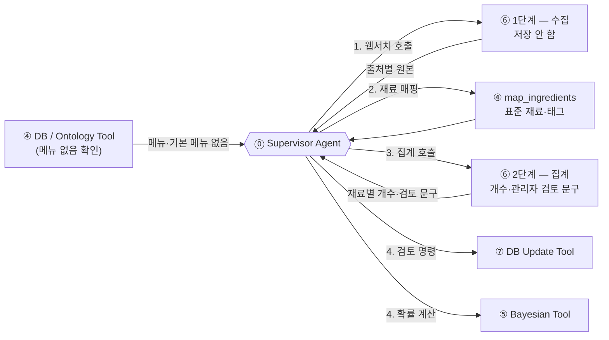
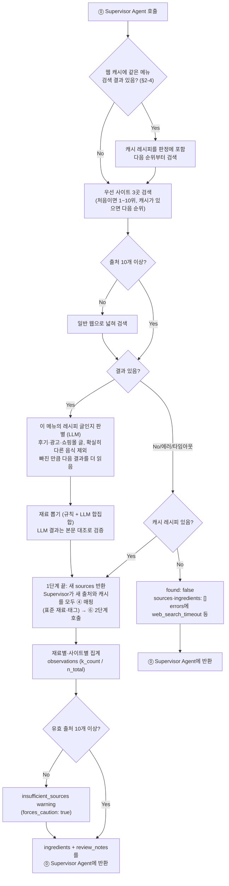

# ⑥ Web Search Agent 스펙

담당: 정유진
상태: 설계 정리됨, 구현 전 (남은 항목은 §5 참조)
상위 문서: `caution-multi-agent-architecture.md`, `caution-db-schema.md`

---

## 0. ⑥ 결과의 성격 — soft evidence

⑥이 웹에서 모은 결과는 **soft evidence**(사람이 확인하지 않은 미검증 정보)다.

| 항목 | 내용 |
|---|---|
| 판정에 쓰는 법 | ⑤ 확률 계산에 바로 쓴다. 판정은 CAUTION까지이고, DANGER/SAFE는 사장님 확인값으로만 나온다 (⑧ §3, PPT 8쪽 6) |
| DB에 올리는 법 | **관리자 승인 후에만** 정식 메뉴로 등록한다 (§2-4). 원본 기록(`web_search_cache`)은 검토 없이 저장한다. 저장은 메뉴판 분석이 끝난 뒤 한 번에 한다 (§2-4). 가게 없는 스캔은 아무것도 저장하지 않는다 (§2-4 "가게 없는 스캔") |
| 위험을 낮추는 데 쓰는가 | 쓰지 않는다. 웹 레시피에 재료가 없어도 "없음"의 근거가 되지 않는다 (`caution-db-schema.md` §5) |

이유: 기계가 혼자 추측한 데이터를 사람 검토 없이 공유 DB에 흘려보내면, 크롤링 하나가 잘못돼도 그 메뉴를 스캔하는 모든 사용자의 확률이 조용히 오염된다.

**⑥은 저장 권한이 전혀 없다.**

---

## 1. 전체 흐름에서 ⑥의 위치

- **⑥ Web Search Agent**: DB에 없는 메뉴를 웹에서 조사만 한다. **DB에 아무것도 쓰지 않고, 저장 명령도 만들지 않는다.** 검색 결과(출처별 `sources`, 재료별 집계 `ingredients`)만 반환한다.

> Agent·Tool끼리 직접 호출하지 않는다. ④의 결과를 보고 ⑥을 부를지는 ⓪ Supervisor가 정하고, ⑥의 결과도 ⓪을 거쳐 다음 단계로 간다 (⓪ §0).

> **재료 태그는 ④만 붙인다** (결정, 2026-10-10 회의). ⑥은 표준 재료 매핑(`ingredient_id`)과 태그(`constraint_tags`)를 스스로 붙이지 않고, ④를 직접 부르지도 않는다. 대신 **⑥은 두 단계로 나눠 불리고, 그 사이에 Supervisor가 ④의 재료 매핑(`map_ingredients`)을 부른다** (결정, 2026-10-12).
>
> 1. **⑥ 1단계 — 수집**: 검색 → 이 메뉴의 레시피 글인지 판별 → 재료 뽑기. 출처별 원본(`sources`)을 돌려준다.
> 2. **Supervisor → ④ 매핑**: 뽑은 재료명을 표준 재료(`ingredient_id`)와 태그로 맞춘다. 예: "진간장" → 표준 재료 "간장". 맞추지 못한 재료에는 ④가 `unmapped_constraint_tags` warning을 붙인다 (④ §2-7).
> 3. **⑥ 2단계 — 집계**: ④가 맞춘 **표준 재료 기준으로** 사이트별 개수(`observations`)를 세고, 관리자 검토 문구(`review_notes`)를 만든다. 개수를 세기 전에 이름을 맞추므로 "간장"과 "진간장"이 둘로 나뉘지 않는다.
> 4. 그다음 Supervisor가 ⑦(관리자 검토 명령 저장)과 ⑤(확률 계산)로 넘긴다. 가게 없는 스캔은 ⑦을 건너뛰고 ⑤로만 넘긴다 (⓪ §1-3, §2-4 "가게 없는 스캔").
>
> 관리자 검토 자료는 ⑥이 맡고, 저장이 필요할 때 ⑦을 쓴다 (Agent·Tool끼리 직접 부르지 않으므로 Supervisor를 거친다, ⓪ §0).

> ⑥이 Agent인 이유: 검색 전략(검색어)과 근거 검토를 **판단**해야 하므로 LLM 추론 노드다 (`docs/ppt-baseline.md` 7쪽 "Agent는 판단하고 Tool은 수행한다").

**PPT 정의와의 대응**

PPT 7쪽은 ⑥을 "내부 근거가 부족하거나 DB 미등록 메뉴일 때 검색 여부, 쿼리, 출처 신뢰도를 판단하여 외부 레시피와 재료 근거를 보완"하는 Agent로 정의한다 (`조건부 검색` `출처 평가` `근거 수집`). 이 문서는 이를 다음과 같이 나눠 맡는다.

| PPT 표현 | 이 문서에서 | 담당 |
|---|---|---|
| 조건부 검색 (검색 여부) | DB 미등록이고 기본 메뉴도 없는 메뉴에만 호출 (§2). 호출 여부는 ⓪이 정한다 | ⓪ |
| 내부 근거가 부족할 때 | **다루지 않는다** (결정, 2026-10-11). 레시피 근거가 적은지 판단하는 로직은 없다. DB에 있는 메뉴는 ④·⑤ 경로로 간다 | — |
| 쿼리 | 템플릿으로 검색어를 만든다 (§3-0) | ⑥ 코드 |
| 출처 평가 / 출처 신뢰도 판단 | 이 메뉴의 레시피 글인지 판별(LLM)하고 우선 검색 사이트(§2-3-1)부터 찾는다. 신뢰도 **숫자 계산**은 하지 않는다 (#194) | ⑥ (판별), ⑦ (신뢰도 계산) |
| 근거 수집 | 레시피에서 재료를 찾고 사이트별로 개수를 센다 (§2-2, §3) | ⑥ |
| 7쪽·8쪽 4: 검색 실패 → NO_INFORMATION, 안전으로 단정하지 않음 | 웹 근거가 하나도 없으면 `found: false` → ⑧이 정보 없음으로 CAUTION (§3-2). 캐시에 웹 근거가 있으면 다음 순위 검색이 실패해도 그 근거로 판정한다 (§2-4) | ⑥, ⑧ |
| 8쪽 흐름: 웹 근거 있음 → ⑦ 새 근거 저장(관리자 페이지 업로드·검토 후 DB 갱신) → ⑤ 확률 계산 | ⑥은 저장하지 않고 결과만 돌려준다. 새로 검색한 레시피는 관리자 검토로 가고(§2-6), 판정에 쓰는 레시피는 ⑤로 간다 (§2-4). 가게 없는 스캔은 관리자 검토 없이 ⑤로만 간다 | ⑦, ⑤ |
| 10쪽: `Caching` | 웹 캐시 재사용과 다음 순위 검색 (§2-4) | ⑥ |

---

## 2. 입력 / 출력

**JSON 형식은 [⓪ §4-5 "⑥ Web Search Agent"](0-agent-supervisor.md)에서만 정의한다** (1단계 `WebCollectRequest`·`WebCollectResponse`, 2단계 `WebAggregateRequest`·`WebAggregateResponse`, 공통 모델은 ⓪ §1-2). 이 문서에는 JSON을 다시 적지 않고, ⑥이 값을 어떻게 정하는지만 적는다. 필드를 바꾸려면 ⓪을 고친다.

**호출 조건**: ④가 `exists_in_db: false`이면서 `base_menu_id: null`을 반환한 경우에만 호출된다 (⓪ §4-5). 즉 메뉴도 없고 기본 메뉴도 찾지 못한 경우다. 차돌된장찌개처럼 기본 메뉴(된장찌개)를 찾은 변형 메뉴는 웹서치가 아니라 ④의 변형 경로로 간다. 레시피 근거가 적은지 판단하는 로직은 없으며, DB에 있는 메뉴는 웹서치를 하지 않는다 (PPT 7쪽 "내부 근거가 부족할 때"는 다루지 않음, §1).

### 2-1. 1단계(수집)에서 ⑥이 지키는 것

- `context.store_id`는 로그·추적용이다. 가게 없는 스캔이면 `null`이다 (⓪ §1-3). 웹 캐시는 가게와 무관하다. `context`는 수정하지 않고 그대로 반환한다.
- `menu.menu_id`는 DB에 없는 메뉴라 항상 `null`이다. 검색어는 `menu.normalized_menu_name`(②가 정규화한 이름)으로 만들고 `menu.locale_hint`(메뉴판 언어)를 참고한다.
- `max_sources`는 한 번 검색할 때 **새로** 모을 최대 출처 수 `10`이다 (§2-3). 캐시 레시피(`cached_sources`)는 이 수와 별개로 함께 쓴다 (§2-4).
- `next_rank`부터 검색한다. 처음이면 `1`, 캐시에 1~10위가 있으면 `11` (§2-4).
- 응답 `next_rank`에는 이번에 **실제로 읽은** 검색 결과의 다음 순위를 넣는다. 일반 웹으로 넓히거나(§2-3-1), 판별에서 빠진 글만큼 더 읽거나(§2-3), 시간 제한으로 덜 읽으면(§2-5) "요청 `next_rank` + 10"과 달라질 수 있다. 새로 읽은 결과가 없으면 요청 값을 그대로 돌려준다. Supervisor가 이 값을 캐시 저장 명령에 넣는다 (⓪ §4-5, §2-4).
- 응답 `sources[]`에는 **이번에 새로 검색한 출처만** 넣는다. 출처마다 원문 재료명을 그대로 뽑고, 이름을 합치거나 개수를 세지 않는다.
- `sources[].evidence`는 항상 `evidence_class: soft`, `source_type: web_search`, `verification_status: pending_review`(관리자 검토 대기)다. 출처 신뢰도 `reliability_weight`는 계산하지 않고 `null`로 보낸다 (#194).
- 입력 `warnings`·`errors`는 보존하고 ⑥의 신호를 덧붙인다 (§3-2).

### 2-2. 2단계(집계)에서 ⑥이 지키는 것

Supervisor가 새 출처와 캐시를 모두 ④ `map_ingredients`로 표준 재료에 맞춘 뒤(`mapped_sources`) ⑥을 다시 부른다. 출처마다 레시피 제목(`title`)도 함께 온다. 관리자 검토 규칙 2(§2-6)에 쓴다.

- **`ingredients[]`는 표준 재료 기준 개수 세기다.** 새 출처와 캐시를 합쳐 ④가 맞춘 `ingredient_id`로 묶는다. 표준 재료로 못 맞춘 재료는 버리지 않고 `ingredient_id: null`, `canonical_name`에 ⑥이 뽑은 이름 그대로 둔다. ⑤ 확률 계산의 입력이 된다.
- **`observations[]`는 사이트별로 따로 센다** (⑤ §1-1·§3-3, ④ §1-5와 같은 형식).
  - `corpus`: 우선 검색 사이트는 크롤링 코퍼스와 같은 이름(`10000recipe` / `wtable` / `semie`), 그 밖의 일반 웹 출처는 모두 `web_search`로 묶는다.
  - `n_total`: 그 사이트의 유효 레시피 수 (§2-3). 같은 사이트면 모든 재료가 같은 값이다.
  - `k_count`: 그 사이트 레시피 중 이 재료가 나온 수. 한 번도 안 나온 사이트도 `k_count: 0`으로 넣는다.
- 고정값: `source: web_search`, `depth: 0`(펼치기 전), `curated: false`(DB에 없는 메뉴라 큐레이션 레시피가 없음), `observation_basis: direct`(레시피마다 직접 셈), `anomaly_locked: false`(사장님 답변이 아님).
- `constraint_tags`와 `role`은 ④가 매핑하며 붙인 값을 그대로 옮긴다. ⑥이 새로 붙이지 않는다 (§1, ④ §2-7).
- `ingredients[].evidence_refs`는 그 재료가 나온 출처의 `evidence_id` 목록이다.
- 2단계 응답에는 출처 원본(`sources`)을 다시 넣지 않는다. 저장·관리자 검토에 쓸 새 출처 원본은 Supervisor가 1단계 응답 `sources`를 그대로 쓴다 (⓪ §4-5).
- `found`는 캐시와 새 검색 모두에서 쓸 수 있는 출처를 하나도 못 찾았을 때만 `false`다. 그때 `ingredients`는 `[]`.
- `review_notes[]`는 관리자 페이지에 보여줄 검토 필요 문구다 (§2-6). `rule_code`는 걸린 규칙, `message`는 한국어 한 줄. 걸린 규칙이 없으면 `[]`. 판정에는 쓰지 않는다.
- **개수 세기는 병합·선택이 아니다.** "어느 출처를 믿을지" 고르지 않고 모든 유효 출처를 그대로 센다. 레시피별 통과·제외는 관리자가 한다 (§2-6). 원본은 `sources`에 남고 `ingredients[].evidence_refs`가 원본을 가리킨다.

### 2-3. 수집 개수와 중복 허용 (결정)

| 항목 | 값 |
|---|---|
| 최대 출처 수 | **한 번 검색에 10개** (`max_sources`). 캐시가 쌓인 메뉴는 판정에 더 많이 쓸 수 있다 (§2-4) |
| 최소 출처 수 | **10개**. 10개 미만이면 결과는 반환하되 `insufficient_sources` warning(`forces_caution: true`)을 붙인다 (2026-10-10 회의) |
| 중복 | **따로 구분하지 않는다.** 재료 구성이 같은 레시피도 각각 1개로 센다 (2026-10-10 회의). 복사본을 골라 표시하는 단계는 두지 않는다 (2026-10-12) |
| 유효 출처 | **이 메뉴의 레시피로 판별되고(§3 2단계) 재료가 하나 이상 뽑힌 글**만 센다. 후기·광고·다른 음식 레시피·재료 없는 글은 세지 않고, 유효 출처가 10개가 될 때까지 다음 검색 결과를 더 읽는다. 우선 사이트에서 더 없으면 일반 웹으로 넓히고(§2-3-1), 시간 제한(§2-5) 안에 못 채우면 모은 만큼 쓴다 (결정, 2026-10-23) |

**근거 1 — 팀 크롤링 데이터 시뮬레이션** (`crawling/wtable_normalized.csv`, 2026-10-08)

레시피가 30개 이상인 메뉴 11개(불고기, 삼겹살, 육개장, 떡만두국, 후라이드치킨, 김밥, 콩나물무침, 떡볶이, 오징어 순대, 간장게장, 양념게장)에서 메뉴마다 전체 레시피를 정답으로 보고, n개만 무작위로 뽑는 것을 500번씩 반복했다.

| 뽑은 레시피 수 | 핵심 재료 포착률 (레시피 절반 이상에 나오는 재료) | 20% 이상 나오는 재료 포착률 |
|---|---|---|
| 3 | 94.9% | 76.7% |
| **5** | **99.0%** | 89.2% |
| 7 | 99.8% | 94.7% |
| **10** | **100%** | **98.1%** |
| 15 | 100% | 99.6% |
| 20 | 100% | 99.9% |

- 10개면 핵심 재료를 100%, 다섯 번에 한 번 나오는 재료도 98% 잡고, 그 이후로는 거의 늘지 않는다 → 한 번 검색에서 최소·최대 10개

**최소 10개로 정한 이유 (2026-10-10 회의)**: 웹 근거만 있는 메뉴는 판정이 어차피 CAUTION이라(⑧ §3), 확률 정확도보다 **재료를 놓치지 않는 것**이 중요하다. 10개면 레시피 30% 이상에 나오는 재료를 95% 넘게 잡는다 (95% 신뢰 기준). 크롤링 대상 메뉴 76개 모두 레시피가 37개 이상 있어(가장 적은 메뉴: 약과 37개, 경단·부대찌개 51개) 10개를 모으기 어렵지 않다.

**근거 2 — 놓칠 확률 공식**: 비율 p로 나오는 재료를 출처 n개에서 한 번도 못 볼 확률은 (1−p)^n이다. 절반에 나오는 재료는 10개면 0.1%, 30%에 나오는 재료는 10개면 약 3% 놓친다. 다섯 번에 한 번 나오는 재료는 10개면 11% 놓친다. 시뮬레이션 결과와 맞는다.

**근거 3 — 3의 법칙(rule of three)**: n개 중 0번 나왔을 때 실제 비율의 95% 상한은 약 3/n이다. 10개 레시피에 소고기가 한 번도 없어도 "소고기 확률 30% 미만"까지만 말할 수 있다. 웹 결과로는 "없다"고 확신할 수 없으므로, 웹 데이터로 위험을 낮추지 않는다는 원칙(§0)과 맞는다. ([BMJ Quality & Safety](https://qualitysafety.bmj.com/content/22/12/1042))

**근거 4 — 검색 결과 품질**: 검색 클릭의 대부분은 첫 페이지(상위 10개)에 몰리고 10위 클릭률은 약 2.5%다. 10개를 넘기면 레시피가 아닌 글이 섞일 가능성이 커진다. ([Search Engine Journal](https://www.searchenginejournal.com/google-first-page-stats/374516/))

**중복을 허용하는 이유 (2026-10-10 회의)**: 많이 퍼진 레시피는 그만큼 많은 사람이 실제로 해 먹는 레시피라, 개수에 그 인기를 반영한다. 팀 크롤링 데이터(만개의레시피)에서 재료 구성이 완전히 같은 레시피는 4.8%뿐이라 영향도 작다.

**주의와 보완**: 블로그 여러 곳이 같은 레시피를 퍼 가면 레시피가 사실상 1개인데 개수가 늘어, 근거가 충분하다고 착각할 수 있다. 퍼 간 레시피에 없는 재료는 확률이 낮게 나와 FN으로 이어질 수 있다 ([Recipe1M](https://im2recipe.csail.mit.edu/im2recipe.pdf)). 이 문제는 복사본을 자동으로 골라내지 않고 **관리자 검토로 막는다** (2026-10-12). DB 등록은 관리자가 통과시킨 레시피만으로 세므로, 관리자가 같은 글을 여러 번 통과시키지 않으면 된다 (§2-4, §2-6). 웹 근거만 있는 메뉴는 어차피 CAUTION 이상이라 판정이 SAFE로 새지는 않는다.

**한계**: 사이트 1곳·메뉴 11개 실험이고, 집밥 레시피라 식당 레시피와 다를 수 있다.

### 2-3-1. 우선 검색 사이트 (결정)

아래 3개 레시피 사이트를 **우선** 검색한다.

| 사이트 | 도메인 |
|---|---|
| 만개의레시피 | `10000recipe.com` |
| 우리의식탁 | `wtable.co.kr` |
| 새미네부엌 | `semie.cooking` |

**근거**
- **재료가 목록으로 정리돼 있어 재료를 덜 놓친다.** 레시피 사이트는 재료를 따로 목록으로 적는다 (크롤러도 이 목록만 가져온다, `crawling/README.md`). 블로그·후기는 재료가 본문에 흩어져 있거나 양념을 빠뜨리는 경우가 많다. 맛집 후기·광고·쇼핑몰 글도 애초에 들어오지 않는다.
- **규모가 크거나 전문가가 만든 레시피다.**

| 사이트 | 규모 | 출처 |
|---|---|---|
| 만개의레시피 | 레시피 20만여 개, "1,000만 이용자" | [앱스토어 소개](https://apps.apple.com/kr/app/id494190282) |
| 우리의식탁 | 요리연구가·푸드스타일리스트가 만든 레시피 2,000여 개 + 커뮤니티 레시피 매달 1,000여 개, "200만 유저" | [메트로신문 2023-09](https://www.metroseoul.co.kr/article/20230921500119), [앱스토어 소개](https://apps.apple.com/kr/app/id1090371750) |
| 새미네부엌 | 샘표 우리맛 연구팀이 10년 이상 연구한 요리 500여 가지 | [세계일보 2024-08](https://www.segye.com/newsView/20240820518713) |

> 수치는 각 사이트의 자체 소개나 보도 기준이며, 최신 값은 사이트에서 다시 확인해야 한다. 만개의레시피는 규모, 우리의식탁·새미네부엌은 전문가가 만든 레시피라는 점이 강점이다.

**우선 사이트에서 레시피가 부족할 때 (결정)**
- 우선 사이트 3곳에서 모은 출처가 **10개 미만**이면 **일반 웹으로 넓혀** `max_sources`(10개)까지 채운다.
- 일반 웹으로 넓혀도 10개 미만이면 `insufficient_sources` warning을 붙인다 (§2-3).

### 2-4. 웹 캐시 재사용과 DB 승격 (결정)

DB에 없는 메뉴는 **없음 → 웹 캐시 → DB** 세 단계를 거친다.

| 단계 | 상태 | 판정 (⑧) | 다음 단계로 가는 조건 |
|---|---|---|---|
| **없음** | DB에도 `web_search_cache`에도 없음 | 이번 스캔에서 바로 웹서치한다. 성공하면 CAUTION + 확률 (`evidence_basis: estimated`), 실패하면 정보 부족으로 CAUTION (`found: false` → `evidence_basis: unknown`, §3-2) | 웹서치에 성공하면 메뉴판 분석이 끝난 뒤 결과가 `web_search_cache`에 저장됨 |
| **웹 캐시** | 웹서치 결과가 쌓이는 중 | CAUTION + 확률 (`evidence_basis: estimated`) | 웹서치할 때마다 관리자 페이지에 올라감 (가게 없는 스캔은 제외, 아래). 관리자가 통과시킨 레시피가 **30개 이상** → DB 등록 |
| **DB** | 관리자가 통과시킨 레시피 30개 이상으로 `menus`/`recipe_ingredients`에 정식 등록 | 피해야 할 재료가 사장님 확인으로 들어 있으면 DANGER, 모든 재료가 사장님 확인값이고 SAFE 금지 조건이 없으면 SAFE, 그 밖에는 CAUTION + 확률 (⑧ §3, PPT 8쪽 6) | — |

**웹 캐시 재사용**
- `web_search_cache`는 가게와 무관하다. 다른 사용자·다른 가게에서 같은 메뉴를 검색한 결과도 재사용한다. 웹 결과는 원래 "일반 레시피"라 누가 검색했든 의미가 같고, 가게별 정보는 사장님 확인값(③)으로 따로 다룬다.
- **같은 메뉴가 다시 나오면 다음 순위 10개를 새로 검색하고, 캐시에 쌓인 레시피와 합쳐 판정한다** (결정, 2026-10-12). 아래 "30개를 채우는 방법".

**DB 승격**
- **조건: 관리자가 통과시킨 레시피 30개 이상** (2026-10-10 회의 후 20개 → 30개, 2026-10-12 "재료 구성이 서로 다른" 조건 삭제). 웹 데이터는 soft evidence(미검증 정보)라 관리자가 통과시키지 않은 레시피는 DB에 올리지 않는다 (§0).
- 30개 근거: 열 번에 한 번 나오는 재료까지 95% 확률로 한 번 이상 잡는다(`(1−0.1)^30 ≈ 0.04`). 확률 수치의 95% 오차도 약 ±18%p로 줄어, DB prior로 쓸 만해진다. 20개면 다섯 번에 한 번 나오는 재료는 98.8% 잡지만(`(1−0.2)^20 ≈ 0.012`) 열 번에 한 번 나오는 재료는 88%만 잡는다. 지금 DB의 크롤링 데이터는 메뉴당 레시피가 최소 37개다.
- ⑥은 승격을 결정하거나 저장하지 않는다. 승인·반려는 관리자가 하고, 통과 레시피 수를 세서 DB에 등록하는 것은 백엔드가 한다 (2026-10-12).
- **PPT 8쪽 흐름과 같다:** 웹서치를 할 때마다(가게 없는 스캔 제외) **새로 검색한 레시피**가 관리자 페이지에 올라가고 (캐시에서 꺼내 쓴 레시피는 이미 올라간 것이라 다시 올리지 않는다), 관리자가 레시피별로 통과·제외한다 (§2-6). 다만 DB에 올리려면 근거가 충분해야 하므로, **통과된 레시피가 30개 이상 쌓였을 때** DB에 등록한다.
- DB에 올라가도 사장님 확인값이 없으면 판정은 CAUTION이다. 대신 매번 웹서치를 하지 않아 빨라지고, ④가 재료를 끝까지 펼치고(예: 액젓 → 생선) 변형 메뉴를 연결해 재료를 덜 놓친다.

**30개를 채우는 방법 — 검색할 때마다 다음 순위 (결정, 2026-10-11)**

같은 검색을 반복하면 상위 결과가 거의 같아 서로 다른 레시피가 늘지 않는다. 그래서 DB에 등록되기 전까지는 메뉴가 웹서치 경로로 올 때마다 **다음 순위**를 검색한다. 따로 백그라운드 수집은 하지 않는다.

1. **캐시가 없으면** (처음 나온 메뉴) 1~10위를 검색해 그 결과로 판정한다.
2. **캐시가 있으면** 다음 순위 10개(`max_sources`, 입력 `next_rank`부터)를 새로 검색하고, **캐시 레시피와 합쳐 판정한다** (결정, 2026-10-12). 두 번째면 11~20위, 세 번째면 21~30위다. 우선 사이트 3곳에서 더 나올 게 없으면 일반 웹으로 넓힌다 (§2-3-1).
3. 새로 검색한 결과는 출력 `sources`에 담고, 메뉴판 분석이 끝난 뒤 캐시에 더해 저장한다 (§3 0단계). 따로 저장 경로를 만들지 않는다. 캐시에는 다음에 가져올 순위도 함께 저장한다. 가게 없는 스캔은 저장하지 않는다 (아래).
4. 관리자가 통과시킨 레시피가 30개 이상이 되면 DB에 등록되고, 그때부터 이 메뉴는 웹서치하지 않는다 (④·⑤ 경로).
5. 더 가져올 순위가 없으면 새 검색을 하지 않고 캐시 레시피만으로 판정한다. 새 검색이 실패·시간 초과해도 캐시 레시피만으로 판정한다. 캐시도 없을 때만 `found: false`다.

| 스캔 | 판정에 쓰는 레시피 | 새로 검색 | 캐시에 쌓인 레시피 |
|---|---|---|---|
| 1번째 | 새 검색 1~10위 (10개) | 1~10위 | 10개 |
| 2번째 | 캐시 1~10위 + 새 11~20위 (20개) | 11~20위 | 20개 |
| 3번째 | 캐시 1~20위 + 새 21~30위 (30개) | 21~30위 | 30개 → 관리자가 30개 이상 통과시키면 DB 등록 |
| DB 등록 후 | DB 레시피 (웹서치 안 함) | — | — |

- 새 검색은 같은 스캔 안에서 메뉴 하나 7초 안에 돈다 (§2-5). 어차피 기다리는 검색이라 이번 판정에도 쓴다. 저장은 다른 결과와 함께 메뉴판 분석이 끝난 뒤 한 번에 하므로 따로 저장 경로가 필요 없다 (결정, 2026-10-12).
- 레시피가 쌓일수록 확률 근거가 늘어난다. 판정은 웹 근거만 있으면 CAUTION이라 SAFE로 새지 않는다.
- DB에 등록되기 전까지 계속 쌓으므로 캐시 유효기간은 따로 두지 않는다.

**가게 없는 스캔 (`store_id: null`, #281)**
- 웹서치는 똑같이 한다. 웹 캐시는 가게와 무관해서 읽어 쓸 수 있다 (⓪ §1-3 가게 없는 스캔 규칙이 막는 것은 가게별 확인값·가게 prior·`menu_ingredient_cache`다).
- 다만 이 스캔은 **저장 명령을 하나도 만들지 않는다** (⓪ §1-3, `persistence_commands: []`). 그래서 새로 검색한 레시피는 이번 판정에만 쓰이고, 캐시에 쌓이지 않고, 관리자 검토에도 올라가지 않는다. 다음 순위(`next_rank`)도 저장되지 않아, 다음 스캔은 같은 순위부터 다시 검색한다.
- ⑥이 할 일은 달라지지 않는다. ⑥은 원래 저장하지 않고 결과만 돌려준다 (§0).

---

### 2-5. 시간 제한 (결정)

사용자는 식당에서 결과를 기다리고 있다. ⑥은 메뉴 하나당 **최대 7초** 안에 끝낸다.

| 구간 | 최대 시간 |
|---|---|
| 검색 API 호출 1회 | 3초 |
| LLM 호출 1회 (레시피 판별, 재료 뽑기) | 3초. 넘기면 규칙(재료 사전) 결과만 쓴다 (§3-0) |
| **⑥ 전체 (메뉴 하나)** | **7초** |
| **동시에 웹서치하는 메뉴 수** | **최대 5개** (초기값) |

- 검색 API의 일시 오류는 Supervisor adapter가 7초 안에서 1번만 다시 시도한다 (⓪ §2-13). 그 밖의 재시도 판단은 ⓪이 한다 (§3-1).

**근거**: 스캔 전체 응답 목표는 30초다 (`ai_ocr/README.md` "30초 SLA"). OCR이 약 16초를 쓰면 판정 쪽에 약 12초가 남고, 그 안에서 ④⑤와 ⑧ 문장 생성도 돌아야 한다. 메뉴별로 병렬 처리하므로 ⑥에는 메뉴 하나당 7초를 쓴다. 이 계산은 Prepare(OCR)·Judge(판정) 두 단계로 나누기 전 기준이다. 지금 OCR은 Prepare에서 따로 끝나므로 7초는 Judge 단계 안에서 쓰고, Judge 단계 전체 시간은 ⓪·백엔드가 정한다 (⓪ §8). 같은 메뉴가 다시 나오면 다음 순위를 검색해 캐시와 합쳐 판정한다 (§2-4).

**메뉴판 한 장에 웹서치할 메뉴가 여러 개일 때 (결정, 2026-10-11)**
- 한 번에 최대 5개 메뉴까지 동시에 웹서치하고, 나머지는 앞 메뉴가 끝나는 대로 이어서 한다. 캐시 결과를 쓰는 메뉴는 검색하지 않으므로 이 수에 들어가지 않는다.
- 5개는 초기값이다. 검색 API 호출 한도와 LLM 호출 한도를 넘지 않으면서, 메뉴 하나 7초 기준으로 판정 단계 안에 대부분 끝나도록 잡았다. 실제 한도와 응답 시간을 보고 QA에서 조정한다.
- 판정 단계 전체 시간 안에 차례가 오지 않은 메뉴는 `found: false`, `web_search_timeout`으로 처리한다. 캐시가 있는 메뉴는 캐시로 판정하므로 해당하지 않는다. CAUTION 이상이라 SAFE로 새지 않는다.

**7초를 넘기면**
- 그때까지 모은 레시피가 있으면 **모은 만큼으로 결과를 낸다.** `warnings`에 `web_search_deadline_exceeded`(`forces_caution: true`)를 붙인다. 판정은 어차피 CAUTION이라 위험이 늘지 않고, 재료 정보를 하나라도 더 넘길 수 있다. 10개 미만이면 `insufficient_sources`도 함께 붙는다.
- 하나도 못 모았으면 `found: false`와 `web_search_timeout` 오류를 낸다. (캐시가 있는 메뉴는 캐시로 판정하므로 여기에 오지 않는다, §2-4)

> 이 7초는 백엔드 2-phase 제안의 판정(judge) 단계 타임아웃 안에 들어간다. 판정 단계 전체 값은 ⓪·백엔드와 함께 정한다.

### 2-6. 관리자 검토 자료 (결정)

웹서치를 할 때마다(§2-4) ⑥은 관리자 페이지에 올라갈 **검토 자료**를 만든다. ⑥은 자료만 만들고, 화면과 승인 처리는 하지 않는다. 가게 없는 스캔에서도 ⑥은 같은 자료를 만들지만, Supervisor가 저장 명령을 만들지 않아 관리자 페이지에 올라가지 않는다 (§2-4 "가게 없는 스캔").

**⑥이 만드는 것**

묶음 요약은 `ingredients[].observations`(재료별 개수)로, 레시피별 목록은 `sources[]`로 만들 수 있다. 출력에 따로 담는 것은 검토 필요 문구(`review_notes`)뿐이다 (결정, 2026-10-12).

| 항목 | 내용 |
|---|---|
| 묶음 요약 | 메뉴 이름, 레시피 수, 재료별 등장 수 (예: 소고기 15/22) |
| 레시피별 목록 | 레시피마다 제목, 링크, 뽑힌 재료 |
| 검토 필요 문구 | 출력 `review_notes[]` (§2-2). 아래 규칙에 걸린 항목을 읽기 쉬운 문장으로 정리 (예: "땅콩은 레시피 22개 중 3개에만 나와서 확인이 필요해요") |

**검토 필요 문구 — 이유는 규칙, 문장은 LLM**
- 검토가 필요한 **이유는 코드가 아래 규칙으로 뽑는다.** LLM이 이유까지 정하면 매번 다르게 말하거나 중요한 경고를 빠뜨릴 수 있다.
- LLM은 뽑힌 이유를 **읽기 쉬운 문장으로만** 바꾼다. LLM이 실패하면 규칙 이름을 그대로 보여준다.

| 분류 | # | 규칙 | 기준 (초기값) | 왜 필요한가 |
|---|---|---|---|---|
| **A. 같은 음식이 맞나** | 1 | 일반 웹 출처 포함 | 우선 검색 사이트(§2-3-1)가 아닌 도메인의 출처가 1개 이상 | 후기·광고가 섞였을 수 있다 |
| | 2 | 레시피 제목이 메뉴명과 다름 | 제목에 메뉴명이 없는 레시피 | 다른 음식(예: 마라탕 ↔ 마라샹궈)이 섞였을 수 있다 |
| | 3 | 레시피끼리 재료가 너무 다름 | 레시피 절반 이상에 나오는 재료가 3개 미만 | 서로 다른 음식이 섞였다는 신호다 |
| **B. 재료가 제대로 뽑혔나** | 4 | 드물게 나온 재료 | 레시피 1~2개에만 나온 재료 | 잘못 뽑혔거나 특이한 레시피의 재료일 수 있다 |
| | 5 | LLM만 찾은 재료 | 규칙(재료 사전)은 못 찾고 LLM만 찾은 재료 | 지어낸 재료인지 확인한다 |
| | 6 | 표준 재료 매핑 실패 | ④ 매핑에서 표준 재료로 맞추지 못한 재료 (`unmapped_constraint_tags`) | 태그가 없어 위험을 놓칠 수 있다. **C에도 함께 표시한다** |
| **C. 위험 재료를 놓치지 않았나** | 7 | 위험 태그 재료가 일부에만 나옴 | ④가 알레르기·종교·채식 태그를 붙인 재료가 레시피 절반 미만에 나옴 | 넣으면 과잉 경고, 빼면 FN이라 사람 판단이 필요하다 |

- 규칙별 `rule_code` (출력 `review_notes[].rule_code`): 1 `general_web_source`, 2 `title_mismatch`, 3 `inconsistent_recipes`, 4 `rare_ingredient`, 5 `llm_only_ingredient`, 6 `unmapped_ingredient`, 7 `risky_ingredient_partial`
- 검토 문구는 A → B → C 순서로 보여준다. 이 묶음이 맞는 음식인지 먼저 보고, 재료를 정리한 뒤, 위험 재료를 마지막에 확인하는 순서다.
- 규칙 1은 출처 링크의 도메인으로 판단한다. ⑥ 출력에 별도 표시 필드는 두지 않는다.
- **규칙은 이번에 새로 관리자에게 올라가는 레시피만으로 계산한다** (결정, 2026-10-12). 관리자는 이번 묶음을 통과·제외하므로 그 묶음에 대한 경고여야 한다. 대상은 이번에 새로 검색한 `sources`다. 캐시에서 받은 레시피는 이미 이전에 올라갔으므로 다시 계산하지 않는다. 예: "레시피 1~2개에만 나온 재료"는 이번 10개 기준이다.
- **규칙 6·7은 ④ 매핑 결과가 있어야 판단할 수 있다.** 그래서 검토 문구는 ⑥ 2단계에서 만든다. 2단계는 ④ 매핑 뒤에 불리므로 태그와 매핑 실패 여부를 알 수 있다 (§1, 결정 2026-10-12).
- 기준 숫자는 초기값이며, 실제 검토 결과를 보고 조정한다.

**⑥ 범위 밖 — 관리자 화면과 승인 처리 (⑦·백엔드·프론트에 전달)**

최소 기능은 다음과 같다.
- 묶음 요약을 기본으로 보고, 레시피를 하나씩 펼쳐 볼 수 있다.
- 검토 필요 문구는 화면 맨 아래에 보여준다.
- **전체 통과:** 이번에 올라온 레시피를 모두 통과시킨다.
- **레시피별 통과:** 레시피마다 통과/제외를 고른다.
- **반려:** 이번에 올라온 레시피를 하나도 통과시키지 않는다. 웹 캐시는 그대로 남는다.
- **DB 등록:** 통과된 레시피가 30개 이상이 되면, 통과된 레시피만으로 재료 개수를 세어 DB에 등록한다 (§2-4).
- 관리자는 재료를 직접 고치지 않는다. 레시피를 넣고 빼는 것만 한다. 그래서 위험 재료를 임의로 지우는 일이 생기지 않는다.

---

## 3. 처리 로직

0. `web_search_cache`에 같은 메뉴의 레시피가 있으면 다음 순위를 새로 검색해 캐시 레시피와 합쳐 판정한다 (§2-4). 다른 사용자·다른 가게의 검색 결과도 재사용한다. **⑥은 DB를 직접 조회하지 않는다.** 판정(judge) 도중에는 DB를 부르거나 저장하지 않으므로, 캐시 결과는 백엔드가 judge 요청에 담아 넘긴다. 새로 검색한 결과도 judge 결과에 담아 두고, 메뉴판 분석이 끝난 뒤 백엔드가 한 번에 저장한다 (결정, 2026-10-10 회의). 가게 없는 스캔은 캐시를 읽기만 하고 저장하지 않는다 (§2-4).
1. `menu.normalized_menu_name`으로 우선 검색 사이트 3곳(§2-3-1)에서 검색한다. 캐시가 없으면 1~10위, 있으면 `next_rank`부터다 (최대 `max_sources`개). 모은 출처가 10개 미만이면 일반 웹으로 넓힌다. 실패·타임아웃이면 캐시 레시피만으로 진행하고, 캐시도 없으면 `found: false`.
2. **(LLM)** 검색된 글마다 **이 메뉴의 레시피 글인지** 판별한다 (결정, 2026-10-23). 맛집 후기·광고·쇼핑몰 글은 제외한다. 다른 음식 레시피는 **확실히 다른 음식일 때만** 제외한다. 예) 김치찌개 검색에 김치찜·김치볶음밥 레시피. **애매하면 남기고** 관리자 검토 규칙 2(§2-6)로 넘긴다. 진짜 레시피를 잘못 빼면 그 레시피에만 있던 재료를 놓칠 수 있어서다 (FN). 빠진 글은 유효 출처로 세지 않고, 10개가 될 때까지 다음 결과를 더 읽는다 (§2-3).
2-1. **(규칙 + LLM)** 레시피 글에서 재료를 뽑는다. 규칙(재료 사전)과 LLM이 각각 뽑고, **둘 중 한쪽이라도 찾은 재료는 모두 남긴다** (§3-0).
2-2. 출처마다 `source_url`, `title`, `fetched_at`, 재료 목록을 정리하고 `evidence`를 붙인다. **저장 명령은 만들지 않는다.**
3. **(1단계 끝)** `sources`(출처별 원본과 뽑은 재료명)를 Supervisor에 돌려준다. Supervisor가 ④ `map_ingredients`로 재료명을 표준 재료와 태그로 맞춘 뒤 ⑥ 2단계를 부른다 (§1).
4. **(2단계)** ④가 맞춘 **표준 재료 기준으로** 묶고, **출처 사이트별로** `k_count`(그 사이트에서 나온 레시피 수)와 `n_total`(그 사이트의 유효 레시피 수)을 세어 `observations`에 담는다. 우선 사이트 밖의 출처는 `web_search` 하나로 묶는다.
5. 유효 출처가 10개 미만이면 `insufficient_sources` warning을 붙인다. 결과는 버리지 않고 반환한다.
5-1. 관리자 검토 규칙 1~7(§2-6)을 확인해 `review_notes`를 만든다.
6. `ingredients`, `review_notes`를 ⓪ Supervisor Agent에 반환한다. 새 출처 원본은 1단계 응답 `sources`로 이미 넘겼다. 저장은 ⑥의 일이 아니다. 관리자 검토 명령은 Supervisor가 ⑦을 불러 만든다. 가게 없는 스캔은 ⑦을 부르지 않는다 (⓪ §1-3).

**fallback**: 캐시도 없고 웹서치도 실패하면 "정보 없음"(`NO_INFORMATION`) 상태로 CAUTION 이상 처리 — SAFE로 떨어뜨리지 않는다 (FN-minimization 원칙, `docs/ppt-baseline.md` 8쪽 "4 정보 부족→보수적 판정").

### 3-0. LLM이 맡는 일과 코드가 맡는 일

PPT 7·8쪽은 ⑥을 "검색 전략 수립·근거 검토"를 하는 Agent로 정의한다. 모델은 **저가 모델**을 쓴다 (PPT 10쪽 "Web Search Agent — 저가 모델"). 참고로 PPT 10쪽의 ⑥ 설명 문장("메뉴명 오탈자 보정 및 옵션 분리")은 ② 설명과 같아 작성 실수로 보며, ⑥의 역할은 7쪽 정의를 따른다. LLM은 **문맥을 읽어야 하는 판단**에만 쓰고, 정해진 규칙대로 하면 되는 일은 코드가 맡는다. LLM을 많이 쓸수록 느려지고 결과가 매번 달라질 수 있기 때문이다. 모델·프롬프트·재시도 같은 공통 규칙은 `agent-implementation-guide.md` §5를 따른다.

| 단계 | 담당 | 이유 |
|---|---|---|
| 캐시 확인 | 코드 | judge 요청에 담겨 온 캐시 레시피와 다음 검색 순위를 확인 (DB 조회 아님) |
| 검색어 만들기 | 코드 (템플릿) | 한글 메뉴는 "{메뉴} 레시피" 같은 템플릿으로 충분하다. |
| 검색 실행, 시간 제한, 우선 사이트 검사 | 코드 | 정해진 절차 (§2-3-1) |
| **이 메뉴의 레시피 글인지 판별** | **LLM** | 맛집 후기·광고·쇼핑몰 글과 다른 음식 레시피(예: 김치찌개 ↔ 김치찜)를 걸러내는 건 문맥 판단이다. 단어("재료", "레시피") 포함 여부나 제목 글자 비교만으로는 후기도 통과하고, 제목에 메뉴명이 없는 진짜 레시피는 빠진다. 확실히 다른 음식일 때만 빼고 애매하면 남긴다 |
| **재료 뽑기** | **규칙 + LLM** | 규칙(재료 사전)은 아는 재료를 빠르고 일정하게 잡고, LLM은 사전에 없는 재료를 추가로 잡는다. 둘의 **합집합**을 쓴다 |
| LLM 결과 검증 | 코드 | 실제 검색 결과에 없는 URL은 버린다. LLM만 찾은 재료는 **본문에 실제로 있을 때만** 남긴다 (지어낸 재료 방지) |
| 관리자 검토 문구 (§2-6) | 이유는 코드(규칙), 문장은 LLM | 이유까지 LLM이 정하면 중요한 경고를 빠뜨릴 수 있다 |
| 표준 재료 매핑·태그 붙이기 | **⑥이 하지 않음** — ⑥ 1단계와 2단계 사이에 Supervisor가 ④ `map_ingredients`를 부른다 | 태그는 ④만 붙인다 (§1). 매핑 실패 warning도 ④가 붙인다 |
| 개수 세기, 10개 미만 경고 | 코드 | 정해진 규칙 (§2-3) |

**재료 뽑기 — 규칙 + LLM 합집합**
- **합집합을 쓰는 이유:** 둘 다 찾은 재료만 남기면 한쪽이 놓친 재료가 사라져 FN이 생긴다.
- **LLM이 실패·시간 초과해도** 규칙 결과는 남는다. 재료가 통째로 사라지지 않는다.
- **LLM만 찾은 재료**는 본문에 그 단어가 있어야 남긴다. 표준 재료 매핑은 Supervisor가 부른 ④가 하며, 매핑되지 않으면 ④가 `unmapped_constraint_tags` warning(`forces_caution: true`)을 붙인다 (④ §2-7). 태그 없이 넘어가면 ⑧이 SAFE를 낼 수 있기 때문이다.

### 3-1. ⑥이 하지 않는 것

| 하지 않음 | 담당 |
|---|---|
| DB 저장, 저장 명령 생성 (`web_search_cache`, 정식 메뉴 등록) | ⑥ 범위 밖 |
| 여러 후보 중 어느 걸 믿을지 병합/선택 | ⑥ 범위 밖. 레시피별 통과·제외는 관리자 (§2-6) |
| 출처 신뢰도(`reliability_weight`) 계산 | ⑥ 범위 밖 (#194) |
| 확률 계산 | ⑤ Bayesian Tool |
| 재호출/재시도 여부 판단 | ⓪ Supervisor Agent |
| DANGER/CAUTION/SAFE 판정 | ⑧ Decision Policy / XAI Agent |

### 3-2. 예외 처리

| 상황 | 처리 |
|---|---|
| 검색 실패, 또는 7초 안에 레시피를 하나도 못 모음 | (캐시가 없는 메뉴) `found: false`, `sources: []`, `ingredients: []`. `errors`에 `web_search_timeout`(`retryable: true`, `fallback: no_information`)을 넣는다. 재시도 여부는 ⓪이 정한다 |
| 7초를 넘겼지만 모은 레시피가 있음 | 모은 만큼으로 결과를 반환하고 `warnings`에 `web_search_deadline_exceeded`(`forces_caution: true`)를 붙인다 (§2-5) |
| 웹 캐시를 못 가져옴 (`web_search_cache.status: unavailable`, 백엔드 조회 실패) | 캐시가 없다고 단정하지 않는다. 받은 캐시 레시피 없이 새로 검색하고, 백엔드가 붙인 warning은 그대로 보존한다 (⓪ §1-3 KnowledgeBundle 표) |
| 유효 출처 10개 미만 | 결과는 그대로 반환하고 `warnings`에 `insufficient_sources`(`forces_caution: true`)를 붙인다. ⑧은 이 경고가 있으면 SAFE를 내지 않는다 |
| 재료 구성이 같은 레시피 여러 개 | 구분하지 않고 각각 센다 (§2-3). 원본은 `sources`에 남긴다 |
| 재료를 하나도 뽑지 못한 출처 | 유효 출처로 세지 않는다 |
| 다른 음식 레시피가 섞임 (예: 김치찌개 검색에 김치찜) | LLM이 확실히 다른 음식이라고 판별한 글만 빼고, 빠진 만큼 다음 결과로 채운다. 애매하면 남겨 관리자 검토 규칙 2(§2-6)로 넘긴다 |
| LLM 호출 실패·시간 초과 | 규칙(재료 사전)으로 뽑은 결과만 반환하고 `warnings`에 `web_llm_extraction_failed`(`forces_caution: true`)를 붙인다. 레시피 판별을 못 했으므로 모든 글을 후보로 둔다 |
| LLM이 뽑은 재료가 본문에 없음 | 버린다 (지어낸 재료 방지) |
| LLM만 찾은 재료가 표준 재료로 매핑되지 않음 | 재료는 남긴다. 매핑은 ④가 하며, 실패하면 ④가 `unmapped_constraint_tags` warning(`forces_caution: true`)을 붙인다 |

오류·경고 형식은 [⓪ §1-2 `NodeError`·`NodeWarning`](0-agent-supervisor.md)을 따른다. 위 `web_search_timeout` 예시도 ⓪ §1-2에 있다.

---

## 4. 테스트 케이스

| # | 입력 | 기대 동작 | 검증 포인트 |
|---|---|---|---|
| 1 | 웹서치 성공 (마라탕) | `found: true` + `sources` + `ingredients` 반환 | ⑥ 출력에 저장 명령이 없을 것. `menus`/`recipe_ingredients`는 미반영일 것 |
| 2 | 웹서치 실패/타임아웃 | `found: false`, `sources: []`, `ingredients: []`, `errors`에 `web_search_timeout` | ⑧이 "완전 정보 없음" 경로로 감 |
| 3 | 만개의레시피 5개 중 3개, 우리의식탁 3개 중 1개, 일반 웹 2개 중 0개에 소고기 | 소고기 `observations`: `10000recipe` 3/5, `wtable` 1/3, `web_search` 0/2 | 사이트별 개수가 맞고, 안 나온 사이트도 `k_count: 0`으로 들어갈 것 |
| 4 | 출처 10개 중 3개가 재료 구성이 같은 레시피 | 사이트별 `n_total` 합이 10, 최소 개수 충족 | 같은 구성의 레시피도 각각 셀 것 |
| 5 | 유효 출처 8개 | 결과 반환 + `insufficient_sources` warning(`forces_caution: true`) | 결과를 버리지 않고, SAFE를 막는 신호를 보낼 것 |
| 6 | 정상 결과 | 모든 `sources[].evidence.reliability_weight`가 `null` | ⑥이 출처 신뢰도를 계산하지 않을 것 |
| 7 | 검색 결과에 맛집 후기 글 섞임 | 후기 글은 유효 출처에서 제외 | LLM 레시피 판별이 동작할 것 |
| 8 | 재료 사전에 없는 재료(예: 마라소스)가 본문에 있음 | LLM이 찾아 결과에 포함 | 규칙만으로 놓치는 재료가 남을 것 |
| 9 | LLM이 본문에 없는 재료를 반환 | 그 재료는 버림 | 지어낸 재료가 결과에 들어가지 않을 것 |
| 10 | LLM 시간 초과 | 규칙 결과만 반환 + `web_llm_extraction_failed` warning | 재료가 통째로 사라지지 않을 것 |
| 11 | 우선 사이트 레시피 3개 | 일반 웹으로 넓혀 최대 10개까지 채움 | 레시피가 부족하면 일반 웹으로 넓힐 것 |
| 12 | 우선 사이트 레시피 10개 | 일반 웹 검색 안 함 | 우선 사이트만으로 충분하면 넓히지 않을 것 |
| 13 | 7초까지 레시피 3개만 모음 | 3개로 결과 반환 + `web_search_deadline_exceeded` + `insufficient_sources` warning | 시간 초과여도 모은 결과를 버리지 않을 것 |
| 14 | 7초까지 레시피 0개 | `found: false` + `web_search_timeout` | 정보 없음 경로로 갈 것 |
| 15 | 관리자 페이지에 올라간 웹서치 결과, 땅콩(`is_peanut`)이 22개 중 3개에만 나옴 | 검토 문구 C에 땅콩 표시 | 위험 태그 재료가 검토 문구에서 빠지지 않을 것 |
| 16 | 검토 문구 생성 중 LLM 실패 | 규칙 이름을 그대로 문구로 표시 | 검토 이유가 사라지지 않을 것 |
| 17 | 같은 메뉴 2번째 웹서치, 캐시에 1~10위 레시피 10개 | 11~20위를 검색해 캐시 10개와 합쳐 20개로 판정, `sources`에는 새 10개만 | 이미 가져온 순위를 다시 검색하지 않고, 캐시 레시피를 `sources`에 다시 넣지 않을 것 |
| 18 | 캐시 레시피 10개 + 다음 순위 검색 실패 | 캐시 10개로 판정 (`found: true`) | 캐시가 있는데 정보 없음으로 떨어지지 않을 것 |
| 19 | 가게 없는 스캔(`store_id: null`) + 캐시 레시피 10개 | 11~20위를 검색해 캐시와 합쳐 판정, `sources`에는 새 10개만. ⑥ 출력은 가게 있는 스캔과 같음 | 웹 캐시는 그대로 읽어 쓸 것. 저장·관리자 검토가 없는 것은 Supervisor 몫이다 (⓪ 테스트 2-a) |
| 20 | 김치찌개 검색 결과 10개 중 3개가 김치찜 레시피 | 김치찜 3개는 제외하고 다음 결과를 더 읽어 김치찌개 레시피 10개를 채움, `next_rank`는 실제로 읽은 다음 순위 | 다른 음식이 이번 판정에 섞이지 않고, 유효 출처 수가 줄지 않을 것 |
| 21 | 제목에 메뉴명이 없지만 본문은 김치찌개 레시피 ("엄마표 얼큰 찌개") | 남김 (관리자 검토 규칙 2에는 표시) | 애매한 레시피를 빼서 재료를 놓치지 않을 것 |
| 22 | 판별 LLM 실패 | 모든 레시피 글을 남김 + `web_llm_extraction_failed` warning | LLM이 없어도 레시피가 통째로 빠지지 않을 것 |

---

## 5. 미확정 항목 (팀 확인 대기)

- [x] **수집 개수·중복** — 한 번 검색에 최소·최대 10개. 같은 구성의 레시피도 각각 센다 (2026-10-10 회의). 복사본 표시 단계는 두지 않는다 (2026-10-12, §2-3)
- [x] **관리자 확인 방식** — 웹서치할 때마다 관리자 페이지에 올림, 묶음 요약 기본 + 레시피별 통과·제외, 검토 필요 문구(이유는 규칙, 문장은 LLM), 관리자는 재료를 직접 고치지 않음 (§2-6)
- [x] **웹 결과와 기존 DB 값이 다를 때 우선순위** — 해당 없음. ⑥은 DB에 없는 메뉴에만 불리고(§2), DB에 등록되면 그 메뉴는 웹서치를 하지 않는다(§2-4). 한 메뉴에 웹 값과 DB 값이 동시에 쓰이는 경우가 없다 (2026-10-12, #170)
- [x] **웹 캐시 재사용과 DB 승격 기준** — 다른 사용자의 캐시도 재사용, 관리자가 통과시킨 레시피가 30개 이상이면 DB 등록 (2026-10-10, 2026-10-12 "서로 다른" 조건 삭제, §2-4)
- [x] **메뉴판 1장당 여러 unknown 메뉴가 나올 때 ⑥ 호출 배치 전략** — 동시에 최대 5개(초기값), 나머지는 이어서. 판정 단계 시간 안에 못 끝난 메뉴는 `found: false` (2026-10-11, §2-5)
- [x] **LLM이 맡는 부분과 코드가 맡는 부분 구분** — LLM은 레시피 글 판별과 재료 뽑기(규칙과 합집합)에만 쓰고 나머지는 코드 (§3-0)
- [x] **검색할 사이트 범위** — 만개의레시피·우리의식탁·새미네부엌 3곳을 우선 검색 (§2-3-1)
- [x] **우선 사이트에서 레시피가 부족할 때** — 10개 미만이면 일반 웹으로 넓힌다 (§2-3-1)
- [x] **⑥ 시간 제한** — 메뉴 하나당 7초 (검색 API 3초, LLM 3초). 넘기면 모은 만큼 반환 (§2-5). 2-phase 판정 단계 전체 타임아웃은 ⓪·백엔드와 함께 정한다
- [x] **캐시 확인 주체와 저장 시점** — 백엔드가 judge 요청에 캐시 결과를 담아 넘기고, 새 검색 결과는 judge 결과에 담아 메뉴판 분석이 끝난 뒤 한 번에 저장한다. judge 도중 DB 호출·저장 없음 (2026-10-10 회의, §3 0단계)
- [x] **캐시 재사용과 반복 검색** — 검색할 때마다 다음 순위 10개를 가져와 캐시 레시피와 합쳐 판정하고, 새 레시피는 분석이 끝난 뒤 캐시에 더해 저장한다. 백그라운드 추가 수집과 캐시 유효기간은 두지 않는다. DB 등록 전까지 계속 (2026-10-11, 2026-10-12 판정 포함으로 변경, §2-4)
- [x] **다음 순위 검색을 언제 돌릴지** — 같은 스캔 안에서 돌리고 이번 판정에도 쓴다. 저장은 분석이 끝난 뒤 한 번에 하므로 따로 경로가 필요 없다 (2026-10-12, §2-4)
- [x] **통과된 레시피 30개를 누가 세서 DB에 등록할지** — 백엔드. 관리자 승인은 AI 판정 흐름 밖에서 일어나므로, 백엔드가 메뉴별 통과 레시피 수를 세다가 30개가 되면 등록한다. ⑥은 레시피를 모아 주기만 한다 (2026-10-12, #170)
- [x] **출처 신뢰도 가중치를 ⑥에서 어디까지 판단할지** — ⑥은 계산하지 않고 `reliability_weight: null`로 보낸다 (2026-10-06, #194)
- [x] **재료 태그(`constraint_tags`)를 누가 붙일지** — ④가 모두 붙인다. 웹 재료를 표준 재료로 매핑하는 일도 ④가 한다. ⑥이 ④를 직접 부르지 않고 ⑥ 1단계와 2단계 사이에 Supervisor가 ④ `map_ingredients`를 부른다 (2026-10-10 회의, §1, ④ §2-7). PPT 7쪽이 위험 속성 매핑을 ④의 역할로 정의한 것과 같다
- [x] **④ 매핑 후 같은 재료로 합쳐질 때 개수 다시 세기** — 순서를 바꿔 해결: ⑥ 1단계(수집) → ④ 매핑 → ⑥ 2단계(표준 재료 기준으로 개수 세기). 처음부터 "간장 10/10"으로 센다 (2026-10-12, §1)
- [x] **관리자 검토 규칙 6·7을 붙이는 시점** — ⑥ 2단계에서 ④ 결과로 판단한다. 관리자 검토 자료는 ⑥이 맡고, 저장할 때 ⑦을 쓴다 (2026-10-12, §1, §2-6)
- [x] **검색 서비스(provider)** — **네이버 검색 API** (2026-10-13). 한국어 레시피 글이 많이 잡히고 무료 한도가 커서 비용 부담이 없다. 구현 단계로 넘김 (#254): 우선 사이트 3곳(§2-3-1)만 골라 검색(`site:`)이 되는지 실제 API로 확인하고, 안 되면 대안을 정한다. 검색 1회 3초, 동시 5개(§2-5)가 호출 한도 안에 드는지도 #254에서 확인한다
- [x] **⑥ 두 단계 호출 형식** — ⓪에 반영됨: node `ingredient_mapping` → `web_aggregate`, §4-5 1단계·2단계 요청·응답 (2026-10-12 확인). 원래 요청: ⓪ §2-11에 ⑥ 2단계 node를 추가하고(⑥ 1단계 → ④ 매핑 → ⑥ 2단계 → ⑦ → ⑤), §4-5에 단계별 요청·응답 형식을 정해야 함. 두 단계를 합쳐 메뉴 하나 7초 안 (§2-5)
- [x] **⑤로 넘기는 개수 형식** — ⑤·④와 같은 사이트별 `observations`로 보낸다. 일반 웹 출처는 `corpus: web_search` 하나로 묶는다 (§2-2)
- [x] **⑤가 요구하는 재료 필드** — ⑤ 입력에 맞춰 `curated`(항상 `false`)와 `observation_basis`(항상 `direct`)를 `ingredients[]`에 넣는다 (2026-10-11, §2-2)
- [x] **⑤ 문서 맞추기 (외부 의존)** — ✅ ⑤ 반영됨 (#286, #201 닫힘, 2026-10-21 확인). ⑤ §1-1 입력 표의 "⑥ 출력은 필드 정합 미확정"과 테스트 14번("⑥ 후보는 개수 없음 → 무정보") 정리, `web_search` 코퍼스 신뢰도와 반영 비율(#201) 결정. ⑤ §1-2-1 "'낮음' 기준 5는 ⑥에서 정한 '고유 레시피 최소 5개'와 같은 기준" 문장 정리 — ⑥은 10/10 회의에서 최소 10개, 같은 구성의 레시피도 각각 세기로 바꿨다 (§2-3). 5는 ⑤가 따로 정한 기준으로 적어야 한다 (2026-10-19 확인) — ⑤ 담당자 요청
- [x] **⑦ 문서 맞추기 (외부 의존)** — ✅ ⑦ 반영됨 (#286, 2026-10-21 확인). ⑦ §4의 "(정리 전)" 문단이 "⑥ §3은 ⑥이 검색 결과마다 `web_search_cache` 저장 명령을 직접 만든다"고 옛 내용을 적고 있다. ⑥은 저장 명령을 만들지 않고 `save_web_search_cache`는 ⑦이 만든다 (#208, §3-1). 옛 문단 삭제 요청 (2026-10-19 확인) — ⑦ 담당자 요청
- [x] **관리자가 승인한 웹 레시피를 언제·어디에 반영할지** — ✅ 결정 (2026-10-20 AI 회의): ⑥ 기준으로 통일. 승인된 레시피가 30개 모이면 공용 메뉴로 등록하고 가게 prior에는 넣지 않는다. ⑦ §2-1(#287)·⓪(#289) 반영됨. 아래는 결정 전 기록. 문서끼리 달랐다 (2026-10-19 확인). ⑥ §2-4는 승인된 레시피를 쌓다가 **30개가 되면** 백엔드가 공용 메뉴(`menus`·`recipe_ingredients`)로 등록하고, 웹 결과는 가게와 무관하다고 적는다. ⑦ §2-1은 **승인할 때마다 바로** `menus` → `recipe_ingredients` → `ingredient_evidence_log`를 넣고 **가게별** `ingredient_risk_scores`(가게 prior)를 다시 계산한다. ⓪ §1-3도 "가게 prior에 관리자 승인된 `web_search` 근거"라고 적는다. 정해야 할 것: ① 공용 메뉴 등록 시점(승인마다 / 30개), ② 승인된 웹 근거가 가게 prior로 가는지 공용 메뉴로 가는지. 안 정하면 백엔드가 어느 쪽을 구현할지 모르고, 승인마다 등록되면 레시피 몇 개로 DB 메뉴가 생겨 30개 기준이 의미가 없어진다
- [x] **⓪ 문서 반영 요청** — ⓪에 반영됨: `reliability_weight`는 `evidence` 안에만 `null`, `insufficient_sources` warning, 사이트별 `observations` (2026-10-12 확인). 원래 요청: ⓪ §4-5 예시는 `reliability_weight: 0.5`를 ⑥이 채우는 것처럼 되어 있고, 같은 값이 `sources[]`와 `evidence`에 두 번 들어간다. `null` 허용과 한 곳으로 합치기를 ⓪ 담당자에게 요청. `insufficient_sources` warning, ⑥ `ingredients[]`의 `k_count`·`n_total`을 사이트별 `observations`로 바꾸는 점도 ⓪에 반영 요청
- [ ] **일반 웹으로 넓힐 때 `next_rank`가 가리키는 순위** — `next_rank`는 숫자 하나인데, 우선 사이트 검색(§2-3-1)과 일반 웹 검색은 순위가 따로 매겨진다. 예: 우선 사이트 1~6위를 보고 일반 웹 1~4위로 채웠으면 다음 스캔은 어느 검색의 몇 위부터 볼지 정해야 한다. 정하지 않으면 다음 스캔에서 이미 본 일반 웹 결과를 다시 가져오거나 건너뛸 수 있다 (2026-10-23 확인)
- [x] **다른 음식 레시피를 1단계에서 거를지** — 거른다 (결정, 2026-10-23). 1단계 LLM 판별에서 "이 메뉴의 레시피인지"까지 보고, 확실히 다른 음식만 빼고 애매하면 남긴다. LLM이 실패하면 전부 남긴다. 빠진 만큼 다음 결과로 채운다 (§2-3, §3 2단계). 관리자 검토 규칙 2는 남은 레시피를 한 번 더 보는 장치로 유지한다. 어떤 LLM을 쓸지는 `agent-implementation-guide.md` §12 결정을 따른다
- [x] **가게 없는 스캔** — 결정 (#281, AGENTS.md 갱신): Judge `store_id: null`이면 웹서치는 똑같이 하고 웹 캐시도 읽지만, 저장 명령을 하나도 만들지 않아 새 레시피가 캐시·관리자 검토에 들어가지 않는다. ⑥의 동작은 바뀌지 않는다 (§2-4 "가게 없는 스캔")

---

## 6. ⓪에 미반영 항목

이 문서에서 정했지만 [⓪ Supervisor 문서](0-agent-supervisor.md)에 아직 반영되지 않은 것을 적는다. JSON 형식은 ⓪에서만 정의하므로, 여기 남은 항목은 ⓪만 보고 구현하면 빠진다. ⓪에 반영되면 체크한다.

- [x] **2단계 응답 `sources`를 채울 자료가 2단계 요청에 없음** (2026-10-23, 구현 중 발견) — 2단계 응답에서 `sources`를 뺐다. 새 출처 원본은 Supervisor가 1단계 응답 `sources`를 쓴다 (다은님 확인, 2026-10-23). ⓪ §4-5·`contracts/web_search.py` 반영
