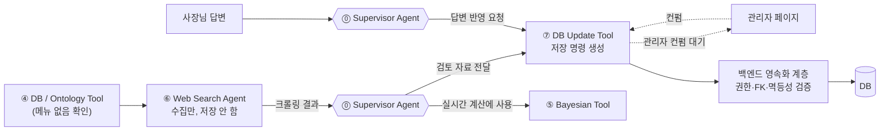
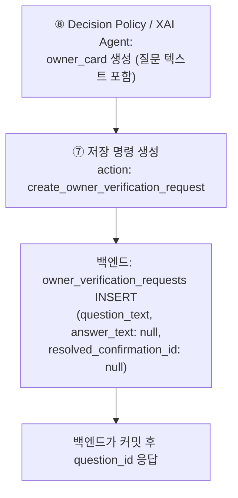
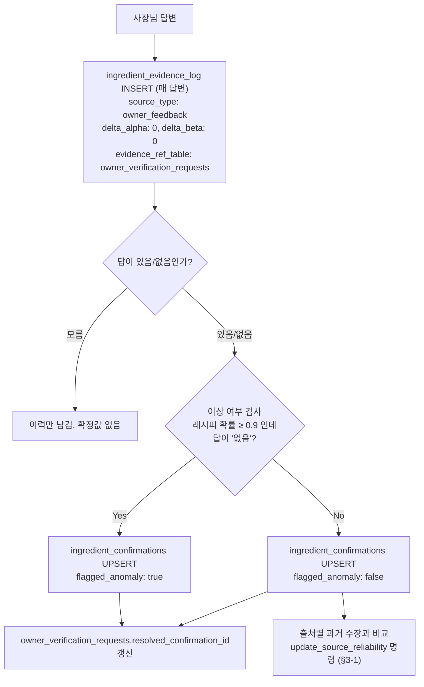

# ⑦ DB Update Tool 스펙

담당: 윤지
상태: 초안 (미확정 항목은 §8 참조)
상위 문서: `caution-multi-agent-architecture.md`, `caution-db-schema.md`
짝 문서: [`6-agent-websearch.md`](6-agent-websearch.md) (⑥ Web Search Agent) — ⑦이 받는 soft evidence를 수집하는 쪽

---

## 0. 역할 범위

⑦은 새롭게 확보된 근거를 **출처·신뢰도·검증 상태와 함께 저장하도록 하는 저장 명령 Tool**이다. Hard Evidence와 Soft Evidence를 분리해, 관리자 검토가 필요한 명령과 사장님 답변 반영 명령을 구분해 만든다.

⑦은 DB 자격 증명을 갖지 않는다. 출력은 백엔드에 대한 **명령**이고, 권한·FK·멱등성 검증과 실제 저장은 백엔드가 한다.

| 하지 않음 | 담당 |
|---|---|
| 웹 크롤링 | ⑥ Web Search Agent |
| 확률 계산 | ⑤ Bayesian Tool |
| DANGER/CAUTION/SAFE 판정 | ⑧ Decision Policy / XAI Agent |
| 사장님 질문 문구 생성 | ⑧ Decision Policy / XAI Agent |
| 관리자 승인/반려 판단 자체 | 관리자 (사람) |
| 물리 DB 쓰기와 트랜잭션 | 백엔드 영속화 계층 |
| `ingredient_risk_scores` 직접 UPDATE | 누구도 하지 않음. `ingredient_evidence_log` INSERT 후 애플리케이션 로직이 재계산 |
| `menu_ingredient_cache` 저장 명령 | ④ (§4) |

### 0-1. 설계 원칙

- **soft evidence는 사람 승인 전에는 DB에 들어가지 않는다.** 웹 검색 결과와 런타임 변형 제안은 관리자 검토 항목으로만 만든다.
- **이력은 지우지 않는다.** 확정 테이블은 최신값으로 덮어써도, 증거 로그에는 매 답변을 새 행으로 남긴다.
- **모든 명령에 출처와 검증 상태를 붙인다** (§3).
- **저장과 신뢰 판단을 분리한다.** ⑦은 이상 답변 표시를 붙여 저장할 뿐, 그 값을 믿을지는 ③ 이후 단계가 정한다.
- **명령은 멱등이어야 한다.** 같은 명령이 두 번 와도 한 번만 반영되도록 `idempotency_key`를 붙이고, Supervisor는 ⑦ 명령을 자동 재시도하지 않는다 (⓪ §6-1).
- **외부 경계는 Pydantic 모델로 검증한다** (⓪ §1-3).

> ⑦이 Tool인 이유: 증거 종류에 따라 정해진 저장 명령을 **수행**하는 실행 노드이고, 무엇을 믿을지에 대한 판단은 하지 않는다 (`docs/ppt-baseline.md` 7쪽 "Agent는 판단하고 Tool은 수행한다").

### 0-2. 기준 문서 대응

[`ppt-baseline.md`](ppt-baseline.md)의 ⑦ 관련 내용과 이 문서의 대응 위치다. 이 표의 항목이 빠지면 이 문서가 틀린 것이다.

| PPT 표현 | 이 문서 |
|---|---|
| 7쪽: 새롭게 확보된 근거를 출처·신뢰도·검증 상태와 함께 저장 (`Provenance`, `근거 저장`) | §3 출처·검증 상태 관리, §3-1 출처 신뢰도 계산, §2 |
| 7쪽: Hard Evidence와 Soft Evidence를 분리 관리 (`신뢰도 분리`) | §0-3, §2-1, §2-3 |
| 8쪽 5: 웹 검색·변형 후보 → 관리자 검토·승인 → DB Update Tool | §2-1 |
| 8쪽 5: 사장님 확인 정보 → 최소 n회 이상 시 기록·이상 여부 검사 → DB Update Tool | §2-3 |
| 8쪽 6: 사장님 확인 n건↑이면 확정, n개월마다 재확인 | §2-3. n=1, 기간 만료 없음 (⓪ #151). 주기적 재확인은 두지 않는다 |

### 0-3. 증거 신뢰도 계층 (⑥⑦ 공통 전제)

⑥과 ⑦은 "웹서치 결과 → 관리자 컨펌 → DB 반영"이라는 하나의 파이프라인을 나눠 맡는다. 두 문서의 공통 축은 **증거 신뢰도 계층**이다.

| 구분 | 예시 | 처리 주체 | 반영 시점 |
|---|---|---|---|
| **soft evidence** | 웹서치 크롤링 결과, ④의 변형 태깅 제안 | ⑥ → ⑦ → 백엔드 | **관리자 컨펌 후에만** DB 반영 |
| **hard evidence** | 사장님 답변 | ⑦ → 백엔드 | 답변 이력은 **즉시** 기록. `present`/`absent` 답 **한 번**으로 이상 여부 검사를 거쳐 확정값(`ingredient_confirmations`)이 바로 생기거나 바뀐다 (§2-3) |

이 구분이 왜 필요한가: `caution-db-schema.md` §5 원칙 — "웹서치 캐시 데이터는 실제 식당 레시피로 간주하지 않고, danger 판정을 낮추는 데 쓰지 않음". 기계가 혼자 추측한 데이터를 사람 검토 없이 공유 DB(`ingredient_risk_scores`)에 자동으로 흘려보내면, 크롤링 하나가 잘못돼도 그 가게를 스캔하는 모든 이후 사용자의 확률이 조용히 오염된다. 사장님 답변은 사람이 직접 확인해준 것이라 관리자 검토는 거치지 않지만, 답 한 번과 이상 여부 검사를 거쳐 바로 확정값이 된다 (단일 확인 정책, ⓪ #151).

> PPT의 n은 **1**이다 (단일 확인 정책, ⓪ #151. 2026-10-06 #193의 n=2를 대체).

### 0-4. ⑥ ↔ ⑦ 역할 분담



- **⑥ Web Search Agent**: DB에 없는 메뉴를 크롤링으로 조사만 함. 상세는 [`6-agent-websearch.md`](6-agent-websearch.md).
- **⑦ DB Update Tool**: 증거 종류에 따라 관리자 검토 명령과 답변 반영 명령을 구분해 만든다. 웹 경로에서는 Supervisor가 ⑦ 명령을 만든 뒤 ⑤를 호출한다 (⓪ §2).

---

## 1. 입력 / 출력 스펙

**JSON 형식은 [⓪ §4-6 "⑦ DB Update Tool"](0-agent-supervisor.md)에서만 정의한다** (요청 `DbUpdateRequest`, 응답 `DbUpdateResponse`, 공통 모델은 ⓪ §1-2). 이 문서에는 JSON을 다시 적지 않고, ⑦이 값을 어떻게 정하는지만 적는다. 필드를 바꿀 때는 ⓪부터 고친다.

### 1-1. 입력에서 ⑦이 지키는 것

Supervisor가 저장할 일을 `operations[]`로 묶어 보낸다. 공통 문맥은 ⓪ §1-2 `NodeContext`.

| 트리거 | ⓪ operation | 증거 등급 |
|---|---|---|
| 웹서치 결과 | `create_review_item` (`review_origin: web_search`) + `save_web_search_cache` | soft |
| ④의 변형 태깅 제안 | `create_review_item` (`review_origin: variant_suggestion`, ④ `variant_suggestion` 그대로) | soft |
| ⑧의 질문 카드 | `create_owner_verification_request`. 재료 카드와 메뉴 애매함 플래그 카드 두 종류 (§2-2) | 신규 질문 |
| 사장님 답변 | `record_owner_answer`. 질문과 같은 종류 (§2-3, §2-4) | hard |

- `db_registered` 변형은 이미 컨펌된 데이터라 ⑦ 대상이 아니다 (④ §5-2).
- 사장님 답변은 스캔 흐름 밖에서 들어온다. `context.call_scope: out_of_band`, `item_id: null`이고, `scan_session_id`는 원래 질문이 생긴 스캔이다.
- 질문 문구는 **한국어(`ko`) + 사용자 언어** 두 개만 담은 객체다 (10/14 회의, ⓪ §4-7·⑧). 사용자 언어가 `ko`면 한 개다. `owner_verification_requests.question_text`(언어 키 JSONB)에 받은 그대로 저장한다.
- 확인 정보는 **사장님 답변만** 다룬다. 관광객이 직접 알려주는 재료 정보는 수집 경로가 없어 트리거를 두지 않는다 (③ 결정, 2026-10-09).

### 1-2. 출력 값을 정하는 규칙

모든 출력은 **저장 명령**(`commands[]`)이다. 저장 완료 응답이 아니며, 백엔드가 커밋한 뒤 생성 ID(예: `question_id`)와 최종 상태를 응답한다.

| ⑦이 만드는 `action` | 언제 |
|---|---|
| `create_review_item` | 웹서치 결과 / 변형 태깅 제안 (§2-1) |
| `create_owner_verification_request` | ⑧ 질문 카드 (§2-2) |
| `record_owner_answer` | 사장님 답변. 이력 기록 + 즉시 확정 (§2-3, §2-4) |
| `update_source_reliability` | 사장님 확정값이 생기거나 바뀜 (§3-1) |
| `save_web_search_cache` | ⑥ 웹서치 결과 원본 (관리자 게이트 없음, §4) |

- 허용 action은 위 5종 + ④가 직접 만드는 `save_menu_ingredient_cache`, 총 6종이다 (`ai_command_receipts.action`, `caution-db-schema.md` §4).
- 모든 명령은 `idempotency_key`를 가진다. 백엔드는 `ai_command_receipts`에 먼저 기록하고, 이미 있으면 다시 실행하지 않는다 (§3-2).
- `idempotency_key`는 **내용 기준**이다: action과 내용 키(예: 질문은 가게·스캔·`item_id`·`card_id`·메뉴·재료 또는 플래그, 답은 `question_id`)의 해시. `trace_id`·`operation_id`는 넣지 않는다. 넣으면 같은 스캔을 재시도할 때 같은 질문이 또 저장된다. action별 내용 키는 ⓪ §4-6 표를 따른다.
- `context`는 입력 값을 수정하지 않고 그대로 돌려준다. 메뉴·재료 ID는 정수, 질문 ID는 UUID다.
- 스캔 중에 만든 명령은 Supervisor 최종 응답의 `persistence_commands`로 백엔드에 전달된다.

**백엔드의 `record_owner_answer` 처리 결과** (§2-3)

백엔드는 `present`/`absent` 답을 같은 트랜잭션에서 확정값에 바로 반영하고, 확정값 ID를 질문 행에 연결한다. 2·3차 질문이나 진행 상태(`round`, `previous_question_id`, `confirmation_state`, `owner_question_states`)는 만들지 않는다 (⓪ #151). `unknown` 답은 이력에만 남고 확정값을 만들지 않는다.

## 2. 처리 로직

### 2-1. soft evidence 처리 (관리자 컨펌 게이트)

```mermaid
flowchart TD
    IN["웹서치 결과 OR 변형 태깅 제안"] --> CMD["⑦ 저장 명령 생성<br/>action: create_review_item<br/>verification_status: pending_review"]
    CMD --> REVIEW["백엔드: 관리자 검토 항목 저장<br/>(source_url/extracted_ingredients 또는<br/>base_menu_id/remain_token/suggested_ingredients 포함)"]
    REVIEW --> WAIT{관리자 판단}
    WAIT -->|반려| DROP["반영 안 함, 로그만 남김<br/>verification_status: rejected"]
    WAIT -->|승인| KIND{어떤 근거?}
    KIND -->|변형 태깅 (가게 메뉴판)| M1["1. menus INSERT<br/>(source: variant_generated)"]
    M1 --> M2["2. recipe_ingredients INSERT<br/>(evidence_type: variant)"]
    M2 --> M3["3. ingredient_evidence_log INSERT<br/>(source_type: ocr_variant_tag,<br/>delta_alpha = 출처 신뢰도 × 1, delta_beta = 0,<br/>review_item_id로 검토 항목 연결)"]
    M3 --> M4["4. 애플리케이션 로직이<br/>ingredient_risk_scores α/β 재계산"]
    KIND -->|웹 레시피| W1["승인 레시피 수 세기<br/>(같은 메뉴의 approved 검토 항목)"]
    W1 --> W2{30개 이상?}
    W2 -->|No| W3["대기. DB 등록 안 함<br/>판정은 ⑥이 캐시 레시피로 계속"]
    W2 -->|Yes| W4["공용 메뉴 등록<br/>menus INSERT (source: web_search_generated)<br/>→ recipe_ingredients INSERT (evidence_type: web_search)<br/>가게 prior에는 넣지 않음"]
```

**승인된 웹 레시피는 30개가 모이면 공용 메뉴로 등록한다 (결정, 2026-10-20, ⑥ §2-4와 같음).**
- 웹 레시피는 인터넷에서 찾은 일반 레시피라 **그 가게의 레시피가 아니다.** 그래서 `ingredient_evidence_log`·`ingredient_risk_scores`(가게 prior)에 넣지 않는다. 넣으면 남의 레시피가 "이 가게 증거"가 된다.
- 승인 1건마다 메뉴를 등록하지 않는다. 레시피 몇 개만으로 DB 메뉴가 생기면 그때부터 웹서치가 멈춰 30개 기준이 의미가 없어진다.
- 30개 전까지는 등록하지 않고, ⑥이 웹 캐시 레시피로 판정한다 (CAUTION).
- 30개가 되면 백엔드가 `menus`(`source: web_search_generated`) → `recipe_ingredients`(`evidence_type: web_search`) 순서로 등록한다. 이후 그 메뉴는 ④⑤ 경로로 간다.
- 미확정: 30개 레시피의 "n개 중 k개" 통계도 함께 넣을지. 제안은 크롤링 코퍼스와 같은 형태로 `menu_recipe_corpora`·`menu_ingredient_priors`에 `corpus: web_search`로 넣는 것이다. 그러면 ⑤가 다른 사이트처럼 계산하고 출처 신뢰도 `web_search`가 적용된다 (§8, `caution-db-schema.md` §6 22번).
- **변형 태깅 근거는 그 가게 메뉴판에서 나온 것**이라 지금처럼 가게 prior(`ocr_variant_tag`)에 반영한다.

**soft 증거의 δ 값 (결정, 2026-10-10):** 승인된 변형 근거는 "이 재료가 있다"는 근거 1건이다. ⑦은 기록할 때 그 출처의 현재 신뢰도를 곱해 `delta_alpha = 신뢰도 × 1`, `delta_beta = 0`으로 넣는다. `ingredient_risk_scores`에는 출처별로 나뉘지 않은 합계만 남으므로, 신뢰도는 기록 시점에 곱해야 한다 (⑤ §3-3). 후보 목록에 없다고 β를 더하지 않는 이유는 큐레이션 레시피와 같다. 목록에 없다고 안 들어간다는 뜻이 아니다.

**순서가 고정인 이유**: `menus` → `recipe_ingredients` → `ingredient_evidence_log` 순서를 지키지 않으면 FK가 끊긴다 (`caution-db-schema.md` §7-3, §7-4). `ingredient_risk_scores`는 이 로그 재계산 결과로만 갱신되고 **직접 UPDATE는 절대 금지**.

**관리자 페이지에 뭐가 보이는가** (§8에서 UI 세부는 미확정이지만 최소 노출 데이터):
- 웹서치 건: 메뉴명, 후보 URL별 추출 재료 목록, 크롤링 시각
- 변형 태깅 건: 원본 메뉴명, remain 토큰, 제안된 재료

### 2-2. 질문 생성 처리 (`owner_verification_requests` 최초 INSERT)



- **질문 내용(무엇을 물을지)은 ⑧이 만들고, 저장 명령은 ⑦이 만들고, 실제 저장은 백엔드가 한다** — "판정/설명은 ⑧, 저장 명령은 ⑦, 물리 쓰기는 백엔드"라는 역할 분리를 따름.
- **질문은 두 종류다** (⓪ §4-6, ⑧ §2-1 5-2). 재료 질문은 `ingredient_id`를, 메뉴 애매함 플래그 질문은 `ambiguity_flag`와 물어본 태그(`asked_tags`, 카드의 `constraint_tags`)를 저장한다. 플래그 질문은 `ingredient_id`가 NULL이다 (`caution-db-schema.md` §3).
- 정보 없는 메뉴의 화면 표시용 카드(`ingredient: null`, `ambiguity_flag: null`)는 저장 명령을 만들지 않는다 (⓪ §4-6).
- 백엔드가 이 단계에서 발급한 `question_id`가 이후 "사장님 답변" 트리거(§1-1)에서 그대로 쓰인다 — 답변 처리는 질문이 이미 존재한다고 전제하므로, 이 단계가 빠지면 사장님 답변을 저장할 대상 행 자체가 없다.

### 2-3. hard evidence 처리 (이력 즉시 기록, 확정은 2번 일치 또는 3번 중 2번)



- **확정 조건 (결정, 단일 확인 정책, ⓪ #151)**: 같은 재료에 대한 사장님 답은 **한 번만** 받는다. `present`/`absent` 답이 오면 이상 여부 검사를 거쳐 **바로 확정**한다. 2·3차 질문과 다수결은 없다 (2026-10-10 #193의 n=2 규칙을 대체).
  - "모름" 답변은 확정값을 만들지 않고 이력에만 남는다.
  - 한 번 잘못 누른 답(오조작)은 따로 거르지 않는다. 대신 레시피상 거의 확실한 재료에 "없음"을 누르면 이상 답변으로 잠겨 SAFE로 새지 않는다 (아래).
- 확정값이 아직 없는 동안 ③은 해당 재료를 미확인으로 본다. 그동안 ⑤의 확률 계산과 ⑧의 CAUTION 판정이 유지되어 SAFE로 새지 않는다.
- **이미 확정값이 있을 때**: 같은 대상에 새 답이 오면 **가장 최근 답으로 바로 덮어쓴다.** 이전 답은 질문 행 이력에 남는다.
- **유효기간 없음 (⓪ #151):** 사장님 확정값은 기간이 지났다는 이유만으로 만료하거나 다시 묻지 않는다. `confirmed_at`은 감사·이력 표시용이다. 사장님 답변은 확률 계산에도 쓰지 않는다 (10/10 회의, ⑤ §1-1).
- `ingredient_confirmations`는 UNIQUE `(store_id, menu_id, ingredient_id)` — `present`/`absent` 답이 오면 **upsert(덮어씀)**. 이 테이블은 항상 "현재값 스냅샷" 1행만 유지하고, 과거 답변은 남기지 않는다.
- **답변 이력은 `ingredient_evidence_log`에 별도로 남긴다.** upsert와 별개로, 매 답변마다 `source_type: owner_feedback`, `evidence_ref_table: owner_verification_requests`(해당 질문 행 참조)로 **새 행을 추가**한다 — 이 테이블은 절대 덮어쓰지 않으므로, "사장님이 같은 질문에 답을 몇 번 바꿨는지" 같은 이상 패턴을 나중에 여기서 확인할 수 있다. `delta_alpha`/`delta_beta`는 확정 답변이 확률 계산을 거치지 않으므로 `0`으로 기록 — 재계산 로직에 영향 없이 순수 이력 기록 용도.
- `flagged_anomaly=true`여도 **⑦은 저장 명령만 만듦, "그대로 신뢰할지"는 ⑦의 책임이 아님.** AGENTS.md 확정 정책에 따라 anomaly 재료는 override가 거부된다. ③이 `override_eligible: false`로 반환하고, Supervisor가 `anomaly_locked: true`를 붙여 ⑤ 확률 계산으로 보내며, ⑧은 **확률 값과 무관하게 CAUTION 이상을 강제**한다 (③ §1-6, ⑤ §1-4). 저장(⑦)과 신뢰 판단(③ 이후)의 책임을 분리한 것.
- **이상 답변 기준 (결정, 2026-10-06, #193)**: 레시피상 그 재료가 들어갈 확률(⑤ `posterior_mean`)이 **0.9 이상**인데 답이 **"없음"**이면 `flagged_anomaly: true`를 붙인다. **"있음" 답변은 이상 답변으로 보지 않는다.** "있음"을 믿는 것은 더 조심하는 쪽이라 위험을 놓치지 않고, "있음"에 표시를 붙이면 override가 거부돼 DANGER 근거가 CAUTION으로 내려가기 때문이다.
- **비교할 확률은 질문을 만들 때 저장한다 (결정, 2026-10-13).** 사장님 답은 스캔 밖에서 들어와 그 순간에는 ⑤ 결과가 없다. 그래서 Supervisor가 `create_owner_verification_request`에 그 스캔의 ⑤ `posterior_mean`을 `recipe_probability`로 넣고, 백엔드가 `owner_verification_requests.recipe_probability`에 저장한다. 답을 확정할 때는 **그 답이 달린 질문**의 값을 쓴다. 질문 시점의 값이라 그 사이 레시피 데이터가 바뀌어도 다시 계산하지 않는다. 플래그 질문은 비교할 확률이 없어 `NULL`이다 (§2-4).
- 답이 확정되면 `owner_verification_requests.resolved_confirmation_id`를 방금 만든 confirmation 행으로 갱신 (`present`/`absent` 답은 항상 채운다, DB 스키마 §6 16번) — ⑧이 생성한 질문과 실제 반영 결과를 연결하기 위함.

### 2-4. 메뉴 애매함 플래그 답 처리 (결정, 2026-10-13)

메뉴에 "젓갈 종류 불분명"(`has_unclear_jeotgal`) 같은 애매함 플래그가 있으면 ⑧이 재료가 아니라 메뉴 단위로 묻는다. 예) "이 메뉴의 젓갈에 생선이 들어가나요?" (③ §1-8, ⑧ §2-1 5-2). 그 답의 저장 명령도 ⑦이 만든다.

| 항목 | 재료 답 (§2-3) | 플래그 답 |
|---|---|---|
| 확정 단위 | `(가게, 메뉴, 재료)` | `(가게, 메뉴, 플래그, 물어본 태그)`. 같은 플래그라도 다른 태그로 물은 답은 따로 |
| 확정 조건 | 답 1번으로 즉시 확정 | **같음** |
| 유효기간 | 없음 | **같음** |
| 이상 답변 표시 | 레시피 확률 ≥ 0.9 + "없음" | **없음.** 비교할 확률이 없다 |
| 확정값 저장 | `ingredient_confirmations` | `owner_flag_confirmations` (신규 제안, `caution-db-schema.md` §3) |
| 증거 로그 | `ingredient_evidence_log`에 매번 기록 | **기록하지 않음.** 확률에 쓰지 않고, 로그 테이블은 재료가 필수다. 이력은 `owner_verification_requests` answered 행 |
| 출처 신뢰도 갱신 | 있음 (§3-1) | **없음.** 플래그에 대해 주장한 출처가 없다 |

- `present`의 뜻: 물어본 태그 중 **하나 이상** 있으면 `true`, **전부** 없으면 `false` (⓪ §4-2 `flag_confirmations`).
- "모름" 답은 재료 답과 같이 확정값을 만들지 않는다.

---

## 3. 출처·검증 상태 관리 (Provenance)

PPT 7쪽 "출처·신뢰도·검증 상태와 함께 저장"은 세 곳으로 나눠 표현한다. 명령 형식은 ⓪ §4-6에서만 정의한다.

| 무엇 | 어디에 | 누가 정함 |
|---|---|---|
| 출처 | 명령 `payload.provenance`의 `origin_node`·`source_type`·`evidence_class`·`evidence_refs` (action별 고정값은 ⓪ §4-6 표) | ⑦ |
| 검증 상태 | `knowledge_review_items.status`(`pending` / `approved` / `rejected`), `ingredient_confirmations.source`(`owner_confirmed`) | 백엔드가 action별 저장 정책으로 정함. 명령에 넣지 않는다 |
| 신뢰도 | `source_reliability` 테이블 (§3-1). 가게 증거는 `delta_alpha`에 곱해 넣는다 | ⑦이 `update_source_reliability`로 갱신 명령을 만들고 백엔드가 저장. 명령 provenance에 넣지 않는다 |

- ④ `runtime_tagged` 변형 제안은 `source_type: ocr_variant_tag`로 기록한다. 관광객 피드백은 출처로 쓰지 않는다 (③ 결정).

### 3-1. 출처 신뢰도 계산 (결정, 2026-10-06, #194)

출처 신뢰도는 **"이 출처가 말한 재료 정보가 사장님 확정값과 얼마나 잘 맞았나"** 를 0~1 숫자로 나타낸다. 잘 맞추면 올라가고, 틀리면 내려간다. PPT 9쪽 5의 출처 신뢰도 추적(Dawid-Skene 응용)을 이 방식으로 구현한다.

```
신뢰도(출처) = (맞춘 수 + 1) / (비교한 수 + 2)
```

| 비교 기록 | 신뢰도 | 뜻 |
|---|---|---|
| 0건 중 0건 | 0.50 | 아직 모름. 반만 믿음 |
| 10건 중 9건 맞춤 | 0.83 | 꽤 믿을 만함 |
| 62건 중 62건 맞춤 | 0.98 | 거의 항상 맞음 |
| 62건 중 0건 맞춤 | 0.02 | 거의 항상 틀림 |

**무엇을 비교하나**

- **정답:** 사장님 확정값이다. 확정 조건(§2-3)을 채워 확정된 값만 쓰고, 이상 답변 표시(`flagged_anomaly`)가 붙은 확정값은 쓰지 않는다.
- **출처의 주장:** 같은 가게·메뉴·재료에 대해 그 출처가 앞서 남긴 정보다 (`ingredient_evidence_log`).
  - 웹 검색(`web_search`): 후보 재료 목록에 그 재료가 있으면 "있음" 주장이다. 목록에 없다고 "없음"으로 보지는 않는다.
  - 크롤링 코퍼스(`corpus:semie` / `corpus:wtable` / `corpus:10000recipe`): 사이트마다 따로 센다. 그 사이트 레시피상 확률(`(k+1)/(n+2)`)이 0.5 이상이면 "있음", 미만이면 "없음" 주장이다.
  - 큐레이션 레시피(`curated`): 목록에 있으면 "있음" 주장이다. 목록에 없다고 "없음"으로 보지는 않는다.
- **맞춤:** 출처의 주장과 사장님 확정값이 같으면 맞춘 것이다.
- 같은 출처의 같은 가게·메뉴·재료 주장은 한 번만 센다.

**언제 갱신하나**

1. 사장님 답변으로 확정값이 새로 생기거나 바뀌면(§2-3), ⑦은 그 재료에 대해 출처별 과거 주장을 확정값과 비교한다.
2. 출처별 "비교한 수 +1, 맞췄으면 맞춘 수 +1" 증가분을 `update_source_reliability` 명령으로 만든다.
3. 백엔드가 출처별 누적값을 `source_reliability`에 저장하고 신뢰도를 다시 계산한다. ⑦은 DB에 직접 쓰지 않는다.
4. ⑤는 계산할 때마다 최신 신뢰도를 읽어 쓴다.

**저장 테이블 `source_reliability` (백엔드에 생성 요청, 2026-10-10)**

| 컬럼 | 타입 | 설명 |
|---|---|---|
| `source_type` | VARCHAR, PK | 출처. `corpus:10000recipe`, `curated`, `web_search`, `ocr_variant_tag` 등 |
| `agree_count` | INTEGER, 기본 0 | 사장님 확정값과 맞은 수 |
| `compared_count` | INTEGER, 기본 0 | 비교한 수 (`agree_count` 이하) |
| `reliability` | NUMERIC, GENERATED | `(agree_count + 1) / (compared_count + 2)` |
| `last_evidence_id` | BIGINT, FK → `ingredient_evidence_log.id`, NULL 허용 | 마지막으로 반영한 증거 |
| `updated_at` | TIMESTAMPTZ | 갱신 시각 |

**신뢰도 세부 (결정, 2026-10-12)**

- **시작값 0.5**: 비교한 적이 없으면 `(0 + 1) / (0 + 2) = 0.5`. 따로 정하지 않고 공식 그대로 쓴다.
- **"있음"과 "없음" 정확도를 나누지 않는다.** 초기에는 비교 건수가 적어 둘로 나누면 둘 다 0.5 근처에 머문다. "없음"을 틀리는 위험은 이미 anomaly 검사(§2-3)와 "확률만으로는 SAFE 없음"(⑧ §3)이 막는다.
- **최소 비교 건수를 두지 않는다.** 공식의 +1/+2가 비교 수가 적을 때 신뢰도를 0.5 쪽으로 잡아 준다.
- 영향: 처음에는 크롤링 근거가 절반만 반영된다. 확률이 0.5 쪽으로 가고 신용구간이 넓어져 사장님 질문 후보가 늘어난다 (⑤ §1-2-2). FN 쪽으로는 안전한 방향이다.

**가게를 넘는 범위**

신뢰도는 가게별이 아니라 **출처 종류별** 값이다. 여러 가게의 사장님 확정값으로 함께 배운다. 다른 가게의 확정값 자체는 이 가게 확률에 쓰지 않고(가게 스코프 원칙), "어느 출처가 믿을 만한가"만 공유한다. 가게 증거로 전역 prior를 갱신하지도 않는다 (⑤ §0-1, 2026-10-10 회의).

**PPT 9쪽 숫자와의 관계**

PPT 표는 1.000에서 시작해 1을 넘을 수 있는 다른 눈금이다 (web_crawl 1.946, partner_api 0.000). 이 문서는 가장 높은 값을 1로 두는 0~1 눈금을 쓴다. PPT 결과를 이 눈금으로 옮기면 web_crawl은 1에 가깝고 partner_api는 0에 가깝다. 계속 맞추는 출처는 오르고 계속 틀리는 출처는 0으로 떨어진다는 성질은 같다. PPT는 정답 없이 출처끼리 비교하는 EM 방식이었지만, 여기서는 사장님 확정값을 정답으로 쓸 수 있어 단순 비율로 계산한다.

### 3-2. 저장 명령별 SQL (백엔드가 실행)

⑦은 아래 SQL을 실행하지 않는다. 명령(`action` + `payload`)만 만들고, 백엔드가 같은 트랜잭션 안에서 실행한다. 백엔드 ERD(V9·V10) 기준 PostgreSQL 예시다.

**공통 — 멱등 영수증**

```sql
INSERT INTO ai_command_receipts (action, idempotency_key, store_id, request_hash, result)
VALUES (:action, :idempotency_key, :store_id, :request_hash, :result)
ON CONFLICT (action, idempotency_key) DO NOTHING
RETURNING action;   -- 반환 행이 없으면 이미 처리한 명령 → 아래를 실행하지 않음
```

**`create_owner_verification_request`**

```sql
-- 재료 질문: :ingredient_id 값, :ambiguity_flag·:asked_tags NULL
-- 플래그 질문: :ingredient_id NULL, :ambiguity_flag·:asked_tags 값 (asked_tags는 정렬)
-- :recipe_probability = 질문 시점 ⑤ posterior_mean (재료 질문만, 플래그 질문은 NULL)
INSERT INTO owner_verification_requests
       (id, store_id, scan_session_id, menu_id, ingredient_id, ambiguity_flag, asked_tags, recipe_probability,
        card_id, question_text, status)
VALUES (:id, :store_id, :scan_session_id, :menu_id, :ingredient_id, :ambiguity_flag, :asked_tags, :recipe_probability,
        :card_id, :question_text, 'pending')
ON CONFLICT DO NOTHING;
```

**`record_owner_answer` — 재료 답** — 이력 기록 + 즉시 확정 (§2-3)

```sql
UPDATE owner_verification_requests
SET status = 'answered', answer = :answer, answered_at = now()
WHERE id = :question_id AND status = 'pending';

INSERT INTO ingredient_evidence_log (store_id, menu_id, ingredient_id, source_type, delta_alpha, delta_beta, owner_verification_request_id)
VALUES (:store_id, :menu_id, :ingredient_id, 'owner_feedback', 0, 0, :question_id);

-- answer가 unknown이면 여기서 끝 (확정값 없음)
-- :flagged_anomaly = (:answer = 'absent') AND (이 질문의 recipe_probability >= 0.9)

INSERT INTO ingredient_confirmations (store_id, menu_id, ingredient_id, present, source, flagged_anomaly, confirmed_at)
VALUES (:store_id, :menu_id, :ingredient_id, :present, 'owner_confirmed', :flagged_anomaly, now())
ON CONFLICT (store_id, menu_id, ingredient_id)
DO UPDATE SET present = EXCLUDED.present, flagged_anomaly = EXCLUDED.flagged_anomaly,
              confirmed_at = EXCLUDED.confirmed_at, updated_at = now()
RETURNING id;   -- → owner_verification_requests.resolved_confirmation_id에 기록
```

**`record_owner_answer` — 플래그 답** (§2-4). 증거 로그·신뢰도 갱신 없음

```sql
UPDATE owner_verification_requests
SET status = 'answered', answer = :answer, answered_at = now()
WHERE id = :question_id AND status = 'pending';

-- answer가 unknown이면 여기서 끝 (확정값 없음)

INSERT INTO owner_flag_confirmations (store_id, menu_id, ambiguity_flag, asked_tags, present, confirmed_at)
VALUES (:store_id, :menu_id, :ambiguity_flag, :asked_tags, :present, now())
ON CONFLICT (store_id, menu_id, ambiguity_flag, asked_tags)
DO UPDATE SET present = EXCLUDED.present, confirmed_at = EXCLUDED.confirmed_at, updated_at = now()
RETURNING id;   -- → owner_verification_requests.resolved_flag_confirmation_id에 기록
```

**`create_review_item` 승인 후 soft 증거 반영** — 로그 INSERT 후 재계산 (직접 UPDATE 금지)

```sql
INSERT INTO ingredient_evidence_log (store_id, menu_id, ingredient_id, source_type, delta_alpha, delta_beta, review_item_id)
VALUES (:store_id, :menu_id, :ingredient_id, :source_type, :reliability * 1, 0, :review_item_id);

INSERT INTO ingredient_risk_scores (store_id, menu_id, ingredient_id, delta_alpha_sum, delta_beta_sum, evidence_count, last_evidence_id)
SELECT store_id, menu_id, ingredient_id, SUM(delta_alpha), SUM(delta_beta), COUNT(*), MAX(id)
FROM ingredient_evidence_log
WHERE store_id = :store_id AND menu_id = :menu_id AND ingredient_id = :ingredient_id
  AND source_type <> 'owner_feedback'                 -- 사장님 답변 이력(δ=0)은 확률에 안 씀
GROUP BY store_id, menu_id, ingredient_id
ON CONFLICT (store_id, menu_id, ingredient_id)
DO UPDATE SET delta_alpha_sum = EXCLUDED.delta_alpha_sum, delta_beta_sum = EXCLUDED.delta_beta_sum,
              evidence_count = EXCLUDED.evidence_count, last_evidence_id = EXCLUDED.last_evidence_id,
              updated_at = now();
```

**`update_source_reliability`**

```sql
INSERT INTO source_reliability (source_type, agree_count, compared_count, last_evidence_id, updated_at)
VALUES (:source_type, :agree, 1, :evidence_id, now())          -- :agree = 맞으면 1, 틀리면 0
ON CONFLICT (source_type)
DO UPDATE SET agree_count      = source_reliability.agree_count + EXCLUDED.agree_count,
              compared_count   = source_reliability.compared_count + 1,
              last_evidence_id = EXCLUDED.last_evidence_id,
              updated_at       = now();
```

**`save_web_search_cache`**

```sql
INSERT INTO web_search_cache (normalized_menu_name, original_menu_name, search_status, payload, next_rank, searched_at, expires_at)
VALUES (normalize_food_name(:menu_name), :menu_name, :search_status, :sources, :next_rank, :searched_at, NULL)
ON CONFLICT (normalized_menu_name)
DO UPDATE SET search_status = EXCLUDED.search_status,
              payload       = web_search_cache.payload || EXCLUDED.payload,   -- 덮어쓰지 않고 이어 붙인다
              next_rank     = EXCLUDED.next_rank,
              searched_at   = EXCLUDED.searched_at, updated_at = now();
```

- `payload`는 출처 배열(JSONB array)이다. 명령에는 이번에 새로 찾은 `sources`만 들어 있으므로 기존 배열 뒤에 붙인다. 덮어쓰면 2번째 검색 때 1~10위 레시피가 사라져 30개가 모이지 않는다 (⑥ §2-4).
- `next_rank`는 다음 검색 시작 순위다. Supervisor가 ⑥ 1단계 응답의 `next_rank`를 그대로 넣는다 (⓪ §4-5). 다음 Judge 때 백엔드가 이 값을 ⑥ 입력으로 넘긴다.
- `expires_at`은 항상 NULL이다 (⑥은 캐시 유효기간을 두지 않음).

---

## 4. 쓰기 책임 경계 — `menu_ingredient_cache`는 ⑦을 거치지 않음

AGENTS.md 기준 역할 분리는 다음과 같다.

- **물리 DB 쓰기는 백엔드만 수행한다.** ⑦을 포함한 AI 노드는 DB 자격 증명을 갖지 않는다.
- **저장 명령은 ⑦만 만든다.** `menus`/`recipe_ingredients`/`ingredient_evidence_log`/`ingredient_confirmations`/`owner_verification_requests`가 대상이다. `ingredient_risk_scores`는 명령 대상도 아니며 재계산으로만 갱신된다.
- **AGENTS.md가 정한 예외는 `menu_ingredient_cache` 하나다** (`caution-db-schema.md` §5). ④가 ⑦을 거치지 않고 저장 명령을 직접 만든다. ④가 이미 계산한 재귀 확장 결과를 저장만 하는 파생 캐시이지, 새로운 증거·사실이 아니기 때문에 관리자 컨펌 게이트가 필요 없다는 게 근거다. 이 경우에도 물리 쓰기는 백엔드가 한다 (④ §0).
- **`web_search_cache` 저장 명령은 ⑦이 만든다 (결정, #208).** ⑥은 검색만 하고, 원본 기록 명령 `save_web_search_cache`는 ⑦이 만든다. 원본 로그라 관리자 게이트 없이 바로 저장한다.

---

## 5. Supervisor와의 계약

| ⑦이 받는 것 | 보장 사항 |
|---|---|
| soft evidence 트리거 | Supervisor가 스캔 처리 중에 호출한다(⓪ §2 웹 경로). ⑦은 DB에 접근하지 않고 명령만 만들므로 빠르게 끝나며, 명령은 Supervisor 최종 응답의 `persistence_commands`로 백엔드에 전달된다. **관리자 컨펌과 DB 반영은 사용자 응답과 분리**되어 응답을 기다리게 하지 않는다 |
| hard evidence 트리거 | 사장님이 질문에 답변을 제출한 시점에 호출, 즉시 완료 응답 기대 |

| ⑦이 돌려주는 것 | 백엔드의 후속 처리 |
|---|---|
| soft evidence `action: create_review_item` | 멱등 검증 후 검토 항목 저장. 사용자 분석 응답과 분리 |
| `action: create_owner_verification_request` | 질문 행 저장 후 `question_id` 응답 |
| hard evidence `action: record_owner_answer` | 권한·FK 검증 후 트랜잭션 저장. 이력 기록은 항상, 확정값 upsert는 확정 조건(2번 일치 또는 3번 중 2번)을 채울 때. 커밋 성공 뒤에만 반영 완료 응답 |
| `action: update_source_reliability` | 출처별 맞춘 수·비교한 수 누적 후 신뢰도 재계산 (⑦ §3-1) |

**⑦이 직접 호출하지 않는 것**: 어떤 Agent·Tool도 직접 호출하지 않는다. 명령을 만들어 Supervisor에 반환하고 종료한다.

---

## 6. 예외 처리

| 상황 | 처리 |
|---|---|
| `context.store_id` 누락/null/0 이하 | `StoreIdRequiredError`. 명령을 만들지 않음. 가게 없는 스캔(`store_id: null`)이면 Supervisor가 ⑦을 부르지 않는다 (⓪ §1-3). 가게 단위 테이블에 저장할 곳이 없기 때문이다 |
| 관리자가 오랫동안 컨펌 안 함 | review item은 대기 상태 유지, DB 미반영 (SLA 미확정, §8) |
| 웹서치 후보가 여러 개고 서로 재료 목록이 다름 | 전부 관리자에게 노출, 병합 규칙은 관리자 판단 또는 별도 규칙 필요 (§8) |
| 같은 메뉴에 대해 웹서치 제안과 변형 태깅 제안이 동시에 옴 | 각각 독립된 review item으로 취급 (병합하지 않음) |
| 기존 확정값과 다른 답변이 옴 | 새 답으로 바로 덮어씀. `ingredient_evidence_log`에는 매번 새 행이 남아 변경 이력은 보존됨 |
| 확정값 없이 답이 1번만 옴 | 이력만 기록, 확정값 생성 보류. ③은 미확인으로 계속 취급 |
| 같은 명령이 두 번 전달됨 | 같은 `idempotency_key`로 백엔드가 한 번만 반영 |

오류는 ⓪ §6-1 공통 오류 모델(`code`, `node`, `item_id`, `retryable`, `fallback`)로 Supervisor에 반환한다. ⑦ 저장 명령은 Supervisor가 자동 재시도하지 않는다 (⓪ §6-1).

---

## 7. 테스트 케이스

| # | 입력 | 기대 동작 | 검증 포인트 |
|---|---|---|---|
| 1 | 관리자가 변형 태깅 제안 승인 | 백엔드가 `menus`→`recipe_ingredients`→`ingredient_evidence_log` 순서로 INSERT | FK 순서 위반 시 트랜잭션 전체 실패 |
| 1-b | 관리자가 웹 레시피 승인, 같은 메뉴 승인 누적 29개 | DB 등록 없음, 가게 prior 변경 없음 | 승인 1건으로 메뉴가 생기지 않을 것 |
| 1-c | 웹 레시피 승인 누적 30개 | 공용 `menus`·`recipe_ingredients` 등록, `ingredient_evidence_log` 없음 | 웹 레시피가 가게 prior에 들어가지 않을 것 |
| 2 | 관리자가 제안 반려 | DB 변경 없음 | `ingredient_risk_scores` 그대로 |
| 3 | 사장님 답 1번 (돈까스 + "돼지고기 있음") | ⑦이 `record_owner_answer` 명령 생성, 백엔드가 이력 기록 후 `ingredient_confirmations` UPSERT | 커밋 후 다음 조회부터 확정값 반환 |
| 3-b | 사장님 답 "모름" | 이력만 기록 | `ingredient_confirmations` 변경 없음, ③은 미확인 유지 |
| 3-d | 확정값 "없음" + 새 답 "있음" 1번 | "있음"으로 바로 덮어씀 | 2·3차 질문 없이 최근 답을 쓸 것 |
| 3-e | 오래전에 확정한 "있음" | 그대로 확정값으로 사용 | 기간 경과만으로 만료하지 않을 것 |
| 4-b | 레시피 확률 0.95 + "없음" | `flagged_anomaly: true` | 0.9 이상 "없음"이면 표시 |
| 4-c | 레시피 확률 0.95 + "있음" | `flagged_anomaly: false` | "있음"은 이상 답변이 아님 |
| 4-d | 질문 생성 요청에 `recipe_probability: 0.95` → 나중에 "없음" | 확정 시 `flagged_anomaly: true` | 스캔 밖 답변도 질문 시점 확률로 판정할 것 |
| 4 | 사장님 이상 답변 (돈까스 + "돼지고기 없음") | `flagged_anomaly: true`로 저장, ③이 `override_eligible: false` 반환 | **확률 값과 무관하게** ⑧에서 CAUTION 이상 유지될 것 |
| 5 | 변형 태깅 제안 승인 | `base_menu_id`로 연결된 새 `menus` 행 생성, 원본 메뉴 risk score 불변 | 원본과 변형의 evidence가 안 섞일 것 |
| 6 | ⑧ 질문 생성 요청 | `create_owner_verification_request` 명령만 반환 | ⑦ 출력에 `question_id`·저장 완료 표시가 없을 것 (백엔드가 발급) |
| 7 | 모든 명령 | `payload.provenance` 포함 | `origin_node`·`source_type`·`evidence_class`·`evidence_refs`만 있고 `verification_status`·`reliability_weight`는 없을 것 (⓪ §4-6) |
| 8 | 같은 명령 2회 전달 | 한 번만 반영 | `idempotency_key`가 같을 것 |
| 8-b | 같은 스캔(`scan_session_id`)의 Judge를 다른 `trace_id`로 재시도 | 같은 질문 명령의 `idempotency_key`가 같음 | 질문 행이 하나만 생길 것 |
| 8-c | 다른 스캔에서 같은 재료를 다시 물어 답이 2건 (`question_id` 다름) | `record_owner_answer` 키가 서로 다름 | 두 답이 모두 기록되고 최근 답이 확정값이 될 것 |
| 9 | 정상 호출 | 출력 `context`가 입력과 동일 | `store_id`·`trace_id`를 수정하지 않을 것 |
| 10 | 비교 기록 없는 새 출처 | 신뢰도 0.5 | (0+1)/(0+2) |
| 11 | 웹 검색이 "있음", 사장님 확정 "있음" | 웹 검색 비교 +1, 맞춤 +1 | `update_source_reliability` 명령만 만들고 DB에 직접 쓰지 않을 것 |
| 12 | 이상 답변 표시가 붙은 확정값 | 신뢰도 비교에 쓰지 않음 | 출처 신뢰도가 바뀌지 않을 것 |
| 13 | ⑧ 플래그 카드 (`ingredient: null`, `ambiguity_flag: has_unclear_jeotgal`, `constraint_tags: [is_fish]`) | `create_owner_verification_request`에 `ambiguity_flag`·`asked_tags` 포함, `ingredient_id` 없음 | 재료 질문으로 저장되지 않을 것 |
| 14 | 플래그 질문에 "없음" 1번 | `owner_flag_confirmations`에 `present: false` 즉시 확정 | 재료 확정값 테이블에 쓰지 않을 것, 증거 로그를 남기지 않을 것 |
| 15 | 같은 플래그를 `[is_fish]`와 `[is_shellfish]`로 각각 물음 | 두 답을 따로 확정 | 한 답이 다른 태그 답을 덮어쓰지 않을 것 |
| 16 | 정보 없는 메뉴의 표시용 카드 (`ingredient: null`, `ambiguity_flag: null`) | 저장 명령 없음 | 빈 질문 행을 만들지 않을 것 |

> 웹서치 수집 단계(성공/타임아웃)의 테스트 케이스는 [`6-agent-websearch.md`](6-agent-websearch.md) §4에 있다.

---

## 8. 미확정 항목 (팀 확인 대기)

- [ ] **웹 레시피 30개 등록 때 통계 함께 저장 (백엔드와)** — `corpus: web_search`로 `menu_recipe_corpora`·`menu_ingredient_priors`에 넣을지 (§2-1, `caution-db-schema.md` §6 22번)
- [x] **10개 후보의 병합/선택 규칙** — 관리자 화면은 레시피 10개를 하나씩 보여주지 않고 **재료별로 합쳐서** 보여준다 (예: "돼지고기 8/10, 새우 2/10", 고유 레시피 기준, ⑥ §1-2 `observations`). 관리자는 재료 단위로 체크해 승인하고, 자동 채택은 하지 않는다 (2026-10-12)
- [x] **관리자 컨펌 SLA** — 두지 않는다. 검토 항목은 승인·반려될 때까지 `pending`으로 쌓이고, 대기 일수 표시나 자동 만료도 없다 (2026-10-12)
- [x] **사장님 오조작(버튼 잘못 누름) 대비** — 따로 거르지 않는다. 레시피상 거의 확실한 재료의 "없음"은 이상 답변으로 잠긴다 (단일 확인 정책, ⓪ #151)
- [x] **`ingredient_confirmations` 재답변 시 이력 보존 여부** — 확정 테이블은 최신 1행만 두고, 이력은 `ingredient_evidence_log`에 매 답변마다 남긴다. `caution-db-schema.md` §3과 본문 §2-3에 이미 정해진 내용이라 정리함
- [x] **사장님 확인 최소 건수 n** — n=1. 답 한 번으로 즉시 확정 (단일 확인 정책, ⓪ #151, §2-3. 2026-10-10 #193의 n=2를 대체)
- [x] **모순 답변 처리** — 새 답으로 바로 덮어씀 (⓪ #151)
- [x] **확정값 유효기간** — 없음. 기간 경과만으로 만료하거나 다시 묻지 않음 (⓪ #151, §2-3)
- [x] **anomaly 판정 기준** — 레시피 확률 0.9 이상 + "없음"이면 표시, "있음"은 대상 아님 (2026-10-06, #193, §2-3). ③ §6(#168)에도 같은 결정 전달 필요
- [x] **사용자 피드백 트리거** — 두지 않는다. 확인 정보는 사장님 답변만 다룬다 (③ 결정, 2026-10-09)
- [x] **`reliability_weight` 계산 위치** — ⑦이 사장님 확정값과 비교해 계산 명령을 만들고, ⑤가 사용한다. 0~1 범위 (2026-10-06, §3-1, #194). ⑥ 담당자에게 공유 필요 (⑥ §5, #125, #171)
- [x] **출처 신뢰도 세부** — 시작값 0.5(공식 그대로), "있음"/"없음" 정확도는 나누지 않음, 최소 비교 건수 없음 (2026-10-12, §3-1)
- [x] **사장님 답변의 공통 문맥** — `item_id: null` 허용. ⓪ §1 공통 문맥에서 `scan`·`out_of_band`는 null 허용으로 정해짐 (2026-10-12 확인)
- [x] **`web_search_cache` 저장 명령 주체** — ⑦이 `save_web_search_cache`로 만든다 (#208, §4)
- [x] **soft 증거의 신뢰도 반영 위치** — ⑦이 기록할 때 `delta_alpha = 신뢰도 × 1`, `delta_beta = 0` (2026-10-10, §2-1)
- [x] **멱등성** — `ai_command_receipts`, 허용 action 6종 (2026-10-10, §1-2, §3-2)
- [x] **사장님 질문 저장 언어** — `question_text`에는 한국어 + 사용자 언어 두 개만 저장한다 (10/14 회의). 컬럼이 받을 수 있는 언어 코드는 7개다 (`caution-db-schema.md` §6 7번)
- [ ] **스키마 보완 요청 (외부 의존)** — `source_reliability` 생성, `ai_command_receipts.action` 6종 등 10건을 `caution-db-schema.md` v4 §6에 정리함 (#47). 백엔드 반영 대기
- [x] **⑥ §0 동기화** — ⑥ §0이 이 표를 복사하지 않고 soft evidence 성격만 적도록 바뀌어 해당 없음 (2026-10-12 확인)
- [ ] **플래그 답 저장 테이블 (외부 의존)** — `owner_flag_confirmations` 신설과 `owner_verification_requests`의 `ingredient_id` NULL 허용·`ambiguity_flag`·`asked_tags` 추가를 백엔드에 요청함 (`caution-db-schema.md` §6 11·12번). 테이블 이름과 최종 컬럼은 백엔드가 정한다 (⓪ §8)
- [x] **2·3차 질문 연결** — 삭제. 질문은 대상마다 한 번만 만든다 (⓪ #151)
- [ ] **질문 카드 연결 컬럼 (외부 의존)** — `owner_verification_requests`에 `card_id`만 추가 요청. 차수·사슬 컬럼은 만들지 않음 (`caution-db-schema.md` §6 20번)
- [x] **이상 답변 판정용 레시피 확률** — 질문 생성 때 ⑤ `posterior_mean`을 `recipe_probability`로 저장하고, 답 확정 때 그 답이 달린 질문의 값으로 판정 (2026-10-13, §2-3). ⑧은 바뀌지 않는다 (Supervisor가 ⑤ 결과에서 채움)
- [ ] **`owner_verification_requests.recipe_probability` 컬럼 (외부 의존)** — `caution-db-schema.md` §6 15번으로 백엔드에 요청

---

## 9. 구현 계획 (GitHub Backlog / Iteration)

아래 항목은 2026-10-06에 GitHub 이슈로 등록했다. 제목 옆 번호가 이슈 번호이고, 문서 작업은 #73, 구현 작업은 #61의 하위 이슈다. **진행 상황과 결정 내용은 이슈에서 관리한다.** 아래 본문은 등록 당시 초안이다.

### Iteration 1 — 문서와 계약 확정 (10/13까지)

#### `[DOCS] ⑦ DB Update - 사장님 답변 확정 조건과 anomaly 기준 확정` (#193)

**작업 내용**

사장님 답변이 몇 건 쌓여야 확정값이 되는지, 무엇을 이상한 답변으로 보는지, 사용자 피드백을 어떻게 받는지 정한다.

**배경**

PPT는 사장님 확인이 n건 이상일 때 확정한다고 제출했다 (n=2로 결정, 2026-10-06). 이상 답변 기준이 없으면 "돈가스에 돼지고기 없음" 같은 답변이 그대로 확정되어 위험 메뉴가 SAFE로 판정될 수 있다.

**세부 작업**

- [x] 최소 확인 건수 n과 재확인 주기 결정 (③ #168과 함께) — n=1, 유효기간 없음 (⓪ #151로 변경)
- [x] anomaly 판정 임계값과 `present: true` 포함 여부 결정 — 0.9, "없음"만
- [x] 사용자 피드백 트리거와 신뢰도 등급 결정 — 쓰지 않음
- [x] 사장님 오조작 대비 방안 정리 — 따로 거르지 않음, 이상 답변 잠금만 유지
- [x] 사장님 답변의 공통 문맥(`item_id: null`) 허용 여부를 ⓪ 담당자와 확정

**관련 서비스**

- [ ] ai_ocr
- [x] ai_result
- [ ] ai_ruleengine
- [ ] ai_web_search_agent
- [ ] crawling
- [x] 공통 (app.py, README, 인프라)

**참고**

- 상위 이슈 #73, ③ 미확정 #168
- `docs/ppt-baseline.md` 8쪽 5·6

#### `[DOCS] ⑦ DB Update - 출처·검증 상태 필드와 스키마 보완 요청 정리` (#194)

**작업 내용**

모든 저장 명령에 붙는 출처·검증 상태·신뢰도 필드를 확정하고, 이를 담을 컬럼을 스키마 문서에 요청한다.

**배경**

PPT 7쪽은 ⑦이 근거를 "출처·신뢰도·검증 상태와 함께 저장"한다고 정의했지만, 현재 스키마에는 검증 상태와 신뢰도를 담을 곳이 없다.

**세부 작업**

- [x] `verification_status` 값과 전이 규칙 확정 (§2-1, `knowledge_review_items.status`)
- [x] `reliability_weight` 계산 위치 결정 (⑤·⑥과 함께) — ⑦ 계산, ⑤ 사용
- [x] 스키마 문서에 컬럼 추가 요청 (#47, #241)
- [x] 웹 후보 병합 규칙과 관리자 컨펌 SLA 결정 (⑥과 함께) — 재료별 합산 후 재료 단위 승인, SLA 없음
- [x] ⑥ §0 표와 문구 동기화 요청 (해당 없음)

**관련 서비스**

- [ ] ai_ocr
- [ ] ai_result
- [ ] ai_ruleengine
- [x] ai_web_search_agent
- [ ] crawling
- [x] 공통 (app.py, README, 인프라)

**참고**

- 상위 이슈 #73, DB 테이블 정의 #47
- `docs/caution-db-schema.md` §3

### Iteration 2 — 핵심 구현

#### `[FEAT] ⑦ DB Update - 저장 명령 모델과 soft evidence 검토 명령 구현` (#195)

**작업 내용**

공통 명령 형태(`context`, `action`, `idempotency_key`, `payload.provenance`)를 모델로 만들고, 웹 검색·변형 제안을 관리자 검토 명령으로 바꾸는 로직을 구현한다.

**배경**

soft evidence가 사람 승인 없이 DB에 들어가면 한 번의 잘못된 크롤링이 이후 모든 사용자의 확률을 오염시킨다. 명령 형태를 고정해 이 경로를 막아야 한다.

**세부 작업**

- [ ] 저장 명령 Pydantic 모델과 `context` 검증 구현
- [ ] `idempotency_key` 생성 규칙 구현
- [ ] `create_review_item` 명령 생성 구현 (웹서치·변형 제안)
- [ ] DB 쓰기 코드가 없음을 확인하는 테스트 작성

**관련 서비스**

- [ ] ai_ocr
- [ ] ai_result
- [ ] ai_ruleengine
- [x] ai_web_search_agent
- [ ] crawling
- [x] 공통 (app.py, README, 인프라)

**참고**

- 상위 이슈 #61

#### `[FEAT] ⑦ DB Update - 질문 생성·사장님 답변 명령 구현` (#196)

**작업 내용**

⑧의 질문을 저장하는 명령과, 사장님 답변을 이력·확정값으로 나눠 반영하는 명령을 구현한다.

**배경**

답변 이력은 매번 남기고 확정값은 확정 조건(2번 일치 또는 3번 중 2번)을 채울 때만 반영해야 PPT 기준과 맞는다. 이상 답변 표시도 이 단계에서 붙는다.

**세부 작업**

- [ ] `create_owner_verification_request` 명령 구현
- [ ] `record_owner_answer` 명령 구현 (이력 기록 + 2번 일치 또는 3번 중 2번이면 확정)
- [ ] `update_source_reliability` 명령 구현 (§3-1)
- [ ] anomaly 검사와 `flagged_anomaly` 부여 구현
- [ ] `resolved_confirmation_id` 연결 정보 포함
- [ ] §7 테스트 케이스 3·3-b·4·6 작성

**관련 서비스**

- [ ] ai_ocr
- [x] ai_result
- [ ] ai_ruleengine
- [ ] ai_web_search_agent
- [ ] crawling
- [x] 공통 (app.py, README, 인프라)

**참고**

- 상위 이슈 #61, ⑧ owner_card 계약 #136

### Iteration 3 — 연동

#### `[FEAT] ⑦ DB Update - Supervisor·백엔드 저장 계약 연결` (#197)

**작업 내용**

⑦ 명령이 Supervisor의 `persistence_commands`를 거쳐 백엔드 저장 API까지 이어지도록 연결한다.

**배경**

현재 AI 저장소에는 스키마 테이블을 담는 DB가 없고, 실제 저장은 백엔드가 한다. 명령 형태와 백엔드 API 계약이 맞아야 저장이 동작한다.

**세부 작업**

- [ ] Supervisor adapter 연결과 `context` 그대로 반환
- [ ] 백엔드 저장 API 명세 확인 및 명령 형태 맞추기 (#82, #83)
- [ ] 사장님 답변 진입 경로(스캔 흐름 밖) 연결
- [ ] 연동 테스트는 가짜 백엔드로 작성

**관련 서비스**

- [ ] ai_ocr
- [x] ai_result
- [ ] ai_ruleengine
- [x] ai_web_search_agent
- [ ] crawling
- [x] 공통 (app.py, README, 인프라)

**참고**

- 상위 이슈 #61, Supervisor 연동 #155, DB 연동 #82

### Iteration 4 — QA

#### `[CHORE] ⑦ DB Update - 시나리오 QA 및 회귀 검증` (#198)

**작업 내용**

§7 테스트 케이스와 soft·hard 두 경로를 끝까지 검증한다.

**배경**

검토 전 데이터가 DB에 들어가거나, 이상 답변이 확정값으로 새는 경로가 하나라도 있으면 FN으로 이어진다.

**세부 작업**

- [ ] §7 테스트 케이스 전체 통과
- [ ] 승인·반려·대기 각 상태에서 DB 변경 여부 검증
- [ ] 확정 전 답변·이상 답변이 SAFE로 이어지지 않는지 통합 검증
- [ ] 중복 명령 멱등성 검증

**관련 서비스**

- [ ] ai_ocr
- [x] ai_result
- [ ] ai_ruleengine
- [x] ai_web_search_agent
- [ ] crawling
- [x] 공통 (app.py, README, 인프라)

**참고**

- 상위 이슈 #61
- 북극성 지표: FN 최소화, F2 기준

---

## 10. 확정된 결정 (변경 금지)

AGENTS.md "변경 금지 — 팀 확정 결정" 중 ⑦에 해당하는 항목이다.

- **물리 DB 쓰기는 백엔드만 수행한다.** ⑦은 저장할 명령과 근거를 반환할 뿐이고, 권한·FK·멱등성 검증과 트랜잭션은 백엔드 몫이다
- **`ingredient_risk_scores`는 직접 UPDATE 금지.** 항상 `ingredient_evidence_log` INSERT → 재계산 순서
- **`menu_ingredient_cache` 쓰기는 ④가 수행한다** (파생 캐시이므로 ⑦ 승인 대상 아님)
- **anomaly 판정된 재료는 override를 거부하고 CAUTION 이상을 강제 유지한다**
