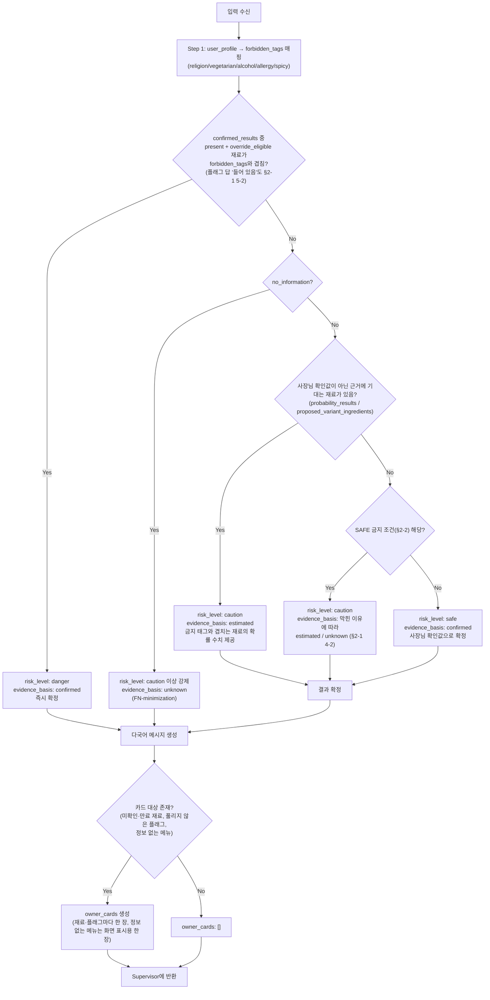

# ⑧ Decision Policy / XAI Agent 스펙

담당: 정유진
상태: 초안 (미확정 항목은 §8 참조)
상위 문서: `caution-multi-agent-architecture.md`, `caution-db-schema.md`

---

## 0. 역할 범위

두 가지 책임을 가진다.

1. **판정**: 확정값(hard evidence)과 확률(soft evidence)을 사용자 개인의 알레르기·식이 제약과 대조해 DANGER/CAUTION/SAFE를 결정
2. **설명**: 판정 근거를 사람이 이해할 수 있는 문장으로 바꾸고, 정보가 부족한 재료에 대해 사장님에게 물어볼 질문을 만듦

판정 로직과 설명 로직을 분리하지 않고 ⑧ 하나에 묶은 이유는 반대로 **"둘 다 사용자 프로필과 재료 데이터를 같은 순간에 대조해야" 자연스럽기 때문**이다. 대신 ⑧을 확률 계산(⑤)이나 하드 오버라이드 조회(③)로부터는 분리해둬서, 판정 기준이나 문구·언어가 바뀔 때 이 문서/⑧만 고치면 되게 했다.

### 0-1. 기준 문서(PPT) 대응

[`ppt-baseline.md`](ppt-baseline.md)의 ⑧ 관련 내용과 이 문서의 대응 위치다. 이 표의 항목이 빠지면 이 문서가 틀린 것이다.

| PPT 표현 | 이 문서 |
|---|---|
| 7쪽: 사용자 식단 제약과 확정·추정 근거를 정책에 따라 종합해 Safe / Caution / Danger 판정 (`정책 기반 판정`) | §2, §3. 판정은 정해진 정책(규칙)으로 한다 |
| 7쪽: 위험 재료·판정 근거 생성 (`근거 설명`) | §1-2 `risk_ingredients`, `evidence_refs`, `message`. §4 다국어 문구 |
| 7쪽: 확인 질문 생성 (`확인 질문`) | §1-3 `owner_cards`, §2-1 7단계 |
| 3쪽: Hard Evidence와 Soft Evidence를 구분, 근거의 출처·신뢰도를 함께 전달 | `evidence_basis`(`confirmed` / `estimated` / `unknown`)로 근거 종류를 구분하고, `evidence_refs`로 근거를 가리킨다. 출처·신뢰도는 ⓪ 근거 목록(`EvidenceRef`)에 있다 |
| 3쪽: 근거가 부족하면 억지로 확정하지 않고 Caution / 확인 질문으로 전환 | §2-2 SAFE 금지 조건, §2-1 7단계 |
| 3쪽 OUTPUT: 위험도 판정 결과 / 판정 근거 / 위험 재료 / 확인 질문 | §1-2 |
| 8쪽 4: 정보 부족 → 보수적 판정 (NO_INFORMATION, 안전으로 단정하지 않음) | §2-1 3단계, §3. `no_information`이면 CAUTION, `evidence_basis: unknown` |
| 8쪽 흐름: 확정값과 미확인 재료의 확률값 통합 → ⑧ 최종 판정 생성 | ⓪이 ③ 확정값과 ⑤ 확률을 모아 넘기고(§5), ⑧이 합쳐 판정한다 (§2) |
| 8쪽 6: Hard Evidence 있음(사장님 확인 n건↑) → DANGER / SAFE 확정 | §3. n건 확정 규칙은 ⑦ §2-3 |
| 8쪽 6: Hard Evidence 없음 → DANGER / SAFE 판정 불가, CAUTION + 확률 수치 제공 | §2-1 4단계, §3 |
| 8쪽 6: n개월마다 재확인 | ③ §1-7(3개월 만료). 만료된 재료는 다시 묻는 질문 카드를 만든다 (§2-1 7단계, 이유 `expired`) |
| 8쪽 6·흐름: 정보 부족·충돌 케이스만(5~10%) → 고가 모델 재검증 (`고위험 재검증`) | §2-3. 대상 기준·하는 일·결과 사용처 결정. 판정은 바꾸지 않고 질문 카드·설명만 보강 (#234) |
| 10쪽 모델: Decision / XAI Agent(고위험 시 선택 호출) — 저가~중가 모델, 고위험 재검증은 고가 모델 | §0-2. 설명 문장은 기본 템플릿이고 필요할 때 LLM을 쓴다. 판정 값에는 LLM을 쓰지 않는다. 고위험 재검증은 §2-3 |
| 10쪽 RAI 01 공정성: 언어·알레르기·종교가 달라도 같은 알고리즘 | §2-1 1단계에서 모든 제약을 금지 태그 하나로 바꿔 같은 규칙으로 판정. 언어는 문구에만 영향 (§4) |
| 10쪽 RAI 02 책임성: 결론을 강요하지 않고 근거 확인·직접 선택 경로 제공 | 판정과 함께 위험 재료·확률 수치·근거를 준다 (§1, §3) |
| 10쪽 RAI 03 투명성: 판단 결과와 판단 근거, 대체 메뉴 설명 | 결과·근거는 ⑧. 대체 메뉴는 ⑨ Curation Tool |
| 10쪽 RAI 04 안전성: 불확실할 때 안전으로 단정하지 않음 | §2-2 SAFE 금지 조건 |

### 0-2. LLM이 맡는 일과 코드가 맡는 일

⓪ §0-2-2·§2-11·§2-13에서 정한 경계를 따른다.

| 일 | 담당 |
|---|---|
| `risk_level`, `evidence_basis`, `matched_tags`, `risk_ingredients` 결정 | **코드(정책 함수).** 같은 입력은 같은 판정을 낸다. LLM은 판정을 만들거나 바꿀 수 없다 |
| 6개 언어 설명 문장(`message`) | 기본은 고정 템플릿, 템플릿으로 표현하기 어려울 때 LLM (아래 원칙). LLM은 코드가 확정한 판정 JSON을 바꿀 수 없는 입력으로 받아 문장만 만든다 |
| LLM 실패·시간 초과 | 판정은 그대로 두고 `risk_level + evidence_basis`별 고정 문장 템플릿을 쓴다. 문장 LLM 재시도는 1회 |

**설명 문장을 나누는 방식 (결정, 2026-10-12)**
- **판정 한 줄은 템플릿**으로 쓴다. 예: "돼지고기가 들어있을 수 있어요 (약 62%)." 늘 같은 문장이라 믿을 수 있다.
- **그 뒤의 이유 설명은 필요할 때 LLM**이 쓴다. 예: "김치에 들어가는 액젓 때문에 새우가 포함될 수 있어요."
- **틀리면 안 되는 내용은 코드가 넣은 값을 그대로** 쓴다. 판정(`risk_level`), 확률 수치, 재료 이름은 LLM이 바꾸거나 새로 만들지 못한다. LLM은 말투와 문장 연결만 맡는다.

**LLM 사용 원칙 (결정, 2026-10-11)**
- **같은 입력에 같은 결과가 나와야 하는 항목은 LLM을 쓰지 않는다.** `risk_level`, `evidence_basis`, `matched_tags`, `risk_ingredients`(재료 역할 `role` 포함), `information_status`, 금지 태그 매핑(§2-1 1단계), SAFE 금지 조건 판단(§2-2)이 여기에 해당한다. 같은 메뉴를 다시 찍었는데 판정이 바뀌면 사용자가 결과를 믿을 수 없다.
- **설명 문장 LLM은 고위험 메뉴에만 한정하지 않고 필요할 때 쓴다.** 판정 한 줄은 고정 템플릿이고, 이유 설명을 덧붙일 때 LLM을 쓴다 (위 "설명 문장을 나누는 방식").

- ⑧이 Agent인 이유: 근거를 사람이 읽을 수 있게 **설명**하는 데 언어 판단(LLM)이 필요하기 때문이다. 판정 자체는 FN을 막기 위해 규칙으로 고정한다.

---

## 1. 입력 / 출력 스펙

**JSON 형식은 [⓪ §4-7 "⑧ Decision Policy / XAI Agent"](0-agent-supervisor.md)에서만 정의한다** (요청 `DecisionRequest`, 응답 `DecisionResponse`, 질문 카드 `owner_cards[]`, 공통 모델은 ⓪ §1-2). 이 문서에는 JSON을 다시 적지 않고, ⑧이 값을 어떻게 쓰고 정하는지만 적는다. 필드를 바꾸려면 ⓪을 고친다.

### 1-1. 입력에서 ⑧이 지키는 것

> **`constraint_tags`는 모두 ④가 붙인 값이다** (결정, 2026-10-10 회의, ④ §2-7). ③·⑥은 태그 없이(`[]`) 반환하고, Supervisor가 ④를 불러 채운 뒤 ⑧에 넘긴다. ③ 확인값은 ④ `lookup_tags`, ⑥ 웹 재료는 ④ `map_ingredients`, ④ 확장 재료는 ④가 처음부터 붙여 ⑤를 거쳐 그대로 온다 (⓪ §1-2, §2-8). ⑧은 태그를 새로 붙이거나 재료 이름으로 추측하지 않는다. 태그 조회·매핑이 실패하면 ④가 붙인 warning(`forces_caution: true`)으로 SAFE를 막는다 (§2-1 3-3).

**`confirmed_results` (③ 사장님 확인값, hard evidence)**
- **`status`는 3값을 유지한다. `true/false` 2값으로 축약하지 않는다** (AGENTS.md 확정). 2값이면 "없다고 확인됨"과 "아직 안 물어봄"이 구분되지 않아, 안 물어본 재료가 "없음"으로 읽혀 SAFE가 될 수 있다 (FN).
- hard evidence로 쓰는 것은 **`override_eligible: true`이고 `status`가 `present` 또는 `absent`인 항목뿐**이다.
- `status: unknown`은 "없음"으로 취급하지 않는다. 확인값이 없는 것과 같다.
- `override_eligible: false`(anomaly이거나 3개월 만료)인 항목은 hard evidence로 쓰지 않는다. 이 재료는 Supervisor가 ④⑤ 경로로 보냈으므로 `probability_results`의 확률로 판정한다.
- `expired: true`(확인한 지 3개월 경과, ③ §1-7)면 이 재료를 다시 묻는 질문 카드를 만든다 (§2-1 7단계).

**`probability_results` (⑤ 확률, soft evidence)**
- `confidence`는 ⑤가 계산한 근거 충분도(0~1)다. 출력 `evidence_basis`(confirmed/estimated/unknown)와는 별개다. "낮음" 기준은 §1-3 `low_confidence`.
- `anomaly_locked: true`(③이 override를 거부한 이상 답변 재료)면 확률값과 무관하게 CAUTION 이상 강제 (§2-1 3-1).

**`proposed_variant_ingredients` (④ 변형 추정 재료)**
- DB에 저장되지 않은 런타임 추정이고 관측값도 없다 (`source: variant_suggested`, ④ §1-3·§1-5). 확정 재료와 같은 신뢰도로 다루지 않는다. 사용자 제한과 겹치면 **최소 CAUTION, DANGER 확정 근거로 쓰지 않는다** (§2-1 5단계).

**`risk_tag_observations` (① OCR이 감지한 메뉴 속성)**
- **매운맛은 재료 태그가 아니라 메뉴 속성이다** (⓪ §1-2). 어떤 재료에도 `is_spicy`가 붙지 않으므로, 이 입력이 없으면 `no_spicy` 사용자의 매운 메뉴를 걸러낼 방법이 없다 (FN).
- 여기 `confidence`는 OCR 감지 확신도다. ⑤의 `confidence`와 다른 값이다.
- OCR은 **감지한 태그만** 넣는다. 목록에 없다고 "맵지 않다"는 근거로 쓰지 않는다 (⓪ §4-0).
- soft evidence라서 사용자 제한과 겹치면 **CAUTION 근거로만** 쓰고 DANGER 근거로는 쓰지 않는다 (§2-1 5-1).

**그 밖의 입력**
- `no_information: true`(메뉴·재료 정보 자체가 없음, 엣지 케이스 4)면 CAUTION 이상 (§2-1 3단계).
- `information_status`가 `complete`가 아니면 SAFE 금지 (§2-1 3-2).
- `locale`은 사용자 화면 언어지만 메시지는 6개 언어를 모두 만든다 (§4).
- 입력 `warnings`·`errors`는 그대로 보존하고 ⑧의 신호를 덧붙인다.

#### `menu_ambiguity_flags` — 메뉴 애매함 플래그 (결정, 2026-10-12)

④가 메뉴 정보에 붙은 플래그를 그대로 넘긴다 (④ §1-2). 예) 김치찌개 → `has_unclear_jeotgal`(어떤 젓갈이 들어가는지 가게마다 다름). 재료 목록 **밖**에 무엇이 더 들어갈 수 있다는 신호라서, 사장님이 목록의 재료를 모두 확인해도 SAFE를 막아야 한다 (§2-1 5-2).

플래그마다 걸릴 수 있는 태그가 정해져 있다. **이 태그 중 사용자의 금지 태그(§2-1 1단계)와 겹치는 것이 있으면 "관련 있음"**이고, 겹치는 태그가 사장님에게 물을 태그다.

| 플래그 | 뜻 | 걸릴 수 있는 태그 |
|---|---|---|
| `has_unclear_broth` | 육수 재료가 불분명 | `is_pork`·`is_beef`·`is_chicken`·`is_shrimp`·`is_crab`·`is_shellfish` |
| `has_unclear_seasoning` | 양념(술 등)이 불분명 | `is_alcohol` |
| `has_unclear_jeotgal` | 젓갈 종류가 불분명 | `is_fish`·`is_shrimp`·`is_crab`·`is_squid`·`is_shellfish`·`is_mackerel` |
| `has_hidden_animal` | 동물성 재료가 숨어 있을 수 있음 | `is_pork`·`is_beef`·`is_chicken`·`is_duck`·`is_fish`·`is_shrimp`·`is_crab`·`is_squid`·`is_shellfish`·`is_mackerel` |
| `has_variant` | 변형 메뉴라 재료가 불확실 | 모든 태그 (사용자 금지 태그 전부) |

- 지금 룰엔진(`ai_ruleengine/risk_judge.py`)의 기준을 옮겼다. 두 군데가 다르다.
  - `has_unclear_jeotgal`에 `is_fish`를 더했다. 멸치액젓은 `is_fish`인데 룰엔진 기준에는 빠져 있어, 생선 알레르기 사용자가 놓친다 (FN).
  - 룰엔진은 채식 여부를 따로 봤지만 여기서는 금지 태그만 본다. 채식 사용자의 금지 태그에 동물성 태그가 이미 들어 있기 때문이다 (1단계). 예를 들어 페스코는 생선·해산물을 먹으므로 젓갈 플래그와 관련 없다.
- 관련 없는 플래그는 판정에 쓰지 않는다 (§6 "사용자 태그와 무관한 재료만 애매함"과 같은 원칙).

#### `flag_confirmations` — 메뉴 애매함 플래그에 대한 사장님 답 (결정, 2026-10-12)

메뉴 애매함 플래그 질문 카드(§1-3)에 사장님이 답한 값이다. ③이 조회해 넘긴다 (③ §1-8). 형식은 [⓪ §4-2 `flag_confirmations`](0-agent-supervisor.md)다. 예) `constraint_tags: ["is_fish"]`, `status: absent` → "이 메뉴의 젓갈에 생선이 들어가나요?"에 "아니오".

- `absent`는 **물어본 태그 전부**가 없다는 뜻이고, `present`는 그중 **하나 이상**이 있다는 뜻이다. 그래서 다른 사용자에게 쓸 때 규칙이 다르다 (§2-1 5-2).

### 1-2. 출력 값을 정하는 규칙

- `context`·`menu`는 입력 값을 그대로 반환한다.
- `risk_level`·`evidence_basis`·`information_status`는 §2·§3 규칙으로 정한다. `information_status`가 `complete`가 아니면 `risk_level`은 `safe`가 될 수 없다. `evidence_basis`는 판정 근거 종류다: `confirmed`(사장님 확인값) / `estimated`(확률 추정) / `unknown`(근거 부족).
- `risk_ingredients[]`: 금지 태그와 겹친 재료.
  - `constraint_tags`는 재료의 전체 제한 태그, `matched_tags`는 그중 이 사용자와 실제로 겹친 태그다.
  - `status`는 확인값이면 3값 그대로, 확률 근거면 `unknown`.
  - `posterior_mean`·`confidence`·`prior_source`는 ⑤ 확률 근거면 그대로 옮기고, 사장님 확인값이면 `null`.
  - `role`은 입력 값을 그대로 옮긴다 (아래).
- 최상위 `matched_tags`는 모든 위험 재료와 `risk_tag_observations`에서 겹친 태그를 중복 제거한 목록이다 (예전 이름 `hits`).
- `evidence_refs`는 판정에 쓴 근거 ID 전체를 중복 제거한 목록이다. 위험 재료가 없는 SAFE 판정도 "없음" 확인 근거가 있으면 남긴다.
- `message`는 6개 언어 문구다 (§0-2, §4).
- `owner_cards`는 질문이 필요 없으면 `[]`다. **한 메뉴에서 여러 장이 나올 수 있다** (§1-3, §2-1 7단계).
- `high_risk_review`는 이 메뉴가 고위험 재검증 후보인지와 그 이유를 표시한다 (§2-3). 재검증 결과도 판정을 바꾸지 않는다 (§2-3, #234).

#### `role` — 재료 역할 (결정, 2026-10-12)

판정에 걸린 재료가 메뉴에서 어떤 역할인지 알려 준다. 사용자가 "빼고 요청"을 할 때 빼기 어려운 재료인지 설명하는 데 쓴다 (§4-1).

| 값 | 뜻 | 예 |
|---|---|---|
| `identity` | 주재료. 메뉴명에 들어간 재료, 또는 그 음식을 성립시키는 기본 재료 | 참치김밥의 참치·밥·김, 국수의 면 |
| `component` | 속재료. 따로 넣는 재료 중 주재료가 아닌 것 | 참치김밥의 단무지·어묵·햄·달걀 지단 |
| `hidden` | 숨은 재료. 양념·육수·소스·가공품 안에 섞인 재료 | 마요네즈 속 달걀, 김치 속 젓갈 |
| `null` | 역할을 정하지 못함 | — |

- **값은 ④가 정한다.** ⑧은 입력에 들어온 값을 그대로 옮기고 새로 정하지 않는다 (태그와 같은 방식). 정하는 규칙은 ④ 담당이며 §8 외부 의존.
- **판정에는 쓰지 않는다.** 주재료라고 더 위험하게 보지 않는다. `risk_level`, `evidence_basis`는 role과 무관하다.
- **LLM으로 정하지 않는다.** 같은 메뉴는 항상 같은 role이어야 한다 (§0-2).

`evidence_basis` 필드가 핵심이다 — 같은 `risk_level: danger`라도 **확정값 기반인지 확률 추정 기반인지**를 사용자에게 다른 톤으로 전달해야 한다 (§4 참고).

> 이름: 원래 `confidence`였으나 ⑤가 계산하는 0~1 숫자 `confidence`(재료별 근거 충분도)와 이름이 겹쳐 `evidence_basis`(판정 근거 종류)로 바꿨다 (2026-10-08). 값은 그대로 `confirmed | estimated | unknown`이다.

### 1-3. `owner_cards` — 질문 카드

형식은 ⓪ §4-7 `owner_cards[]`다 (`menu_id`, `round`, `ingredient`, `question` 6개 언어, `reason_codes`, `evidence_refs`). ⑧이 정하는 것:

- 카드 하나에 재료 하나다. 어떤 재료에 카드를 만드는지는 §2-1 7단계.
- **메뉴 애매함 플래그 카드** (2026-10-12, §2-1 5-2): 재료가 아니라 메뉴 단위로 묻는 카드다. 예) "이 메뉴의 젓갈에 생선이 들어가나요?" `ingredient: null`, `ambiguity_flag`에 플래그 이름, `constraint_tags`에 물어볼 태그(§1-1 `menu_ambiguity_flags` 표에서 사용자 금지 태그와 겹친 것)를 넣는다. 재료 카드는 `ambiguity_flag: null`, `constraint_tags: []`다.
- **정보 없는 메뉴 카드** (결정, 2026-10-13): `no_information: true`인 메뉴는 재료 목록이 없어 재료 카드를 만들 수 없다. 사용자에게 금지 태그가 있으면 메뉴 전체를 묻는 카드를 한 장만 만든다. 예) 할랄 사용자 → "이 메뉴에 돼지고기나 술이 들어가나요?" `ingredient: null`, `ambiguity_flag: null`, `constraint_tags`에 사용자 금지 태그 전부, `reason_codes: ["no_information"]`. 손님이 가게에서 사장님께 보여 주는 **화면 표시용**이다. 사장님이 "예"라고 해도 둘 중 무엇이 들어가는지 알 수 없어 판정을 바꾸지 않고(DANGER로 올리지 않음), 메뉴가 DB에 없어 저장할 곳도 없으므로 ⑦ 저장 요청을 만들지 않는다 (⓪ §4-6·§4-7).

**`reason_codes` 허용값 (결정, 2026-10-12)** — 모두 ⑧ 입력에 이미 있는 신호에서 정해진다.

| 값 | 뜻 | 신호 |
|---|---|---|
| `low_confidence` | 확률 근거가 부족함 | ⑤ `confidence`가 낮은 재료. "낮음"은 실질 레시피 근거 5개 미만, 즉 `confidence < 0.59`다 (⑤ §1-2-1, 2026-10-12). 카드를 만들지 말지 정하는 조건이 아니라 이유 표시로만 쓴다 (§2-1 7단계) |
| `anomaly` | 사장님 답이 레시피와 크게 어긋나 다시 확인 필요 | `anomaly_locked: true` |
| `no_information` | 메뉴 정보가 없음 | `no_information: true` 또는 `information_status: none` |
| `unknown_tag` | 어떤 제한에 걸리는 재료인지 모름 | ④ warning `unmapped_constraint_tags`, `constraint_tags_lookup_failed` |
| `expired` | 확인한 지 3개월이 지나 다시 확인 필요 | `confirmed_results[].expired: true` |
| `high_risk_review` | 고위험 재검증이 찾은 재료 | §2-3 |
| `unconfirmed` | 사장님 확인값이 없음. 위 이유가 하나도 없을 때만 쓴다 | 사용자 태그와 겹치고 `override_eligible: true` 확인값이 없는 재료 (2026-10-12). 예) 레시피 54개로 근거는 충분하지만 확인 안 된 설렁탕 새우젓 |
| `ambiguous_menu` | 메뉴 재료 목록 밖에 사용자 제한에 걸릴 재료가 있을 수 있음 | 사용자와 관련 있는 `menu_ambiguity_flags` (2026-10-12) |

- 한 카드에 이유가 여럿이면 모두 넣는다. 모든 카드에 이유가 하나 이상 있다 (다른 이유가 없으면 `unconfirmed`).
- **카드 순서** (결정, 2026-10-12): 사장님 답이 판정을 바꿀 가능성이 큰 이유부터 둔다. `anomaly` → `expired` → `unknown_tag` → `ambiguous_menu` → `high_risk_review` → `low_confidence` → `no_information` → `unconfirmed`. 이유가 여럿인 카드는 가장 앞선 이유로 순서를 정하고, 같은 이유끼리는 확률(`posterior_mean`)이 높은 재료가 먼저다 (확률이 없으면 `ingredient_id` 순, 플래그 카드는 플래그 이름 순). 장수는 제한하지 않는다.

---

## 2. 처리 로직

### 2-1. Step별 설명

1. **forbidden_tags 매핑**: `religion_type`(halal→is_pork/is_alcohol 등), `vegetarian_type`, `no_alcohol`, `allergies`, `no_spicy`를 하나의 금지 태그 집합으로 변환. 종교·채식 유형별 태그 목록은 룰엔진 `ai_ruleengine/profile_mapper.py`를 원본으로 쓴다 (예: kosher → `is_pork`·`is_crab`·`is_shrimp`·`is_shellfish`·`is_squid`, hindu → `is_beef`). ⑨ 프로필 필터도 같은 매핑을 쓴다.
2. **hard evidence 우선 체크**: `confirmed_results` 중 `status: present`이고 `override_eligible: true`인 재료의 `constraint_tags`가 forbidden_tags와 겹치면 다른 계산 없이 즉시 `danger` + `evidence_basis: confirmed`. `status: absent`이고 `override_eligible: true`인 재료는 확률과 무관하게 "없음"으로 확정한다. `unknown`이나 `override_eligible: false`인 항목은 이 단계에서 쓰지 않는다.
3. **정보 없음 우선순위**: hard evidence로 안 걸렸어도 `no_information: true`면 확률 계산 자체를 건너뛰고 `caution` 이상 강제 (엣지 케이스 4와 동일 원칙).
3-1. **anomaly_locked 강제**: `probability_results`에서 `anomaly_locked: true`인 재료는 posterior_mean이 아무리 낮게 나와도 `caution` 이상으로 강제하고 `evidence_basis: estimated`로 표시 — ③이 override를 거부한 이상 답변이 확률 계산을 거치며 조용히 SAFE로 새는 것을 막기 위함(이 값이 ④를 거쳐 여기까지 끊기지 않고 와야 함).
3-2. **정보 부족 시 SAFE 금지**: `information_status`가 `partial` 또는 `none`이면 확률이 낮게 나와도 `safe`를 내지 않고 `caution` 이상으로 둔다. 앞 단계 조회·계산이 일부 실패한 상태에서 남은 재료만 보고 SAFE를 내면 빠진 재료를 놓친다 (FN).
3-3. **앞 단계 경고 시 SAFE 금지**: 입력 `warnings` 중 `forces_caution: true`가 하나라도 있으면 `safe`를 내지 않고 `caution` 이상으로 둔다. 앞 단계가 문제를 발견했다는 신호다 (예: ④ 태그 조회 실패 `constraint_tags_lookup_failed`, ④ 순환 참조 `cycle_detected`, ④ 웹 재료 매핑 실패 `unmapped_constraint_tags`). 예를 들어 Supervisor가 ③ 확인값의 태그를 ④에 조회했는데 실패해 돼지고기에 `is_pork`가 안 붙으면, 이 단계가 없을 때 할랄 사용자에게 SAFE가 나갈 수 있다 (FN).
4. **확정값이 없는 재료는 CAUTION**: `probability_results`나 `proposed_variant_ingredients`에 재료가 하나라도 있으면(사장님 확인값이 아닌 근거에 기대는 재료) `risk_level: caution`, `evidence_basis: estimated`로 둔다. 확률이 아무리 높거나 낮아도 확률만으로 DANGER/SAFE를 내지 않는다 (§3, PPT 8쪽 6). 금지 태그와 겹치는 재료는 `risk_ingredients`에 `posterior_mean`(확률 수치)과 함께 담아 사용자에게 보여준다.
4-1. **SAFE는 사장님 확인값으로만**: 판정에 쓴 재료가 모두 사장님 확인값(`override_eligible: true`)이고, 금지 태그와 겹치는 `present` 재료가 없고, §2-2의 SAFE 금지 조건에 하나도 해당하지 않을 때만 `risk_level: safe`, `evidence_basis: confirmed`다.
4-2. **확인값은 다 있는데 SAFE가 막힌 경우의 `evidence_basis`** (결정, 2026-10-12): 판정에 쓴 재료가 모두 사장님 확인값인데 §2-2의 다른 조건 때문에 SAFE가 막히면, 막힌 이유에 따라 정한다.
   - 정보가 빠져서 막혔으면 → `unknown` ("정보가 부족해요"). 예: `information_status`가 `partial`/`none`, 태그 조회·매핑 실패 같은 `forces_caution` 경고, 관련 있는 메뉴 애매함 플래그(5-2단계)
   - 추정 근거 때문에 막혔으면 → `estimated` ("~수 있어요"). 예: 매운맛 감지(`risk_tag_observations`, 5-1단계)
   - 두 종류가 함께 있으면 `unknown`을 쓴다. 정보가 빠졌다는 사실을 먼저 알리는 쪽이 더 조심스럽다.
5. **변형 제안 반영**: `proposed_variant_ingredients`가 있으면 확정 재료와 **절대 같은 신뢰도로 취급하지 않는다** — 최소 caution 처리하고, 문구도 추정형으로만 생성 (danger 확정 근거로 쓰지 않음).
5-1. **메뉴 속성 관측 반영**: `risk_tag_observations`의 `tag`가 forbidden_tags와 겹치면(예: `no_spicy` 사용자 + `is_spicy`) `caution` 이상으로 두고 그 태그를 최상위 `matched_tags`에 넣는다. 재료가 아니므로 `risk_ingredients`에는 넣지 않는다. soft evidence라 DANGER 근거로 쓰지 않는다 (⓪ §4-7).
5-2. **메뉴 애매함 플래그 반영** (결정, 2026-10-12): `menu_ambiguity_flags`의 플래그마다 물을 태그(§1-1 표에서 사용자 금지 태그와 겹친 것)를 구한다. 비어 있으면 그 플래그는 건너뛴다. 아니면 `flag_confirmations` 중 같은 플래그이고 `override_eligible: true`인 답을 보고 아래처럼 한다.
   - `absent`이고 답의 `constraint_tags`에 물을 태그가 **모두** 들어 있음 → 플래그가 풀린다. 판정에 영향 없음
   - `present`이고 답의 `constraint_tags`가 **모두** 사용자 금지 태그 → `danger`, `evidence_basis: confirmed`, 그 태그를 최상위 `matched_tags`에 넣는다. 사장님이 "들어 있다"고 확인한 hard evidence다
   - 그 밖(답이 없음, `unknown`, 만료, 물은 태그가 달라 판단할 수 없음) → `safe`를 내지 않고 `caution` 이상으로 둔다. 설명 문장에 이유를 쓰고 (예: "젓갈 종류가 가게마다 달라 확인이 필요해요"), 7단계에서 질문 카드를 만든다
   - 재료가 아니므로 `risk_ingredients`에는 넣지 않는다. 플래그만으로(사장님 답 없이) DANGER를 내지 않는다.
6. **메시지 생성**: `evidence_basis`에 따라 확정형/추정형 문구 템플릿 분기 (§4).
6-1. **빼기 어려움 안내**: 판정에 걸린 재료의 `role`이 `identity`나 `hidden`이면 "빼기 어려울 수 있어요" 안내를 덧붙인다 (§4-1). 판정은 바꾸지 않는다.
7. **사장님 질문 생성**: 사용자 태그와 겹치는데 사장님 확인값(`override_eligible: true`)이 없는 재료마다 `owner_cards`에 카드를 한 장씩 만든다. 확률이 높든 낮든 숫자 기준으로 걸러내지 않는다 (결정, 2026-10-12). 이런 재료는 모두 CAUTION의 원인이고, 사장님이 답하면 확정값으로 바뀌기 때문이다. 고위험 재검증이 찾은 재료도 카드로 더한다 (§2-3). 3개월이 지난 확인값(`expired: true`)은 사용자 태그와 관련 있으면 다시 묻는 카드를 만든다 (이유 `expired`, PPT 8쪽 6 "n개월마다 재확인"). 5-2단계에서 풀리지 않은 메뉴 애매함 플래그도 플래그마다 한 장씩 만든다 (이유 `ambiguous_menu`, 답이 만료됐으면 `expired`도). 같은 재료는 한 장만 만든다. 카드 순서는 §1-3 `reason_codes` 아래 규칙을 따른다. 정보 없는 메뉴는 메뉴 전체를 묻는 화면 표시용 카드 한 장만 만든다 (§1-3).

### 2-2. SAFE 금지 조건 (⓪ §4-7과 동일)

아래 중 하나라도 해당하면 확률이 아무리 낮아도 `risk_level`을 `safe`로 내지 않는다.

| 조건 | 뜻 | 처리 단계 |
|---|---|---|
| `no_information: true` | 메뉴·재료 정보 자체가 없음 | 3 |
| `probability_results`에 `anomaly_locked: true` 재료 존재 | ③이 override를 거부한 이상 답변 재료 | 3-1 |
| `information_status`가 `partial` 또는 `none` | 앞 단계 조회·계산이 일부 또는 전부 실패 | 3-2 |
| `warnings`에 `forces_caution: true` 존재 | 앞 단계가 "SAFE 금지" 신호를 보냄 | 3-3 |
| `probability_results` 또는 `proposed_variant_ingredients`가 비어 있지 않음 | 사장님 확인값이 아닌 근거(확률·변형 추정)에 기대는 재료가 있음 | 4 |
| `risk_tag_observations`에 forbidden_tags와 겹치는 태그 존재 | OCR이 감지한 메뉴 속성(예: 매운맛)이 사용자 제한과 겹침 | 5-1 |
| `menu_ambiguity_flags`에 사용자와 관련 있고 사장님 답으로 풀리지 않은 플래그 존재 | 레시피 목록 밖 재료가 사용자 제한에 걸릴 수 있음 (§1-1 표) | 5-2 |

### 2-3. 고위험 재검증 (설계 중)

PPT 8쪽 6·10쪽: **정보 부족·충돌 케이스만(전체의 5~10%) 고가 모델로 재검증**한다 ("고위험 메뉴 정밀 검토").

| 항목 | 상태 |
|---|---|
| 대상 | **정보 부족이거나 근거가 충돌하는 메뉴만.** 모든 메뉴를 재검증하지 않는다 (PPT). 기준은 아래 (결정, 2026-10-11) |
| 실행 시점 | 스캔 안에서 실시간으로, 시간 제한을 둔다. 넘기면 재검증 없이 기본 결과를 낸다 (결정, 2026-10-11) |
| 시간 제한 | 재검증만의 값을 따로 두지 않고 **판정(judge) 단계 전체 시간 제한 안에 맞춘다** (결정, 2026-10-11). 남은 시간 안에 끝나지 않으면 기본 결과를 낸다. judge 단계 전체 값은 ⓪·백엔드가 정한다 (⓪ §8 "phase별 timeout", 스캔 전체 목표 30초) |
| 판정을 바꿀 수 있는지 | **바꾸지 않는다** (결정, 2026-10-13, #234). 재검증 대상(정보 부족·충돌)은 이미 SAFE가 금지된 메뉴라 SAFE→CAUTION으로 낮출 경우가 없고, DANGER는 사장님 확인값으로만 나온다 (§3, PPT 8쪽 6). 그래서 질문 카드와 설명만 보강한다 |
| 하는 일 | 고가 모델 LLM이 아래 세 가지를 한다 (결정, 2026-10-11) |
| 결과를 쓰는 곳 | **사장님 질문(`owner_cards`)과 사용자 설명(`message`) 두 곳.** 관리자 검토에는 쓰지 않는다 (결정, 2026-10-11) |

**재검증이 하는 일 (결정, 2026-10-11)**

| 역할 | 예시 | 쓰는 곳 |
|---|---|---|
| **놓친 위험 찾기** | 마라탕 재료 목록에 땅콩이 없는데 "마라탕에는 땅콩소스가 들어가는 경우가 많다"고 지적 | 사장님 질문(그 재료를 물어봄), 사용자 설명("~가 들어갈 수 있어요") |
| **근거 충돌 설명** | 사장님은 "돼지고기 없음"인데 레시피상 확률은 0.95 | 사용자 설명(왜 CAUTION인지), 사장님 질문(다시 확인) |
| **질문 다듬기** | 정보가 없는 메뉴에 "어떤 재료가 들어가나요?" 대신 사용자 제한에 맞춘 구체적인 질문 | 사장님 질문 |

- 재검증 LLM이 찾은 재료는 **질문과 설명에만** 쓴다. `risk_ingredients`, `matched_tags` 같은 판정 값에는 넣지 않는다 (§0-2, #234).
- 사용자 설명은 확인되지 않은 내용이므로 "~가 들어갈 수 있어요"처럼 **가능성 말투**로만 쓴다.
- 결과는 `owner_cards`와 `message`에 담으므로 재검증 전용 필드는 필요 없다.
- **재검증 LLM은 표준 재료 목록(`ingredients`) 안에서만 재료를 고른다** (결정, 2026-10-11). 목록을 선택지로 주고 그 밖의 이름은 받지 않는다. 그래야 사장님 답을 재료 번호(`ingredient_id`)로 저장할 수 있고(⑦), 재료 태그로 이 사용자와 관련 있는지 규칙으로 판단할 수 있다. 예: "사차장"이 아니라 표준 재료 "땅콩"을 고른다.
- 시간 제한을 넘기거나 LLM이 실패하면 재검증 없이 기본 결과(규칙으로 만든 판정·질문·템플릿 문장)를 낸다.

**재검증 LLM 입력·출력 (결정, 2026-10-12)**

| 구분 | 내용 |
|---|---|
| 넘기는 것 | 메뉴명, 메뉴판 설명 문구, 지금까지 찾은 재료 목록과 태그, 사용자 금지 태그, 재검증을 하게 된 이유(아래 대상 기준의 신호), 표준 재료 목록 |
| 받는 것 | 놓친 재료 목록(표준 재료 목록 안에서만), 사용자에게 보여줄 설명 한 줄, 다듬은 질문 |

- 정해진 칸 외에는 받지 않는다 (Pydantic 구조화 출력, ⓪ §2-13). 형식이 맞지 않으면 버리고 기본 결과를 낸다.

**한 스캔당 개수 (결정, 2026-10-12)**
- 고가 모델이라 **한 스캔당 최대 3개 메뉴**만 재검증한다. 초기값이며 QA에서 조정한다.
- 대상이 3개를 넘으면 사용자와 관련이 큰 순서로 고른다: 이상 답변 충돌(`anomaly_locked`) → 태그 모름 → 정보 없음(`no_information`) → 정보 일부 실패(`information_status`) → 웹 근거 부족·웹서치 시간 초과·LLM 추출 실패. 같으면 메뉴판 순서(`source_index`)다.
- ⑧은 메뉴마다 따로 돌기 때문에 다른 메뉴를 모른다. 그래서 ⑧은 재검증 대상 여부와 이유만 표시하고, **어느 3개를 고를지는 Supervisor가 메뉴 결과를 모은 뒤 정해** 재검증을 부른다 (⓪ §2-10).

**재검증 대상 기준 (결정, 2026-10-11)**

대상은 ⑧ 입력에 이미 있는 신호로만 고른다. 규칙으로 고르므로 같은 입력이면 항상 같은 메뉴가 대상이 된다 (§0-2).

| 구분 | 신호 | 상황 | 단위 |
|---|---|---|---|
| 정보 부족 | `no_information: true` | DB에도 없고 웹서치도 실패해 재료 정보가 전혀 없음 | 메뉴 |
| 정보 부족 | `information_status: partial` 또는 `none` | 앞 단계 조회·계산이 일부 또는 전부 실패 (④ 조회 실패, ⑤ 계산 실패 등) | 메뉴 |
| 정보 부족 | ⑥ warning `insufficient_sources` | 웹 레시피를 10개 미만으로만 모음 | 메뉴 |
| 정보 부족 | ⑥ warning `web_search_deadline_exceeded`, `web_llm_extraction_failed` | 웹서치가 시간 초과로 일부만 모았거나, LLM 재료 추출이 실패해 규칙 결과만 있음 | 메뉴 |
| 정보 부족 | ④ warning `unmapped_constraint_tags`, `constraint_tags_lookup_failed` | 재료를 표준 재료로 못 맞추거나 태그 조회에 실패해, 그 재료가 어떤 제한에 걸리는지 모름 | 재료 |
| 충돌 | `anomaly_locked: true` | 사장님은 "없음"이라는데 레시피상 확률은 0.9 이상 (③ §1-6) | 재료 |

- **"고위험" — 이 사용자와 관련 있을 때만 재검증한다.**
  - 메뉴 단위 신호: 사용자에게 금지 태그(§2-1 1단계)가 하나라도 있으면 대상이다. 정보가 없으면 어떤 재료든 들어 있을 수 있기 때문이다.
  - 재료 단위 신호(`anomaly_locked`): 그 재료의 `constraint_tags`가 사용자의 금지 태그와 겹칠 때만 대상이다.
  - **예외 — 태그를 모르는 재료**(`unmapped_constraint_tags`, `constraint_tags_lookup_failed`)는 사용자 제한과 상관없이 항상 대상이다. 원래 어떤 태그가 붙을지 모르는 재료라 관련 여부를 판단할 수 없다.
- **대상에서 뺀 것**: ⑤ 확신도(`confidence`)가 낮은 재료(초기에는 대부분이 낮아 PPT의 5~10%를 넘음), 변형 메뉴 추정 재료, 숨은 재료 확장 중단(`max_depth_reached`, `cycle_detected`), 사장님 확인값과 확률이 반대지만 이상 답변 기준(0.9) 미만인 경우, 사이트별 레시피가 엇갈리는 경우.
- 웹 결과와 DB 값이 다른 경우는 #170에서 정의되면 다시 검토한다.
- 실제 대상 비율이 PPT의 5~10%에 맞는지는 구현 후 측정한다.

---

## 3. 판정 기준 — DANGER/SAFE는 사장님 확인값으로만 (PPT 8쪽 6)

제출 PPT 8쪽 "6 최종판단 기준"을 따른다 (`ppt-baseline.md`).

> - Hard Evidence 있음 (사장님 확인 n건↑) → DANGER/SAFE 확정, n개월마다 재확인
> - Hard Evidence 없음 → DANGER/SAFE 판정 불가, CAUTION + 확률 수치까지 제공

| 근거 | `risk_level` | `evidence_basis` |
|---|---|---|
| 사장님 확인값(`override_eligible: true`)으로 금지 태그 재료가 `present` | `danger` | `confirmed` |
| 판정에 쓴 재료가 모두 사장님 확인값이고 금지 태그 재료가 없으며, SAFE 금지 조건(§2-2)에 해당하지 않음 | `safe` | `confirmed` |
| 확률·변형 추정에 기대는 재료가 있음 | `caution` + 금지 태그와 겹치는 재료의 확률 수치 | `estimated` |
| 정보 자체가 없음 (`no_information`) | `caution` | `unknown` |
| 재료는 모두 사장님 확인값인데 SAFE가 막힘 (§2-1 4-2) | `caution` | 정보가 빠진 이유면 `unknown`, 추정 근거 때문이면 `estimated` |

- **확률(`posterior_mean`)은 판정 기준선이 아니다.** 확률이 0.95여도 DANGER가 아니고, 0.01이어도 SAFE가 아니다. 확률은 사용자에게 보여줄 수치와 사장님 질문(`owner_cards`) 우선순위에 쓴다.
- 따라서 확률을 DANGER/CAUTION/SAFE로 나누는 컷오프(F2 최적화)는 `risk_level` 판정에 쓰지 않는다.

---

## 4. 다국어 메시지 정책

6개 언어를 지원하기로 확정: `ko`(한국어), `en`(영어), `ja`(일본어), `zh_hans`(중국어 간체), `zh_hant`(중국어 번체), `es`(스페인어). JSON 키는 ⓪ 규칙(snake_case)을 따른다.

**확정형 vs 추정형 톤 구분이 핵심 설계 포인트다**:

| evidence_basis | 문구 톤 | 예시 (ko) |
|---|---|---|
| `confirmed` | 단정형 | "돼지고기가 들어 있어요." |
| `estimated` | 추정형, 확률 뉘앙스 포함 | "돼지고기가 들어 있을 수 있어요 (약 62%)." |
| `unknown` | 정보 부족 명시 | "정보가 부족해 안전한지 확인할 수 없어요." |

예시 문장은 아래 판정 한 줄 템플릿과 같다.

이 구분을 안 하면 확률 추정치를 확정 사실처럼 전달하게 되어, 사용자가 과신하거나(추정을 확정으로 오해) 반대로 신뢰를 잃을(나중에 틀렸을 때) 위험이 있다.

**확률 수치 표시 (결정, 2026-10-12)**
- 문장에는 **정수 퍼센트**로 쓴다. 예: `posterior_mean: 0.62` → "약 62%". 소수점까지 쓰면 근거에 비해 지나치게 정확해 보인다.
- 데이터(`posterior_mean`)는 0~1 숫자 그대로 두고, 문장에 넣을 때만 바꾼다.
- "0%"나 "100%"로 보이지 않게 한다. 1% 미만은 "1% 미만", 99% 초과는 "99% 이상"으로 쓴다. "0%"는 "없다"로 읽혀 SAFE처럼 보일 수 있다.

**언어별 표기와 번역 (결정, 2026-10-12)**

| 항목 | 규칙 |
|---|---|
| 결과 설명(`message`) | 사용자 언어로만 쓴다. 재료 이름도 사용자 언어로 쓴다 (예: "pork") |
| 사장님 질문 카드(`owner_cards[].question`) | **한국어와 사용자 언어를 함께** 보여준다. 손님이 화면을 사장님께 보여주고 소통하는 카드라 한국어가 있어야 바로 통한다. 6개 언어를 모두 만들어 두고 화면에서 `ko`와 사용자 언어를 같이 쓴다 |
| 판정 한 줄 템플릿 | 사람이 6개 언어로 미리 써 두고 한 번 검수한다 |
| 재료 이름 번역 | 번역 사전(데이터)에서 가져온다. LLM이 번역하지 않는다 (§0-2 "틀리면 안 되는 내용") |
| 이유 설명 | LLM이 6개 언어로 쓴다 |
| 언어 선택 | `locale`은 6개 중 하나만 들어온다. 앱이 이 6개 중에서만 고르게 하므로 다른 언어를 요청하는 경로는 없다 |
| LLM 실패 | 실패한 언어는 이유 설명 없이 판정 한 줄 템플릿만 보여준다 |

**판정 한 줄 템플릿 예시 (초안, 2026-10-13, #174)** — 톤을 맞추기 위한 예시다. 6개 언어 전체 템플릿은 구현 때 작성하고(#135), `ja`·`zh_hans`·`zh_hant`·`es`는 원어민 확인을 거친다. `{재료}`·`{확률}`은 코드 값을 그대로 넣는다.

| 경우 | `ko` | `en` |
|---|---|---|
| DANGER (`confirmed`) | {재료}가 들어 있어요. | This dish contains {재료}. |
| SAFE (`confirmed`) | 사장님이 확인한 재료 중 피해야 할 재료가 없어요. | The owner confirmed none of the ingredients you avoid are in this dish. |
| CAUTION (`estimated`) | {재료}가 들어 있을 수 있어요 (약 {확률}). | This dish may contain {재료} (about {확률}). |
| CAUTION (`unknown`) | 정보가 부족해 안전한지 확인할 수 없어요. | We don't have enough information to confirm this dish is safe for you. |

**LLM 이유 설명 자동 검수 (결정, 2026-10-13, #174)** — 이유 설명은 스캔마다 실시간으로 만들어져 사람이 하나하나 볼 수 없다. 사람 대신 코드가 바로 확인한다.
- LLM 문장에 나온 숫자(확률)·재료 이름·판정 단어가 ⑧이 넘긴 값과 다르면 버린다.
- 판정과 반대되는 표현이 있으면 버린다. 예: CAUTION인데 "안전해요", 확률을 "100%"·"0%"로 쓴 경우.
- 버리면 그 언어는 판정 한 줄 템플릿만 보여 준다 (LLM 실패와 같은 처리).
- 사람이 검수하는 것은 미리 쓰는 판정 한 줄 템플릿뿐이다.

### 4-1. 빼기 어려움 안내 (결정, 2026-10-12)

'빼고 요청' 버튼은 그대로 두고, 판정에 걸린 재료가 빼기 어려운 재료이면 설명에 안내 한 줄을 덧붙인다. 재료 역할(`role`, §1-2)로 정한다.

| `role` | 안내 (ko 예시) |
|---|---|
| `identity` | "참치는 이 메뉴의 주재료라 빼기 어려울 수 있어요." |
| `hidden` | "새우는 젓갈 같은 양념 안에 들어 있어 빼기 어려울 수 있어요." |
| `component`, `null` | 안내 없음 |

- 판정에 걸린 재료(`risk_ingredients`)에만 붙인다.
- 안내는 판정을 바꾸지 않는다. 빼기 어렵다고 위험도를 올리거나, 뺄 수 있다고 내리지 않는다.
- "~수 있어요" 말투로만 쓴다. 실제로 뺄 수 있는지는 가게마다 다르다.

---

## 5. Supervisor와의 계약

| ⑧이 받는 것 | 보장 사항 |
|---|---|
| `confirmed_results`/`probability_results` | Supervisor가 ③/⑤ 호출을 마친 뒤에만 전달 — 부분적으로만 채워질 수 있음(둘 다 없을 수도 있음, 그 경우 `no_information` 처리) |
| `user_profile` | 온보딩 단계에서 필수로 수집되므로 항상 존재함이 보장됨 (비로그인/미입력 케이스 없음) |

| ⑧이 돌려주는 것 | Supervisor의 후속 판단 |
|---|---|
| `owner_cards`가 비어 있지 않음 | 카드마다 Supervisor가 ⑦에 전달 → ⑦이 저장 명령 생성 → **백엔드가 `owner_verification_requests`에 INSERT**. XAI와 ⑦은 DB 자격 증명을 갖지 않음. 정보 없는 메뉴의 화면 표시용 카드는 ⑦에 보내지 않음 (§1-3, ⓪ §4-6) |
| `high_risk_review.required: true` | 메뉴판 전체 판정이 끝난 뒤 Supervisor가 후보 중 최대 3개를 골라 고가 모델로 재검증한다. 판정은 바꾸지 않고 질문 카드·설명만 보강한다 (§2-3, ⓪ §2-10) |
| `risk_level` 등 판정 결과 | 바꾸지 않고 최종 응답에 넣는다. 모든 메뉴의 판정이 끝나면 ⑨가 표시 순서와 SAFE 추천을 만든다 (⓪ §2-10, §4-8) |

---

## 6. 예외 처리

| 상황 | 처리 |
|---|---|
| `confirmed_results`와 `probability_results`가 동시에 같은 재료를 다르게 판정 | `override_eligible: true`인 `confirmed_results`(hard evidence)가 우선. `override_eligible: false`면 확률 쪽을 따른다 |
| `confirmed_results`에 `status: unknown` 항목이 있음 | "없음"으로 읽지 않는다. 확인값이 없는 재료로 처리 |
| `proposed_variant_ingredients`만 있고 나머지는 다 없음 | caution으로 처리하되 `evidence_basis: estimated`, danger로 격상 금지 |
| 사용자 태그와 무관한 재료만 애매함 | `owner_cards: []` — 카드를 만들지 않음 — 관련 없는 질문으로 사장님 피로도 유발 방지 |

---

## 7. 테스트 케이스

| # | 입력 | 기대 출력 | 검증 포인트 |
|---|---|---|---|
| 1 | 할랄 사용자 + `confirmed_results`: 돼지고기 `status: present`, `constraint_tags: [is_pork]`, `override_eligible: true` | `danger`, `evidence_basis: confirmed` | 확정형 문구 사용 |
| 2 | 비건 사용자 + `probability_results`: 우유(`is_milk`) `posterior_mean: 0.3` | `caution`, `evidence_basis: estimated`, `risk_ingredients`에 우유 확률 0.3 포함 | 확률만으로 SAFE를 내지 않을 것, 추정형 문구 |
| 3 | `no_information: true` | `caution` 이상 강제 | FN-minimization 원칙 위반 없을 것 |
| 4 | `proposed_variant_ingredients`만 있음(차돌된장찌개, 소고기 제안) + 채식 사용자 | `caution`, `evidence_basis: estimated` | `danger`로 절대 확정 짓지 않을 것 |
| 5 | 알레르기 태그와 무관한 애매 재료만 존재 | `owner_cards: []` | 불필요한 사장님 질문 생성 안 할 것 |
| 6 | `confirmed_results`(`override_eligible: true`)와 `probability_results`가 상반 | `confirmed_results` 값이 이김 | hard evidence 우선순위 확인 |
| 7 | 할랄 사용자 + `confirmed_results`: 돼지고기 `status: unknown` | 돼지고기를 "없음"으로 처리하지 않음 | `unknown`이 SAFE 근거가 되지 않을 것 (3값 검증) |
| 8 | 할랄 사용자 + `confirmed_results`: 돼지고기 `status: absent`, `override_eligible: false` + `probability_results`: 돼지고기 0.8 | 확률 쪽으로 판정 (`caution` 이상) | override 불가 확인값이 확률을 덮지 않을 것 |
| 9 | `information_status: partial` + 남은 재료 확률이 모두 낮음 | `caution` 이상, 출력 `information_status: partial` | 정보가 빠진 상태에서 SAFE가 나오지 않을 것 |
| 10 | 할랄 사용자 + 돼지고기 `constraint_tags: []` + 입력 `warnings`에 ④가 붙인 `constraint_tags_lookup_failed`(`forces_caution: true`) | `caution` 이상, 입력 warning을 출력에 보존 | 태그가 빠져도 SAFE가 나오지 않을 것 |
| 11 | 할랄 사용자 + `probability_results`: 돼지고기 `posterior_mean: 0.95`만 있음 | `caution`, `evidence_basis: estimated`, 확률 0.95 표시 | 확률만으로 DANGER를 내지 않을 것 (PPT 8쪽 6) |
| 12 | 할랄 사용자 + `confirmed_results`만 있음: 모든 재료 사장님 확인, 돼지고기 `absent`(`override_eligible: true`) + `probability_results: []` + SAFE 금지 조건 없음 | `safe`, `evidence_basis: confirmed` | SAFE는 사장님 확인값으로만 나올 것 |
| 13 | 해산물 알레르기 + 참치김밥, 참치 `role: identity`, 사장님 확인 `present` | `danger`, `risk_ingredients`의 참치 `role: identity`, 설명에 "주재료라 빼기 어려울 수 있어요" | 안내가 붙어도 판정은 그대로일 것 |
| 14 | 새우 알레르기 + 김치찌개, 새우 `role: hidden`, 확률 근거 | `caution`, 새우 `role: hidden`, 설명에 "양념 안에 들어 있어 빼기 어려울 수 있어요" | 숨은 재료 안내가 붙을 것 |
| 15 | 위험 재료 `role: component` 또는 `null` | 빼기 어려움 안내 없음 | 역할을 모를 때 안내를 지어내지 않을 것 |
| 16 | `no_spicy` 사용자 + 모든 재료 사장님 확인(금지 태그 없음) + `risk_tag_observations`: `is_spicy` | `caution`, 최상위 `matched_tags`에 `is_spicy`, `risk_ingredients`에는 없음 | 매운 메뉴가 SAFE로 나가지 않고, OCR 관측만으로 DANGER를 내지 않을 것 |
| 17 | 할랄 사용자 + 4개월 전 확인한 돼지고기 `absent` (`expired: true`) | `owner_cards`에 돼지고기 카드, `reason_codes: ["expired"]` | 만료된 확인값을 다시 물을 것 |
| 18 | 생선 알레르기(`is_fish`) + 김치찌개 모든 재료 사장님 확인(금지 태그 없음) + `menu_ambiguity_flags: ["has_unclear_jeotgal"]` + `flag_confirmations: []` | `caution`, `evidence_basis: unknown`, 설명에 젓갈 안내, `owner_cards`에 플래그 카드(`ingredient: null`, `ambiguity_flag: has_unclear_jeotgal`, `constraint_tags: ["is_fish"]`, `reason_codes: ["ambiguous_menu"]`) | 목록 밖 젓갈 때문에 SAFE가 나가지 않고, 사장님에게 물을 것 |
| 19 | 할랄 사용자(`is_pork`·`is_alcohol`) + 같은 메뉴 + `menu_ambiguity_flags: ["has_unclear_jeotgal"]` | 플래그로는 판정이 바뀌지 않음 (다른 조건이 없으면 `safe`) | 관련 없는 플래그로 CAUTION을 내지 않을 것 |
| 20 | 18번 + `flag_confirmations`: `has_unclear_jeotgal`, `constraint_tags: ["is_fish", "is_shrimp"]`, `absent`, `override_eligible: true` | `safe`, `evidence_basis: confirmed`, 플래그 카드 없음 | 사장님 답으로 플래그가 풀릴 것 |
| 21 | 18번 + 같은 플래그 답 `present`, `constraint_tags: ["is_fish"]` | `danger`, `evidence_basis: confirmed`, 최상위 `matched_tags`에 `is_fish` | "들어 있다" 답을 hard evidence로 쓸 것 |
| 22 | 새우 알레르기(`is_shrimp`) + 18번 메뉴 + 답 `absent`, `constraint_tags: ["is_fish"]` | `caution`, 플래그 카드(`constraint_tags: ["is_shrimp"]`) | 다른 태그에 대한 답으로 플래그를 풀지 않을 것 |
| 23 | 생선 알레르기 + 18번 메뉴 + 답 `present`, `constraint_tags: ["is_fish", "is_shrimp"]` | `caution` (DANGER 아님) | 어느 태그가 들어 있는지 모르는 답으로 DANGER를 내지 않을 것 |
| 24 | 할랄 사용자 + `probability_results`: 돈까스 돼지고기 `posterior_mean: 0.05`, `anomaly_locked: true` (사장님 "없음" 답이 이상 답변으로 잠김) | `caution`, `evidence_basis: estimated`, 돼지고기가 `risk_ingredients`에 남음, `owner_cards`에 돼지고기 카드 `reason_codes`에 `anomaly`(맨 앞), `high_risk_review.required: true`·`reason_code: anomaly` | 이상 답변 재료가 확률이 낮아도 SAFE로 새지 않을 것 |
| 25 | 생선 알레르기 사용자 + `anomaly_locked: true`인 재료가 돼지고기(`is_pork`)뿐 | `caution`(SAFE 금지 조건), 고위험 재검증 대상 아님 (`required: false`) | 이상 답변 잠금은 SAFE를 막되, 재검증은 사용자 금지 태그와 겹칠 때만일 것 (§2-3) |
| 26 | 할랄 사용자 + 4개월 전 돼지고기 `absent` 확인값(`expired: true`, 이상 답변 아님) + `probability_results`의 같은 재료 `anomaly_locked: false` | `caution`, 카드 `reason_codes`에 `expired`만 (`anomaly` 없음) | 만료를 이상 답변으로 설명하지 않을 것 |
| 27 | 할랄 사용자 + `no_information: true` (DB에 없고 웹서치도 실패) | `caution`, `evidence_basis: unknown`, `owner_cards`에 메뉴 전체 카드 1장(`ingredient: null`, `ambiguity_flag: null`, `constraint_tags: ["is_pork", "is_alcohol"]`, `reason_codes: ["no_information"]`) | 정보가 없어도 사장님께 물을 수 있는 카드가 나올 것 |
| 28 | 금지 태그가 없는 사용자 + `no_information: true` | `caution`, `owner_cards: []` | 물을 것이 없으면 카드를 만들지 않을 것 |

---

## 8. 미확정 항목 (팀 확인 대기)

- [x] **DANGER/CAUTION/SAFE 컷오프** — 확률 컷오프로 판정하지 않는다. DANGER/SAFE는 사장님 확인값으로만, 확정값이 없으면 CAUTION + 확률 수치 (PPT 8쪽 6, §3)
- [x] **컷오프 계산/보관 주체** — 확률 컷오프가 없으므로 해당 없음 (§3)
- [x] **고위험 재검증 정의** (§2-3) — PPT 8쪽 6·10쪽은 정보 부족·충돌 케이스(5~10%)를 고가 모델로 재검증한다고 했다. 대상 기준, 하는 일(놓친 위험 찾기·근거 충돌 설명·질문 다듬기), 결과 사용처(사장님 질문·사용자 설명)는 결정(§2-3, 2026-10-11). 시간 제한은 judge 단계 전체 시간 제한에 맞춤, 질문 카드는 여러 장 허용(`owner_cards`), 재검증 LLM은 표준 재료 목록 안에서만 고름 (2026-10-11). 입력·출력 형식, 한 스캔당 최대 3개(2026-10-12). 3개를 고르는 일은 Supervisor가 한다 (⓪ Judge Graph에 반영됨, 2026-10-12 확인). 판정 변경 여부: 바꾸지 않는다. 재검증 대상은 이미 SAFE가 금지돼 있고 DANGER는 사장님 확인값으로만 나와 바꿀 경우가 없다 (2026-10-13, #234, ⓪ §2-10과 같음)
- [x] **LLM 호출 범위** — 고위험 메뉴에 한정하지 않고 설명 문장에 필요할 때 쓴다. 같은 입력에 같은 결과가 필요한 항목(판정 값 등)은 LLM 금지 (2026-10-11, §0-2)
- [x] **설명 문장에 LLM을 쓰는 기준** — 판정 한 줄은 템플릿, 이유 설명은 필요할 때 LLM, 판정·확률·재료명은 코드 값 그대로 (2026-10-12, §0-2)
- [x] **LLM 이유 설명 검수 방법** — 사람 대신 코드가 확인: 숫자·재료 이름·판정 단어가 입력과 다르거나 판정과 반대되는 표현이 있으면 버리고 템플릿만 보여 줌 (2026-10-13, §4, #174)
- [x] **판정 한 줄 예시 문장** — `ko`·`en` 예시를 §4에 둠. 6개 언어 전체 템플릿은 구현 때 작성하고 원어민 확인 (2026-10-13, #174, #135)
- [x] **'빼고 요청' 안내** — 버튼은 유지하고, 판정에 걸린 재료가 주재료(`identity`)나 숨은 재료(`hidden`)면 설명에 "빼기 어려울 수 있어요" 안내를 덧붙인다 (2026-10-12, §1-2 `role`, §4-1)
- [ ] **재료 역할(`role`)을 정하는 규칙 (외부 의존)** — ④ 담당. `hidden`은 ④가 펼친 하위 재료(depth 1 이상), `identity` 중 메뉴명에 들어간 재료는 이름 맞추기로 정할 수 있다. 메뉴명에 없는 "기본 재료"(참치김밥의 밥·김, 국수의 면)는 지금 DB에 정보가 없어 메뉴별 데이터가 필요하다. ③ 확인값·⑥ 웹 재료에도 Supervisor가 ④를 부를 때 함께 받아야 한다
- [x] **⓪ 반영 요청 (`role`)** — ⓪ §4-7 입력 세 목록·`risk_ingredients`, ④⑤ 응답에 `role` 반영됨 (2026-10-12 확인)
- [x] **메뉴 애매함 플래그 사용** — 사용자와 관련 있는 플래그면 SAFE 금지 (2026-10-12, §1-1 `menu_ambiguity_flags`, §2-1 5-2). ④ §8 요청 반영
- [x] **메뉴 애매함 플래그 질문 카드** — 메뉴 단위로 묻는다: 플래그와 사용자 금지 태그로 "이 메뉴의 젓갈에 생선이 들어가나요?"를 만들고, "아니오"면 플래그가 풀린다 (2026-10-12, §1-1 `flag_confirmations`, §2-1 5-2·7단계, 이유 `ambiguous_menu`)
- [ ] **플래그 답 저장 (외부 의존)** — 사장님 답을 메뉴·플래그·물어본 태그 단위로 저장할 DB 자리. ⑦·DB 스키마 문서에는 `owner_flag_confirmations`로 반영됨 (#259). 남은 것: 백엔드 확정. ⑦이 저장하고 ③이 읽는다 (③ §1-8)
- [x] **⓪ 반영 요청** — ⓪에 반영함 (2026-10-13: §1-3 Bundle `ontology.menu.ambiguity_flags`·`exact_feedback.exact.flag_confirmations`, §4-2, §4-3 `menu_ambiguity_flags`, §4-6 질문·답 명령, §4-7, 테스트 26·27). 원래 요청: ⓪ §4-7 ⑧ 입력에 `menu_ambiguity_flags`·`flag_confirmations`, SAFE 금지 조건(§2-2), `owner_cards`에 `ambiguity_flag`·`constraint_tags`, `reason_codes`에 `ambiguous_menu`·`unconfirmed` 추가. ③ 결과만으로 끝나는 경로(전 재료 확인 + 캐시, ④⑤ 생략)에서도 메뉴 플래그를 ⑧에 넘겨야 한다. 안 넘기면 그 경로에서 SAFE가 나간다 (FN)
- [x] **정보 없는 메뉴의 질문 카드** — 사용자 금지 태그로 메뉴 전체를 묻는 화면 표시용 카드 한 장. 답은 판정을 바꾸지 않고(무엇이 들어가는지 모름), ⑦ 저장 요청도 없음 (2026-10-13, §1-3)
- [x] **만료된 확인값 재질문** — 3개월 지난 확인값은 사용자 태그와 관련 있으면 다시 묻는 카드를 만든다(이유 `expired`). ⓪ §4-7 `confirmed_results`에 `expired` 필드가 필요하다 (2026-10-12, §2-1 7단계)
- [x] **질문 카드 이유 코드(`reason_codes`) 허용값** — 8개 (2026-10-12, §1-3. `ambiguous_menu`, `unconfirmed` 추가). `low_confidence` 기준은 ⑤가 정함: 실질 레시피 근거 5개 미만 (`confidence < 0.59`, ⑤ §1-2-1)

아래는 백엔드의 Judge 계약 검토(2026-10-13)와 결과 화면 시안에서 나온 항목이다.

- [ ] **설명 문장 언어 범위 (팀 의견 대기)** — 판정 한 줄은 6개 언어 템플릿이라 비용이 없다. LLM 이유 설명을 몇 개 언어로 만들지 정해야 한다. 6개 전부면 메뉴당 약 2~3초가 더 들고, 사용자 언어만이면 스캔 기록을 다른 언어로 열 때 설명이 없다 (숨기거나, 새 API로 다시 만들면 메뉴판 한 장에 1~2초). 지금 §1-1·§1-2("6개 언어 모두")와 §4 표("사용자 언어로만")가 서로 달라, 결정 후 맞춘다
- [x] **지원 언어와 코드** — 아랍어를 넣어 7개 언어, 코드는 프론트에 맞춘다: `ko` / `en` / `ar` / `zh-CN` / `zh-TW` / `ja` / `es` (2026-10-13). 원래 ⑧은 `ar` 없이 6개, 중국어는 `zh_hans`·`zh_hant`였다
- [ ] **언어 코드 일괄 수정 (⓪ 고칠 항목)** — 위 결정대로 한 번에 고친다. 중국어 코드에 하이픈이 들어가므로 ⓪ §1-1 "enum은 소문자 snake_case" 규칙에 언어 코드 예외를 적는다
  - ⓪: §1-3 PrepareRequest·JudgeRequest `locale` 허용값, JudgeResponse 예시 `message`, §4-6 `create_owner_verification_request.question` 예시, §4-7 `message`·`owner_cards[].question` 예시 (`zh_hans`·`zh_hant` → `zh-CN`·`zh-TW`, `ar` 칸 추가)
  - ⑧: §1-1·§1-2·§4의 "6개 언어", §4 "언어 선택" 행, 판정 한 줄 템플릿 표
  - ⑨: §1-2·§6·§8의 "6개 언어"
  - ⑦: §1-1 "6개 언어 객체"와 언어 키 표기, §8 "사장님 질문 저장 언어"
  - DB 스키마 §6 요청 7·19번: 지금 백엔드에 **"`ar` 삭제, `zh_hans`·`zh_hant`"로 요청돼 있어 반대 방향**이다. 7개 값으로 고치고, `users.language_code` 길이는 `zh-CN`(5자)이 들어가게
- [ ] **질문 카드와 질문 행 연결 (외부 의존)** — 백엔드 지적: `owner_cards[]`에 메뉴 칸 번호(`item_id`)와 카드 번호(`card_id`)가 없어, 사장님 답을 어느 질문 행에 기록할지 정할 수 없다. 같은 메뉴가 두 번 나오거나 `menu_id`가 null이면 구분이 안 된다. ⓪ `owner_cards[]`와 `create_owner_verification_request`에 같은 키가 필요하다. 질문 차수 `round`도 ⑧ 입력에 이전 답 상태가 없어 지금은 1만 낼 수 있다 (⓪ §4-6 미확정 "2·3차 질문 연결"과 같은 문제)
- [ ] **질문 카드에 재료를 묶어 묻는 화면 (프론트·⑦·백엔드와)** — 결과 화면 시안과 시연판 프론트는 "달걀 지단, 어묵이 들어가 있나요?"처럼 재료 여러 개를 한 장으로 묻고, 답은 "네 / 아니요 / 잘 모르겠어요" 세 개다. ⑧은 카드 하나에 재료 하나다 (§1-3). 묶어서 물으면 "네"가 어느 재료인지 몰라 재료별 확인값으로 저장할 수 없다. "잘 모르겠어요"는 ⓪ `record_owner_answer.present`(boolean)에 담을 수 없다
- [ ] **결과 화면에 쓰는 값 유지 (백엔드 회신)** — 백엔드가 최종 응답 `risk_ingredients[]`의 `role`·`confidence`·`prior_source`·`anomaly_locked`와 `high_risk_review` 삭제를 요청했다. 결과 화면 시안의 "재료별 근거"(일반 조리법 참고 · 근거 제한적)는 `confidence`·`prior_source`, "주의 재료가 숨어 있는 곳"(김밥 속재료)은 `role`을 쓰므로 빼면 안 된다. `anomaly_locked`·`high_risk_review`는 ⑧ → Supervisor 내부 신호라 최종 응답에서는 빼도 된다. 근거 출처(레시피·웹 등)는 `evidence_refs` → 최종 응답 `evidence[].source_type`으로 찾을 수 있지만, 경로(김밥 속재료 → 달걀 지단)를 그릴 상위 재료는 ⑧ 출력에 없다. 추가할지 정해야 한다
- [ ] **재료 이름 번역 (외부 의존)** — 백엔드 지적: `risk_ingredients[].ingredient.canonical_name`이 한국어뿐이라, 프론트가 재료 목록을 사용자 언어로 보여 줄 수 없다. 번역 이름은 지금 `message` 문장 안에만 있다. §4 번역 사전 값을 출력 칸으로 줄지 정해야 한다
- [ ] **촬영 품질 신호 (외부 의존)** — 백엔드 지적: Prepare의 `low_confidence`(사진이 흐림) 경고가 Judge 요청에 실릴 칸이 없다. 이대로면 §2-1 3-3 "SAFE 금지 경고"가 동작하지 않아 흐린 사진으로도 SAFE가 나갈 수 있다. ⓪·백엔드 수정 필요 (백엔드 제안: `prepared_items[]` 항목 안에 넣어 해시로 보호)
