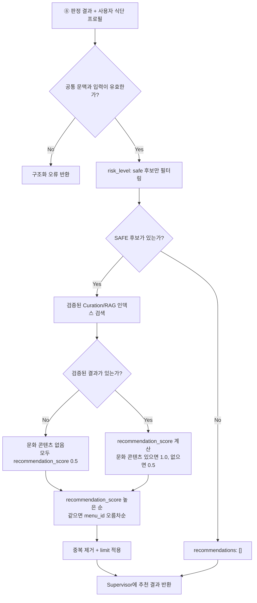

# ⑨ Curation Tool 스펙

담당: 정유진
상태: 초안 (미확정 항목은 §8 참조)
상위 문서: `ppt-baseline.md`, `caution-multi-agent-architecture.md`

---

## 0. 역할 범위

⑨ Curation Tool은 ⑧ Decision Policy / XAI Agent의 안전 판정이 끝난 뒤, **안전 후보를 대상으로 검증된 큐레이션/RAG 인덱스를 검색하고 순위를 매겨 메뉴와 한식 문화 콘텐츠를 추천**한다.

핵심 책임은 네 가지다.

1. ⑧이 `safe`로 판정한 후보만 추천 대상에 포함
2. 검증된 큐레이션/RAG 인덱스에서 후보 메뉴와 문화 콘텐츠 검색
3. 정해진 랭킹 정책에 따라 추천 결과를 정렬하고 근거·출처와 함께 Supervisor에 반환
4. 메뉴판의 **전체 메뉴**를 위험도·근거 순으로 정렬 (§2-3). PPT 8쪽 "추천 메뉴 정렬 (위험도와 근거 기준으로 정렬)"

⑨는 **Tool**이다. 위험 여부를 새로 판단하는 Agent가 아니라, ⑧의 확정된 판정과 정해진 검색·랭킹 절차를 수행한다. LLM을 사용하더라도 안전 판정을 재해석하거나 출처에 없는 내용을 생성하는 데 사용할 수 없다.

| 하지 않음 | 담당 |
|---|---|
| DANGER/CAUTION/SAFE 판정 | ⑧ Decision Policy / XAI Agent |
| 재료 포함 여부 추론 | ③·④·⑤·⑥ |
| ⑧의 판정·근거·위험 재료 수정 | 수행하지 않음 |
| 일반 웹에서 검증되지 않은 추천 근거 수집 | ⑥ Web Search Agent 또는 별도 검증 파이프라인 |
| 큐레이션 데이터 물리 DB 쓰기 | 백엔드 영속화 계층 |
| 스폰서 여부로 안전 판정 변경 | 수행하지 않음 |

### 0-1. 확정된 결정 (변경 금지)

PPT 기준상 위험도 판정과 추천 로직은 분리한다. 따라서 ⑨는 다음 확정 원칙을 지켜야 한다.

- `risk_level: safe`인 메뉴만 추천 후보로 사용한다 (확정, 2026-10-11, #140). CAUTION은 확률이 낮아도 추천하지 않는다. 사장님 확인값이 아니라서 FN 위험이 남기 때문이다 (⑧ §3).
- `danger`·`caution` 메뉴, 정보가 없는 메뉴(`evidence_basis: unknown`), 일부 처리에 실패한 메뉴(`partial_failed`)를 안전 메뉴처럼 추천하지 않는다.
- 추천 점수와 관계없이 ⑧의 `risk_level`, `evidence_basis`, 근거, 위험 재료를 변경하지 않는다.
- 추천할 안전 후보가 없으면 빈 배열을 반환한다. 후보를 채우기 위해 CAUTION을 SAFE로 낮추지 않는다.
- ⑨이 실패하거나 timeout이 발생해도 기존 안전 판정 응답은 그대로 반환한다.

### 0-2. 검증된 인덱스만 사용하는 이유

추천 설명과 한식 문화 콘텐츠는 사용자에게 사실처럼 보일 수 있다. 출처가 검증되지 않은 일반 웹 문서를 바로 사용하면 문화 정보 오류뿐 아니라 재료·식이 제약과 관련된 잘못된 설명이 섞일 수 있다.

따라서 ⑨는 팀이 승인한 큐레이션/RAG 인덱스만 조회하고, 반환 항목마다 원문을 추적할 수 있는 `source_id`를 포함한다. 인덱스의 소유 주체·스키마·검수 절차는 §8에서 확정한다.

---

## 1. 입력 / 출력 스펙

입출력 JSON은 ⓪ §1(공통 모델)·§4-8을 기준으로 한다. 아래는 같은 내용을 옮긴 것이다. 단, §2-3 전체 메뉴 정렬에 필요한 부분(전체 메뉴 전달, 정렬 결과 필드)은 아직 ⓪에 없어 §8에서 반영을 요청한다.

### 1-1. 입력 — `CurationRequest` (⓪ Supervisor Agent로부터)

```json
{
  "context": {
    "schema_version": "1.0",
    "trace_id": "0199a2f0-0000-7000-8000-000000000001",
    "scan_session_id": "scan-123",
    "store_id": 123456,
    "call_scope": "scan",
    "item_id": null
  },
  "decision_results": [
    {
      "item_id": "scan-123:1",
      "source_index": 1,
      "menu_id": "menu-002",
      "normalized_menu_name": "비빔밥",
      "risk_level": "safe",
      "evidence_basis": "confirmed",
      "information_status": "complete",
      "risk_ingredients": [],
      "matched_tags": [],
      "evidence_refs": ["evidence-010"]
    }
  ],
  "user_profile": {
    "religion_type": "halal",
    "is_vegetarian": false,
    "vegetarian_type": null,
    "no_alcohol": false,
    "allergies": [],
    "no_spicy": false
  },
  "locale": "ko",
  "limit": 5,
  "warnings": [],
  "errors": []
}
```

| 필드 | 설명 |
|---|---|
| `context` | 요청 공통 정보 (⓪ §1-2 `NodeContext`). 메뉴판 전체 단위 호출이라 `call_scope: scan`, `item_id: null`. ⑨는 수정하지 않고 그대로 반환 |
| `decision_results[]` | ⑧이 반환한 메뉴별 최종 판정을 복사한 것. ⑨는 이 값의 소유자가 아니며 수정할 수 없다 |
| `decision_results[].source_index` | 메뉴판에서의 메뉴 순서. §2-3 정렬에서 같은 칸 안의 순서로 쓴다 |
| `decision_results[].matched_tags` | 사용자 제한과 실제로 겹친 태그 (예전 이름 `hits`) |
| `decision_results[].information_status` | `complete` / `partial` / `none`. 판정에 필요한 정보가 다 모였는지 |
| `decision_results[].risk_ingredients` | ⑧의 위험 재료 목록 그대로 |
| `decision_results[].evidence_refs` | ⑧ 결과의 최상위 근거 ID를 그대로 전달 |
| `user_profile` | 추천 필터에 필요한 식단 프로필. 원본 사용자 식별자는 전달하지 않음 |
| `locale` | 콘텐츠 표시 언어. `ko` / `en` / `ja` / `zh_hans` / `zh_hant` / `es` (⓪ §1-3) |
| `limit` | 최대 추천 개수. ⓪ 초안은 1~20, 기본 5 (§8) |
| `warnings` / `errors` | 앞 단계 신호. ⑨는 그대로 보존하고 자기 신호를 덧붙인다 |

- 지금 ⓪ §4-8은 `risk_level: safe`이면서 `information_status: complete`인 메뉴만 넘긴다. 추천(§2-2)은 이것으로 충분하지만, §2-3 전체 메뉴 정렬을 하려면 전체 메뉴가 필요하다 (§8 요청).

### 1-2. 출력 — `CurationResponse` (⓪ Supervisor Agent에게 반환)

```json
{
  "context": {
    "schema_version": "1.0",
    "trace_id": "0199a2f0-0000-7000-8000-000000000001",
    "scan_session_id": "scan-123",
    "store_id": 123456,
    "call_scope": "scan",
    "item_id": null
  },
  "recommendations": [
    {
      "rank": 1,
      "item_id": "scan-123:1",
      "menu_id": "menu-002",
      "menu_name": "비빔밥",
      "recommendation_score": 1.0,
      "reason_codes": ["safe_confirmed", "culture_match"],
      "culture_contents": [
        {
          "content_id": "culture-101",
          "title": "비빔밥의 구성과 먹는 방법",
          "summary": "검증된 인덱스에서 가져온 요약",
          "source_id": "curation-source-11"
        }
      ],
      "sponsored": false
    }
  ],
  "warnings": [],
  "errors": []
}
```

- `context`는 입력 값을 그대로 반환한다.
- §2-3 정렬 결과를 담을 필드는 ⓪ 반영 후 추가한다 (§8).
- `rank`는 1부터 시작하고 응답 안에서 중복되지 않는다.
- `item_id`와 `menu_id`는 입력에 존재한 값을 그대로 사용한다. 인덱스 검색 결과만으로 새로운 안전 메뉴 ID를 만들어내지 않는다.
- `recommendation_score`(추천 점수)는 **추천할 만한 정도**이지 안전도가 아니다. 이름을 `score`로 두지 않은 이유: 최종 응답에 OCR 품질 `scan_quality.score`, ② 메뉴 후보 매칭 `score`가 이미 있어 뜻이 다른 값이 같은 이름이 된다 (2026-10-12). 검증된 문화 콘텐츠가 있으면 `1.0`, 없으면 `0.5`다 (§2-1 5단계). 확률·위험도·스폰서 여부는 점수에 넣지 않는다.
- `reason_codes`는 랭킹 이유를 구조화해서 전달한다. ⓪ 초안의 허용값은 `safe_confirmed` / `profile_match` / `culture_match`다. `safe_confirmed`는 추천에 **항상** 붙인다. SAFE는 사장님 확인값으로만 나오기 때문이다 (2026-10-12). `culture_match`는 검증된 문화 콘텐츠가 있어 `recommendation_score: 1.0`일 때 붙인다. `profile_match`는 사용자 선호 데이터가 없어 지금은 쓰지 않는다 (§8). 사용자용 문구 생성 방식은 §8에서 확정한다.
- `culture_contents`는 검증된 인덱스에 존재하고 `source_id`로 추적 가능한 항목만 포함한다.
- `sponsored`는 안전 판정과 분리하기 위한 표시 필드다. 실제 스폰서 콘텐츠의 포함·정렬 정책은 §8에서 확정한다.

---

## 2. 처리 로직



### 2-1. Step별 설명

1. **입력 검증**: 공통 문맥과 메뉴별 최종 판정 형식을 검증한다.
2. **안전 필터**: `risk_level == safe`인 항목만 남긴다. 이 단계는 랭킹보다 항상 먼저 실행한다.
3. **RAG 검색**: 안전 후보의 `menu_id`, 표준 메뉴명, 사용자 언어를 이용해 검증된 인덱스에서 메뉴·문화 콘텐츠를 검색한다.
4. **프로필 필터** (결정, 2026-10-12): 문화 콘텐츠의 재료 태그(`constraint_tags`, §3)가 사용자 금지 태그(⑧ §2-1 1단계와 같은 매핑)와 하나라도 겹치면 그 콘텐츠를 뺀다. 예: 술을 안 마시는 사용자에게 "막걸리와 함께 드세요"(`is_alcohol`) 콘텐츠는 보여주지 않는다. 규칙으로만 판단한다. 이 필터는 새로운 위험 판정이 아니라 이미 확정된 사용자 제약을 추천 결과에 다시 적용하는 방어 절차다.
5. **점수 계산** (결정, 2026-10-12): 검증된 문화 콘텐츠가 있으면 `recommendation_score: 1.0`과 `reason_codes`에 `culture_match`, 없으면 `recommendation_score: 0.5`다. `recommendation_score`는 추천할 만한 정도이지 안전도가 아니다. 확률·위험도·스폰서 여부는 넣지 않는다. 규칙으로만 계산하고 LLM은 쓰지 않는다.
6. **정렬**: `recommendation_score` 높은 순으로 정렬하고, 같은 `recommendation_score` 안에서는 DB 순서(`menu_id` 오름차순)로 정렬한다. 같은 입력에는 항상 같은 순서가 나온다.
7. **결과 제한**: 중복 메뉴·중복 콘텐츠를 제거하고 `limit`만큼 반환한다.
8. **출처 포함**: 문화 콘텐츠마다 `source_id`를 포함해 검증된 원문으로 추적할 수 있게 한다.

### 2-2. 랭킹과 안전성의 관계

추천 순서는 SAFE 후보 사이의 노출 순서만 정한다. 다음 항목은 순서와 관계없이 추천 대상이 될 수 없다.

- `risk_level`이 `danger` 또는 `caution`인 메뉴
- 정보 부족으로 `evidence_basis: unknown`인 메뉴
- 일부 처리 실패로 안전 판정이 완결되지 않은 메뉴
- 사용자 식단 프로필과 충돌하는 콘텐츠
- 검증된 인덱스에서 출처를 찾을 수 없는 문화 콘텐츠

### 2-3. 전체 메뉴 정렬 (규칙)

추천(§2-2)은 SAFE만 하지만, 사용자가 모든 메뉴를 보고 직접 고를 수 있도록 **메뉴판 전체 메뉴**도 정렬해 돌려준다. 정해진 규칙으로 계산하므로 LLM을 쓰지 않는다 (⑨는 Tool, §0).

PPT 8쪽은 정렬 기준을 **위험도**(`risk_level`)와 **근거**(`evidence_basis`, 판정 근거 종류)로 적었다. 확률(`posterior_mean`)은 PPT 8쪽 "6 최종판단 기준"에서 화면에 **보여주는 값**으로만 나오므로 정렬에 쓰지 않는다.

| 순서 | 메뉴 | 표시 |
|---|---|---|
| 1 | `safe` | 추천 표시 + 문화 콘텐츠 (§2-2) |
| 2 | `caution` + `evidence_basis: estimated` (확률 근거 있음) | CAUTION + 확률 수치. 문화 콘텐츠는 붙이지 않는다 |
| 3 | `caution` + `evidence_basis: unknown` (정보 없음) | CAUTION + 정보 부족 |
| 4 | `danger` | — |

- **같은 칸 안에서는 메뉴판 순서(`source_index`)를 유지한다.** CAUTION끼리 확률 순으로 세우면 "위에 있을수록 덜 위험하다"는 메시지를 줘서 FN 쪽으로 기울 수 있다.
- **⑧ 판정이 실패한 메뉴**(`partial_failed`)는 ⓪이 `risk_level: caution`, `evidence_basis: unknown`으로 채워 3번째 칸(CAUTION + 정보 부족)에 넣는다 (결정, 2026-10-12). 사용자에게는 "확인하지 못했어요"로 보인다. ⓪ §6에 반영 필요 (§8).
- 재료는 모두 사장님 확인값인데 SAFE가 막힌 CAUTION은 ⑧이 막힌 이유에 따라 `estimated`나 `unknown`을 붙이므로(⑧ §2-1 4-2) 2번째나 3번째 칸에 들어간다.
- **두 목록은 일부러 순서 기준이 다르다** (결정, 2026-10-12). 전체 메뉴 목록은 같은 칸 안에서 메뉴판 순서(`source_index`)를 따라 사용자가 메뉴판과 맞춰 보기 쉽게 하고, SAFE 추천 목록은 `recommendation_score`와 `menu_id` 순서(§2-1 6단계)를 따른다.
- 정렬은 표시 순서만 정한다. ⑧의 `risk_level`, `evidence_basis`, 근거, 위험 재료는 바꾸지 않는다 (§0-1).

---

## 3. Curation/RAG 인덱스 계약 — 제안 (팀 승인 필요)

PPT는 **검증된 큐레이션/RAG 인덱스** 사용을 요구한다. 최소한 다음 정보를 반환할 수 있어야 한다.

| 필드 | 설명 |
|---|---|
| `content_id` | 콘텐츠 고유 식별자 |
| `menu_id` | 연결된 표준 메뉴 식별자 |
| `locale` | 콘텐츠 언어 |
| `title` | 사용자에게 표시할 제목 |
| `content` | 검증된 원문 또는 요약 대상 본문 |
| `source_id` | 원출처 추적 식별자 |
| `constraint_tags` | 콘텐츠가 언급하는 재료의 제한 태그 (예: 막걸리 → `is_alcohol`). ④와 같은 `is_*` 어휘. 프로필 필터(§2-1 4단계)에 쓴다 |
| `review_status` | 사람 또는 승인 파이프라인의 검수 상태 |
| `updated_at` | 최신성 확인 시각 |

⑨는 검증이 완료된 문서만 검색 대상으로 사용해야 한다. 위 필드명과 `review_status`의 실제 상태값, 저장소가 벡터 DB인지 관계형 DB와 벡터 검색을 결합할지, 인덱스 갱신을 누가 담당할지는 §8에서 결정한다.

---

## 4. Supervisor와의 계약

| ⑨가 받는 것 | 보장 사항 |
|---|---|
| `context` | 유효한 `schema_version`, `trace_id`, `scan_session_id`, 양의 정수 `store_id` |
| `decision_results` | ⑧ 처리가 끝난 메뉴별 최종 판정. 입력 순서와 `item_id`가 보존됨 |
| `user_profile` | 추천 필터에 필요한 최소 식단 정보만 포함 |

| ⑨가 돌려주는 것 | Supervisor의 후속 처리 |
|---|---|
| `recommendations` | 최종 응답의 추천 영역에 추가하되 기존 판정 결과는 수정하지 않음 |
| 빈 배열 | 추천 없음으로 처리하고 판정 결과는 정상 반환 |
| warning/error | 로그와 응답 메타데이터에 남기되 안전 판정 응답을 실패시키지 않음 |

⑨는 ⑧이나 다른 Agent·Tool을 직접 호출하지 않는다. 인덱스 조회도 Supervisor가 전달한 요청 범위 안에서 수행하고 결과는 Supervisor에게만 반환한다.

---

## 5. 스폰서 콘텐츠 분리 원칙

PPT의 “Sponsored 콘텐츠와 AI 안전 판정은 명확히 분리” 원칙을 따른다.

- 스폰서 여부는 ⑧의 위험도 판정 입력으로 전달하지 않는다.
- 안전 필터를 통과하지 못한 메뉴는 스폰서 여부와 관계없이 추천하지 않는다.
- 스폰서 콘텐츠를 반환한다면 `sponsored: true`를 명시해 일반 추천과 구분한다.
- 스폰서 점수가 안전 점수처럼 보이거나 판정 근거에 섞이지 않게 한다.
- SAFE 후보 사이에서 스폰서 요소를 랭킹에 반영할지, 별도 영역으로 분리할지는 §8에서 결정한다.

---

## 6. 예외 처리

| 상황 | 처리 |
|---|---|
| SAFE 후보 없음 | `recommendations: []`, 오류로 취급하지 않음. 사용자 화면에서는 추천 칸에 안내 한 줄을 띄운다 (예: "아직 사장님이 확인한 안전 메뉴가 없어요. 아래에서 메뉴별 위험도를 확인해 주세요."). 정렬된 전체 메뉴(§2-3)는 그대로 보인다 (결정, 2026-10-11, #140) |
| 인덱스에 그 메뉴의 검증된 문화 콘텐츠가 없음 | 장애가 아니다. `recommendation_score: 0.5`로 정렬해 추천한다 (§2 흐름도) |
| RAG 인덱스 timeout·장애 | SAFE 메뉴를 모두 `recommendation_score: 0.5`로 두고 `menu_id` 순서로 추천한다. 문화 콘텐츠는 `[]`. 장애 warning을 붙인다. ⑧ 판정 결과 유지 (결정, 2026-10-12) |
| 검색 결과에 출처 없음 | 해당 콘텐츠 제외 + warning |
| 검색 결과의 `menu_id`가 입력 후보와 다름 | 해당 결과 제외 + warning |
| 중복 메뉴·콘텐츠 | `menu_id`·`content_id` 기준 중복 제거 |
| 요청 `limit`이 허용 범위 밖 | 기본값 또는 최댓값으로 제한하고 warning |
| 지원하지 않는 locale | 확정된 fallback 언어 사용 또는 콘텐츠 제외. 정책은 §8에서 결정 |
| 스폰서 메뉴가 CAUTION/DANGER | 추천 제외. 스폰서 여부로 판정 변경 금지 |

⑨의 실패는 추천 기능의 실패일 뿐 안전 판정 실패가 아니다. Supervisor는 ⑨ 오류가 발생해도 ⑧ 결과를 사용자에게 반환해야 한다.

---

## 7. 테스트 케이스

| # | 입력 | 기대 출력 | 검증 포인트 |
|---|---|---|---|
| 1 | SAFE 2개 + CAUTION 1개 | SAFE 2개만 추천 후보 | CAUTION 제외 |
| 2 | SAFE 후보 없음 | 빈 추천 배열 | 후보를 만들기 위한 판정 완화 없음 |
| 3 | SAFE 후보 + 검증된 문화 콘텐츠 | `source_id`가 있는 추천 결과 | 출처 추적 가능 |
| 4 | SAFE 후보 + 미검증 콘텐츠 | 미검증 콘텐츠 제외 | 검증된 인덱스만 사용 |
| 5 | RAG timeout | 기존 판정 유지 + SAFE 메뉴 전부 `recommendation_score: 0.5`, `menu_id` 순서, warning | 전체 요청 실패 없음, 추천이 사라지지 않음 |
| 6 | SAFE 후보 3개: A·C는 문화 콘텐츠 없음, B만 있음 (`menu_id` A < B < C) | B(1.0) → A(0.5) → C(0.5) | 콘텐츠가 있는 메뉴가 먼저, 같은 `recommendation_score`는 `menu_id` 오름차순, 반복 실행 시 동일 순서 |
| 7 | DANGER 스폰서 메뉴 | 추천 제외 | 스폰서와 안전 판정 분리 |
| 8 | 입력과 다른 `menu_id` 검색 결과 | 해당 결과 제외 + warning | 인덱스 결과로 후보 확장 금지 |
| 9 | 사용자 프로필과 충돌하는 콘텐츠 | 추천 제외 | 식단 제약 재검증 |
| 10 | ⑨ 출력 반환 전후 | ⑧의 판정·근거 동일 | 판정 수정 금지 |

---

## 8. 미확정 항목 (팀 확인 대기)

- [ ] **입력·출력 JSON 최종 계약** — §1을 ⓪ §4-8에 맞춤 (2026-10-11). 남은 것: §2-3 정렬용 필드(아래 ⓪ 계약 변경)
- [x] **SAFE만 추천할지, CAUTION도 포함할지** — SAFE만 추천. 대신 전체 메뉴를 위험도·근거 순으로 정렬해 함께 돌려준다 (2026-10-11, #140, §0-1, §2-3)
- [x] **문화 콘텐츠를 CAUTION 메뉴에도 붙일지** — 붙이지 않는다. CAUTION 메뉴 옆에 소개 글이 붙으면 추천처럼 보여 위험이 가볍게 읽힐 수 있다(FN). 문화 콘텐츠는 추천된 SAFE 메뉴에만 붙인다 (2026-10-12, #140)
- [ ] **⓪ 반영 요청 (외부 의존)** — ⓪ §6 "⑧ 판정 실패 → `partial_failed`"에 `risk_level: caution`, `evidence_basis: unknown`을 채우도록 추가 (§2-3)
- [ ] **추천 후보 범위** — 앱에 큐레이션 탭이 따로 있어(홈·큐레이션·촬영·지도·카드) 메뉴판을 찍지 않아도 큐레이션을 본다. 그래서 **모든 메뉴·가게 데이터를 대상으로 하는 방향** (2026-10-12). 스캔 안에서는 지금처럼 ⑧ 판정이 끝난 메뉴로 추천하고(PPT 8쪽 흐름), 큐레이션 탭에서는 별도로 부르는 구조가 된다. **큐레이션 탭의 SAFE 판정** (결정, 2026-10-12): SAFE는 사장님 확인값으로만 나오므로 추천 단위는 **"특정 가게의 특정 메뉴"**다. 후보는 사장님이 모든 재료를 확인한 (가게, 메뉴)뿐이고, 사용자 금지 태그와 대조하는 ⑧ 판정 규칙(코드 부분, LLM 없음)만 다시 돌린다. 남은 것: 큐레이션 탭에서 부르는 진입 경로(⓪ 밖 별도 API인지) 지금 문서는 스캔 안에서 ⑧ 판정이 끝난 메뉴만 받는 구조라(§0, §1, PPT 7쪽 "판정 완료 후 안전 후보") 다음을 정해야 한다: ① 스캔 없이 부르는 진입 경로(⓪ 밖의 별도 API인지), ② 스캔 없이 SAFE를 어떻게 정할지(가게별 사장님 확인값 + 사용자 프로필로 ⑧ 규칙을 다시 돌릴지), ③ 대상이 많아질 때 속도. PPT 10쪽 B2B API "Curation 기능 제공"은 이 방향과 맞는다
- [ ] **전체 메뉴 정렬을 위한 ⓪ 계약 변경 (외부 의존)** — 지금 ⓪ §4-8은 SAFE이면서 정보가 다 모인 메뉴만 ⑨에 넘기고, 응답에도 `recommendations`만 있다. §2-3 정렬을 하려면 ⓪이 전체 `decision_results`를 넘기고, 응답에 정렬 결과 필드(예: `item_id` 순서 목록)를 추가해야 한다. ⓪ 담당자 요청
- [ ] **Curation/RAG 인덱스 소유 주체와 저장 방식** — 벡터 DB, 관계형 DB, 파일 기반 인덱스 중 무엇을 사용할지
- [x] **콘텐츠 검수·승인 기준 ("검증된"의 뜻)** — 관리자가 승인한 콘텐츠만 쓴다(`review_status`가 승인). 출처 후보는 한식진흥원·한국관광공사 같은 공공 자료와 팀이 직접 쓴 글이며, 저작권은 따로 확인한다 (2026-10-12, #142)
- [x] **SAFE 추천끼리의 순서** — `recommendation_score` 높은 순, 같은 `recommendation_score`는 DB 순서(`menu_id` 오름차순). `recommendation_score`는 검증된 문화 콘텐츠가 있으면 1.0, 없으면 0.5 (2026-10-12, §2-1 5·6단계)
- [x] **동점 tie-break 규칙** — 같은 `recommendation_score`는 `menu_id` 오름차순 (2026-10-12). ⓪ §4-8 초안의 `source_index` 우선은 Supervisor 문서 수정 때 맞춘다
- [ ] **인기도·사용자 선호(`profile_match`)를 점수에 넣을지** — 지금은 데이터가 없어 넣지 않는다. 메뉴 인기도나 사용자 선호 데이터가 생기면 `recommendation_score` 계산식에 추가를 검토한다
- [x] **추천 개수** — 기본 5개, 1~20개 사이 (⓪ §1-3 초안대로 확정, 2026-10-12)
- [ ] **지원 언어와 fallback** — 문화 콘텐츠가 요청 언어로 없을 때 사용할 언어와 번역 정책
- [ ] **스폰서 콘텐츠 노출 방식** — 스폰서 여부는 `recommendation_score`에 넣지 않는다 (2026-10-12, §2-1 5단계). 남은 것: 스폰서 콘텐츠를 일반 추천과 다른 영역으로 보여줄지
- [ ] **추천 이유 문구 생성 주체** — ⑨의 템플릿인지 별도 표현 계층인지. ⓪ §4-8 초안의 `reason_codes`는 `safe_confirmed` / `profile_match` / `culture_match`
- [x] **인덱스 장애 fallback** — SAFE 메뉴를 모두 0.5점으로 `menu_id` 순서대로 추천하고 warning을 붙인다. 문화 콘텐츠가 없을 때와 같게 처리한다 (2026-10-12, §6)
- [ ] **캐시와 인덱스 갱신 주기** — 콘텐츠 수정·삭제가 추천 결과에 반영되는 시점
- [ ] **개인정보 최소화 범위** — ⑨에 전달할 `user_profile` 필드의 최종 목록과 로그 보존 정책
