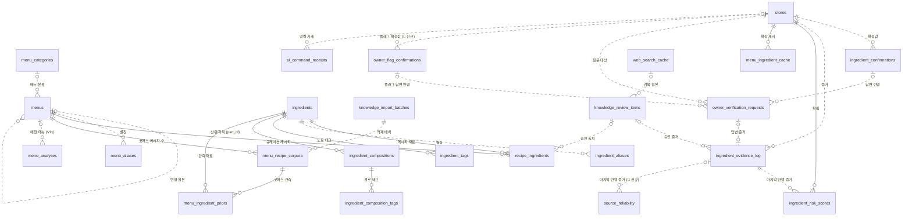

# Caution DB 스키마 (AI 관점 정리) — v4

AI(④⑤⑦)가 읽고, 저장 명령을 만드는 테이블을 백엔드 ERD 기준으로 정리한 문서다. **물리 스키마의 정본은 백엔드 ERD와 마이그레이션(V1~V11)이다.** 이 문서는 컬럼을 새로 정의하지 않고, AI가 기대하는 값과 제약, 그리고 백엔드에 요청한 변경을 적는다.

| 버전 | 내용 |
|---|---|
| v3 | AI 쪽 초안. 구조 변경 없이 테이블명 정리 |
| **v4 (2026-10-12)** | 백엔드 ERD V7~V11에 맞춤. 코퍼스·배치·별칭·태그·멱등 영수증·검토 항목 테이블 추가, `ingredient_hierarchy` → `ingredient_compositions`, `store_menus` 삭제(ERD에 없음), `user_feedback` 출처 삭제(사장님 답변만 씀, ③ 결정 2026-10-09), 백엔드 변경 요청 정리 (§6) |

표기: 🔶 = 백엔드에 변경 요청한 항목 (§6). 컬럼은 AI가 쓰는 것만 적는다. 전체 컬럼은 백엔드 ERD를 본다.

---

## 0. 설계 원칙

물리 DB 쓰기는 **백엔드만** 한다. AI는 저장 명령과 근거를 반환하고, 백엔드가 권한·FK·멱등성을 검증한 뒤 트랜잭션으로 반영한다. AI는 `stores`를 만들거나 고치지 않는다.

| 원칙 | 이유 |
|---|---|
| 가게별 학습·확정 테이블은 `store_id NOT NULL` | 다른 가게 정보로 위험도가 낮아지는 것을 막는다 |
| **`ingredient_risk_scores`(현재 값)와 `ingredient_evidence_log`(원본 증거)를 분리** | 출처 신뢰도 학습(Dawid & Skene 계열)에 증거 단위 로그가 필요하다 |
| 웹서치·변형으로 새로 생긴 메뉴도 `menus` 행을 먼저 만든다 | `menu_id` FK가 끊기지 않게 한다 |
| 모든 확정값·증거는 출처를 추적할 수 있어야 한다 | 디버깅, 이상 답변 감사 |
| 전역 지식(메뉴·재료·레시피·코퍼스)은 가게와 무관 | 가게 데이터는 가게 스코프 테이블에만 쌓는다 |

---

## 1. ERD (AI 관련 부분)

---

## 2. 전역 지식 테이블 (가게 무관, V7·V8)

### `menu_categories`
| 컬럼 | 설명 |
|---|---|
| `id` BIGINT PK | |
| `name_ko` UK | 예: 찌개, 구이, 김치. 시드 25개 (`ai_ruleengine/data/menus.csv`) |

⑤의 `cluster` prior 단위다. 메뉴의 `category_id`가 NULL이면 ⑤는 cluster 단계를 건너뛴다.

### `menus`
| 컬럼 | 설명 |
|---|---|
| `id` BIGINT PK | AI 입출력에서 정수 `menu_id` |
| `name_ko` | 변형 메뉴면 변형 표기 그대로 (예: 차돌된장찌개) |
| `name_normalized` UK | GENERATED, `normalize_food_name(name_ko)`. ④는 이 값으로 메뉴를 찾는다 |
| `category_id` FK | `menu_categories.id`, NULL 허용 |
| `base_menu_id` FK, `remain_token` | 변형 메뉴의 원본과 남은 토큰. 둘은 함께 있거나 함께 NULL. **변형 판별은 이 컬럼이 우선**이고 파싱은 컬럼이 없을 때만 한다 |
| `ambiguity_flags` | 애매함 플래그 5종의 부분집합. ④가 `menu_ambiguity_flags`로 그대로 내보낸다 |
| `source` | `curated` / `web_search_generated` / `variant_generated` |
| `needs_review` | 웹서치·변형으로 생긴 메뉴는 `true` |
| `knowledge_revision` | 기본 1. 메뉴의 지식이 바뀌면 +1. ④ 캐시 무효화 기준 (§5) |

- **웹서치 메뉴**: 관리자가 승인하면 백엔드가 `menus`(`source: web_search_generated`)를 먼저 만들고, 그 `menu_id`로 `recipe_ingredients`·`ingredient_evidence_log`를 채운다.
- **변형 메뉴**: 원본 메뉴 행을 다시 쓰지 않고 `base_menu_id`로 원본을 가리키는 새 행(`source: variant_generated`)을 만든다. 변형 메뉴의 증거가 원본 메뉴 확률과 섞이지 않게 하기 위해서다. 원본 메뉴의 확정값을 변형 메뉴가 물려받아 쓰는 방식은 보류다 (③ §6).

### `menu_aliases`, `ingredient_aliases`
별칭 → 대표 메뉴·재료. `alias_normalized`(GENERATED, 전역 유일)로 찾는다. 예: 돈까스 → 돈가스, 쇠고기 → 소고기.

### `ingredients`
| 컬럼 | 설명 |
|---|---|
| `id` BIGINT PK | AI 입출력에서 정수 `ingredient_id`. 이름은 `canonical_name`(= `name_ko`)으로 함께 보낸다 |
| `name_ko`, `name_normalized` UK | 대표 표기와 정규화 값 |
| `taxonomy_category` 🔶 | `fermented` / `broth` / `sauce` / `processed` / `seasoning` / `oil` / `garnish` / `base` / `unknown` (④ §4). ERD는 "7종 code"라 9종으로 바꿔 달라고 요청함 |

- 시드 324개의 분류 값은 `crawling/ingredient_taxonomy.csv`.
- **알레르겐은 분류에 넣지 않는다.** 별도 축인 `ingredient_tags`에 둔다.
- **교차오염은 다루지 않는다.** 공유 기름·도마 같은 조리 과정 위험은 가게 단위로 관측할 수 없어 확률 모델 범위 밖이다.

### `ingredient_tags`
| 컬럼 | 설명 |
|---|---|
| `ingredient_id` PK·FK, `tag_code` PK 🔶 | 재료 자체의 위험 태그 (`is_*` 형식, §6 21번) |

`tag_code`는 `is_*` 22종이다: 식약처 알레르기 19종 + `is_fish`, `is_duck`, `is_alcohol`. 원천은 `ai_ruleengine/constants.py`의 `VARIANT_INGREDIENTS`. 사용자 알레르기(`user_allergies.allergy_code`)와 같은 어휘를 쓴다. 태그를 붙이는 쪽은 ④ 하나다 (④ §2-6).

### `ingredient_compositions`
재료의 구성 관계. ④의 재귀 확장이 따라가는 간선이다 (예: 김치 → 멸치액젓 → 멸치).

| 컬럼 | 설명 |
|---|---|
| `parent_ingredient_id`, `child_ingredient_id` PK·FK | 상위 ≠ 하위 |
| `relation_type` 🔶 | **`part_of`만.** ERD는 `part_of/is_a`인데, 분류(is-a)는 `ingredients.taxonomy_category`에 둔다. 섞으면 재귀 확장이 "갑각류" 같은 분류 이름을 재료로 펼친다 |
| `ambiguity_flag` | 이 간선을 만든 애매함 플래그 4종 중 하나 (`has_unclear_jeotgal` / `has_unclear_broth` / `has_unclear_seasoning` / `has_hidden_animal`). 메뉴 애매함 플래그(`menus.ambiguity_flags`)를 정할 때의 근거다. ④는 노드별로 내보내지 않는다 (④ §1-2) |

- 원천은 `ai_result/rules/hidden_rules_data.py`.
- 순환은 ④가 지나온 경로로 막고(`cycle_detected`), 깊이는 5에서 멈춘다(`max_depth_reached`).

### `ingredient_composition_tags`
그 간선에서만 성립하는 위험 태그. 예) 김치 → 액젓 간선의 `is_fish`·`is_shellfish`: 액젓이라는 재료 자체가 아니라 김치에 쓰이는 액젓(멸치·새우)일 때의 위험이다.

### `recipe_ingredients`
큐레이션 레시피. 메뉴마다 재료 목록, 가게 무관.

| 컬럼 | 설명 |
|---|---|
| `menu_id`, `ingredient_id` PK·FK | |
| `evidence_type` | `explicit`(레시피 명시) / `variant`(변형 토큰) / `name_rule` / `web_search` |
| `review_item_id` FK | `web_search`면 필수. 승인한 검토 항목 |

④의 시작 재료(depth 0)는 이 테이블과 `menu_ingredient_priors`에 나온 재료의 **합집합**이다 (④ §2-1).

### `knowledge_import_batches`
시드·코퍼스 적재 이력.

| 컬럼 | 설명 |
|---|---|
| `source` 🔶 | `menus_csv` / `hidden_rules` / `variant_ingredients` / `ingredient_rules` / `semie_prior` / `wtable_prior` + **`10000recipe_prior` 추가 요청** |
| `source_version` | 시드를 만든 AI 저장소 커밋 SHA |

### `menu_recipe_corpora`
메뉴별·사이트별 크롤링 레시피 수.

| 컬럼 | 설명 |
|---|---|
| `menu_id`, `corpus` PK | `corpus` 🔶: `semie` / `wtable` + **`10000recipe` 추가 요청** |
| `n_total` | 그 사이트의 그 메뉴 레시피 수 (1 이상) |

### `menu_ingredient_priors`
메뉴 × 재료 × 사이트 관측값. ⑤의 전역 prior 원천이다.

| 컬럼 | 설명 |
|---|---|
| `menu_id`, `corpus`, `ingredient_id` PK | |
| `n_total` | 부모(`menu_recipe_corpora`)와 복합 FK로 일치 강제 |
| `k_count` | 그 재료가 나온 레시피 수 (1 이상 `n_total` 이하) |

- **k가 0인 행은 저장하지 않는다.** 행이 없으면 ④가 직접 재료에 한해 "n개 중 0개"로 채운다. 숨은 재료(depth ≥ 1)는 0으로 채우지 않고 상위 재료 값을 물려받는다 (④ §1-5).
- ⑤는 사이트별 관측값에 출처 신뢰도를 곱해 더한다: `α = 1 + Σ 신뢰도 × k`, `β = 1 + Σ 신뢰도 × (n − k)` (⑤ §3-3). 신뢰도가 모두 1이면 확정 공식 `α = k + 1`, `β = n − k + 1`과 같다.

---

## 3. 가게 스코프 테이블 (`store_id` 필수, V10)

### `stores` (백엔드 소유)
이 문서에서 다시 정의하지 않는다. AI의 `store_id`는 `stores.id BIGINT`(JSON 정수, Python `int`)다. 가게 검색·선택·공공데이터 매칭은 백엔드 책임이고, AI는 확정된 `store_id`만 받는다. AI는 GPS·지도 검색, 가게 후보 생성, `stores` INSERT/UPDATE를 하지 않는다.

### `ingredient_risk_scores`
"이 가게, 이 메뉴에 이 재료가 들어 있을 확률" — 현재 값. ⑤의 `store` prior.

| 컬럼 | 설명 |
|---|---|
| `store_id`, `menu_id`, `ingredient_id` PK | |
| `delta_alpha_sum`, `delta_beta_sum` | 증거 로그 합계 |
| `alpha`, `beta` | GENERATED. `1 + δα 합계`, `1 + δβ 합계` |
| `evidence_count`, `last_evidence_id` | 반영한 증거 수, 마지막 증거 |

- **직접 UPDATE 금지.** 항상 `ingredient_evidence_log` INSERT → 재계산.
- 가게 증거는 ⑦이 기록할 때 이미 출처 신뢰도를 곱해 둔다. ⑤는 `α − 1`, `β − 1`을 그대로 더하고 다시 곱하지 않는다 (⑤ §3-3).
- 가게 증거는 전역 prior(`menu_ingredient_priors`)를 바꾸지 않는다.

### `ingredient_evidence_log`
"왜 그 확률이 됐나"의 원본 증거. append-only.

| 컬럼 | 설명 |
|---|---|
| `id` PK | |
| `store_id`, `menu_id`, `ingredient_id` | |
| `source_type` | `owner_feedback` / `web_search` / `ocr_variant_tag`. 손님 피드백은 쓰지 않는다 |
| `delta_alpha`, `delta_beta` | soft evidence는 `delta_beta = 0` 고정 |
| `owner_verification_request_id` / `review_item_id` | 배타적 아크. 사장님 답변이면 앞쪽, 웹서치·변형이면 뒤쪽 |

- 사장님 답변은 확률을 거치지 않고 `ingredient_confirmations`로 override하지만, 답변 이력은 이 로그에 **매번** 남는다. 답이 바뀐 이력은 여기서 본다.
- OCR 변형 재료(예: "차돌" → 소고기)는 변형 `menu_id`로 `ocr_variant_tag` 증거 한 줄을 남긴다. 확정이 아니라 확률 증거다.

### `ingredient_confirmations`
사장님이 확인한 확정값 (hard evidence).

| 컬럼 | 설명 |
|---|---|
| `store_id`, `menu_id`, `ingredient_id` UK | |
| `present` | 있음/없음. **행이 없으면 `unknown`** (status 3값) |
| `source` | `owner_confirmed` |
| `flagged_anomaly` | 통계적으로 이상한 답변 |
| `override_eligible` | GENERATED, `NOT(flagged_anomaly AND NOT present)` |
| `confirmed_at` 🔶 | 확정 시각. **확정(upsert)할 때만 갱신**하고, 확정되지 않은 답(예: 확정 뒤 다른 답 1번)으로는 바꾸지 않는다. 3개월 유효기간의 기준이다 (ERD는 "최신 답변 시각") |

- **확정 규칙**: 확인 차례(마지막 확정 이후의 답변)에서 1·2차 답이 같으면 확정, 다르면 3차까지 받아 3개 중 2개 다수결 (⑦ §2-3).
- **유효기간 3개월.** 지나면 override에 쓰지 않지만 삭제하지 않는다. 확률 계산에도 넣지 않고(사장님 답변은 확률에 쓰지 않음, 10/10 회의), ⑧이 다시 묻는 카드를 만든다.
- **이상 답변**: "없음"인데 레시피상 확률이 0.9 이상이면 `flagged_anomaly`. 확률은 이번 확인 차례에서 가장 최근에 답한 질문의 `owner_verification_requests.recipe_probability`를 쓴다. override를 거부하고 **CAUTION 이상을 유지**한다(`anomaly_locked`). 확률 계산은 하되 잠근다. "있음" 쪽 이상 답변은 이미 안전한 방향이라 대상이 아니다.

### `owner_verification_requests`
⑧이 만든 사장님 질문과 답변. 질문은 두 종류다 (⓪ §4-6 `create_owner_verification_request`).

- **재료 질문**: "이 메뉴에 액젓이 들어가나요?" — `ingredient_id` 있음, `ambiguity_flag` 없음
- **메뉴 애매함 플래그 질문** (2026-10-12, ③ §1-8): "이 메뉴의 젓갈에 생선이 들어가나요?" — `ingredient_id` 없음, `ambiguity_flag`와 물어본 태그 있음

| 컬럼 | 설명 |
|---|---|
| `id` UUID PK | `question_id` |
| `store_id`, `scan_session_id`, `menu_id` | |
| `ingredient_id` 🔶 | 재료 질문만. **플래그 질문은 NULL** (지금 ERD는 NOT NULL) |
| `ambiguity_flag` 🔶 신규 | 플래그 질문만. `menus.ambiguity_flags` 값 하나 |
| `asked_tags` 🔶 신규 | 플래그 질문에서 물어본 `is_*` 태그 배열 (정렬해서 저장). 재료 질문은 NULL |
| `card_id` 🔶 신규 | 화면 카드와 질문 행을 잇는 ID (`card:{item_id}:{대상}:r{round}`, ⓪ §4-7). 같은 스캔 안에서 유일 |
| `round` 🔶 신규 | 질문 차수 `1` / `2` / `3` |
| `previous_question_id` 🔶 신규 | 직전 질문 `id` (같은 테이블 FK). 1차 질문은 NULL |
| `confirmation_state` 🔶 신규 | 답을 처리한 결과 `confirmed` / `needs_second` / `needs_third`. 답 전에는 NULL. 다음 Judge의 `owner_question_states[]` 원천 (⓪ §4-2) |
| `recipe_probability` 🔶 신규 | 질문을 만들 때의 ⑤ `posterior_mean` (0~1). 재료 질문만, 플래그 질문은 NULL. 답을 확정할 때 이상 답변 판정에 쓴다 (⑦ §2-3) |
| `question_text` | 언어별 문구 (🔶 7개 언어, §6 7번) |
| `status` | `pending` / `answered` / `expired` |
| `answer` | `present` / `absent` / `unknown` |
| `resolved_confirmation_id` 🔶 | 재료 답변이 확정값으로 반영되면 채움. 1차 답처럼 아직 확정되지 않은 답은 NULL (ERD의 "present/absent면 필수" 삭제 요청) |
| `resolved_flag_confirmation_id` 🔶 신규 | 플래그 답변이 확정값으로 반영되면 채움 (`owner_flag_confirmations.id`) |

- CHECK: `ingredient_id`와 `ambiguity_flag` 중 **정확히 하나**만 값이 있다. `ambiguity_flag`가 있으면 `asked_tags`는 비어 있지 않다.
- UNIQUE 🔶: 재료 질문은 `(scan_session_id, menu_id, ingredient_id) WHERE ingredient_id IS NOT NULL`, 플래그 질문은 `(scan_session_id, menu_id, ambiguity_flag, asked_tags) WHERE ambiguity_flag IS NOT NULL`로 나눈다. ERD의 `(scan_session_id, menu_id, ingredient_id)` 하나로는 `ingredient_id`가 NULL인 플래그 질문의 중복을 막지 못한다.
- 답변 이력은 이 테이블의 answered 행들이다. 확인 차례(⑦ §2-3) 계산도 이 행으로 한다.
- **다음 Judge에 넣을 질문 진행 상태**: 대상(재료 또는 플래그+태그)마다 가장 최근 answered 행의 `{id → question_id, round → answered_round, confirmation_state}`를 KnowledgeBundle `exact_feedback.exact.owner_question_states[]`로 보낸다 (⓪ §4-2).
- CHECK: `round = 1`이면 `previous_question_id IS NULL`, `round > 1`이면 NOT NULL. `confirmation_state`가 `needs_second`이면 `round = 1`, `needs_third`이면 `round = 2`.

### `owner_flag_confirmations` 🔶 신규 (제안, 2026-10-13)
메뉴 애매함 플래그 질문에 대한 사장님 **확정 답**. ③이 읽어 `flag_confirmations`로 넘긴다 (⓪ §4-2). 재료 확정값(`ingredient_confirmations`)과 따로 둔다 — 플래그 답은 특정 재료가 아니라 "그 메뉴의 젓갈·육수 등에 이 태그가 있는가"이기 때문이다. 테이블 이름은 ⓪ 예시(`source_ref: owner_flag_confirmations:…`)를 따랐고 최종 결정은 백엔드가 한다.

| 컬럼 | 설명 |
|---|---|
| `id` BIGINT PK | |
| `store_id`, `menu_id` | FK, `store_id NOT NULL` |
| `ambiguity_flag` | 물어본 플래그 |
| `asked_tags` | 물어본 태그 배열 (정렬) |
| `present` | 물어본 태그 중 하나 이상 있음(`true`) / 전부 없음(`false`). 행이 없으면 `unknown` |
| `confirmed_at` | 확정 시각. 3개월 유효 (재료 확정값과 같음) |
| `created_at`, `updated_at` | |

- UNIQUE `(store_id, menu_id, ambiguity_flag, asked_tags)`. 같은 플래그라도 다른 태그로 물은 답은 따로 저장한다 (③ §1-8).
- **이상 답변 표시(`flagged_anomaly`) 없음.** 비교할 레시피 확률이 없다.
- 확률 계산에 쓰지 않으므로 `ingredient_evidence_log`에 행을 남기지 않는다 (그 테이블은 `ingredient_id`가 필수이기도 하다). 이력은 `owner_verification_requests` answered 행으로 본다.

### `knowledge_review_items` (V9)
웹서치 결과·변형 제안을 관리자가 검토하는 항목. ⑦의 `create_review_item`이 만든다. `status`는 `pending` / `approved` / `rejected`. 승인되면 `resolved_menu_id`가 채워진다.

---

## 4. 운영 테이블

### `ai_command_receipts` (V9)
AI 저장 명령의 멱등 영수증. 백엔드는 `(action, idempotency_key)`를 먼저 기록하고, 이미 있으면 다시 실행하지 않는다.

| 컬럼 | 설명 |
|---|---|
| `action` PK 🔶 | 허용값 **6종** (ERD는 3종): `create_review_item`, `create_owner_verification_request`, `record_owner_answer`, `update_source_reliability`, `save_web_search_cache`, `save_menu_ingredient_cache` |
| `idempotency_key` PK | AI가 결정적으로 만든다 |
| `store_id` | 캐시 명령 외에는 필수 |
| `request_hash`, `result` | payload 해시, 재응답용 결과 |

### `source_reliability` 🔶 신규
출처별 신뢰도. **모든 가게 공통 1벌**이다 (⑦ §3-1).

| 컬럼 | 타입 | 설명 |
|---|---|---|
| `source_type` | VARCHAR, PK | `corpus:semie`, `corpus:wtable`, `corpus:10000recipe`, `curated`, `web_search`, `ocr_variant_tag` 등 |
| `agree_count` | INTEGER, 기본 0 | 사장님 확정값과 맞은 수 |
| `compared_count` | INTEGER, 기본 0 | 비교한 수 (`agree_count` 이하) |
| `reliability` | NUMERIC, GENERATED | `(agree_count + 1) / (compared_count + 2)` |
| `last_evidence_id` | BIGINT, FK → `ingredient_evidence_log.id`, NULL 허용 | 마지막으로 반영한 증거 |
| `updated_at` | TIMESTAMPTZ | |

⑦의 `update_source_reliability` 명령으로 갱신한다.

### 스캔·사용자 테이블
`scan_sessions`, `menu_images`, `menu_analyses`, `user_profiles`, `user_allergies`는 백엔드 ERD를 따른다. AI와 맞닿는 곳만 적는다.

- `menu_analyses.menu_id`, `menu_match_type`(V11): `exact` / `alias` / `fuzzy` / `runtime_variant` / `unmatched`
- `menu_analyses.owner_card`: ⑧이 만든 사장님 질문 카드
- `user_allergies.allergy_code` 🔶: `ingredient_tags.tag_code`와 같은 `is_*` 22종 어휘 (ERD는 "19종", §6 21번)
- `user_profiles`: `religion_type`, `vegetarian_type`, `no_alcohol`, `no_spicy` → ⑧이 금지 태그로 바꾼다

---

## 5. 캐시 테이블

### `web_search_cache`
| 컬럼 | 설명 |
|---|---|
| `normalized_menu_name` UK | `normalize_food_name` 결과와 같아야 한다 |
| `search_status` | `searched` / `unresolved` |
| `payload` | 후보 URL별 추출 재료 (출처 배열). **검색할 때마다 새 출처를 뒤에 붙인다. 덮어쓰지 않는다** |
| `next_rank` 🔶 신규 | 다음 검색 시작 순위 (1 이상). 1번째 검색 뒤 11, 2번째 뒤 21 (⑥ §2-4) |
| `searched_at` | 마지막 검색 시각 |
| `expires_at` 🔶 | **NULL 허용, 항상 NULL** (지금 ERD는 NOT NULL). ⑥은 캐시 유효기간 없이 DB에 등록되기 전까지 레시피를 계속 쌓는다 (⑥ §2-4, ⓪ §4-6) |

⑥이 검색할 때마다 `save_web_search_cache` 명령으로 원본을 남긴다(관리자 게이트 없음). **실제 식당 레시피로 보지 않고, 판정을 낮추는 데 쓰지 않는다.** DB 반영은 관리자 승인을 거친 `knowledge_review_items`로만 한다.

### `menu_ingredient_cache`
④의 재귀 확장 결과를 저장한 **파생 캐시**.

| 컬럼 | 설명 |
|---|---|
| `store_id`, `menu_id` PK | |
| `menu_revision` | 계산할 때의 `menus.knowledge_revision`. **다르면 캐시 무효** |
| `ingredients_snapshot` | 확인 재료를 빼기 전 **전체 확장 목록**. 전역 데이터만 담고, 가게 데이터인 `anomaly_locked`·확정값은 넣지 않는다 (③이 분모로 쓰기 때문) |

- **쓰기 예외**: ④가 `save_menu_ingredient_cache` 명령을 직접 만든다. 재계산할 수 있는 파생 데이터라 ⑦ 관리자 게이트를 거치지 않는다. AGENTS.md의 유일한 예외다.
- **무효화** 🔶: 메뉴 하나의 지식이 바뀌면 그 메뉴의 `knowledge_revision` +1. 재료 단위 데이터(구성 간선·재료 태그·분류)가 바뀌면 **그 재료가 들어간 모든 메뉴**의 `knowledge_revision` +1을 요청함 (④ §8).

---

## 6. 백엔드 변경 요청 (2026-10-12, 11~19는 2026-10-13, 20·21은 2026-10-17 추가)

🔴 **우선: 16·20번.** 이 두 개가 없으면 사장님 질문 흐름(1차 답 저장 → 2·3차 질문)이 동작하지 않는다.

| # | 대상 | 지금 ERD | 요청 | 이유 |
|---|---|---|---|---|
| 1 | `source_reliability` | 없음 | 테이블 생성 (§4) | 출처별 신뢰도 저장 |
| 2 | `ai_command_receipts.action` | 3종 | 6종 (§4) | ⑦·④·⑥ 저장 명령 멱등 처리 |
| 3 | `menu_recipe_corpora.corpus` | `semie` / `wtable` | + `10000recipe` | 만개의레시피 코퍼스 |
| 4 | `knowledge_import_batches.source` | 6종 | + `10000recipe_prior` | 시드 배치 출처 |
| 5 | `ingredient_compositions.relation_type` | `part_of` / `is_a` | `part_of`만 | 분류는 `taxonomy_category`에 둠 |
| 6 | `ingredients.taxonomy_category` | 7종 code | 9종 (§2) | 가공식품 추가, 기타를 `base`·`unknown`으로 분리 (#182) |
| 7 | 다국어 JSONB 키 (`menus.name_i18n`, `ingredients.name_i18n`, `menu_analyses.message`, `saved_cards.text`, `owner_verification_requests.question_text`) | `ko` / `en` / `ar` | `ko` / `en` / `ar` / `zh-CN` / `zh-TW` / `ja` / `es` (7개, `ar` 유지) | 팀 결정 (2026-10-13, ⑧ §4): 아랍어 포함 7개 언어, 코드는 프론트 표기와 같음 |
| 8 | `record_owner_answer` 처리 결과 | — | `confirmation_state`(`confirmed` / `needs_second` / `needs_third`)를 질문 행에 저장하고, 다음 Judge Bundle `owner_question_states[]`로 보냄 (20번 컬럼) | ⑧이 2·3차 질문을 만든다 (⑦ §1-2, ⓪ §4-6) |
| 9 | `menus.knowledge_revision` | 메뉴 단위 | 재료 단위 변경 시 관련 메뉴 전부 +1 | ④ 캐시가 옛 재료 목록을 내지 않게 (§5) |
| 10 | 시드 적재 | — | CSV의 `id`를 그대로 INSERT (IDENTITY 컬럼은 `OVERRIDING SYSTEM VALUE`). 안 되면 AI에 알림 → 이름 기준 매핑으로 바꿈 | 시드 CSV의 FK가 id로 연결돼 있음 |
| 11 | `owner_verification_requests` | `ingredient_id` NOT NULL | `ingredient_id` NULL 허용 + `ambiguity_flag`, `asked_tags`, `resolved_flag_confirmation_id` 추가 + CHECK(둘 중 하나) | 메뉴 애매함 플래그 질문을 저장하려면 재료 없는 질문 행이 필요 (§3) |
| 12 | `owner_flag_confirmations` | 없음 | 테이블 생성 (§3) | 플래그 답을 저장할 곳이 없으면 같은 질문을 매번 다시 묻고, 확인된 플래그가 판정에 반영되지 않음 |
| 13 | `web_search_cache.expires_at` | NOT NULL, TTL | NULL 허용 | ⑥이 캐시 유효기간을 두지 않기로 함 |
| 14 | `web_search_cache` | `payload` 갱신 시 덮어씀, 순위 컬럼 없음 | `next_rank` INT 추가 + `payload`는 기존 배열에 이어 붙임 (§5) | ⑥이 검색마다 다음 순위 10개를 더해 30개까지 모은다. 덮어쓰면 이전 레시피가 사라짐 |
| 15 | `owner_verification_requests` | 확률 컬럼 없음 | `recipe_probability` NUMERIC NULL 추가 (§3) | 사장님 답은 스캔 밖에서 들어와 그 순간 비교할 확률이 없다. 없으면 "돈가스에 돼지고기 없음" 같은 이상 답이 그대로 확정된다 (FN) |
| 16 | `owner_verification_requests.resolved_confirmation_id` | present/absent 답이면 필수 | 필수 조건 삭제. 확정값이 만들어진 때만 채움 (§3) | 1차 답은 확정하지 않는다(`needs_second`). 지금 제약이면 1차 답 저장이 실패해 2·3차 질문 흐름 전체가 막힌다 |
| 17 | `owner_verification_requests` UNIQUE | `(scan_session_id, menu_id, ingredient_id)` | 부분 UNIQUE 2개로 분리: 재료 질문 / 플래그 질문 (§3) | 플래그 질문은 `ingredient_id`가 NULL이라 지금 UNIQUE로 중복을 막지 못한다 |
| 18 | `ingredient_confirmations.confirmed_at` | 최신 답변 시각 | 확정(upsert)된 시각. 확정되지 않은 답으로는 갱신하지 않음 (§3) | 확정 뒤 다른 답이 1번만 와도 3개월 유효기간이 다시 시작된다 |
| 19 | `users.language_code` | VARCHAR(2), `ko` / `en` / `ar` | VARCHAR(5), 7번의 7개 값 | `zh-CN`·`zh-TW`가 5자라 지금 길이에 안 들어간다 |
| 20 | `owner_verification_requests` | 질문 차수·사슬 컬럼 없음 | `card_id` VARCHAR(200) NULL, `round` SMALLINT NOT NULL DEFAULT 1 (1~3), `previous_question_id` UUID NULL FK→같은 테이블, `confirmation_state` VARCHAR(20) NULL 추가 + CHECK (§3) | ⓪이 "백엔드는 `round`·`previous_question_id`를 질문 행에 보존해 질문 사슬과 차수를 검증한다"로 정함. 저장할 곳이 없으면 2·3차 질문을 만들 수 없다 |
| 21 | `ingredient_tags.tag_code`, `ingredient_composition_tags.tag_code`, `user_allergies.allergy_code` | 알레르기 19종 + fish/duck/alcohol (이름 형식 미정), `allergy_code`는 "19종" | `is_*` 형식 22종으로 통일: 식약처 알레르기 19종 + `is_fish` / `is_duck` / `is_alcohol` (원천 `ai_ruleengine/constants.py`) | 재료 태그와 사용자 알레르기 코드의 이름이 다르면 매칭이 안 돼 알레르겐을 놓친다 |

- `corpus`·배치 `source`에 `etc` 같은 기타 값은 넣지 않는다 (3·4번 값만).
- 메뉴·재료 ID는 정수(BIGINT)를 유지한다.

**값 매핑 (스키마 변경 없음)**: ⓪ `create_review_item.review_origin`의 `web_search` → `knowledge_review_items.item_type` `web_search_menu`, `variant_suggestion` → `runtime_variant`.

**시드 적재 순서** (FK): `menu_categories` → `menus` → `ingredients` → `ingredient_tags` · `recipe_ingredients` · `ingredient_compositions` · `ingredient_composition_tags` → `knowledge_import_batches` → `menu_recipe_corpora` → `menu_ingredient_priors`. 적재 뒤 영향받은 메뉴의 `knowledge_revision` +1. 재생성 절차는 `crawling/README.md` "DB 시드 재생성".

---

## 7. 백엔드에 강조할 제약

1. `ingredient_risk_scores`, `ingredient_confirmations`, `ingredient_evidence_log`는 `store_id NOT NULL`
2. **`ingredient_risk_scores` 직접 UPDATE 금지** — 항상 `ingredient_evidence_log` INSERT → 재계산
3. 웹서치 새 메뉴는 `menus` INSERT(`source: web_search_generated`)가 먼저
4. 변형 메뉴는 원본 행을 다시 쓰지 않고 `base_menu_id`로 연결된 새 `menus` 행(`source: variant_generated`)을 먼저 만든다
5. 3·4번은 AI가 실시간으로 실행하지 않는다. 관리자가 승인한 시점에만 실행한다. 사장님 답변 이력은 예외로 즉시 기록한다
6. `owner_verification_requests.resolved_confirmation_id`는 답변이 실제로 확정값에 반영된 시점에 채운다
7. 물리 DB 쓰기는 백엔드만. AI 명령은 `ai_command_receipts`로 한 번만 반영한다
8. 메뉴·재료 이름 비교는 DB 함수 `normalize_food_name()` 하나로 한다 (`name_normalized`, `alias_normalized`, `web_search_cache.normalized_menu_name`)
